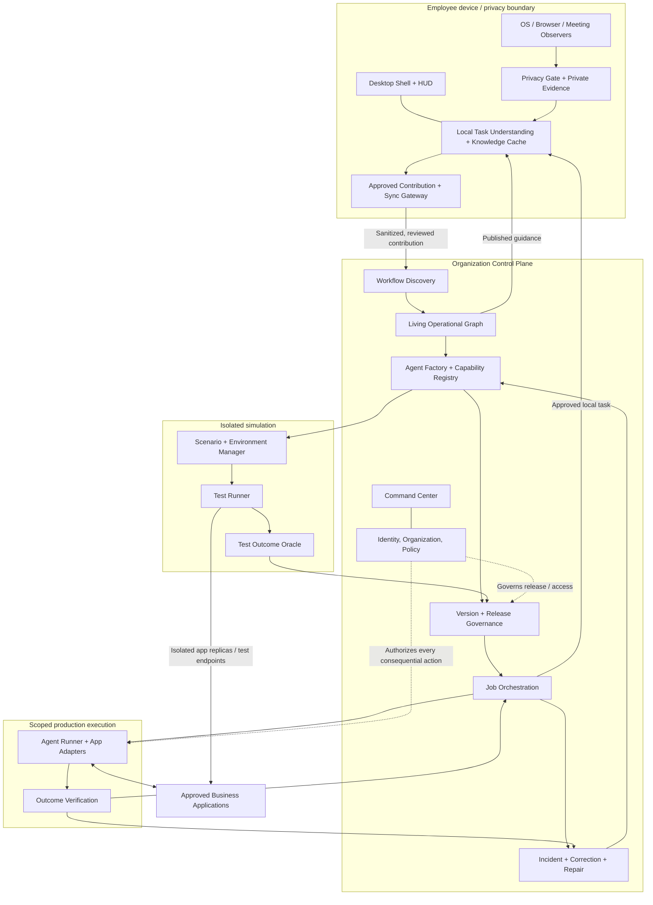
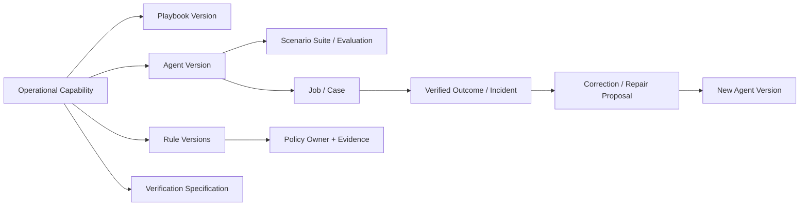
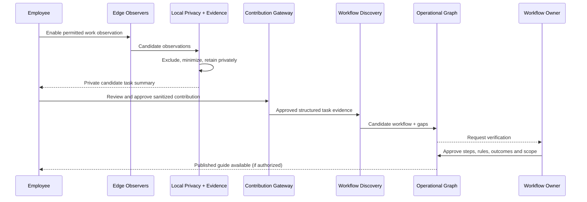
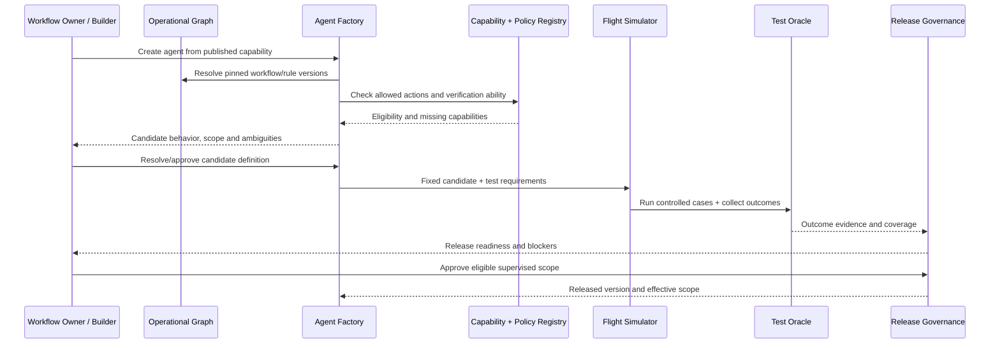
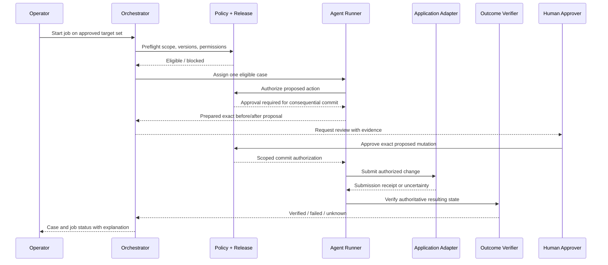
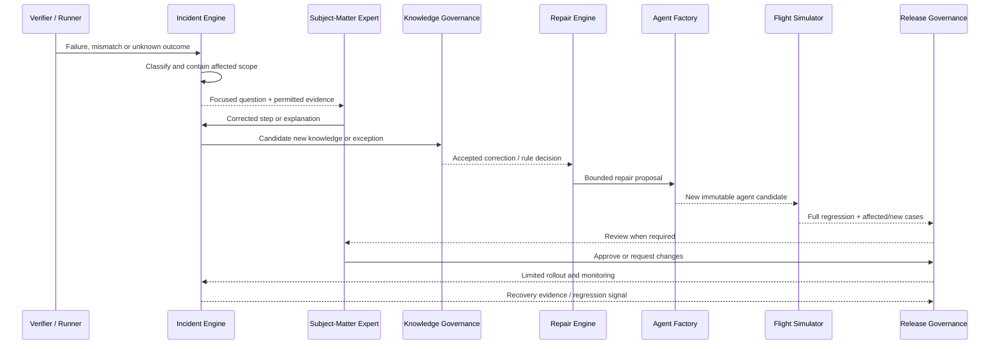

# Oryn — High-Level Technical Architecture

**Document:** `TECHNICAL.md`  
**Product:** Oryn  
**Target release:** v1.0  
**Status:** Proposed reference architecture / architecture baseline  
**Audience:** Engineering, architecture, product, security, and specialized design agents  
**Companion document:** [`PRODUCT.md`](PRODUCT.md) — authoritative definition of v1.0 product behavior, permissions, release gates, and acceptance criteria

---

### Document map

- [0. Purpose, Reading Guide, and Decision Boundaries](#0-purpose-reading-guide-and-decision-boundaries)
- [1. Architectural Principles and Non-Negotiable Invariants](#1-architectural-principles-and-non-negotiable-invariants)
- [2. System Context and Deployment Boundaries](#2-system-context-and-deployment-boundaries)
- [3. Shared Domain Model and Sources of Truth](#3-shared-domain-model-and-sources-of-truth)
- [4. Employee Edge: Desktop, Observation, Privacy, and Guidance](#4-employee-edge-desktop-observation-privacy-and-guidance)
- [5. Organizational Control Plane and Knowledge Services](#5-organizational-control-plane-and-knowledge-services)
- [6. Execution, Simulation, Verification, and Improvement Services](#6-execution-simulation-verification-and-improvement-services)
- [7. Integration Patterns and Cross-Component Contracts](#7-integration-patterns-and-cross-component-contracts)
- [8. End-to-End Flows](#8-end-to-end-flows)
- [9. State Machines and Lifecycle Ownership](#9-state-machines-and-lifecycle-ownership)
- [10. Data Architecture and Information Boundaries](#10-data-architecture-and-information-boundaries)
- [11. Security, Safety, and Failure Semantics](#11-security-safety-and-failure-semantics)
- [12. Cross-Cutting Operational Characteristics](#12-cross-cutting-operational-characteristics)
- [13. Architectural Decision Register](#13-architectural-decision-register)
- [14. How to Design Each Layer Independently](#14-how-to-design-each-layer-independently)
- [15. Whole-System Integration and Release Validation](#15-whole-system-integration-and-release-validation)
- [16. Scope Map for Future Agents](#16-scope-map-for-future-agents)
- [17. Final Architecture Summary](#17-final-architecture-summary)

---

## 0. Purpose, Reading Guide, and Decision Boundaries

This document describes **how Oryn is divided into major technical components, what each component owns, how they communicate, where state resides, and how end-to-end product workflows cross those boundaries**. It is intended to remain stable while separate design discussions specify the desktop shell, capture engine, browser extension, databases, integrations, agent runtime, simulator, and other subsystems in greater detail.

### 0.1 What this document establishes

- The logical architecture and major trust/deployment boundaries.
- The responsibilities, inputs, outputs, dependencies, and nonresponsibilities of each component.
- The shared domain concepts and lifecycle of an operational capability.
- How observations become reviewed organizational knowledge, and how knowledge becomes tested agents.
- How execution, authorization, verification, incidents, corrections, repairs, and releases interact.
- System-wide safety, privacy, reliability, tenant-isolation, provenance, and versioning requirements.
- The required interfaces and cross-component contracts **at a conceptual level**.
- Which implementation questions must be resolved in future component design documents.

### 0.2 What this document intentionally does **not** decide

- Exact programming languages, frameworks, model providers, hosting vendors, or database products.
- Code organization below the component boundary; class or package design.
- Endpoint paths, RPC signatures, event payload schemas, SQL tables, indexes, or migration plans.
- Threading, buffering, polling, IPC, message brokers, queue topology, retry formulas, or caching algorithms.
- Exact OS API calls, browser extension permissions, UI selector formats, sandbox implementations, or credential-vault integrations.
- Specific model prompts, embedding choices, clustering algorithms, scoring formulas, or test-generation techniques.
- Infrastructure-as-code, Kubernetes topology, CI/CD configuration, build packaging, deployment scripts, and capacity sizing.

These are to be addressed in **layer-specific design documents**. Any choice made there must preserve the contracts and invariants defined here. An implementation recommendation in this document is not a commitment unless explicitly marked as a **required architectural constraint**.

### 0.3 Precedence and terminology

1. **`PRODUCT.md` governs customer-visible scope, user experience, policies, risk tiers, autonomy stages, defaults, and release criteria.** If this document conflicts with `PRODUCT.md`, the product specification wins until an explicit product decision changes it.
2. **`TECHNICAL.md` governs technical responsibilities and cross-component boundaries.** It may be revised through an architecture decision when component design reveals a better approach.
3. **Component design documents** own implementation decisions *within* their boundaries and must record any proposed change to a shared contract.

Terms **must/required** denote constraints inherited from the v1.0 product or essential architecture properties. **Recommended** denotes a starting design preference. **Deferred** means the detailed choice belongs to a future design. Example values and sample events are illustrative, not production specifications.

### 0.4 Product baseline

Oryn is a local-first enterprise platform that observes **consented and permitted work**, discovers repeatable business processes, creates reviewable procedures, compiles approved procedures into constrained agents, evaluates those agents against expected business outcomes, runs approved jobs, and learns from failures and authorized human corrections.

Its continuous lifecycle is:

**Observe → Understand → Review → Publish → Compile → Simulate → Authorize → Execute → Verify → Diagnose → Correct → Repair → Re-evaluate → Release.**

The key unit of value is a **verified operational capability**, not a screen recording, chatbot conversation, or isolated automation script.

### 0.5 v1.0 boundaries to preserve

- Employee desktop companion for **Windows and macOS**; Chrome/Edge browser support; approved desktop-application observation and limited assistance.
- Meeting audio is a distinct, **per-meeting opt-in** feature.
- Human guidance, supervised automations, and narrowly scoped autonomous automations are supported; capabilities are reported per application and workflow.
- Three synthetic reference workflows: invoice/PO reconciliation, customer/order status reconciliation, support exception triage. At least one demonstrates the entire repair loop.
- No Linux desktop, unrestricted arbitrary-app automation, universal software-to-API product, autonomous Tier 4 actions, blanket agent autonomy, or company-wide predictive digital twin in v1.0.
- No employee surveillance analytics or manager-accessible raw local activity playback.

---

## 1. Architectural Principles and Non-Negotiable Invariants

These rules must hold regardless of how the underlying components are implemented.

| ID | Principle | System consequence |
|---|---|---|
| A-01 | **Local-first observation** | Raw employee screen/audio capture is stored on that employee's device; organizational services receive only permitted, reviewed, sanitized contributions and authorized business artifacts. |
| A-02 | **Privacy before capture and before sharing** | Exclusions and consent are enforced at source; a separate review gate governs promotion of private observations into organizational knowledge. |
| A-03 | **Business outcome over UI completion** | A click or success banner does not mark a case verified. Verification is a separately governed capability. |
| A-04 | **Knowledge is not authority** | An observed human behavior or model inference does not create an approved business policy or authorize an action. |
| A-05 | **Agents are constrained executors** | Every real-world action must conform to an approved immutable agent version, declared scope, applicable policy, and the actor's authorization. |
| A-06 | **Proposal is not deployment** | Generated agents, tests, repairs, and suggested rules are unapproved candidates until their respective review and release gates are satisfied. |
| A-07 | **Independent policy enforcement** | The same model that suggests an action must not be the sole authority deciding whether it may execute. |
| A-08 | **Independent outcome verification** | A test and production run require a separately specified outcome/expected-state check; agent self-reports alone are insufficient. |
| A-09 | **Immutable executable versions** | Materially changed workflows, agents, rules, verification specifications, and evaluated artifacts require versioned lineage. |
| A-10 | **Unknown is not success** | Missing, conflicting, or unobservable outcomes are reported explicitly; uncertain external writes stop unsafe retries. |
| A-11 | **Simulation is not production** | Simulation environments and their credentials/data cannot cause unapproved real-world business mutations. |
| A-12 | **Least privilege and tenant isolation** | Access to organizational records, tools, models, jobs, and evidence is bounded by organization, role, task, and target resource. |
| A-13 | **Human control for consequential operations** | Tier 3 commits require appropriate per-action human approval; Tier 4 actions are not executed by v1 agents. |
| A-14 | **Contained failure** | A failure can pause one case, one job, an adapter, an agent version, or a broader affected scope without necessarily stopping unrelated work. |
| A-15 | **Auditable learning** | Approved knowledge and repairs preserve provenance, test evidence, approval history, effective scope, and affected versions. |
| A-16 | **No implicit cross-customer learning** | One customer's proprietary workflows, records, or corrections never become another customer's accessible knowledge. |

**Core separation:** The **knowledge system** establishes what a business task means; the **agent system** proposes how to perform it; the **policy system** decides what may happen; the **runner** performs allowed actions; the **verifier** determines what happened; the **release system** controls which tested version may run.

---

## 2. System Context and Deployment Boundaries

Oryn spans several environments with different privacy and privilege levels.

### 2.1 Primary environments

| Environment | Purpose | Primary responsibilities | Must not do |
|---|---|---|---|
| **Employee edge** | Understand permitted human work and assist locally | Desktop companion, OS observers, browser extension link, private media/evidence store, privacy gating, local task context, HUD, authorized local execution | Automatically transmit raw screen/audio or bypass employee capture controls |
| **Organizational control plane** | Coordinate shared knowledge and governed automation | Identity, permissions, workflow discovery, graph, agent definitions, job lifecycle, approvals, incidents, repairs, releases, web management | Directly assume access to excluded raw employee activity or silently approve policy changes |
| **Production execution plane** | Carry out authorized business work | Scoped agent workers, application adapters, per-action checks, action results and evidence | Choose its own security scope or self-certify outcomes |
| **Simulation execution plane** | Evaluate candidate behavior safely | Test environments, scenarios, isolated runs, failure injection, replay, result collection | Use production write authority or represent incomplete mocks as complete production fidelity |
| **External business systems** | Authoritative business state | ERPs, CRMs, mail, document tools, support platforms, other approved applications | Be assumed transactional, reversible, or consistently automatable without qualification |

These are **logical environments**, not necessarily five separate cloud deployments. Some production execution occurs on an employee device; some tests execute in a customer-controlled environment. The control plane may run in a managed or customer-controlled deployment, subject to product and security requirements.

### 2.2 Logical component map



The simulation-to-business-systems arrow represents **only authorized test endpoints or isolated replicas**, never an unrestricted production connection. The diagram abstracts shared persistence, audit, and messaging behind their owning modules.

### 2.3 Deployment strategy

**Recommended initial shape:** a modular control-plane application, independent AI/background workers, a desktop companion, a browser extension, isolated production runners, and isolated simulation runners. Avoid creating separate network microservices for every conceptual module before scale or trust isolation requires it.

A *logical module* is not synonymous with a *deployable service*. Future subsystem documents determine where process boundaries, communication protocols, and scaling boundaries belong. Critical security boundaries must remain enforceable even when components share a process or database.

---

## 3. Shared Domain Model and Sources of Truth

### 3.1 The Operational Capability abstraction

An **Operational Capability** is the central, versioned description of a business objective that people can be guided through and, when sufficiently verified and authorized, agents can execute.

An operational capability relates:

- **Objective and scope:** the intended business result, eligible records, relevant applications, and exclusions.
- **Inputs and preconditions:** required evidence, resources, access, and state before work begins.
- **Procedure:** business-level steps, decision points, supported variants, and exception paths.
- **Rules and authority:** approved constraints, rule owners, provenance, effective period, and permission boundaries.
- **Postconditions:** the business state required for verified completion and the evidence needed to establish it.
- **Representations:** an approved human playbook, one or more agent versions, and guidance/macro capabilities.
- **Evaluation:** test scenarios, coverage, failures, and assessment results.
- **Operational history:** jobs, case outcomes, incidents, corrections, repairs, and releases.

The capability is **not** a monolithic AI prompt or a series of recorded clicks. Agent implementations and application adapters may change without altering the underlying objective. Business-rule changes may require capability revalidation even when no UI changes.

### 3.2 Information ownership

| Information | Authoritative owner | Typical consumers |
|---|---|---|
| Consent, exclusions, raw screen/audio, private observed timeline | **Employee-local privacy/evidence subsystem** | Local context engine; employee privacy UI |
| Reviewed employee contribution and its permission scope | **Contribution subsystem** | Workflow discovery; audit |
| Workflow candidates and clustering evidence | **Workflow Discovery** | Workflow owners; Knowledge Graph |
| Approved playbooks, knowledge edges, published business rules | **Operational Graph / Knowledge Governance** | Agent Factory; HUD; Incident Engine |
| Agent versions and action specifications | **Agent Factory / Agent Registry** | Simulator; Orchestrator; Runner |
| Organization identities, roles, policies, approval decisions | **Identity / Policy subsystem** | Every privileged component |
| Application capabilities and eligibility evidence | **Integration / Capability Registry** | Factory; Runner; Simulator; preflight |
| Job/case state and durable coordination | **Job Orchestrator** | Command Center; incident response |
| External business-state truth | **Applicable business application** | Outcome verifier; test oracle as appropriate |
| Verification verdict and its evidence | **Outcome Verification** | Orchestrator; Analytics; Incident Engine |
| Evaluation result and test provenance | **Flight Simulator / Evaluation subsystem** | Release Governance; Agent Factory |
| Incidents, accepted corrections, repair proposals | **Reliability / Repair subsystem** | Workflow owners; Factory; Release Governance |
| Approval lineage and active rollout scope | **Release Governance** | Orchestrator; Runner; Audit |
| User-facing aggregates and business impact | **Analytics derived from governed domain records** | Authorized dashboards and reports |

An owner is responsible for the canonical state and its changes. Other components may maintain read-optimized copies or caches but must not independently redefine authoritative values.

### 3.3 Core domain objects

| Object | Meaning | Important relationship |
|---|---|---|
| **Demonstration** | Consented human task example; not proof of correctness | Contributes to a candidate workflow |
| **Contribution** | Employee-reviewed, sanitized procedural submission | References private evidence without exposing it |
| **Workflow Candidate** | Proposed procedure, unresolved until reviewed | Becomes an approved playbook or is rejected |
| **Playbook Version** | Published and reviewed human procedure | Derived from a workflow/capability version |
| **Business Rule Version** | Approved condition, obligation, or policy | Owned, effective, scoped, evidenced; may affect many capabilities |
| **Operational Capability Version** | Versioned business-level execution specification | Produces guides and agent candidates |
| **Application Capability** | Known observe/guide/assist/run/verify support and limits | Used in compile/preflight/release decisions |
| **Agent Candidate / Agent Version** | Proposed or approved executable representation | Pinned to capability, rules, permissions, verification spec |
| **Scenario / Test Suite** | Reproducible case and expected result | Evaluates a particular agent/configuration |
| **Evaluation** | Evidence of test outcomes for fixed versions | Supports but does not authorize release |
| **Job / Case** | Requested run / individual business item | Executes a pinned agent version and tracks outcome |
| **Action / Approval** | Specific proposed business operation / authorized human decision | Checked before consequential commit |
| **Verification Result** | Independently checked business outcome | Drives case status and incident creation |
| **Incident / Correction / Repair** | Failure or ambiguity / expert input / candidate change | Produces new knowledge and versioned fixes |
| **Release / Rollout** | Authorization for which version may run for which scope | Can pause, restrict, revert, or expand |
| **Handoff / Commitment** | Cross-person obligation and its completion condition | Scoped workflow dependency and notification |

### 3.4 Immutable lineage and provenance

A material agent version must be traceable to: capability version, approved workflow and rule versions, eligible application capabilities, execution restrictions, verification definition, required evaluation evidence, approval decisions, and release scope. A production job pins the relevant versions at start; an emergency restriction may pause that job but must not silently replace its rules or behavior mid-run.

All inferred concepts remain visibly **suggested/unverified** until approved by the correct role. Contradictory rules remain explicit conflicts until resolved. Evidence must identify the basis of an assertion and its access sensitivity.

### 3.5 Conceptual graph structure



This is a **domain model**, not a prescription to use a dedicated graph database or to create one table per box.

---

## 4. Employee Edge: Desktop, Observation, Privacy, and Guidance

### 4.1 Desktop Shell and User Experience Host

**Responsibility:** The installed Windows/macOS application that exposes enrollment, visible capture state, employee controls, personal history, notifications, contextual help, and approved local execution interfaces.

**Owns:** Desktop-level session and UI lifecycle; the employee's visibility into local observation; user controls for starting/stopping capture; presentation of local assistance; local application configuration.

**Consumes:** Local task state, permitted guidance, consent/exclusion settings, job/approval requests addressed to this employee, application-compatibility information.

**Produces:** User capture commands, contribution review decisions, guide interactions, supervised approvals or corrections, and local executor invocation requests.

**Does not own:** The authoritative organizational graph, workflow publication, organization-wide permissions, central agent versions, or final business verification.

**Boundary requirement:** Closing or disconnecting the UI must not silently change user consent or cause invisible capture. The detailed design must specify expected behavior for background operation, updates, crashes, and session restarts.

### 4.2 Native OS Observation Adapters

**Responsibility:** Read permitted desktop context and relevant changes across approved Windows and macOS applications using supported platform facilities.

**Owns:** OS-specific observation capabilities, their limitations, and a standardized stream of observations to the local privacy and task pipeline.

**Consumes:** Capture consent, app/window exclusion policy, active observation scope, OS access grants.

**Produces:** Typed local observations such as application changes, relevant UI state, permitted interaction events, and capture references with confidence/availability labels.

**Does not own:** Whether observations are safe to share, workflow intent inference, or business rule approval.

**Boundary requirement:** Supported capabilities must be declared per operating system and application; inaccessible controls and gaps are reported rather than guessed. The capture implementation may use different mechanisms per platform; those choices are deferred.

### 4.3 Browser Extension and Local Browser Bridge

**Responsibility:** Obtain high-fidelity, permissioned browser context for supported Chrome/Edge business applications; enable context-aware guidance and approved browser actions where supported.

**Owns:** Browser-side observation/interaction and communication with the desktop/local services. It reports current application and task-relevant context using a shared observation contract.

**Consumes:** Allowed domains, capture settings, authenticated local desktop session, relevant published guide context, authorized assistance requests.

**Produces:** Structured UI observations, permitted navigation/action evidence, element targets for guidance, authorized browser action results.

**Does not own:** Organizational sharing policy, raw cloud upload, independent autonomous job scheduling, or permissions to act beyond a declared job.

**Boundary requirement:** Browser and OS observations must be deduplicated or correlated when describing the same action. The extension must pass observations through the same local privacy policy as other capture sources.

### 4.4 Meeting and Audio Intelligence

**Responsibility:** Support separately authorized meeting transcription, candidate commitments, and later contextual reminders.

**Owns:** Per-meeting capture session state, audio-derived private evidence, speaker/context uncertainty, candidate commitment extraction for employee review.

**Consumes:** Organizational meeting policy, participant consent/notice status, employee per-meeting opt-in, local audio availability.

**Produces:** Private transcript-derived insights and employee-reviewed commitments; only separately approved sanitized contributions may become shared knowledge.

**Does not own:** Default always-on audio capture, authority to send customer follow-ups, or organizational policy based solely on what somebody said.

**Boundary requirement:** Screen observation consent does not imply meeting recording consent. If consent requirements are unmet or unclear, recording does not begin.

### 4.5 Local Privacy Gate, Evidence Store, and Retention

**Responsibility:** Enforce exclusions and data minimization at source; store private screen/audio evidence locally; govern its retention, export, and deliberate conversion into shareable procedural information.

**Owns:** Consent state and exclusion enforcement on the device, private capture retention, sensitive-data classification/redaction, the employee's review-before-sharing workflow, local evidence deletion.

**Consumes:** All observation streams, organization restrictions, employee preferences, explicit contribution approvals.

**Produces:** Permitted private evidence for local use; sanitized candidate contributions after explicit review; privacy-status events without leaking excluded content.

**Does not own:** Automatically publishing a playbook, creating an agent from unreviewed raw capture, or providing managers remote playback.

**Boundary requirement:** Protected application categories must be excluded before capture wherever possible; mixed windows and accidental sensitive exposure require safe suppression. The default local raw retention is **7 days**, employee-selectable **1–6 days**, with explicitly permitted documented extension up to **14 days**, per `PRODUCT.md`.

### 4.6 Local Task Understanding, Context Matcher, and Knowledge Cache

**Responsibility:** Interpret the employee's currently permitted activity into candidate task context and match it against approved guidance without continuously needing a central model call.

**Owns:** Local active-task hypotheses, recent permitted event correlations, unresolved observation gaps, locally available approved playbook signatures, contextual suggestion state.

**Consumes:** Redacted local observations, authorized published playbooks and fixes, meeting commitments, current user context.

**Produces:** Candidate tasks, friction/exception signals, contextual guide suggestions, local demonstration summaries for contribution review.

**Does not own:** Approval of new company procedures, authoritative agent policy, or unilateral cloud sharing.

**Boundary requirement:** Context matching must be uncertainty-aware and respect disabled guidance preferences; inferred task identity cannot be treated as authorization to act.

### 4.7 HUD, Guided Assistance, and Local Executor

**Responsibility:** Provide nonintrusive contextual guidance, approved peer fixes, commitment reminders, interactive guides, supervised macros, and authorized local actions.

**Owns:** Presentation and local interaction state; carrying out local assistance within a separately validated execution scope.

**Consumes:** Local context matches, published guide versions, permitted action plans, applicable policy and approval results, local application capability information.

**Produces:** User acknowledgments, completed guidance steps, proposed corrections, action attempts/results, explicit escalation requests.

**Does not own:** User-independent scheduled work, agent generation, or permission escalation.

**Boundary requirement:** The HUD must avoid unsupported confidence claims and disruptive prompting; assisted actions obey the same action authorization principles as remote runners.

### 4.8 Contribution and Synchronization Gateway

**Responsibility:** Mediate the boundary between private device knowledge and organization-shared knowledge; deliver approved playbooks/context back to the device.

**Owns:** Eligibility of outgoing contributions, review status, synchronization receipts, connectivity state, and authorized retrieval of published guidance.

**Consumes:** Employee-approved sanitized contributions, centrally published organizational knowledge, access-policy changes, local connectivity state.

**Produces:** Authenticated organizational contributions, delivery acknowledgments, guide cache updates, revocation/policy notifications.

**Does not own:** Raw media uploads, automatic publication, or bypassing consent when offline.

**Boundary requirement:** Offline behavior must preserve privacy and fail safely. Unreviewed observations must never be auto-uploaded when connectivity returns. Revoked access invalidates affected local guidance/execution abilities according to policy.

---

## 5. Organizational Control Plane and Knowledge Services

### 5.1 Control Plane API and Domain Coordination

**Responsibility:** Provide a consistent organization-scoped entry point for web/desktop clients, background processing, notifications, and other approved services.

**Owns:** API-level authentication context, request routing, domain-level validation, orchestration of state changes, and publication of domain events once committed.

**Consumes:** Authenticated user/worker requests; central domain data and service results.

**Produces:** Scoped responses, durable domain commands, observable state transitions, emitted domain events.

**Does not own:** Low-level browser or OS capture, direct execution of arbitrary agent suggestions, or implicit permission to access all tenant data.

**Boundary requirement:** The API is a gateway to domain owners, not an excuse to duplicate policy and state transitions across unrelated endpoints.

### 5.2 Identity, Organization, Access, and Approval Governance

**Responsibility:** Govern organizations, teams, user and agent identities, membership, business-object access, role assignments, action policies, approved scopes, and formal decisions.

**Owns:** Authoritative permissions and roles; approval records; policy versions; consent policy distributed to clients; organization suspension/offboarding constraints.

**Consumes:** Identity assertions, administrative changes, proposed operations, approval requests, job/agent context, target scope.

**Produces:** Authorization decisions and justifications, approval requirements, policy-change notifications, eligibility restrictions, auditable decisions.

**Does not own:** Deciding whether the agent's business recommendation is *correct*. Authorization and business validation are separate.

**Boundary requirement:** A model may ask for authorization, but cannot issue it. Every consequential action is checked with a trusted enforcement mechanism at the execution boundary. Tier 3 requires a human approval before each consequential commit; Tier 4 is unavailable for v1 agent execution.

### 5.3 Workflow Discovery and Procedure Synthesis

**Responsibility:** Turn employee-approved task contributions into candidate repeatable workflows, variants, exceptions, confidence statements, and requests for clarification.

**Owns:** Candidate grouping, procedure inference, workflow comparison, suggested canonical steps, discovery provenance, proposed opportunity metrics.

**Consumes:** Sanitized approved demonstrations, existing knowledge, validated business outcomes where available, expert explanations.

**Produces:** Workflow candidates, suggested branching conditions, missing-information questions, evidence references, review requests.

**Does not own:** Declaring observed practices to be approved policy, releasing agents, or changing a published workflow without approval.

**Boundary requirement:** Discovery is asynchronous; ambiguous observations and contradictory examples are retained as uncertainty rather than silently normalized away.

### 5.4 Living Operational Graph and Knowledge Governance

**Responsibility:** Maintain the authoritative network of approved processes, published procedures, rules, dependencies, exceptions, evidence, and their version histories.

**Owns:** Workflow/capability registry, knowledge relationships, rule provenance, playbook publication, scoped search and dependency/impact analysis, knowledge freshness and conflict handling.

**Consumes:** Reviewed workflow candidates, approved rules and corrections, authorized business commitments and handoffs, version/release outcomes.

**Produces:** Published playbooks, effective rule references, workflow dependencies, knowledge search results, affected-version queries for changes and incidents.

**Does not own:** Raw local history, individual employee performance monitoring, or production action authorization.

**Boundary requirement:** Separate observational evidence, proposed interpretations, and authoritative rules. Graph traversal should answer authoritative dependency questions; semantic retrieval may assist discovery but cannot replace authoritative relationships.

### 5.5 Agent Factory and Operational Capability Compiler

**Responsibility:** Transform a sufficiently specified, approved capability into an executable **agent candidate** and related evaluation requirements.

**Owns:** Agent candidate generation, business-level execution representation, dependency resolution, action planning, declared inputs/outputs, exception handling, verification requirements, candidate revision history.

**Consumes:** Published workflow/capability versions, effective business rules, approved integration capabilities, application limits, ownership/risk scope, permitted model assistance.

**Produces:** Immutable candidate agent versions, required tool/action contracts, unresolved prerequisites, suggested test coverage, reviewable generated behavior.

**Does not own:** Approval to run in production, production credential issuance, or declaring its own evaluation a pass.

**Boundary requirement:** Compile to a **model-independent operational representation**, not only an unconstrained natural-language prompt. Keep business goals, actions, policy, and postconditions conceptually separate. If required capabilities or evidence are missing, produce an explicit blocked/incomplete candidate.

### 5.6 Application Capability Registry and Integration Management

**Responsibility:** Describe which approved external applications and operations Oryn can observe, guide, assist, execute, and verify, and under which conditions.

**Owns:** Per-application/per-operation eligibility, connection status, declared read/write/verify capabilities, known limitations, permitted execution modes, adapter compatibility versions.

**Consumes:** Customer-approved application connections, adapter declarations, validation evidence, policy restrictions, availability state.

**Produces:** Capability discovery for the Agent Factory, preflight eligibility, runner action routing, simulator compatibility constraints, customer-visible compatibility status.

**Does not own:** Grants of user authority, customer-wide policy decisions, or guarantees of support for all custom application configurations.

**Boundary requirement:** Observe/Guide/Assist/Run Supervised/Run Autonomously are distinct advertised capabilities. An adapter may support one without supporting the others. Verification support is separate from action support.

### 5.7 Command Center, Notifications, and Analytics

**Responsibility:** Present organization-scoped operations, playbooks, agent catalog, simulations, jobs, incidents, changes, insights, and administration.

**Owns:** User-facing projection, navigation, dashboards, review interfaces, notification inbox/delivery, reporting queries, exports within permission bounds.

**Consumes:** All relevant authorized domain records, aggregated process metrics, user assignments, alert priorities, identity and role context.

**Produces:** Human review actions, job requests, scoped management commands, exports, delivery acknowledgments, user preference changes.

**Does not own:** Authoritative business outcomes, private desktop media, employee surveillance indicators, or policy evaluation in the frontend.

**Boundary requirement:** Analytics are workflow/organization-centric; no employee rankings, idle scoring, or individual desktop timelines. All reports disclose coverage and whether impact numbers are measured or estimated.

---
## 6. Execution, Simulation, Verification, and Improvement Services

### 6.1 Job Orchestration and Scheduling

**Responsibility:** Coordinate manually started and approved recurring agent jobs across cases, approvals, external actions, pauses, resumes, failures, and completion.

**Owns:** Durable job/case lifecycle; dispatch and scheduling; resource/concurrency limits; case dependencies; waiting for approvals; coordination of retries and escalation; job-level reporting.

**Consumes:** Authorized job requests, approved/pinned agent versions, eligible case populations, preflight results, runner progress, verification verdicts, release restrictions.

**Produces:** Scoped work assignments, job/case status transitions, approval waits, completion events, incident signals, operational history.

**Does not own:** Performing application actions itself, deciding approval authority, editing agent versions, or declaring an external state verified based solely on runner success.

**Boundary requirement:** Job operations are durable and recoverable. A restart must not silently repeat non-idempotent external writes. Scheduling must respect organization policy, overlapping-job restrictions, budgets, and explicit stop controls.

### 6.2 Production Agent Runtime and Scoped Workers

**Responsibility:** Execute an approved, pinned agent version against eligible cases through validated application adapters.

**Owns:** Execution of individual structured steps, model-assisted decisions only where permitted, tool/action invocation, action trace, local progress reports, and bounded failure escalation.

**Consumes:** Scoped job assignment, fixed agent/capability version references, effective authorization and action limits, short-lived access to approved application capabilities, permissible task context.

**Produces:** Proposed mutations, authorization requests, step results, external submission attempts, evidence needed for verification, failure signals.

**Does not own:** Defining company policy, approving its own action, altering its deployed version, marking itself business-correct, or gaining new tools without authorization.

**Boundary requirement:** The runner is treated as **less trusted than the authorization and release authorities**. Even if a model is compromised or a document contains prompt injection, action and credential boundaries remain enforced outside model reasoning. Local and remote runners share conceptual action/policy/verification contracts even if execution mechanics differ.

### 6.3 Application Action Adapters and Credential Access

**Responsibility:** Translate a declared business operation into a permitted application interaction and return structured observations/results.

**Owns:** Application-specific actuation and readback, declared side-effect semantics, capability limitations, adapter-level failure classification, safe use of scoped connections.

**Consumes:** Validated operation with arguments and target identity, capability/adapter version, least-privileged connection, job authorization decision.

**Produces:** Submission receipt or failure, observed application state, readback data, evidence or uncertainty indicators.

**Does not own:** Policy approval, business objective interpretation, cross-job orchestration, or the assumption that a timeout means the action did not occur.

**Execution modality preference:** Approved structured APIs/integrations first; validated browser automation when structured integrations are unavailable; native desktop accessibility actions where the specific workflow is supported. This is an architectural preference, not a mandate for any particular SDK or tool protocol.

**Boundary requirement:** External credentials are not copied indiscriminately from employee sessions to remote runners. The design must keep connection authority scoped to the current job and application. Production and test connections are never interchangeable by default.

### 6.4 Agent Flight Simulator and Evaluation Coordinator

**Responsibility:** Evaluate fixed agent candidates and proposed repairs under controlled, representative business scenarios before release.

**Owns:** Test-suite lifecycle, scenario execution requests, test environment allocation, test-result aggregation, coverage assessment, failed-case replay and version comparison.

**Consumes:** Immutable agent candidate, capability and rule versions, approved/sanitized scenarios, supported simulator environments, independent expected-result specifications.

**Produces:** Per-scenario execution evidence, pass/fail/expected-safe-stop/inconclusive results, coverage gaps, version comparisons, release-readiness evidence.

**Does not own:** Business policy authorship, production deployment approval, or an assertion that a mock environment perfectly reproduces every third-party production system.

**Boundary requirement:** Tests execute using the **same behaviorally relevant agent definition** as production, but in distinct nonproduction authorization and data contexts. Every evaluation must identify its environment fidelity and coverage limitations.

### 6.5 Scenario and Test Environment Management

**Responsibility:** Provide isolated test cases and application state that exercise normal business behavior, known exceptions, and failures.

**Owns:** Scenario definitions, starting state, test fixtures, simulated dependencies, reset lifecycle, controlled failure injection, test environment provenance.

**Consumes:** Published rules, permitted historical patterns, synthetic data policies, approved reference workflows, known incidents and repairs.

**Produces:** Reproducible test inputs, environment handles, expected-state baselines, injected fault conditions, replay metadata.

**Does not own:** Production business records, automatic import of raw private observations, or final grading of the agent under test.

**Boundary requirement:** Tests cannot perform unintended real-world writes. For v1.0, realistic reference environments for the three required synthetic workflows are part of the coverage strategy; arbitrary customer production systems are not promised to be perfectly simulatable.

### 6.6 Independent Outcome Verification and Test Oracle

**Responsibility:** Determine whether the **business effect** of an agent action/case matches its authorized postconditions, or whether the result is incomplete, incorrect, or unknown.

**Owns:** Verification specifications and outcome-check execution, interpretation of independent evidence, verdicts and uncertainty classifications, evidence traceability.

**Consumes:** Expected business outcome, applicable business rule versions, observed readback/authoritative business state, submitted action history, test expected state when in simulation.

**Produces:** Verified-complete, correctly-escalated, business-incorrect, policy-attempt, or unverified outcomes; mismatch descriptions; evidence references.

**Does not own:** Choosing agent actions, authorizing side effects, or accepting agent narrative as sufficient proof.

**Boundary requirement:** An independent authoritative readback is preferred. An unconfirmable consequential write is **Outcome Unknown**, not success. The production verifier and simulation oracle share business semantics while independently evaluating their respective state sources.

### 6.7 Incident Detection, Classification, and Containment

**Responsibility:** Convert safety failures, errors, abnormal outcomes, repeated exceptions, and uncertainty into governed incident records and immediate containment actions.

**Owns:** Incident status, severity, correlation across jobs/agents/adapters, diagnostic hypotheses, affected-scope determination, request to pause/restrict activity.

**Consumes:** Execution failures, verification mismatches, policy violations, simulator regressions where relevant, operator reports, application drift signals.

**Produces:** Incidents with observed evidence and labeled hypotheses; escalation and containment requests; expert questions; repair investigation triggers.

**Does not own:** Unilateral approval of a candidate fix, unrestricted access to private desktop evidence, or silent changes to an approved business policy.

**Boundary requirement:** Stop/pause decisions must be able to affect one case, a batch, a worker, an adapter capability, or a released version according to actual blast radius. Security-critical restrictions are not merely UI notifications.

### 6.8 Human Correction and Exception Intelligence

**Responsibility:** Collect structured human knowledge when an observed procedure or agent fails to handle a case; turn explanations and demonstrations into reviewable learning candidates.

**Owns:** Correction requests, expert questions and responses, competing explanations, candidate exceptions and rule proposals, correction-to-incident linkage.

**Consumes:** Incident evidence the expert may access, failed-case context, published policies, expert-provided resolution or demonstration.

**Produces:** Suggested workflow step/branch corrections, potential business rules, additional scenarios, repair inputs, unresolved knowledge conflicts.

**Does not own:** Automatic promotion of an expert's individual response into authoritative company policy or release of repaired agents.

**Boundary requirement:** Classify interaction fixes, data-interpretation fixes, and policy/rule changes separately, because they have different approval paths. No answer or contradictory answers leave the exception unresolved and in a safe escalation state.

### 6.9 Repair Proposal and Regression Engine

**Responsibility:** Generate bounded, explainable modifications that address documented failures and submit them to evaluation and release governance.

**Owns:** Repair hypotheses, proposed behavioral diff, change scope, incident linkage, requested new regression scenarios, effect/impact analysis.

**Consumes:** Incident diagnosis, accepted corrections, knowledge graph dependencies, immutable agent version, relevant test failures, policy restrictions.

**Produces:** New draft agent/capability versions or adapter changes, reviewable repair proposals, new test requirements, re-evaluation requests.

**Does not own:** Editing the active version in place, granting broader permissions, bypassing required tests, or asserting release readiness on its own.

**Boundary requirement:** Prefer narrow change sets. A changed UI target is not a reason to rewrite unrelated finance rules; a changed finance rule may require revalidation of many agents even when no UI behavior changed.

### 6.10 Release, Rollout, and Change Governance

**Responsibility:** Decide which immutable version is allowed to serve which organization, workflow, case population, application configuration, and autonomy stage.

**Owns:** Release requests, review and approval lineage, evaluation references, readiness gates, active version/rollout mapping, canary restrictions, pause/restore/revert operations, release audit.

**Consumes:** Candidate version, complete required evaluation evidence, current organization policy, workflow owner approval, risk tier, rollout configuration, incident/safety state.

**Produces:** Approved scoped release, denied/revision-required decision, rollout changes, stop instructions, version restoration and revalidation requirements.

**Does not own:** Generating agent behavior or substituting its own judgment for mandatory business policy approval.

**Boundary requirement:** Automatic Stage 5 release is limited to the narrow low-risk conditions explicitly permitted by `PRODUCT.md`; higher-risk or policy-changing patches require human approval. Evaluation passing is necessary but not sufficient for production release.

---

## 7. Integration Patterns and Cross-Component Contracts

### 7.1 Three communication patterns

| Pattern | Intended use | Example | Required characteristic |
|---|---|---|---|
| **Synchronous request/response** | Immediate user or worker decisions | Read playbook, check authorization, request approval, get job state | Authenticate, authorize, reject invalid scope, report explicit errors |
| **Asynchronous domain events** | Notify interested modules that committed state changed | `workflow.published`, `incident.created`, `evaluation.completed` | Durable enough for intended consumers; duplicate-tolerant; never itself grants authority |
| **Durable business workflows** | Long-running processes with retries and approvals | Process batch, await approval, evaluate candidate, investigate incident, stage rollout | Recover across restarts; track state and side-effect uncertainty |

The exact transports, brokers, schemas, and orchestration engine are **deferred**. The chosen technology must implement these semantics; it does not dictate the logical domain model.

### 7.2 Conceptual interface inventory

This is a coordination contract, **not** an endpoint list or wire schema.

| Producer | Consumer | Information / command | Boundary rule |
|---|---|---|---|
| OS/browser/audio observers | Privacy + local evidence | Raw candidate observations | Filter at source; no direct cloud pathway |
| Local privacy/contribution | Discovery | Employee-approved sanitized task contribution | Preserve consent receipt, provenance, sensitivity and scope |
| Knowledge Governance | Edge context | Published, access-filtered playbook/peer fix | May be cached only for currently authorized scope |
| Discovery | Knowledge Governance | Candidate workflow, observed variants, questions | Candidate cannot be auto-published |
| Knowledge Governance | Agent Factory | Approved capability, rules, postconditions | Immutable/versioned references |
| Capability Registry | Factory/Orchestrator/Runner | Supported actions, limitations and verification support | Unsupported ability cannot be inferred from model output |
| Agent Factory | Simulator | Fixed candidate and required tests | Test cannot silently change the candidate under evaluation |
| Simulator + Oracle | Release Governance | Evaluation results, coverage and gaps | Evaluation does not authorize deployment |
| Release Governance | Orchestrator | Eligible active version and scope | Jobs must pin accepted version and obey emergency stops |
| Orchestrator | Runner | Approved, bounded work assignment | Assignment alone does not grant unrestricted action rights |
| Runner | Policy Engine | Specific action authorization request | Deny or require review when context/authority is insufficient |
| Runner | External adapter | Authorized operation | Only defined application actions; narrow credentials |
| Runner/adapters | Verifier | Submission and readback evidence | Runner success ≠ business completion |
| Verifier | Orchestrator/Incident | Verdict and mismatch | Unknown outcome blocks dangerous retries |
| Incident | Correction/Repair | Failure classification and evidence references | AI diagnosis labeled hypothesis until supported |
| Correction | Knowledge/Repair | Accepted expert correction or candidate rule | Different owners approve procedures and policies |
| Repair | Factory/Simulator | New candidate version and regression requirements | No in-place active version mutation |
| Governance / domain owners | Command Center | Authorized read models, notifications, audit | Frontend is not an authorization authority |

### 7.3 Shared metadata requirements

Every cross-boundary object/command/event should support a common vocabulary for:

- **Identity:** tenant/organization and appropriate actor/service identity.
- **Traceability:** stable object identifiers, causation/correlation identifiers, created/updated timestamps.
- **Versioning:** schema version and the immutable business/agent/policy versions relevant to correctness.
- **Authorization:** declared scope, intended action, applicable consent and policy state where appropriate.
- **Sensitivity:** classification, access audience, retention rules, and whether data is permitted to cross a boundary.
- **Evidence:** references to approved supporting artifacts and the confidence/verification status of statements.
- **Errors:** whether the operation was rejected, retriable, unverified, or may already have caused an external effect.

Do not adopt one unrestricted universal message containing full screen images, credentials, documents, and model context. Share only the data required for the receiving component's role.

### 7.4 Event taxonomy (illustrative)

Events may include:

- `observation.local_task_identified` (device-local only)
- `contribution.approved_for_sharing`
- `workflow.candidate_created`, `workflow.published`, `workflow.revalidation_required`
- `rule.approved`, `rule.changed`, `knowledge.conflict_detected`
- `agent.candidate_created`, `agent.version_created`
- `evaluation.completed`, `evaluation.regression_detected`
- `job.requested`, `job.case_state_changed`, `job.completed`
- `approval.requested`, `approval.decided`
- `outcome.verified`, `outcome.unknown`
- `incident.created`, `incident.contained`
- `correction.accepted`, `repair.proposed`, `repair.validated`
- `release.approved`, `release.paused`, `release.expanded`, `release.reverted`
- `consent.revoked`, `policy.changed`, `access.revoked`

Some of these events are **local-only**; others are organization-scoped. They are not interchangeable. Event schemas, retention, consistency, ordering, idempotency, replay, and failure semantics belong in a dedicated **messaging/contracts** design.

### 7.5 Commands versus events

A **command** requests a state change from the component that owns it, and may be rejected. An **event** states that an authorized change has already occurred. A notification is an optional presentation of a change; it is not a change in authority. Consumers must not infer permission to execute a business action merely from receiving an event.

### 7.6 Consistency model

- **Strong validation at consequential boundaries:** approvals, current policy restrictions, authorization, exact proposed mutations, version eligibility, and external commit preparation.
- **Eventual propagation allowed for derived knowledge:** workflow discovery results, search indexes, dashboard aggregates, peer-fix recommendations, and noncritical notifications.
- **Never rely on a stale cache to expand privileges:** if fresh authorization is required but unavailable, privileged actions pause or fail closed.
- **External state is not under Oryn's transaction control:** reconcile ambiguous writes using authoritative readback or operator review rather than assuming cross-system atomicity.

---

## 8. End-to-End Flows

The flows below define the **order and responsibility** of business operations, not a sequence of synchronous network calls. Long-running stages can be asynchronous. Each flow must preserve explicit consent, scope, review, and verification boundaries.

### 8.1 Flow A — Consented observation to published playbook



**Guardrails:** No initial capture without consent. Excluded private material never becomes a shareable observation. Unreviewed local data never enters central discovery. Discovery cannot independently certify a procedure. Publishing does not generate production execution authority.

**Important states:** Private Observation → Shareable Candidate → Contributor Approved → Workflow Candidate → Owner Review → Published / Rejected / Needs Clarification.

### 8.2 Flow B — Published capability to supervised agent



**Guardrails:** A candidate with unresolved required steps cannot be silently deployed. Tests must cover expected safe rejections, not just happy paths. Releasing an agent is distinct from starting a job. Test and supervised-history minimums are those in `PRODUCT.md` §14.

### 8.3 Flow C — Production job with a consequential approval



**Guardrails:** Approval is for the specific proposed values, records, and scope, not a blanket authorization. Check for stale target state before committing. If the application may have committed but did not return confirmation, **stop potentially duplicative retries** pending reconciliation. Independent cases may continue only if shared safety is unaffected.

### 8.4 Flow D — Flight Simulator evaluation

1. A fixed candidate agent version and its relevant rule/verification versions are selected.
2. The evaluation coordinator selects the required suite and reports known coverage gaps.
3. The scenario manager provisions known, isolated initial state for each case.
4. The test runner executes the candidate using test-only capabilities and permissions.
5. The oracle inspects expected versus observed state and permitted side effects.
6. The simulator records outcomes: expected success, expected safe escalation/rejection, failure, or inconclusive.
7. Evidence, replay, suite coverage, environment fidelity, and version comparison are generated.
8. Release Governance determines whether test gates are met **and separately** whether approval is granted.

**Guardrails:** Tests do not mutate the live customer production system. Synthetic tests may demonstrate behavior but do not erase gaps in third-party application fidelity. Missing critical branches block relevant promotion.

### 8.5 Flow E — Incident to expert correction and controlled repair



**Guardrails:** Human correction does not necessarily equal policy authorization. Required changes to organizational rules go through owner approval first. Patches cannot self-expand permissions. Automatic Stage 5 release is permitted only for the narrow preapproved low-risk change categories defined in `PRODUCT.md` §14.5; all other releases receive the required human review.

### 8.6 Flow F — Real-time contextual guidance and peer intelligence

1. Edge observation identifies a permitted application/task context or friction signal.
2. Local matcher compares context against cached **published and authorized** playbook/exception signatures.
3. If useful and within user interruption settings, the HUD offers a contextual hint, guide, or eligible supervised action.
4. The employee accepts, dismisses, or snoozes; the guide follows available observable state and reports uncertain steps.
5. Any proposed local action runs through normal capability and authorization checks.
6. The local result may update **private** task history. New organizational knowledge still requires contribution review and owner approval.

**Guardrails:** A suggestion is not execution; an observed error does not justify an autonomous fix. If local context is insufficient, the HUD should present a text-only explanation or no recommendation rather than hallucinating a precise UI target.

### 8.7 Flow G — Meeting commitments and cross-team handoffs

1. The employee explicitly authorizes meeting recording according to applicable organizational/participant consent requirements.
2. Meeting Intelligence extracts *candidate* commitments from local transcript-derived evidence.
3. The employee reviews commitments, ownership, dates, and permitted sharing.
4. Approved personal reminders can be matched locally to subsequent work context.
5. When a commitment becomes an authorized organizational handoff, the Knowledge/Handoff module links source workflow, destination workflow, expected state, owner, and due date.
6. The assigned party accepts or rejects/clarifies ownership; downstream completion is tracked independently of upstream completion.
7. Notifications and operations views reflect only the shared, authorized commitment state.

**Guardrails:** A spoken sentence is not automatically a policy, external promise, or executable command. A handoff never grants access to another team's restricted underlying records.

### 8.8 Flow H — Consent, policy, and permission revocation

1. Employee or administrator changes relevant permission/consent state.
2. The authoritative policy owner records the change and its effective scope.
3. Local capture stops immediately for withdrawn capture categories; no queued private observations are newly shared.
4. Central eligibility is recalculated for affected guidance, jobs, agents, and scheduled execution.
5. Affected runners are prevented from starting new privileged actions; ongoing cases are paused or contained where required.
6. Cached data and credentials are invalidated/expired according to revocation semantics; auditable notifications explain restrictions.

**Guardrails:** Being offline cannot allow a runner to continue indefinitely with stale privileges. Where the system cannot prove current authorization, consequential writes must not proceed.

---

## 9. State Machines and Lifecycle Ownership

Detailed transition tables belong in component design documents; the following **product-facing lifecycle vocabulary** must remain consistent.

### 9.1 Workflow knowledge lifecycle

`Private Demonstration → Reviewed Contribution → Workflow Candidate → Owner Review → Approved/Published Playbook → Revised/Superseded/Archived`

- The employee controls private capture and the decision to share sanitized procedural material.
- Workflow owners approve published playbooks and their business outcomes.
- Business rule approval may require a distinct authorized policy owner.
- Rejected or unresolved candidates cannot be represented as authoritative guidance.

### 9.2 Agent lifecycle and autonomy

`Draft Candidate → Evaluation → Review Requested → Approved Release → Active in Limited Scope → Expanded / Paused / Restricted / Superseded / Retired`

These **version lifecycle states** are distinct from the product's six **autonomy stages**:

| Stage | Name | Architectural meaning |
|---|---|---|
| 0 | Observe | Consented learning only |
| 1 | Suggest | Contextual recommendations with uncertainty labels |
| 2 | Guide | Approved human playbook presentation |
| 3 | Supervised Assist | Tested, owner-approved macros and supervised execution |
| 4 | Scoped Autopilot | Tested, verified, explicitly authorized autonomy for eligible Tier 1/2 cases |
| 5 | Self-Maintaining Autopilot | Controlled repair creation/evaluation and narrowly allowed automatic low-risk releases |

`PRODUCT.md` §14 controls specific gates: Stage 3 defaults include **5 verified demonstrations and 25 representative scenarios**; Stage 4 defaults include **20 consecutive verified supervised cases and 100 representative scenarios** plus other required criteria. These are **minimum gates**, not statistical guarantees, and must be configurable upward where organizational policy demands.

### 9.3 Action risk tiers

| Tier | Action nature | Architectural release/action behavior |
|---|---|---|
| 0 | Informational/read-only | No business-state change; still subject to read permissions and privacy |
| 1 | Low-risk reversible internal change | May be autonomous in approved scope |
| 2 | Controlled reversible internal change | May be autonomous after stronger evidence and explicit scope authorization |
| 3 | Consequential/external/monetary or irreversible action | Human approval for each consequential commit |
| 4 | Restricted action | Not executable by v1.0 agents |

Workflow risk is at least the maximum risk of any possible action; splitting an operation into smaller steps cannot reduce its risk classification.

### 9.4 Job and case lifecycle

**Job states:** Draft, Queued, Preflight Check, Running, Waiting for Review, Partially Complete, Completed, Completed with Exceptions, Paused, Failed, Canceled.

**Case states:** Not Started, In Progress, Prepared, Awaiting Approval, Verified Complete, Expectedly Rejected, Needs Clarification, Blocked, Failed, Canceled, Outcome Unknown.

The Orchestrator owns job/case state; the Verifier owns the correctness verdict used to justify terminal status. A case is not `Verified Complete` merely because the runner finished its steps.

### 9.5 Version and release lifecycle

Every material change produces a new immutable version. Release approval associates that version with a permitted scope and effective time. A rollback/revert normally means **restoring eligibility of an earlier authorized version**, not undoing external business mutations already performed by the newer version.

### 9.6 Incident and repair lifecycle

An incident can be detected, triaged, contained, investigated, awaiting expert input, linked to a proposed repair, and eventually resolved/closed under an accepted disposition. A repair can be proposed, revised, evaluated, rejected, approved, released, monitored, or superseded. The exact state names and transition permissions are owned by their future component specs; the high-level separation must remain.

---

## 10. Data Architecture and Information Boundaries

### 10.1 Logical data domains

| Data domain | Location/ownership | Content | Privacy/retention principle |
|---|---|---|---|
| **Private raw observation** | Employee-local | Screen/audio, private event/evidence references | Local-only; per-employee controls; bounded raw retention |
| **Private derived work history** | Employee-local | Task summaries, local search/context, unshared commitments | Local privacy controls; not manager-visible |
| **Reviewed contribution** | Controlled organizational ingestion | Sanitized task steps, generalized fields, employee-approved excerpts | Explicit review and scoped organizational audience |
| **Organizational knowledge** | Control plane | Approved playbooks, rules, dependencies, provenance | Organization/role isolation and governed retention |
| **Agent and release definitions** | Control plane | Fixed agent versions, scopes, tests, approvals | Immutable lineage; auditable release history |
| **Production execution records** | Control plane / bounded runner evidence | Jobs, actions, approval decisions, postconditions, incidents | Minimal necessary business audit, scoped access |
| **Simulation artifacts** | Isolated test environment and permitted artifact store | Synthetic fixtures, test traces, expected outcomes, results | Separated from production; evidence sensitivity tracked |
| **Analytics and notifications** | Derived and scoped | Aggregates, issues, reminders, estimates | No forbidden individual activity/surveillance views |

### 10.2 Storage responsibilities, not vendor commitments

Oryn will need the following logical storage capabilities:

- **Local private structured store:** Task and UI-event indexes, permitted local context and metadata.
- **Local private media store:** Screen/audio evidence subject to automatic expiration and deletion.
- **Central transactional store:** Identities, memberships, workflow/agent versions, policies, jobs, approvals, outcomes, incidents, release state.
- **Knowledge relationship/search layer:** Authoritative dependency links plus optional semantic retrieval.
- **Approved artifact storage:** Sanitized exports, customer-authorized evidence, evaluation reports, synthetic fixture assets.
- **Durable job state/history:** Long-running execution/approval coordination and replay-safe checkpoints.
- **Audit/telemetry storage:** Authorized security and business transitions, not prohibited raw employee surveillance.

A practical starting design may use a local embedded database, a central relational database with vector search, controlled object storage, and a durable orchestration system. Exact products, physical schemas, encryption methods, indexes, replication, and backup design are deferred.

### 10.3 Retention and deletion

- **Private raw media:** product default 7 days; employee may select 1–6 days; explicitly permitted extension up to a 14-day maximum.
- **Unapproved sanitized organizational workflow candidates:** default retention 365 days, subject to organization policy.
- **Approved change history and consequential business audit:** default 24 months subject to approved audit schedule and applicable obligations.
- Deletion/revocation must distinguish **private original capture**, **already approved shared contribution**, **published organizational knowledge**, **execution evidence**, and **legal/audit obligations**.
- A local deletion does not imply that independently approved organizational knowledge automatically disappears, and the interface must explain the distinction and provide the applicable removal/correction process.

### 10.4 Model/data sensitivity

Model requests are **data egress boundaries**, whether the model is local, customer-controlled, or hosted by an external provider. Each model-bound operation needs an allowlisted sensitivity level, data minimization, customer approval where required, and clear treatment of external provider processing. Model output is untrusted until validated and cannot independently approve policies or actions.

### 10.5 Cross-tenant separation

Every organizational entity, vector/search result, evaluation artifact, credential scope, event, and runner assignment must be tenant-scoped. Cross-tenant references are denied unless explicitly part of a separately authorized product capability; v1.0 does not include proprietary workflow sharing between customers.

---

## 11. Security, Safety, and Failure Semantics

### 11.1 Trust boundary map

| Boundary | Required enforcement |
|---|---|
| Observation source → local private store | Consent, app/window exclusion, secret masking, capture visibility |
| Local private store → organization | Contributor review, sanitization, purpose/audience binding, authenticated submission |
| Organization UI → domain owner | User identity, resource authorization, action validation |
| Model output → agent actions | Typed allowed actions, policy check, argument validation, scope constraints |
| Orchestrator → execution worker | Pinned versions, bounded job identity, scope-appropriate credentials |
| Runner → external business state | Per-action authorization, evidence capture, exact-commit approval where required |
| Production ↔ simulation | Explicit environment separation, no borrowed production write authority |
| Repair proposal → deployed version | Independent testing, release approval, limited rollout and stop controls |
| Business app → verification | Authoritative state/independent evidence with unknown-outcome handling |

### 11.2 Prompt and content injection

Email, PDF, browser, transcript, and business-record content are **untrusted task data**. They may suggest a business fact but cannot redefine agent instructions, grant permissions, demand credential access, override a release gate, or elevate an actor. Model-based workflow interpretation must be separated from trusted operational configuration and authorization.

### 11.3 Approval integrity

A human approval is bound to a **specific proposed operation**, target, scope, and material before/after values. If the target state changes substantially between proposal and execution, the request must be revalidated or returned for review. Approval cannot be silently repurposed to a different record, destination, amount, or agent version.

### 11.4 Side effects and uncertain outcomes

External application calls and UI submissions may not participate in a transaction controlled by Oryn. The runner must distinguish:

1. **Prepared** — proposed action not committed.
2. **Submitted** — an action may have reached the external system.
3. **Outcome Verified** — authoritative evidence confirms expected business effect.
4. **Outcome Unknown** — the system cannot safely determine the external effect.

Retries must be safe under the actual application's idempotency and readback capabilities. An uncertain write must not automatically repeat just because a network timeout occurred. Compensating actions exist only where explicitly supported and authorized.

### 11.5 Offline/disconnect behavior

- Desktop observation may continue **only within active consent and local policy**, with private local retention still enforced.
- Local guidance can use permitted previously synced playbooks, visibly marked when stale where correctness matters.
- New shared contributions wait for the employee's explicit review; reconnection never turns drafts into automatic uploads.
- Privileged execution requiring current central authorization pauses when authority cannot be established.
- Running jobs retain durable state, and cannot assume an incomplete external action did not happen.
- Revoked policies must stop new restricted behavior; detailed revocation latency/reconnection mechanics belong to component specs.

### 11.6 Failure ownership matrix

| Failure | Detecting component | Owning response | Default safe behavior |
|---|---|---|---|
| Consent revoked / excluded window | Edge privacy gate | Local capture control | Stop affected capture and sharing |
| Low-confidence task inference | Local context / Discovery | Contribution or workflow review | Keep private/unverified; request clarification |
| Unsupported application operation | Capability Registry / preflight | Agent Factory / Orchestrator | Guidance-only or blocked, not guessed execution |
| Missing or stale authority | Policy engine | Orchestrator/Runner | Deny or pause action |
| External action timeout | Adapter/Runner | Orchestrator + Verifier | Check side effects; mark Outcome Unknown as needed |
| Business postcondition mismatch | Outcome Verifier | Incident Engine | Stop affected case and assess containment scope |
| Unreproducible simulation | Simulator | Evaluation coordinator | Mark inconclusive and block unsupported promotion |
| Conflicting expert rules | Knowledge Governance | Authorized rule owner | Mark knowledge conflict and escalate |
| Regression in repair | Simulator/Oracle | Repair/Release Governance | Reject or revise candidate; keep active version unchanged |
| Critical incident across versions | Incident Engine | Release Governance + Policy | Pause affected scope and require review |
| Organization deactivation | Identity/Governance | Orchestrator + Runner | Block new jobs and privileged actions |

### 11.7 Audit without surveillance

Oryn records meaningful **business and security decisions**: consent changes, policy approvals, workflow publication, agent release, job initiation, consequential action approval/submission, outcome verdict, incident containment, repair and reversion. It does not record employee attendance/idle rankings, expose raw captures to managers, or derive prohibited individual activity analytics.

---

## 12. Cross-Cutting Operational Characteristics

### 12.1 Reliability and recovery

- User-visible actions and job/case state must survive ordinary worker restarts with explicit recovery semantics.
- Separate the ability to restart processing from the ability to reapply external side effects.
- Make event consumers duplicate-tolerant; ensure important domain changes and their corresponding event publication cannot silently diverge.
- Critical restrictions and emergency stops must take priority over new job dispatch.
- Maintain a clear distinction between component health, runner progress, and verified business success.

### 12.2 Observability and diagnostics

Required cross-layer traceability connects:

**Contribution → Workflow Candidate → Published Capability → Agent Version → Evaluation → Release → Job/Case → Action → Verification → Incident → Correction → Repair → New Version.**

Operational telemetry includes error rates, processing delays, queue backlog, job-state changes, authorization denials, simulator coverage, and maintenance regressions. Instrumentation must minimize sensitive content and not become a covert capture/employee-monitoring channel.

### 12.3 Performance and latency expectations

Different components have different responsiveness needs:

- Capture, exclusion, pause/resume, and immediate status feedback are **local interactive paths**.
- Contextual guide matching should be fast enough to feel ambient and nonblocking.
- Contribution synthesis, workflow discovery, agent compilation, evaluation, and repair analysis are **asynchronous background tasks** with progress indicators.
- Production execution is **durable and observable**, not necessarily low-latency.
- Authorization checks for consequential actions are **correctness-critical**, even when they add latency.

Exact CPU, memory, disk, event rates, latency targets, and performance budgets will be established in component-level requirements and measured against supported devices. Any aspirational targets from the earlier OpsGraph concept are **not treated as proven guarantees**.

### 12.4 Scaling model

Scale each of these concerns independently as usage grows: desktop users and local capture volume; central workflow contributions and search; AI inference tasks; active agent jobs; simulation concurrency; data/retention needs; notification and reporting workloads. Do not assume that a high desktop observation rate should translate into equally high central event ingestion: the privacy/contribution boundary intentionally reduces and filters that flow.

### 12.5 Cost boundaries

Model usage, simulation workload, browser/runtime resources, third-party API consumption, retained artifacts, and notification/exports may have materially different costs. Cost estimates and budget controls belong to job/simulation governance, with organization-level limits. The product must distinguish actual automation consumption from **estimated** labor time avoided.

### 12.6 Extensibility

New operating-system observers, application adapters, verification mechanisms, scenario environments, and model providers should plug into stable conceptual contracts. This does not imply a public plugin marketplace in v1.0. Future integrations must declare capabilities and pass relevant validation; they must not bypass the shared policy and outcome systems.

### 12.7 Accessibility and trust

Desktop and web interfaces must make capture state, approvals, risk, uncertainty, and failure comprehensible. A rejected action should explain **why** it was denied and what the authorized next step is, without revealing restricted information.

---

## 13. Architectural Decision Register

This section distinguishes **decisions that should remain stable** from choices intentionally left to future design sessions.

### 13.1 Stable architectural decisions

| Decision | Rationale |
|---|---|
| Local-private raw capture with explicit contribution promotion | Privacy and trust are foundational product constraints |
| One shared Operational Capability model | Prevents disconnected guide, agent, simulator, and repair concepts |
| Distinct knowledge, policy, execution, verification, and release authorities | Prevents AI inference from becoming ungoverned action authority |
| Immutable material versions and full lineage | Enables replay, audits, regression analysis, and controlled repair |
| Test and production share execution semantics, not credentials or business state | Makes simulation meaningful without unsafe production effects |
| Independently verified business postconditions | Differentiates actual outcomes from successful interaction traces |
| Agent jobs are durable, scoped, and explicitly triggered/scheduled | Handles approvals, outages, retries, and long-running batches |
| Human corrections create proposals and test cases, not instant policy changes | Supports learning without inventing business authority |
| Compatibility is declared per application and ability | Avoids promising arbitrary software execution |
| Logical modularity before premature service proliferation | Makes component ownership clear without needless deployment complexity |

### 13.2 Deferred design decisions by subsystem

| Future detailed design | Decisions to resolve | Must preserve |
|---|---|---|
| **Desktop Shell** | App framework, session lifecycle, installer/updater, accessibility UI, tray/status patterns, startup/shutdown semantics | Always-visible consent state and reliable local controls |
| **Native Capture Engine** | Per-OS APIs, event normalization, sampling, OCR fallback, permission prompts, resource budgets | Exclusion-first private capture and honest capability reporting |
| **Browser Extension / Bridge** | Extension architecture, browser permissions, DOM observation, communication with desktop, guidance rendering | Local privacy gate and authorization for actions |
| **Meeting/Audio** | Capture pipeline, transcription/diarization, participant notice UX, local processing | Per-meeting authorization and private evidence |
| **Local Storage and Privacy** | Local schema, encryption, redaction stages, retention cleanup, evidence references, offline behavior | Raw local-only and review-before-sharing |
| **Local Context + HUD** | Task segmentation, signature matching, cache layout, suggestion ranking, overlay rendering | No inferred authority, nonintrusive guidance |
| **Control Plane / APIs** | Language/framework, module boundaries, auth/session mechanisms, endpoints, internal protocols | Domain ownership, tenant scoping, consistent validation |
| **Messaging + Durable Workflows** | Event contracts, broker, outbox, ordering, job engine, idempotency handling | Durable state and duplicate-safe business effects |
| **Database + Search/Graph** | Schema, indexing, relational versus specialized graph, embeddings, partitioning, audit storage | Source-of-truth ownership, provenance, version lineage |
| **Workflow Discovery** | Clustering, segmentation, evidence weighting, model roles, reviewer workflow | Suggestions never equal approved rules |
| **Operational IR + Agent Factory** | IR schema, compilation passes, validation, interpreter/compiler split, plan editing | Model-independent constrained behavior with explicit postconditions |
| **Application Integrations** | API/MCP/browser/desktop adapter SDKs, capability declarations, connection lifecycle | Scope enforcement and separate observe/act/verify capabilities |
| **Policy/Identity** | Authorization model, policy expression, approval semantics, credential issuance, revocation | Independent enforcement and product risk tiers |
| **Agent Runtime** | Execution state machine, tool protocol, model gateway, sandbox, action tracing | Pinned versions, bounded side effects, external authorization |
| **Flight Simulator** | Scenario language, environment reset, fixture format, fault injection, test scheduling | Isolation, fidelity disclosure, reproducibility |
| **Outcome Verification** | Oracle design, authoritative evidence adapters, confidence states, reconciliation | Agent self-report cannot establish business correctness |
| **Incident / Correction / Repair** | Diagnosis methods, failure taxonomy, expert prompting, patch generation, impact analysis | Explicit uncertainty and reviewable versioned changes |
| **Release Governance** | Gate evaluation, canary design, pause/rollback rules, affected-job semantics | No unauthorized promotion or policy/permission self-change |
| **Web Command Center / Analytics** | UI framework, information architecture, read models, reporting, notification channels | Role-scoped views; no surveillance analytics |
| **Infrastructure / Security** | Hosting topologies, secrets management, isolation, backup, disaster recovery, monitoring | Tenant/privacy/trust boundaries and execution containment |

### 13.3 Recommended but nonbinding starting technologies

For the initial implementation discussions, reasonable candidates from the earlier design are: a cross-platform desktop shell with a native systems core; typed browser extension; local embedded storage; central relational storage with graph-like relationships and semantic search; a Python-friendly AI processing layer; browser automation for supported web workflows; a durable job orchestration engine; isolated evaluation workers; and standardized distributed telemetry.

Possible products include Tauri/React, Rust, TypeScript, SQLite, PostgreSQL/pgvector, Python, Playwright, Temporal, and OpenTelemetry. **These are candidate implementation choices, not architectural invariants.** A subsystem design may justify alternatives as long as it documents compatibility with this specification and the product requirements.

---

## 14. How to Design Each Layer Independently

This section is the working agreement for future design sessions with specialized agents.

### 14.1 Required structure of a component design document

For every component, the detailed design should specify:

1. **Purpose and ownership:** exact responsibility, out-of-scope concerns, and authoritative state.
2. **Product requirements:** relevant `PRODUCT.md` sections, user journeys, safety/retention requirements, and acceptance criteria.
3. **Upstream and downstream contracts:** required input/output semantics, identity/sensitivity/version metadata, and failure propagation.
4. **Trust and deployment boundaries:** process/location, data access, permissions, credential handling, and third-party dependencies.
5. **Internal architecture:** submodules, algorithm/runtime choices, storage decisions, concurrency model, and resource management.
6. **State and lifecycle:** what persists, ownership of transitions, crash/restart behavior, and deletion semantics.
7. **Error and edge-case behavior:** unsupported apps, missing data, stale permissions, ambiguous outcomes, duplicate messages, partial failure, offline recovery.
8. **Observability and audit:** useful diagnostics without violating employee privacy.
9. **Security and threat model:** untrusted data, hostile model output, tenant isolation, prompt injection, authority escalation, external side effects.
10. **Test strategy:** unit/integration/system/permission/failure tests; required end-to-end demonstrations.
11. **Performance and operations:** resource budgets, monitoring, scaling, upgrade/rollback expectations.
12. **Architecture decisions and open questions:** selected options, alternatives, tradeoffs, and any requested changes to shared contracts.

### 14.2 Mandatory handoff questions

Before approving the design of any component, confirm:

- What does this component **own** that no other component should overwrite?
- What data can enter or leave it, and at what sensitivity/authorization level?
- Which versions and identities must accompany its requests or events?
- What happens if its upstream source is unavailable, stale, wrong, or malicious?
- Who is authoritative for **permission**, **business correctness**, and **release** when this component interacts with those concepts?
- How can another component use or test it without depending on its private implementation?
- How does it preserve auditability and avoid unsafe retries or duplicate writes?
- Which failures require local containment, customer-visible attention, or broader emergency stop?
- Which v1.0 acceptance criteria does the component enable, and how is that demonstrated?

### 14.3 Suggested layer-design order

The order below prioritizes contracts with the most downstream impact; independent work can overlap after the relevant interfaces are agreed.

| Wave | Detailed designs | Primary deliverable |
|---|---|---|
| **1 — Shared foundation** | Operational Capability domain model/IR; identity-policy boundary; event/command vocabulary | Stable versioning, authority, data contracts |
| **2 — Observation surface** | Desktop shell, OS capture, browser extension, local privacy/storage, meeting capture | Consented and private observations with approved contributions |
| **3 — Knowledge and learning** | Local context, discovery engine, central graph/search, expert corrections | Reviewed playbooks and evidence-backed procedures |
| **4 — Execution foundation** | Application capability registry/adapters, agent factory, runner, job orchestration | Supervised scoped work with independent checks |
| **5 — Evaluation and verification** | Scenario system, isolated environments, test runner, outcome oracle | Reproducible readiness evidence and replay |
| **6 — Self-maintenance** | Incident engine, repair generation, release governance | Controlled incident → fix → test → release loop |
| **7 — Product completion** | Command Center, notifications, analytics, audit, deployment/security hardening | Full v1.0 operating experience |

**Dependency note:** Even if implemented later, the verifier and authorization contracts must be designed early enough to prevent the agent runtime and data model from assuming that a successful tool call means successful business execution.

### 14.4 Design artifacts to maintain alongside this file

Recommended repository documents:

```text
PRODUCT.md                  # Product behavior and acceptance requirements
TECHNICAL.md                # This cross-component architecture baseline

docs/
  README.md                 # Documentation index and component status
  adr/                      # Architecture Decision Records (ADRs)
    README.md
  architecture/
    contracts/              # Cross-component domain and event agreements
      README.md
    threat-model.md        # Whole-system threats and trust boundaries
    data-classification.md # Shared sensitivity and retention vocabulary
  components/
    desktop-shell.md
    os-observation.md
    browser-extension.md
    meeting-intelligence.md
    local-privacy-storage.md
    local-context-hud.md
    contribution-sync.md
    identity-policy.md
    control-plane.md
    workflow-discovery.md
    operational-graph.md
    agent-factory-ir.md
    application-adapters.md
    agent-runtime.md
    job-orchestration.md
    flight-simulator.md
    outcome-verification.md
    incident-correction-repair.md
    release-governance.md
    command-center-analytics.md
    infrastructure-security.md
```

The list is a documentation structure, **not** a required microservice list or source-code directory layout.

### 14.5 Architecture change process

A layer-level design can introduce a new local subsystem or choose an alternative technology without editing this document if external ownership and behavior stay intact. It must request an architecture update if it changes:

- The location or permission boundary of private employee data.
- The authoritative owner of a domain concept.
- Agent authorization, verification, or release semantics.
- Immutable version lineage or the identity of a deployed agent.
- External side-effect handling, replay/retry guarantees, or simulator isolation.
- A public cross-component contract used by other layer designs.
- A customer-visible guarantee specified in `PRODUCT.md`.

Such changes should be captured in a concise Architecture Decision Record and reconciled with `TECHNICAL.md`; product-visible changes additionally require a `PRODUCT.md` decision.

---

## 15. Whole-System Integration and Release Validation

The component specs together must support these **vertical integration proofs**, each executed under realistic permission and failure conditions.

| Proof | Components involved | Successful system result |
|---|---|---|
| **Consented observation** | Desktop, observers, privacy, local evidence | Relevant work observed; excluded data omitted; private retention obeyed |
| **Safe knowledge sharing** | Local review, contribution gateway, discovery, graph | No unreviewed raw media leaves device; approved candidate retains provenance |
| **Guidance from peer knowledge** | Graph, sync/cache, context matcher, HUD | Approved guidance appears in correct context without unauthorized action |
| **Agent from human procedure** | Playbook, IR/compiler, registry, policy | Reviewable bounded agent candidate; missing support clearly surfaced |
| **Independent evaluation** | Agent candidate, simulator, scenarios, oracle | Reproducible test report includes success, safe stops, errors, and coverage gaps |
| **Governed supervised execution** | Job orchestration, policy, runner, adapter, verifier | Real action authorized; exact approval where required; business result independently checked |
| **Ambiguous external submission** | Runner, adapter, orchestration, verifier, incident | Case becomes Outcome Unknown; no blind duplicative retry |
| **Expert-derived repair** | Incident, SME correction, knowledge, repair, simulator, governance | New immutable candidate tested and released within authorized scope |
| **Immediate containment** | Policy, release, orchestrator, runner | Affected agent/version/action scope stops; unrelated eligible work remains governable |
| **Tenant/privacy isolation** | Every data and execution boundary | No cross-tenant knowledge leakage, private media exposure, or forbidden employee analytics |
| **Cross-team handoff** | Graph/commitments, policy, UI, notifications | Accountable downstream task without granting extra source access |
| **Disconnect/restart** | Local edge, jobs, events, workers, credentials | Recoverable state, explicit uncertainty, no privilege or duplicate-write bypass |
| **Three reference workflows** | Entire application | Invoice/PO, customer/order, and support examples; at least one full self-repair demonstration |

This table is the **high-level architectural definition of done**. The complete customer-facing v1.0 release checklist remains in `PRODUCT.md` §31–32.

---

## 16. Scope Map for Future Agents

When assigning a new design task, give the design agent:

1. `PRODUCT.md` for the authoritative product behavior relevant to the component.
2. `TECHNICAL.md` for the overall architecture and contracts.
3. The component's proposed boundary from Sections 4–6, plus relevant flows in Section 8.
4. Any completed shared contracts or Architecture Decision Records.
5. A clear instruction to **make and justify internal implementation choices without silently changing cross-component boundaries**.

An effective component design request is:

> Design **[specific component]** for Oryn v1.0. Use `PRODUCT.md` as the product authority and `TECHNICAL.md` as the architectural authority. Decide the detailed internal design, technologies, data structures, APIs, security controls, failure handling, and tests for this component. Treat other components as external systems with defined responsibilities. Identify every assumption, unresolved dependency, proposed interface, tradeoff, and any change that would require an architecture decision. Do not redesign unrelated components or relax global product constraints.

The intention is that each subsystem can be specified and built independently **without losing the coherence of the full observe → test → execute → learn → repair loop**.

---

## 17. Final Architecture Summary

Oryn is fundamentally a **governed organizational capability lifecycle**:

- The **employee edge** learns from consented work and supplies private contextual assistance.
- The **contribution boundary** turns only reviewed, sanitized knowledge into an organizational input.
- The **discovery and graph systems** turn demonstrations into approved, evidence-backed operational capabilities.
- The **Agent Factory** compiles those capabilities into restricted, versioned executable candidates.
- The **Flight Simulator** evaluates candidates against isolated, expected business outcomes.
- The **Policy and Release systems** decide which capabilities may act, on what, and under whose authority.
- The **Orchestrator and Runners** carry out bounded business work using approved integrations.
- The **Outcome Verifier** establishes business correctness independently of execution success.
- The **Incident, Correction, and Repair systems** convert failures and expert knowledge into new tested candidates.
- The **Command Center and HUD** expose the lifecycle to operators, experts, owners, administrators, and employees, each within their access boundaries.

**The architecture is successful only if these components form one traceable, testable, privacy-preserving, self-improving system—not a collection of disconnected agent demos.**
