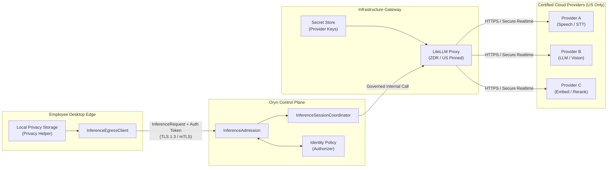

# Governed Cloud Inference Architecture and Gateway Contract

**Status:** `Detailed technical specification — implementation pending`  
**Document Category:** Architecture Specification (Cross-Component Contract)  
**Authority:** Technical Architecture and Security Policy  
**Applies to:** All 21 Oryn components and all AI model inference in Oryn v1.0

---

## 1. Purpose and Normative Invariants

This specification defines the shared architecture, interface contracts, security guarantees, and gateway governance for all AI model inference across Oryn.

### 1.1 Normative Invariants

1. **Cloud-Only AI in v1.0:** All Oryn-owned transcription, diarization, LLM reasoning/generation, OCR/vision extraction, text embeddings, semantic reranking, learned classification, and all other model inference in v1.0 use cloud-managed APIs routed exclusively through an Oryn-managed LiteLLM gateway.
2. **No On-Device Model Inference in v1.0:** The Oryn employee desktop client, privacy helper, native observers, browser extension, and meeting worker MUST NOT invoke Apple SpeechAnalyzer, Whisper, llama.cpp, ONNX models, local embedding models, or any on-device inference fallback runtime. Optional local/on-device inference is explicitly deferred to post-v1.0 product roadmaps.
3. **Deterministic Local Processing Preserved:** Deterministic capture, audio resampling and encoding, window geometry calculation, exclusion evaluation, protected-field masking, regex/structured secret removal, schema validation, exact text and token matching, local cache reads, timer scheduling, and encrypted private evidence storage remain strictly on-device. Local execution does not mean local AI; local deterministic guards must never be replaced by model inference.
4. **Separation of Inference Authority from Business Authority:** Inferred knowledge is not permission to publish knowledge or perform a business action. An AI recommendation, transcript turn, extracted commitment, vision output, or diagnostic hypothesis carries no independent authorization.
5. **No Direct-Provider Bypass:** No component may implement an ad-hoc provider client, direct cloud connection, or speech-provider bypass. Every inference operation routes through the managed ingress coordinator and LiteLLM gateway.
6. **Zero Content Retention and US Processing Required:** Every inference route must enforce contractual zero content retention (ZDR) after active processing, no training on customer content, and strict United States geographic confinement for ingress, proxy, model processing, and all content-bearing subprocessors.

---

## 2. Component Ownership and Architecture

Inference governance divides responsibilities across four primary components:

| Component | Role in Cloud Inference |
|---|---|
| `identity-policy` | Authoritative definition of inference policy, route selection criteria, purpose grants, tenant budget limits, consent tracking, and cryptographic signing/validation of `InferenceAuthorization` tokens. |
| `control-plane` | Operates logical modules `InferenceAdmission` (ingress request validation, schema verification, route matching, budget checks) and `InferenceSessionCoordinator` (transient session lifetime, streaming distribution, event ordering, and cancellation). |
| `infrastructure-security` | Deploys and manages the LiteLLM Proxy service, secure egress credentials, mutual TLS, firewall/VPC routing, memory-backed upload spooling, secret isolation, and audit sanitization. |
| `local-privacy-storage` (Privacy Helper) | Operates the edge `InferenceEgressClient`. Enforces source-level exclusions, protected-field masking, deterministic secret removal, and ephemeral session token attachment prior to transmission. |
| Other 17 components | Pure consumers. Submit typed `InferenceRequest` envelopes to the control plane; process typed `InferenceResult` or stream events; validate schema and bounds independently before applying results. |



---

## 3. Shared Operations and Data Contracts

### 3.1 InferenceOperation Literals

Every operation submitted to the gateway MUST specify one of the following exact typed operation literals:

- `meeting.transcribe.live`: Bidirectional live audio stream transcription.
- `meeting.transcribe.chunk`: Bounded audio chunk transcription (near-live mode).
- `meeting.transcribe.final`: Authoritative final session transcription and diarization.
- `meeting.extract_commitments`: Extraction of commitments, obligations, constraints, and dependencies from finalized transcripts.
- `vision.extract`: OCR and visual structure extraction from privacy-masked screen captures.
- `text.reason`: General reasoning, structured extraction, workflow synthesis, agent generation, diagnostic hypothesis formation, verification assistance, and repair proposal generation.
- `text.embed`: Dense vector generation for knowledge retrieval.
- `text.rerank`: Relevance scoring of candidate documents or nodes.

### 3.2 InferenceRoute

An `InferenceRoute` represents an approved, capability-certified upstream model endpoint. It is defined and maintained server-side by infrastructure and security operators. Clients never supply arbitrary URLs or master keys.

```json
{
  "route_id": "9b1deb4d-3b7d-4bad-9bdd-2b0d7b3dcb6d",
  "revision": "1",
  "provider": "bedrock",
  "litellm_alias": "bedrock-claude-3-5-sonnet",
  "transport": "chat_completions",
  "registered_path": null,
  "endpoint_ref": "vault://production/endpoints/bedrock-us-east-1",
  "credential_ref": "vault://production/credentials/bedrock-iam-role",
  "model_revision": "anthropic.claude-3-5-sonnet-20241022-v2:0",
  "operations": ["text.reason", "vision.extract"],
  "input_modalities": ["text", "image"],
  "output_schema_ids": [
    "meeting.commitments.v1",
    "workflow.synthesis.v1",
    "agent.ir.candidate.v1",
    "repair.patch.v1"
  ],
  "processing_geography": "US",
  "content_retention": "none_after_processing",
  "training_allowed": false,
  "policy_evidence_ref": "compliance://attestations/bedrock-zdr-us-2026",
  "capability_certificate_ref": "cert://routes/bedrock-claude-v2-certified",
  "not_after": "2027-01-01T00:00:00Z",
  "limits": {
    "max_input_bytes": 10485760,
    "max_output_bytes": 1048576,
    "max_input_tokens": 128000,
    "max_output_tokens": 4096,
    "max_audio_duration_ms": null,
    "max_concurrency": 20,
    "request_timeout_ms": 120000
  }
}
```

### 3.3 InferenceAuthorization

Issued and signed by `identity-policy`. Binds an authenticated actor, tenant, purpose, and input generation to a specific route.

```json
{
  "authorization_id": "c71a3b4e-9d2a-4efb-8a1c-6d8b9e0f1a23",
  "organization_id": "org_enterprise_01",
  "actor_id": "usr_employee_42",
  "device_id": "6ba7b810-9dad-11d1-80b4-00c04fd430c8",
  "purpose": "meeting_commitment_extraction",
  "operation": "meeting.extract_commitments",
  "input_scope": "meeting_session:8f9a2b1c-4d3e-4b2a-9f1e-8c7b6a5d4e3f:gen_4",
  "consent_revision": "12",
  "policy_revision": "104",
  "route_id": "9b1deb4d-3b7d-4bad-9bdd-2b0d7b3dcb6d",
  "route_revision": "1",
  "budget_authorization_ref": "bgt_auth_2026_q4_009",
  "issued_at": "2026-11-10T14:30:00Z",
  "not_after": "2026-11-10T14:35:00Z"
}
```

### 3.4 InferenceRequest

Submitted by a consuming component to `InferenceAdmission`. Contains bounded content manifests and strictly validated payload data.

```json
{
  "request_id": "req_8e2f1a9c-5b3d-4c7e-9f0a-1b2c3d4e5f6a",
  "authorization_ref": "c71a3b4e-9d2a-4efb-8a1c-6d8b9e0f1a23",
  "operation": "meeting.extract_commitments",
  "route_id": "9b1deb4d-3b7d-4bad-9bdd-2b0d7b3dcb6d",
  "route_revision": "1",
  "schema_id": "meeting.commitments.v1",
  "input_revision": "4",
  "deletion_generation": "0",
  "input_manifest": [
    {
      "range_id": "span_win_01",
      "start_sample": 0,
      "end_sample": 1600000,
      "sha256": "4b227777d4dd1fc61c6f884f48641d02b4d121d3fd328cb08b5531fcacdabf8a"
    }
  ],
  "content": {
    "transcript_text": "Speaker 1: I will send the reconciled purchase order to Sarah by Friday afternoon.\nSpeaker 2: Perfect, please tag me on the Jira ticket."
  }
}
```

### 3.5 InferenceResult

Returned upon completion of an inference operation.

```json
{
  "request_id": "req_8e2f1a9c-5b3d-4c7e-9f0a-1b2c3d4e5f6a",
  "route_provenance": {
    "provider": "bedrock",
    "model_revision": "anthropic.claude-3-5-sonnet-20241022-v2:0",
    "route_id": "9b1deb4d-3b7d-4bad-9bdd-2b0d7b3dcb6d",
    "route_revision": "1"
  },
  "input_revision": "4",
  "deletion_generation": "0",
  "status": "succeeded",
  "output": {
    "candidates": [
      {
        "candidate_id": "cand_01",
        "obligation_text": "Send reconciled purchase order to Sarah",
        "owner_candidate": "Speaker 1",
        "deadline_candidate": "2026-11-13T17:00:00",
        "deadline_resolution": "proposed_relative"
      }
    ]
  },
  "usage": {
    "input_tokens": 142,
    "output_tokens": 86,
    "duration_ms": 842
  },
  "error": null
}
```

### 3.6 Exact Error Literals

All errors returned by the inference gateway MUST use one of the following exact string literals:

1. `INFERENCE_NOT_AUTHORIZED`: Missing, expired, forged, or scope-mismatched `InferenceAuthorization`.
2. `INFERENCE_ROUTE_UNAVAILABLE`: Configured route disabled, offline, or revoked by policy.
3. `INFERENCE_CAPABILITY_UNSUPPORTED`: Requested operation, modality, or output schema not certified for the route.
4. `INFERENCE_REGION_DISALLOWED`: Upstream endpoint or subprocessor outside certified US boundaries.
5. `INFERENCE_RETENTION_UNVERIFIED`: Upstream provider lacks verifiable zero-retention / no-training terms.
6. `INFERENCE_BUDGET_EXCEEDED`: Tenant or user operational inference budget exhausted.
7. `INFERENCE_LIMIT_EXCEEDED`: Payload exceeds route size, duration, token, or concurrency limits.
8. `INFERENCE_UPSTREAM_UNAVAILABLE`: Upstream provider returned 5xx, transport disconnect, or timeout.
9. `INFERENCE_INPUT_STALE`: Input generation, deletion generation, or consent revision superseded before execution.
10. `INFERENCE_OUTPUT_INVALID`: Model output failed strict schema validation or produced hallucinated entity IDs.
11. `INFERENCE_CANCELLED`: Operation explicitly cancelled by client, session termination, or privacy pause.

---

## 4. Control Plane and Gateway Interfaces

The inference gateway exposes four logical interfaces to Oryn components:

### 4.1 AdmitInference
```typescript
function AdmitInference(request: InferenceRequest): Promise<InferenceAdmissionResult>
```
Validates the token, checks policy freshness and deletion generation, verifies route limits and schema compatibility. Returns an active session handle or typed rejection. Upstream credentials are never returned to clients.

### 4.2 CancelInference
```typescript
function CancelInference(requestId: string, reason: string): Promise<CancellationReceipt>
```
Aborts active upstream transmission and discards buffered frames. Prevents late results from committing to state. Acknowledges that bytes already processed by remote hardware cannot be recalled.

### 4.3 SubscribeInference
```typescript
function SubscribeInference(requestId: string, afterSequence: number): AsyncIterable<InferenceEvent>
```
Streams ordered, sequence-numbered events for live transcription or streamed token completion. Sequence gaps or epoch mismatches trigger fail-closed client resynchronization.

### 4.4 GetInferenceRouteStatus
```typescript
function GetInferenceRouteStatus(operation: InferenceOperation): Promise<InferenceRouteStatus>
```
Returns availability, certified modalities, and operational limits for an operation without disclosing sensitive endpoint credentials or provider URLs.

---

## 5. Provider Policy, Configuration, and Pinning

### 5.1 Route Pinning and Fallback Policy

1. **Pinned Binding:** Provider, model deployment revision, processing geography, route revision, and policy lease are strictly pinned per session or extraction request.
2. **No Automatic Cross-Provider Fallback:** LiteLLM automatic provider failover, traffic mirroring, shadow routing, and A/B routing are disabled. If a pinned route fails, the request fails with `INFERENCE_UPSTREAM_UNAVAILABLE`. Silent substitution of a different provider or model is prohibited.
3. **Bounded Retry:** A request may be retried at most once after a confirmed transient pre-response network failure, under the exact same authorization, route, and input hash. Reconnecting a live stream MUST NOT silently replay old audio.
4. **Independent Diarization Context:** A newly established session or provider route cannot inherit speaker identities or state from an earlier stream.

### 5.2 Zero Retention and No-Training Verification

1. **Contractual ZDR:** Each endpoint, account, and model deployment MUST have an executed Business Associate Agreement or Enterprise Zero Data Retention (ZDR) agreement.
2. **Prohibited Logs:** Content-bearing prompts, completions, audio chunks, and images must not be persisted in upstream server disks, provider debug stores, or error traces.
3. **Aggregator Requirements:** Aggregators (e.g., OpenRouter) are not globally barred, but can only be routed if every intermediary and upstream subprocessor in the execution chain is contractually bound to US-only processing, zero retention, and no training. Routes lacking end-to-end ZDR proof are marked unavailable with `INFERENCE_RETENTION_UNVERIFIED`.

### 5.3 United States Processing Confinement

All inference processing must occur within the United States. This restriction encompasses:
- Oryn control plane ingress and egress proxies.
- LiteLLM gateway instances.
- Provider compute regions and accelerator hardware.
- Content-bearing subprocessors and translation pipelines.

Routes with global dynamic routing, multi-region failover outside the US, or non-US data storage are rejected with `INFERENCE_REGION_DISALLOWED`.

### 5.4 Configuration Shape Examples

The following illustrative configurations demonstrate supported LiteLLM routing schemas with vault-backed secrets and operator-pinned settings. They are configuration patterns, not certified live accounts.

```yaml
# LiteLLM Configuration Pattern: OpenRouter US Pinned Route
model_list:
  - model_name: oryn-openrouter-sonnet
    litellm_params:
      model: openrouter/anthropic/claude-3.5-sonnet
      api_key: os.environ/OPENROUTER_API_KEY
      api_base: https://openrouter.ai/api/v1
      data_collection: deny
      route: us-only

# LiteLLM Configuration Pattern: Azure OpenAI Dedicated US Deployment
  - model_name: oryn-azure-gpt4o
    litellm_params:
      model: azure/gpt-4o-2024-08-06
      api_base: os.environ/AZURE_OPENAI_ENDPOINT_US_EAST
      api_version: "2024-08-01-preview"
      api_key: os.environ/AZURE_OPENAI_KEY

# LiteLLM Configuration Pattern: Amazon Bedrock IAM Role Route
  - model_name: oryn-bedrock-sonnet
    litellm_params:
      model: bedrock/anthropic.claude-3-5-sonnet-20241022-v2:0
      aws_region_name: us-east-1
      aws_role_name: os.environ/BEDROCK_EXECUTION_ROLE_ARN
```

---

## 6. Transient-Processing Hardening

### 6.1 Private Content Ephemerality

1. **Local Durability Only:** Private audio, screen frames, transcripts, and unconfirmed commitment records remain durable only on the employee device.
2. **No Central Content Persistence:** Control plane databases, cache tiers, message queues, and object storage MUST NOT store raw audio, screen images, or full private transcripts.
3. **Gateway Disables:** The LiteLLM proxy deployment must enforce:
   - `litellm_settings.turn_off_message_logging: true`
   - `general_settings.store_prompts_in_spend_logs: false`
   - `general_settings.disable_spend_logs: true`
   - `general_settings.disable_error_logs: true`
   - All third-party analytic callbacks (e.g., Sentry, Langfuse, Helicone) disabled.
   - Response caching disabled across all routes.
4. **Header Sanitization:** Client requests attempting to pass redaction-bypass headers, custom logging endpoints, or arbitrary provider parameters are rejected at admission.

### 6.2 Multipart and Audio Spooling Protections

When audio or image files are uploaded for chunk or batch inference:
1. **Memory-Backed Temp Storage:** Upload spooling must use a private, size-limited RAM disk (`tmpfs` or `ramfs`). Persistent disk volumes are prohibited for payload spooling.
2. **OS Hardening:** Host swap space and kernel core dumps are disabled on inference gateway worker nodes.
3. **Strict Size Admission:** Requests exceeding `max_input_bytes` or available memory allocation are rejected before reading the body.
4. **Immediate Cleanup:** Temp spool allocations are explicitly unlinked and overwritten upon request completion, cancellation, or failure.

### 6.3 Local Pre-Transfer Sanitization

Before any payload leaves the employee device:
1. **Source Exclusions:** Excluded applications and private browser tabs are blocked before capture.
2. **Occlusion & Masking:** Occluded window regions and classified sensitive/password fields are blacked out at the raster level.
3. **Secret Removal:** High-entropy tokens, private keys, and payment card numbers are stripped via deterministic regex/structural passes.
4. **No Cloud Self-Authorization:** Cloud OCR or vision models cannot authorize their own input. If safe admission cannot be established deterministically, the frame is suppressed.

### 6.4 Zero-Retention Personal History Mode

When `personal_history_retention = false`:
- Screen-derived visual inference operates ephemerally with a strict 30-second volatile lifetime.
- Results are held in volatile memory only and discarded immediately after real-time guidance matching.
- No inputs, intermediate representations, embeddings, or results are written to disk.
- If cloud inference is unavailable or interrupted, AI-backed features display an explicit unavailable state; no offline deferred backlog is accumulated.

---

## 7. Component Operation Map

All 21 Oryn components interface with model inference according to the following matrix:

| Component ID & Name | Inference Role & Operations | Boundary & Non-Responsibilities |
|---|---|---|
| `1. desktop-shell` | Presentation host for AI status, offline indicators, and review UI. Pure consumer. | Does not invoke models, hold provider secrets, or maintain cloud network connections. |
| `2. os-observation` | Deterministic capture, window geometry, occlusion masking. Submits `vision.extract` via Privacy Helper. | No local OCR or ML models in worker. Captures uncoverable pixels only. |
| `3. browser-extension` | Deterministic DOM observation, offscreen tab audio capture. Consumes target queries. | No cloud networking, speech recognition, or model inference in extension. |
| `4. meeting-intelligence` | Coordinates `meeting.transcribe.*` and `meeting.extract_commitments`. Owns local private evidence. | All STT and LLM inference routed through LiteLLM. No local Whisper or local diarization. |
| `5. local-privacy-storage` | Operates edge `InferenceEgressClient`. Owns private encryption, retention, and local redaction. | Evaluates exclusions deterministically before any cloud egress. |
| `6. local-context-hud` | Deterministic exact matching and guidance cache. Uses `text.reason` for semantic suggestions. | No local LLM runtime. Displays explicit offline status when disconnected. |
| `7. contribution-sync` | Transmits employee-reviewed contributions to graph. | Transmits reviewed sanitized knowledge only; does not route raw inference traffic. |
| `8. identity-policy` | Issues and cryptographically signs `InferenceAuthorization` tokens; defines route and ZDR policy. | Does not execute inference or handle model outputs directly. |
| `9. control-plane` | Hosts `InferenceAdmission` and `InferenceSessionCoordinator`. Enforces budgets and quotas. | Does not retain private content in durable domain stores. |
| `10. infrastructure-security`| Operates LiteLLM Proxy, vault credentials, VPC egress, and memory spooling. | Sanitizes logs; blocks persistent body capture. |
| `11. workflow-discovery` | Consumes `text.reason` and `text.embed` to cluster tasks and propose candidate workflows. | Inferred workflows remain unapproved candidates until human verification. |
| `12. operational-graph` | Uses `text.embed` and `text.rerank` for semantic search and dependency linking. | Authoritative graph relationships require explicit validation. |
| `13. agent-factory-ir` | Uses `text.reason` to synthesize agent candidates from approved workflows. | Synthesized IR candidates are unapproved until simulator verification. |
| `14. application-adapters` | Deterministic API, UI, and MCP execution. Pure consumer. | Model output cannot bypass declared adapter action constraints. |
| `15. job-orchestration` | Coordinates batch execution and human approvals. | Job dispatch does not generate model authority; follows pinned agent IR. |
| `16. agent-runtime` | Uses `text.reason` for step decisions within strict action and tool boundaries. | Model decisions are bounded by assigned risk tier and require human sign-off for Tier 3. |
| `17. flight-simulator` | Uses `text.reason` to generate synthetic test scenarios and evaluate mock behavior. | Simulated execution cannot touch production systems or bypass test oracles. |
| `18. outcome-verification` | Uses `text.reason` as a verification assistant. | Model judgment alone cannot certify business correctness; requires deterministic oracle checks. |
| `19. incident-correction-repair` | Uses `text.reason` to formulate diagnostic hypotheses and propose IR patches. | AI diagnoses remain unverified hypotheses until confirmed by human experts. |
| `20. release-governance` | Enforces release gates, canary limits, and approval policies. | Release promotion cannot be authorized by model inference. |
| `21. command-center-analytics` | Exposes role-scoped reporting and governance views. | Excludes private raw capture, transcripts, and employee surveillance metrics. |

---

## 8. Documentation Coverage and Traceability

This table records all document families across the Oryn repository and their reconciliation status under this cloud inference baseline:

| Document Family | Reconciliation Status | Notes and Scope |
|---|---|---|
| `PRODUCT.md` | Reconciled | Replaced absolute zero-egress/local-AI claims with local durable ownership + authorized transient cloud processing. Added §31.9 (ORY-071–076), §32.1 blockers, §33 roadmap. |
| `TECHNICAL.md` | Reconciled | Updated baseline (§0.4), invariants (§1), deployment (§2), edge (§4), contracts (§7), data domains (§10), decisions (§13–14). Established 24 total contracts. |
| `docs/architecture/cloud-inference.md` | Authoritative | Canonical shared specification for all cloud inference and gateway governance. |
| `docs/architecture/contracts/README.md` | Reconciled | Added Contracts 22 (Governed Cloud Inference), 23 (Confirmed Commitment Projection), 24 (Reviewed Meeting Handoff). Updated Contracts 1 and 19. |
| `docs/architecture/data-classification.md` | Reconciled | Added transient inference processing data flow; clarified local raw retention and ZDR guarantees. |
| `docs/architecture/threat-model.md` | Reconciled | Added threats for gateway SSRF, aggregator leak, region escape, multipart spooling, and offline backfill. |
| `docs/components/desktop-shell.md` | Reconciled | Updated channel allocation (Channel 4 audio), handshake minor 2, PauseScreenObservation vs PauseCapture, offline indicators. |
| `docs/components/os-observation.md` | Reconciled | Replaced local OCR with Privacy-Helper-governed cloud vision extraction; preserved deterministic capture. |
| `docs/components/browser-extension.md` | Reconciled | Added offscreen tab capture, toolbar gesture challenge, audio channel 4, broker minor 1. Replaced downstream local OCR claims. |
| `docs/components/meeting-intelligence.md` | Reconciled | Full technical specification: native Core Audio/WASAPI taps, tabCapture, LiteLLM live/near-live STT, commitment review, reminders. |
| `docs/components/local-privacy-storage.md`| Reconciled | Added InferenceEgressClient ownership, meeting worker supervision, ZDR enforcement, and retention-off 30s limits. |
| `docs/components/local-context-hud.md` | Reconciled | Preserved deterministic cache/matching; routed semantic reasoning via LiteLLM; consumed confirmed commitment projections. |
| `docs/components/contribution-sync.md` | Reconciled | Added reviewed meeting handoffs; distinguished reviewed contributions from transient inference egress. |
| `docs/components/identity-policy.md` | Reconciled | Added route/purpose policy, ZDR verification gates, and InferenceAuthorization signing. |
| `docs/components/control-plane.md` | Reconciled | Added InferenceAdmission and InferenceSessionCoordinator modules. |
| `docs/components/infrastructure-security.md`| Reconciled | Added LiteLLM operation, vault secrets, no-log settings, memory spooling, and US confinement rules. |
| `docs/components/workflow-discovery.md` | Reconciled | Reconciled model-assisted clustering and playbook synthesis via shared gateway contract. |
| `docs/components/agent-factory-ir.md` | Reconciled | Reconciled IR synthesis and optimization via shared gateway contract. |
| `docs/components/agent-runtime.md` | Reconciled | Reconciled bounded agent step decisions via shared gateway contract. |
| `docs/components/incident-correction-repair.md` | Reconciled | Reconciled diagnostic reasoning and patch generation via shared gateway contract. |
| `docs/components/operational-graph.md` | Reconciled | Added shared inference pointer for embeddings and graph search. |
| `docs/components/application-adapters.md`| Reconciled | Added shared inference pointer; confirmed deterministic action constraints. |
| `docs/components/job-orchestration.md` | Reconciled | Added shared inference pointer; confirmed durable execution state. |
| `docs/components/flight-simulator.md` | Reconciled | Reconciled synthetic scenario generation via shared gateway contract. |
| `docs/components/outcome-verification.md`| Reconciled | Reconciled model-assisted verification; preserved independent deterministic checks. |
| `docs/components/release-governance.md` | Reconciled | Reconciled change analysis via shared gateway contract; preserved human release gates. |
| `docs/components/command-center-analytics.md` | Reconciled | Preserved role-scoped views and prohibition of employee surveillance data. |
| `docs/README.md` | Reconciled | Linked cloud inference specification; confirmed 21-component architecture and v1.0 baseline. |
| `GLOSSARY.md` | Reconciled | Added Cloud Inference, Inference Authorization, Meeting Session, Confirmed Commitment, Speaker Label, Offline Recording, Reviewed Contribution. |
| `docs/adr/` | Reconciled | Added ADR-0005 (Cloud Inference) and ADR-0006 (Meeting Capture & Boundaries); added amendment links to ADR-0001–0004. |
| `.omp/plans/*.md` | Reconciled | Reconciled 4 active plans to remove local OCR/inference instructions and align with cloud baseline. |
| `AGENTS.md` | Reconciled | Appended normative AI inference baseline section. |
| `docs/agents/domain.md` | Reconciled | Added cloud-inference.md to reading list and future planning rules. |
| `docs/agents/issue-tracker.md` | Unaffected | Tracker conventions, issue template structure, and status transitions contain no inference or privacy conflicts. |
| `docs/agents/triage-labels.md` | Unaffected | Canonical triage labels and lifecycle criteria contain no inference or privacy conflicts. |
