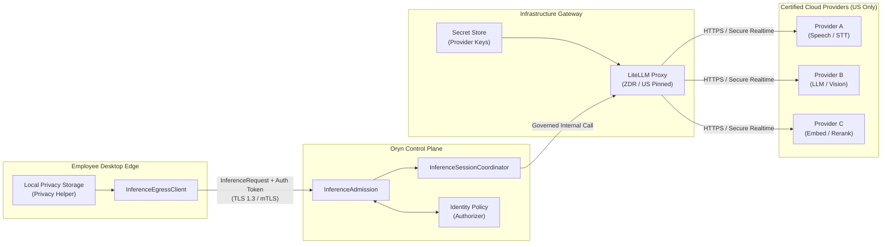

# Governed Cloud Inference Architecture and Gateway Contract

**Status:** `Detailed technical specification — implementation pending`  
**Document Category:** Architecture Specification (Cross-Component Contract)  
**Authority:** Technical Architecture and Security Policy  
**Applies to:** All 21 Oryn components and all AI model inference in Oryn v1.0

---

## 1. Purpose and Normative Invariants

This specification defines the shared architecture, interface contracts, security guarantees, and gateway governance for all AI model inference across Oryn.

### 1.1 Normative Invariants

1. **Cloud-Only AI in v1.0:** All Oryn-owned transcription, diarization, LLM reasoning/generation, OCR/vision extraction, text embeddings, semantic reranking, learned classification, and all other model inference in v1.0 use cloud-managed APIs routed exclusively through an Oryn-managed LiteLLM gateway.
2. **No On-Device Model Inference in v1.0:** The Oryn employee desktop client, privacy helper, native observers, browser extension, and meeting worker MUST NOT invoke Apple SpeechAnalyzer, Whisper, llama.cpp, ONNX models, local embedding models, or any on-device inference fallback runtime. Optional local/on-device inference is explicitly deferred to post-v1.0 product roadmaps.
3. **Deterministic Local Processing Preserved:** Deterministic capture, audio resampling and encoding, window geometry calculation, exclusion evaluation, protected-field masking, regex/structured secret removal, schema validation, exact text and token matching, local cache reads, timer scheduling, and encrypted private evidence storage remain strictly on-device. Local execution does not mean local AI; local deterministic guards must never be replaced by model inference.
4. **Separation of Inference Authority from Business Authority:** Inferred knowledge is not permission to publish knowledge or perform a business action. An AI recommendation, transcript turn, extracted commitment, vision output, or diagnostic hypothesis carries no independent authorization.
5. **No Direct-Provider Bypass:** No component may implement an ad-hoc provider client, direct cloud connection, or speech-provider bypass. Every inference operation routes through the managed ingress coordinator and LiteLLM gateway.
6. **Zero Content Retention and US Processing Required:** Every inference route must enforce contractual zero content retention (ZDR) after active processing, no training on customer content, and strict United States geographic confinement for ingress, proxy, model processing, and all content-bearing subprocessors.

---

## 2. Component Ownership and Architecture

Inference governance divides responsibilities across four primary components:

| Component | Role in Cloud Inference |
|---|---|
| `identity-policy` | Authoritative definition of inference policy, route selection criteria, purpose grants, tenant budget limits, consent tracking, and cryptographic signing/validation of `InferenceAuthorization` tokens. |
| `control-plane` | Operates logical modules `InferenceAdmission` (ingress request validation, schema verification, route matching, budget checks) and `InferenceSessionCoordinator` (transient session lifetime, streaming distribution, event ordering, and cancellation). |
| `infrastructure-security` | Deploys and manages the LiteLLM Proxy service, secure egress credentials, mutual TLS, firewall/VPC routing, memory-backed upload spooling, secret isolation, and audit sanitization. |
| `local-privacy-storage` (Privacy Helper) | Operates the edge `InferenceEgressClient`. Enforces source-level exclusions, protected-field masking, deterministic secret removal, and ephemeral session token attachment prior to transmission. |
| Other 17 components | Pure consumers. Submit typed `InferenceRequest` envelopes to the control plane; process typed `InferenceResult` or stream events; validate schema and bounds independently before applying results. |



---

## 3. Shared Operations and Data Contracts

### 3.0 Normative Wire Contracts
Cloud inference requests, transient streaming sessions, and budget reservations are governed by normative Draft 2020-12 wire schemas and OpenAPI transport definitions:
- Wire Schema: [`cloud-inference-v1.schema.json`](contracts/cloud-inference-v1.schema.json) (`urn:oryn:schemas:cloud-inference:v1`)
- Identity Authorization Schema: [`identity-policy-v1.schema.json`](contracts/identity-policy-v1.schema.json) (`urn:oryn:schemas:identity-policy:v1`)
- Client Transport Specification: [`control-plane-v1.openapi.json`](contracts/control-plane-v1.openapi.json)
- Component Specification: [Control Plane API and Domain Coordination](../components/control-plane.md)

### 3.1 InferenceOperation Literals

Every operation submitted to the gateway MUST specify one of the following exact typed operation literals:

- `meeting.transcribe.live`: Bidirectional live audio stream transcription.
- `meeting.transcribe.chunk`: Bounded audio chunk transcription (near-live mode).
- `meeting.transcribe.final`: Authoritative final session transcription and diarization (capped at 128 MiB / 134,217,728 bytes).
- `meeting.extract_commitments`: Extraction of commitments, obligations, constraints, and dependencies from finalized transcripts.
- `incident.transcribe_correction`: Batch audio transcription of employee incident correction dictation (capped at 1,920,000 decoded bytes / 2,621,440 bytes JSON).
- `vision.extract`: OCR and visual structure extraction from privacy-masked screen captures.
- `text.reason`: General reasoning, structured extraction, workflow synthesis, agent generation, diagnostic hypothesis formation, verification assistance, and repair proposal generation.
- `text.embed`: Dense vector generation for knowledge retrieval.
- `text.rerank`: Relevance scoring of candidate documents or nodes.

### 3.1.1 Cryptographic Input Bindings and Stream Proofs
Inference authorizations strictly link admitted requests to verified input data using cryptographic bindings:

1. **`InputBindingV1` Tagged Union:**
   - `kind: "batch"`: Binds `input_scope_sha256` (RFC 8785 SHA-256 of transient source references) and `input_manifest_sha256` (SHA-256 of the canonical input parts manifest).
   - `kind: "stream"`: Binds `stream_scope_sha256` (SHA-256 of `StreamScopeV1`), `stream_id` (UUIDv4), and `stream_epoch` (UUIDv4).
2. **RAM-Only Source Scopes:** `InputScopeV1` and `StreamScopeV1` contain transient window/segment references verified entirely in memory; they are never persisted to database tables.
3. **Signed Chunk Proofs (`SignedInferenceChunkProofV1`):** Every 100 ms audio chunk (16 kHz, 16-bit mono PCM, max 3,200 bytes) sent over WebSocket includes a header signed by the enrolled device key (`privacy.inference-chunk.v1`). Server validates `sample_start`, `sample_end`, sequence monotonicity, and consent revision before forwarding bytes to LiteLLM.
4. **Child Token Audience:** Desktop employee inference uses Identity child tokens with `audience: "inference"` and scopes `inference:authorize`, `inference:submit`, `inference:cancel`, `inference:read_route`.
5. **Payload Size Caps:** Bounded standard JSON bodies ≤ 256 KiB; general inference input ≤ 10 MiB (10,485,760 bytes). For `incident.transcribe_correction`, the operation-specific JSON-body ceiling is 2,621,440 bytes (to accommodate base64-encoded PCM audio ≤ 1,920,000 decoded bytes). For `meeting.transcribe.final` only, input bodies up to 128 MiB (134,217,728 bytes) are admitted provided the route certifies streaming multipart diarization.
6. **Budget Accounting & Reservations:** Organizations define `inference_budget_limit_microusd` over `calendar_month_utc` windows in `OrganizationPolicyV1`. Control Plane atomically reserves estimated maximum spend in `inference_reservation` prior to upstream transmission; unknown outcomes remain encumbered until billing reconciliation.

### 3.2 InferenceRoute

An `InferenceRoute` represents an approved, capability-certified upstream model endpoint. It is defined and maintained server-side by infrastructure and security operators. Clients never supply arbitrary URLs or master keys.

```json
{
  "route_id": "9b1deb4d-3b7d-4bad-9bdd-2b0d7b3dcb6d",
  "revision": "1",
  "provider": "bedrock",
  "litellm_alias": "bedrock-claude-3-5-sonnet",
  "transport": "chat_completions",
  "registered_path": null,
  "endpoint_ref": "vault://production/endpoints/bedrock-us-east-1",
  "credential_ref": "vault://production/credentials/bedrock-iam-role",
  "model_revision": "anthropic.claude-3-5-sonnet-20241022-v2:0",
  "operations": ["text.reason", "vision.extract"],
  "input_modalities": ["text", "image"],
  "output_schema_ids": [
    "meeting.commitments.v1",
    "workflow.synthesis.v1",
    "workflow.embedding.v1",
    "workflow.compatibility.v1",
    "agent.ir.candidate.v1",
    "agent.runtime-value.v1",
    "repair.patch.v1",
    "hud.context-interpretation.v1",
    "hud.demonstration-summary.v1",
    "hud.step-explanation.v1",
    "knowledge.embedding.v1",
    "knowledge.rerank.v1"
  ],
  "processing_geography": "US",
  "content_retention": "none_after_processing",
  "training_allowed": false,
  "policy_evidence_ref": "compliance://attestations/bedrock-zdr-us-2026",
  "capability_certificate_ref": "cert://routes/bedrock-claude-v2-certified",
  "not_after": "2027-01-01T00:00:00Z",
  "limits": {
    "max_input_bytes": 10485760,
    "max_output_bytes": 1048576,
    "max_input_tokens": 128000,
    "max_output_tokens": 4096,
    "max_audio_duration_ms": null,
    "max_concurrency": 20,
    "request_timeout_ms": 120000
  }
}
```

### 3.3 InferenceAuthorization

Issued and signed by `identity-policy` under schema `inference.authorization.v1` (with policy key). Binds an authenticated actor, tenant, purpose, and ephemeral input scope hashes to a specific route and policy revision. For edge-initiated inference, incorporates or accompanies `SignedPrivacyAuthorizationContextV1` (`privacy.authorization-context.v1`) signed by the local software review key to prove local consent freshness without exposing raw identifiers.

```json
{
  "schema_id": "inference.authorization.v1",
  "key_id": "key_policy_2026_01",
  "payload": {
    "authorization_id": "88888888-8888-4888-8888-888888888888",
    "organization_id": "00000000-0000-4000-8000-000000000001",
    "actor_id": "usr_employee_01",
    "principal_kind": "employee",
    "device_id": "dev_macbook_01",
    "profile_id": "prf_default_01",
    "workload_id": null,
    "purpose": "hud_context_interpretation",
    "operation": "text.reason",
    "route_id": "route_claude_35_sonnet_us",
    "route_revision": "1",
    "budget_reservation_id": "99999999-9999-4999-8999-999999999999",
    "deletion_generation": "1",
    "input_revision": "1",
    "audience": "inference-admission",
    "issued_at": "2026-11-10T15:00:00Z",
    "not_after": "2026-11-10T15:05:00Z"
  },
  "signature": "abevTtsCDuteTNt6Gb55PzhL1jANgzhzN7FN4x1ZJ7RDpytVDeKUjBZOYqJeGfok5ma0GADtgTnxRQANa3pYCA"
}
```

### 3.4 InferenceRequest

Submitted by a consuming component to `InferenceAdmission` using the closed `InferenceRequestV1` schema in [cloud-inference-v1.schema.json](contracts/cloud-inference-v1.schema.json#/$defs/InferenceRequestV1). Its required fields are `schema_id` (`inference.request.v1`), `request_id`, `authorization_ref`, `operation`, `route_id`, `route_revision`, `schema_id_expected`, `input_revision`, `deletion_generation`, `input_manifest`, and `content`. `content` is an array of `InferenceContentPartV1` records, not an arbitrary transcript object; the manifest must match the content and authorization binding. For Factory requests, use `text.reason` and the registered output ID for the authorized purpose.

### 3.5 InferenceResult

Returned upon completion of an inference operation.

```json
{
  "request_id": "req_8e2f1a9c-5b3d-4c7e-9f0a-1b2c3d4e5f6a",
  "route_provenance": {
    "provider": "bedrock",
    "model_revision": "anthropic.claude-3-5-sonnet-20241022-v2:0",
    "route_id": "9b1deb4d-3b7d-4bad-9bdd-2b0d7b3dcb6d",
    "route_revision": "1"
  },
  "input_revision": "4",
  "deletion_generation": "0",
  "status": "succeeded",
  "output": {
    "candidates": [
      {
        "candidate_id": "cand_01",
        "obligation_text": "Send reconciled purchase order to Sarah",
        "owner_candidate": "Speaker 1",
        "deadline_candidate": "2026-11-13T17:00:00",
        "deadline_resolution": "proposed_relative"
      }
    ]
  },
  "usage": {
    "input_tokens": 142,
    "output_tokens": 86,
    "duration_ms": 842
  },
  "error": null
}
```

### 3.6 Exact Error Literals

All errors returned by the inference gateway MUST use one of the following exact string literals:

1. `INFERENCE_NOT_AUTHORIZED`: Missing, expired, forged, or scope-mismatched `InferenceAuthorization`.
2. `INFERENCE_ROUTE_UNAVAILABLE`: Configured route disabled, offline, or revoked by policy.
3. `INFERENCE_CAPABILITY_UNSUPPORTED`: Requested operation, modality, or output schema not certified for the route.
4. `INFERENCE_REGION_DISALLOWED`: Upstream endpoint or subprocessor outside certified US boundaries.
5. `INFERENCE_RETENTION_UNVERIFIED`: Upstream provider lacks verifiable zero-retention / no-training terms.
6. `INFERENCE_BUDGET_EXCEEDED`: Tenant or user operational inference budget exhausted.
7. `INFERENCE_LIMIT_EXCEEDED`: Payload exceeds route size, duration, token, or concurrency limits.
8. `INFERENCE_UPSTREAM_UNAVAILABLE`: Upstream provider returned 5xx, transport disconnect, or timeout.
9. `INFERENCE_INPUT_STALE`: Input generation, deletion generation, or consent revision superseded before execution.
10. `INFERENCE_OUTPUT_INVALID`: Model output failed strict schema validation or produced hallucinated entity IDs.
11. `INFERENCE_CANCELLED`: Operation explicitly cancelled by client, session termination, or privacy pause.


### 3.7 Local Context HUD Semantic Contracts (`text.reason`)

The Local Context HUD component consumes semantic interpretation via `text.reason` routed through the Privacy Helper edge client (Contract 22). It uses three dedicated purpose literals and schemas:

1. **`hud_context_interpretation`:** Interprets ambiguous task surface context and suggests candidate playbooks. Output schema: `hud.context-interpretation.v1`.
2. **`hud_demonstration_summary`:** Synthesizes structured demonstration proposals from observed task instances. Output schema: `hud.demonstration-summary.v1`.
3. **`hud_step_explanation`:** Generates contextual explanations for a guidance step citing approved playbook rules. Output schema: `hud.step-explanation.v1`.

#### `hud.context-interpretation.v1` Schema Example
```json
{
  "request_id": "req_inf_hud_01928374-0001",
  "objective": "Resolve ERP invoice tax discrepancy",
  "task_boundary": "invoice_line_item_view",
  "ranked_candidate_ids": [
    "pb_tax_reconciliation_v2"
  ],
  "supporting_fact_ids": [
    "fct_01928374-0001",
    "fct_01928374-0002"
  ],
  "unknowns": [],
  "uncertainty_label": "low"
}
```

#### `hud.demonstration-summary.v1` Schema Example
```json
{
  "request_id": "req_inf_hud_01928374-0002",
  "task_id": "tsk_01928374-0002",
  "objective": "Reconcile daily invoice adjustments in ERP",
  "steps": [
    {
      "step_index": 1,
      "action_type": "click",
      "target_description": "Post Adjustment button in Invoice screen",
      "sanitized_inputs": {}
    }
  ],
  "variables": [
    {
      "name": "invoice_total",
      "value_label": "<DECIMAL_AMOUNT>"
    }
  ],
  "confidence": "high",
  "gap_detected": false
}
```

#### `hud.step-explanation.v1` Schema Example
```json
{
  "request_id": "req_inf_hud_01928374-0003",
  "step_id": "step_check_tax_code",
  "explanation_text": "Tax code must align with invoice line items before posting to prevent GL reconciliation mismatches.",
  "cited_rule_refs": [
    "rule_finance_tax_matching_01"
  ],
  "is_interpretation": true
}
```

#### Ingress, Egress, and Rate Limits
- **Input Limit:** Minimized context input strictly bounded to 16 KiB, at most 8 candidate IDs, and 64 fact references.
- **Output Limit:** Output strictly bounded to 8 KiB and at most 16 hypotheses.
- **Timeout:** Request timeout is 5,000 ms. The effective execution deadline is the earliest of 5,000 ms, `InferenceAuthorization.not_after`, and the earliest supporting input volatile expiration.
- **Concurrency and Rate Limits:** Exactly one in-flight HUD inference request per device; background requests require at least 500 ms debounce, at least 30 seconds cooldown between successive background requests, and at most 120 background requests per rolling hour.
- **Explicit vs. Background:** Explicit employee requests (e.g. manual search, why step) share the one-in-flight limit but bypass the 30-second background cooldown.
- **No Shadow Queues:** Zero prompt text, intermediate embeddings, or model completions persist on disk in the HUD. Expired or cancelled requests discard late completions without processing.
---

### 3.8 Workflow Discovery Model Contracts (`text.embed`, `text.reason`)

Workflow Discovery and Procedure Synthesis consumes transient cloud text inference via the LiteLLM gateway under Contract 22 for vector retrieval, cluster-wide compatibility evaluation, and structured DAG procedure synthesis:

1. **`workflow_discovery_embed` (Operation: `text.embed`):**
   - **Purpose:** Generates dense vector representations from canonical objective/summary/application projections for exact cosine nearest-neighbor search in PostgreSQL `pgvector`.
   - **Output Schema:** `workflow.embedding.v1` (enforcing `input_fingerprint`, `embedding_space_id`, `dimensions` 1..4096, and normalized vector array).
   - **Input Scope:** `SourceScopeV1.source_kind = "organizational_artifact"` referencing RAM-only text projections capped at 32 KiB. Output capped at 256 KiB. Timeout: 30,000 ms.

2. **`workflow_discovery_compare` (Operation: `text.reason`):**
   - **Purpose:** Evaluates pairwise semantic equivalence, boundary agreement, and postcondition alignment across contributing task demonstrations.
   - **Output Schema:** `workflow.compatibility.v1` (enforcing structured pair verdicts `"equivalent" | "different" | "uncertain"`, supporting/contradicting pointers, and clarification questions).
   - **Input Scope:** Bounded batches of at most 16 pairs and at most 32 distinct source references. Input capped at 128 KiB; output capped at 128 KiB. Timeout: 60,000 ms.

3. **`workflow_discovery_synthesize` (Operation: `text.reason`):**
   - **Purpose:** Infers canonical procedure steps, DAG edges, textual decision branches, suggested variants, exceptions, postconditions, and acyclic repetition guidance from representative task demonstrations.
   - **Output Schema:** `workflow.synthesis.v1` (enforcing `CandidateProcedureV1` with `guidance_eligibility = not_ready` and `agent_eligibility = not_assessed`, `ClaimProvenanceV1`, and `ClarificationQuestionV1`).
   - **Input Scope:** Deterministically selected representative examples (up to 32 examples per batch; partitioned across multiple passes if diversity exceeds batch size). Input capped at 1 MiB; output capped at 256 KiB. Timeout: 120,000 ms.

All Workflow Discovery inference operations strictly prohibit raw screenshot transmission (images remain reviewer-only verification artifacts). Certified route pinning enforces zero content retention and US geographic processing. Transient transport errors permit at most one same-binding retry prior to response commencement.

### 3.9 Operational Graph and Knowledge Governance Contracts (`text.embed`, `text.rerank`)

The Living Operational Graph consumes cloud inference via the LiteLLM gateway under Contract 22 strictly for semantic knowledge retrieval indexing, interactive search embedding, and cross-encoder candidate reranking. Graph operations never execute `text.reason` (reasoning models cannot establish structural relationships, alter approvals, or resolve conflicts):

1. **`knowledge_search_embed` (Operation: `text.embed`):**
   - **Purpose:** Generates a dense query embedding vector for interactive employee or agent search queries to perform exact cosine similarity matching (`<=>`) in PostgreSQL `pgvector`.
   - **Output Schema:** `knowledge.embedding.v1` (enforcing `input_fingerprint`, `embedding_space_id`, `dimensions` 1..4096, and normalized vector array).
   - **Input Scope:** Interactive search query string capped at 4 KiB. Output capped at 256 KiB. Timeout: 5,000 ms.

2. **`knowledge_document_embed` (Operation: `text.embed`):**
   - **Purpose:** Generates a dense document embedding vector from authorized capability, playbook, or rule title/objective/summary text projections for background indexing.
   - **Output Schema:** `knowledge.embedding.v1` (enforcing `input_fingerprint`, `embedding_space_id`, `dimensions` 1..4096, and normalized vector array).
   - **Input Scope:** Approved document projection text capped at 32 KiB. Output capped at 256 KiB. Timeout: 30,000 ms.

3. **`knowledge_search_rerank` (Operation: `text.rerank`):**
   - **Purpose:** Re-scores the top 20 pre-filtered candidate document projections against the query text to compute fine-grained relevance rankings before response projection.
   - **Output Schema:** `knowledge.rerank.v1` (enforcing unique subset/permutation of candidate IDs with finite float scores).
   - **Input Scope:** At most 20 candidates, total input payload capped at 128 KiB. Output capped at 16 KiB. Timeout: 3,000 ms.

All Operational Graph model requests submit through the standard inference authorization and reservation path. Model output is treated as untrusted: the system revalidates document digests, source eligibility, and caller principal audience access before committing indexes or projecting search pages. No direct provider routing or local model fallback is permitted.

### 3.10 Agent Factory and Runtime Semantic Contracts (`text.reason`)

The Agent Factory (`agent-factory-ir`) and Agent Runtime (`agent-runtime`) components consume governed cloud model reasoning via the LiteLLM gateway under Contract 22 for candidate plan synthesis and bounded runtime reasoning. Neither operation can alter business policy authority, bypass Identity checks, or mutate production state:

1. **`agent_candidate_synthesize` (Operation: `text.reason`):**
   - **Purpose:** Infers candidate step mappings, verification requirements, and runtime model bindings from approved playbooks, formal business rules, and declared adapter schemas.
   - **Output Schema:** `agent.ir.candidate.v1` (enforcing `AgentIRCandidateProposalV1` with source citations, unresolved questions, assumptions, and typed step mappings).
   - **Input Scope:** Approved playbook procedure text, business rule statements, and operation schemas; strictly excludes raw observation media, screenshots, audio, transcripts, credentials, and customer data. Input capped at 256 KiB; output capped at 128 KiB. Timeout: 120,000 ms. At most 2 concurrent synthesis requests per tenant within existing worker budgets.
   - **Governance & Provenance:** The output proposal is advisory only and stored immutably with `SynthesisProvenanceV1` (linking request ID, input/output SHA-256, route/model revision, template SHA-256, and usage). It cannot mutate the authoring head until explicitly accepted by an authorized human holding `agent.edit`.

2. **`agent_runtime_reason` (Operation: `text.reason`):**
   - **Purpose:** Executes bounded runtime reasoning (extraction, classification, draft formulation, or branch selection) within an active agent execution.
   - **Output Schema:** `agent.runtime-value.v1` (enforcing `RuntimeModelResultV1` with typed value or explicit unknown reason; numbers excluded from JSON payload).
   - **Input Scope:** Case variables conforming to declared `RuntimeModelBindingV1`. Input capped at 32 KiB; output capped at 16 KiB. Timeout: 30,000 ms.
   - **Governance & Taint:** Invokes strictly through pinned model bindings (`route_id`, `route_revision`, `model_revision`, `output_schema_sha256`). Model outputs are untrusted/tainted: they cannot supply write-target IDs, mandatory policy facts, or Tier 3 action arguments without independent verification under source requirements. Revoked or unavailable bindings pause rather than substitute fallback models.

Both purposes require explicit registration under the existing `InferencePurposePolicyV1`, matching certified route operation and output-schema registrations, and normal `InferenceRequestV1` authorization and budget reservation. Registration does not expand generic provider or client permissions. Synthesis timeout is clamped to route and authorization limits; one retry is allowed only after a confirmed transient pre-response failure under the same input, route, and authorization. Provider-interaction uncertainty requires a new explicit request, never automatic replay or cross-provider fallback. Late results cannot update a changed draft.

Persist validated typed proposals and provenance, not raw synthesis prompts, intermediate reasoning, or raw completions. Runtime prompt templates and their digests are material, version-pinned configuration in `RuntimeModelBindingV1`, not synthesis logs. Tier 2 model-influenced mutation parameters also require independent validation; allowed Tier 0/1 classification cannot change population, risk floor, destination, or permissions.

### 3.11 Flight Simulator Scenario Generation Semantic Contracts (`text.reason`)

The Flight Simulator (`flight-simulator`) component consumes governed cloud model reasoning via the LiteLLM gateway under Contract 22 for bounded draft scenario generation from procedure rules and approved reference patterns:

1. **`simulation_scenario_generate` (Operation: `text.reason`):**
   - **Purpose:** Proposes candidate scenario drafts (boundary conditions, exception cases, input quality variations, fault injection setups) from authorized procedure rules, published playbooks, and verified synthetic reference patterns.
   - **Output Schema:** `simulation.scenario-proposal.v1` (enforcing `ScenarioProposalV1` with proposal ID, category, purpose, application context, proposed inputs, expected disposition, stop conditions, and fault plans).
   - **Input Scope:** Authorized minimized rule/procedure/exception projections and approved synthetic/anonymized patterns; strictly excludes private employee observations, credentials, live customer data, production mailbox contents, and raw meeting transcripts. Input capped at 256 KiB; output capped at 128 KiB. Timeout: 120,000 ms.
   - **Concurrency & Rate Ceilings:** At most 2 concurrent scenario generation calls per tenant; at most 16 proposed cases per call and at most 8 calls per explicit generation operation.
   - **Governance & Provenance:** Persists validated typed draft cases and reusable `SynthesisProvenanceV1`, not raw prompts, completions, or model reasoning. Scenario generation cannot seal suites, establish authoritative expectations, or grade outcomes; candidate proposals require Workflow Owner or delegate review before suite inclusion.
   - **Route Pinning & Retries:** Reuses existing route pinning, US-only/ZDR/no-training agreements, budget reservations, single same-binding pre-response retry, late-result rejection, and zero provider fallback.

### 3.12 Outcome Verification Explanation Semantic Contracts (`text.reason`)

The Outcome Verification (`outcome-verification`) component consumes on-demand, advisory cloud model reasoning via the LiteLLM gateway under Contract 22 for generating human-readable discrepancy summaries and evidence citations over finalized verification results:

1. **`verification_explanation` (Operation: `text.reason`):**
   - **Purpose:** Explains finalized verification run results (`VerificationRunResultV1`) by synthesizing human-readable discrepancy summaries and citing authorized requirement and evidence references.
   - **Output Schema:** `verification.explanation.v1` (enforcing `VerificationExplanationV1` with `verification_id`, `input_sha256`, `summary` [max 2,048 characters], and `citations` [0–32 items `{requirement_id, evidence_ref}`]). Explains finalized results only; contains zero verdict, fact, predicate, or action modification fields.
   - **Input Scope:** Minimized authorized discrepancy and fact projections; strictly excludes unencrypted private captures, credentials, and deleted evidence. Input capped at 16 KiB; output capped at 8 KiB. Timeout: 10,000 ms.
   - **Concurrency & Rate Ceilings:** At most 2 concurrent explanation calls per tenant; no automatic retries.
   - **Governance & Provenance:** Strictly advisory; off unless explicitly enabled and requested. Persists only validated labeled advisory outputs and provenance in expiring encrypted custody, not raw prompts, completions, or model reasoning. Inference failures or outages return unavailable explanation metadata and leave the already-finalized verdict bytes unchanged.
   - **Route Pinning & Retries:** Pinned model route, US-only/ZDR/no-training agreements, budget reservations, rejection of invented citations or stale inputs, zero provider fallback.

### 3.13 Incident Correction, Diagnosis, and Repair Semantic Contracts

The Incident, Correction, and Repair (`incident-correction-repair`) component consumes cloud inference via the LiteLLM gateway under Contract 22 for three specialized purposes across desktop audio transcription and server-side reasoning:

1. **`incident_correction_transcription` (Operation: `incident.transcribe_correction`):**
   - **Purpose:** Performs batch audio transcription of employee correction dictation captured exclusively via the desktop Privacy Helper's `CorrectionMicrophoneSource` mode.
   - **Output Schema:** `incident.correction-transcript.v1` (enforcing `CorrectionTranscriptV1 {schema_id, capture_id, text, quality_status, language, sample_count}`). Quality status is `reliable`, `unreliable`, or `inaudible`; text ≤ 8,192 characters, language ≤ 35 characters, sample count 1–960,000. An unreliable or inaudible transcript cannot auto-submit a correction; the employee must review and edit the exact text first.
   - **Input Scope:** Exactly one `incident_correction_audio` source part in `audio/pcm` format (16-kHz, mono, signed 16-bit little-endian PCM). Input capped at 1,920,000 decoded bytes; operation-specific JSON-body ceiling 2,621,440 bytes accommodates base64 encoding. Output capped at 16 KiB. Timeout ≤ 30 seconds (volatile memory mode timeout ≤ 10 seconds and remaining absolute source lifetime).
   - **Concurrency & Rate Ceilings:** At most 2 concurrent transcription requests per tenant; at most 1 per device. No tools, diarization, commitments extraction, provider fallback, or automatic retries.
   - **Route Pinning & Security:** Pinned US-only/ZDR/no-training route; employee principal with verified child token and device/profile privacy proof.

2. **`incident_diagnose` (Operation: `text.reason`):**
   - **Purpose:** Formulates diagnostic hypotheses (`DiagnosisV1`), identifies candidate first-divergence references, suggests category claims, and generates focused expert interview questions (`CorrectionQuestionV1`) by comparing authorized failed context and relevant verified successful baseline cases pinned to compatible versions.
   - **Output Schema:** `incident.diagnosis.v1` (enforcing `DiagnosisV1` with immutable input digest, observed facts, hypotheses with evidence references and review state, category claims, divergence references, missing evidence, suggested expert question, citations, and synthesis provenance).
   - **Input Scope:** Minimized authorized failure context and compatible baseline cases; strictly excludes unencrypted private captures, credentials, and deleted evidence. Input capped at 64 KiB; output capped at 32 KiB. Timeout: 30 seconds.
   - **Concurrency & Rate Ceilings:** At most 2 concurrent reasoning jobs per tenant shared across `incident_diagnose` and `repair_propose`.
   - **Governance & Provenance:** On-demand by default; organization policy can opt into bounded background diagnosis (`background_diagnosis_enabled`). Persists only validated outputs and `SynthesisProvenanceV1`, never raw prompts, chain-of-thought, or unvalidated completions. Diagnostic hypotheses remain strictly unverified until confirmed by human experts with evidence; no auto-retry or provider substitution.

3. **`repair_propose` (Operation: `text.reason`):**
   - **Purpose:** Generates bounded repair proposals (`RepairProposalV1`) targeting agent IR (`EditableAgentPlanV1`), guidance playbooks, assist executables, or adapter change proposals (`AdapterChangeProposalV1`) from accepted corrections, validated diagnoses, and base definitions.
   - **Output Schema:** `repair.patch.v1` (enforcing proposal replacement bodies conforming to the target domain's canonical format).
   - **Input Scope:** Pinned base version, accepted correction citations, diagnostic divergence findings, and declared repair scope (`RepairScopeV1`). Input capped at 256 KiB; output capped at 128 KiB. Timeout: 120 seconds.
   - **Concurrency & Rate Ceilings:** At most 2 concurrent reasoning jobs per tenant shared across `incident_diagnose` and `repair_propose`.
   - **Governance & Provenance:** Generates proposed replacements within declared structural bounds only; does not accept generated code or advance the Factory authoring head. Diagnostic evidence alone may start interaction/data-format proposals within existing approved behavior; business rule/knowledge/policy changes require accepted corrections and upstream owner approvals. No auto-retry or provider substitution; never auto-rebases repairs.
---

## 4. Control Plane and Gateway Interfaces

The inference gateway exposes four logical interfaces to Oryn components:

### 4.1 AdmitInference
```typescript
function AdmitInference(request: InferenceRequest): Promise<InferenceAdmissionResult>
```
Validates the token, checks policy freshness and deletion generation, verifies route limits and schema compatibility. Returns an active session handle or typed rejection. Upstream credentials are never returned to clients.

### 4.2 CancelInference
```typescript
function CancelInference(requestId: string, reason: string): Promise<CancellationReceipt>
```
Aborts active upstream transmission and discards buffered frames. Prevents late results from committing to state. Acknowledges that bytes already processed by remote hardware cannot be recalled.

### 4.3 SubscribeInference
```typescript
function SubscribeInference(requestId: string, afterSequence: number): AsyncIterable<InferenceEvent>
```
Streams ordered, sequence-numbered events for live transcription or streamed token completion. Sequence gaps or epoch mismatches trigger fail-closed client resynchronization.

### 4.4 GetInferenceRouteStatus
```typescript
function GetInferenceRouteStatus(operation: InferenceOperation): Promise<InferenceRouteStatus>
```
Returns availability, certified modalities, and operational limits for an operation without disclosing sensitive endpoint credentials or provider URLs.

---

## 5. Provider Policy, Configuration, and Pinning

### 5.1 Route Pinning and Fallback Policy

1. **Pinned Binding:** Provider, model deployment revision, processing geography, route revision, and policy lease are strictly pinned per session or extraction request.
2. **No Automatic Cross-Provider Fallback:** LiteLLM automatic provider failover, traffic mirroring, shadow routing, and A/B routing are disabled. If a pinned route fails, the request fails with `INFERENCE_UPSTREAM_UNAVAILABLE`. Silent substitution of a different provider or model is prohibited.
3. **Bounded Retry:** A request may be retried at most once after a confirmed transient pre-response network failure, under the exact same authorization, route, and input hash. Reconnecting a live stream MUST NOT silently replay old audio.
4. **Independent Diarization Context:** A newly established session or provider route cannot inherit speaker identities or state from an earlier stream.

### 5.2 Zero Retention and No-Training Verification

1. **Contractual ZDR:** Each endpoint, account, and model deployment MUST have an executed Business Associate Agreement or Enterprise Zero Data Retention (ZDR) agreement.
2. **Prohibited Logs:** Content-bearing prompts, completions, audio chunks, and images must not be persisted in upstream server disks, provider debug stores, or error traces.
3. **Aggregator Requirements:** Aggregators (e.g., OpenRouter) are not globally barred, but can only be routed if every intermediary and upstream subprocessor in the execution chain is contractually bound to US-only processing, zero retention, and no training. Routes lacking end-to-end ZDR proof are marked unavailable with `INFERENCE_RETENTION_UNVERIFIED`.

### 5.3 United States Processing Confinement

All inference processing must occur within the United States. This restriction encompasses:
- Oryn control plane ingress and egress proxies.
- LiteLLM gateway instances.
- Provider compute regions and accelerator hardware.
- Content-bearing subprocessors and translation pipelines.

Routes with global dynamic routing, multi-region failover outside the US, or non-US data storage are rejected with `INFERENCE_REGION_DISALLOWED`.

### 5.4 Configuration Shape Examples

The following illustrative configurations demonstrate supported LiteLLM routing schemas with vault-backed secrets and operator-pinned settings. They are configuration patterns, not certified live accounts.

```yaml
# LiteLLM Configuration Pattern: OpenRouter US Pinned Route
model_list:
  - model_name: oryn-openrouter-sonnet
    litellm_params:
      model: openrouter/anthropic/claude-3.5-sonnet
      api_key: os.environ/OPENROUTER_API_KEY
      api_base: https://openrouter.ai/api/v1
      data_collection: deny
      route: us-only

# LiteLLM Configuration Pattern: Azure OpenAI Dedicated US Deployment
  - model_name: oryn-azure-gpt4o
    litellm_params:
      model: azure/gpt-4o-2024-08-06
      api_base: os.environ/AZURE_OPENAI_ENDPOINT_US_EAST
      api_version: "2024-08-01-preview"
      api_key: os.environ/AZURE_OPENAI_KEY

# LiteLLM Configuration Pattern: Amazon Bedrock IAM Role Route
  - model_name: oryn-bedrock-sonnet
    litellm_params:
      model: bedrock/anthropic.claude-3-5-sonnet-20241022-v2:0
      aws_region_name: us-east-1
      aws_role_name: os.environ/BEDROCK_EXECUTION_ROLE_ARN
```

---

## 6. Transient-Processing Hardening

### 6.1 Private Content Ephemerality

1. **Local Durability Only:** Private audio, screen frames, transcripts, and unconfirmed commitment records remain durable only on the employee device.
2. **No Central Content Persistence:** Control plane databases, cache tiers, message queues, and object storage MUST NOT store raw audio, screen images, or full private transcripts.
3. **Gateway Disables:** The LiteLLM proxy deployment must enforce:
   - `litellm_settings.turn_off_message_logging: true`
   - `general_settings.store_prompts_in_spend_logs: false`
   - `general_settings.disable_spend_logs: true`
   - `general_settings.disable_error_logs: true`
   - All third-party analytic callbacks (e.g., Sentry, Langfuse, Helicone) disabled.
   - Response caching disabled across all routes.
4. **Header Sanitization:** Client requests attempting to pass redaction-bypass headers, custom logging endpoints, or arbitrary provider parameters are rejected at admission.

### 6.2 Multipart and Audio Spooling Protections

When audio or image files are uploaded for chunk or batch inference:
1. **Memory-Backed Temp Storage:** Upload spooling must use a private, size-limited RAM disk (`tmpfs` or `ramfs`). Persistent disk volumes are strictly prohibited for payload spooling. Each inference worker pod mounts a dedicated 256 MiB RAM-disk (`tmpfs`) scratch volume (`size=256m,noexec,nosuid,nodev`).
2. **OS Hardening:** Host swap space and kernel core dumps are disabled on inference gateway worker nodes.
3. **Strict Size Admission & Input Limits:** Requests exceeding `max_input_bytes` or available memory allocation are rejected before reading the body. The authoritative final meeting transcription payload (`meeting.transcribe.final`) is strictly capped at 128 MiB (134,217,728 bytes); general inference inputs are capped at 10 MiB; and incident transcription dictations are capped at 2,621,440 bytes.
4. **Concurrency & Capacity Ceilings:** Gateway infrastructure enforces a hard ceiling of 20 global concurrent inference sessions across the cluster, and at most 12 concurrent active sessions per individual pod, strictly bounding concurrent RAM-disk spooling pressure.
5. **Immediate Cleanup:** Temp spool allocations are explicitly unlinked and overwritten upon request completion, cancellation, or failure.
6. **mTLS Transport & US Confinement:** Ingress from Control Plane `InferenceSessionCoordinator` to LiteLLM Proxy pods transits over mutual TLS (mTLS) with SPIFFE identity verification. Upstream egress to certified cloud AI providers is strictly confined to United States regions over TLS 1.3. Zero content retention, zero body logging, zero caching, and no automatic cross-provider fallback are non-negotiable invariants.

### 6.3 Local Pre-Transfer Sanitization

Before any payload leaves the employee device:
1. **Source Exclusions:** Excluded applications and private browser tabs are blocked before capture.
2. **Occlusion & Masking:** Occluded window regions and classified sensitive/password fields are blacked out at the raster level.
3. **Secret Removal:** High-entropy tokens, private keys, and payment card numbers are stripped via deterministic regex/structural passes.
4. **No Cloud Self-Authorization:** Cloud OCR or vision models cannot authorize their own input. If safe admission cannot be established deterministically, the frame is suppressed.

### 6.4 Zero-Retention Personal History Mode

When `personal_history_retention = false`:
- Applies strictly to new automatic screen observation history; existing previously acquired screen evidence remains readable and deletable until its original unchanged deadline.
- Separately authorized per-meeting audio recordings and transcripts continue storing under their explicit session-level retention bounds.
- Screen-derived visual inference operates strictly ephemerally with a 30-second volatile memory ceiling from original frame acquisition.
- Buffers are held in locked, non-swappable memory and zeroed immediately after real-time guidance matching or visual extraction.
- Zero inputs, intermediate representations, visual embeddings, candidate drafts, or model completions are persisted to disk.
- If cloud inference is unavailable, rate-limited, or paused, AI-backed features immediately report unavailable without accumulating a deferred upload queue or backlog.
---

## 7. Component Operation Map

All 21 Oryn components interface with model inference according to the following matrix:

| Component ID & Name | Inference Role & Operations | Boundary & Non-Responsibilities |
|---|---|---|
| `1. desktop-shell` | Presentation host for AI status, offline indicators, and review UI. Pure consumer. | Does not invoke models, hold provider secrets, or maintain cloud network connections. |
| `2. os-observation` | Deterministic capture, window geometry, occlusion masking. Submits `vision.extract` via Privacy Helper. | No local OCR or ML models in worker. Captures uncoverable pixels only. |
| `3. browser-extension` | Deterministic DOM observation, offscreen tab audio capture. Consumes target queries. | No cloud networking, speech recognition, or model inference in extension. |
| `4. meeting-intelligence` | Coordinates `meeting.transcribe.*` and `meeting.extract_commitments`. Owns local private evidence. | All STT and LLM inference routed through LiteLLM. No local Whisper or local diarization. |
| `5. local-privacy-storage` | Operates edge `InferenceEgressClient`. Owns private encryption, retention, and local redaction. | Evaluates exclusions deterministically before any cloud egress. |
| `6. local-context-hud` | Deterministic exact matching and guidance cache. Consumes `text.reason` for `hud_context_interpretation`, `hud_demonstration_summary`, and `hud_step_explanation` under schemas `hud.*.v1`. | No local LLM runtime. Displays explicit offline status when disconnected; enforces 5s deadline, 16 KiB input/8 KiB output caps, 1 in-flight limit. |
| `7. contribution-sync` | Transmits employee-reviewed contributions to graph. | Transmits reviewed sanitized knowledge only; does not route raw inference traffic. |
| `8. identity-policy` | Issues and cryptographically signs `InferenceAuthorization` tokens; defines route and ZDR policy. | Does not execute inference or handle model outputs directly. |
| `9. control-plane` | Hosts `InferenceAdmission` and `InferenceSessionCoordinator`. Enforces budgets and quotas. | Does not retain private content in durable domain stores. |
| `10. infrastructure-security`| Operates LiteLLM Proxy, vault credentials, VPC egress, and memory spooling. | Sanitizes logs; blocks persistent body capture. |
| `11. workflow-discovery` | Consumes `text.reason` and `text.embed` to cluster tasks and propose candidate workflows. | Inferred workflows remain unapproved candidates until human verification. |
| `12. operational-graph` | Uses `text.embed` and `text.rerank` for semantic search and dependency linking. | Authoritative graph relationships require explicit validation. |
| `13. agent-factory-ir` | Uses `text.reason` to synthesize agent candidates from approved workflows. | Synthesized IR candidates are unapproved until simulator verification. |
| `14. application-adapters` | Deterministic API, UI, and MCP execution. Pure consumer. | Model output cannot bypass declared adapter action constraints. |
| `15. job-orchestration` | Coordinates batch execution and human approvals. | Job dispatch does not generate model authority; follows pinned agent IR. |
| `16. agent-runtime` | Uses `text.reason` for step decisions within strict action and tool boundaries. | Model decisions are bounded by assigned risk tier and require human sign-off for Tier 3. |
| `17. flight-simulator` | Uses `text.reason` to generate synthetic test scenarios and evaluate mock behavior. | Simulated execution cannot touch production systems or bypass test oracles. |
| `18. outcome-verification` | Uses `text.reason` as a verification assistant. | Model judgment alone cannot certify business correctness; requires deterministic oracle checks. |
| `19. incident-correction-repair` | Submits batch `incident.transcribe_correction` for dictation; consumes `text.reason` for bounded `incident_diagnose` and `repair_propose`. | AI diagnoses remain unverified hypotheses; repairs bounded by declared scope; models cannot approve repairs, advance draft heads, or clear restrictions. |
| `20. release-governance` | Enforces release gates, canary limits, and approval policies. | Release promotion cannot be authorized by model inference. |
| `21. command-center-analytics` | Exposes role-scoped reporting and governance views. | Excludes private raw capture, transcripts, and employee surveillance metrics. |

---

## 8. Documentation Coverage and Traceability

This table records all document families across the Oryn repository and their reconciliation status under this cloud inference baseline:

| Document Family | Reconciliation Status | Notes and Scope |
|---|---|---|
| `PRODUCT.md` | Reconciled | Replaced absolute zero-egress/local-AI claims with local durable ownership + authorized transient cloud processing. Added §31.9 (ORY-071–076), §32.1 blockers, §33 roadmap. |
| `TECHNICAL.md` | Reconciled | Updated baseline (§0.4), invariants (§1), deployment (§2), edge (§4), contracts (§7), data domains (§10), decisions (§13–14). Established 25 total contracts. |
| `docs/architecture/cloud-inference.md` | Authoritative | Canonical shared specification for all cloud inference and gateway governance. |
| `docs/architecture/contracts/README.md` | Reconciled | Added Contracts 22 (Governed Cloud Inference), 23 (Confirmed Commitment Projection), 24 (Reviewed Meeting Handoff). Updated Contracts 1 and 19. |
| `docs/architecture/data-classification.md` | Reconciled | Added transient inference processing data flow; clarified local raw retention and ZDR guarantees. |
| `docs/architecture/threat-model.md` | Reconciled | Added threats for gateway SSRF, aggregator leak, region escape, multipart spooling, and offline backfill. |
| `docs/components/desktop-shell.md` | Reconciled | Updated channel allocation (Channel 4 audio), handshake minor 2, PauseScreenObservation vs PauseCapture, offline indicators. |
| `docs/components/os-observation.md` | Reconciled | Replaced local OCR with Privacy-Helper-governed cloud vision extraction; preserved deterministic capture. |
| `docs/components/browser-extension.md` | Reconciled | Added offscreen tab capture, toolbar gesture challenge, audio channel 4, broker minor 1. Replaced downstream local OCR claims. |
| `docs/components/meeting-intelligence.md` | Reconciled | Full technical specification: native Core Audio/WASAPI taps, tabCapture, LiteLLM live/near-live STT, commitment review, reminders. |
| `docs/components/local-privacy-storage.md`| Reconciled | Added InferenceEgressClient ownership, meeting worker supervision, ZDR enforcement, and retention-off 30s limits. |
| `docs/components/local-context-hud.md` | Reconciled | Preserved deterministic cache/matching; routed semantic reasoning via LiteLLM (`text.reason`, `hud_*` purposes/schemas); consumed confirmed commitment projections. |
| `docs/components/contribution-sync.md` | Reconciled | Added reviewed meeting handoffs; distinguished reviewed contributions from transient inference egress. |
| `docs/components/identity-policy.md` | Reconciled | Added route/purpose policy, ZDR verification gates, and InferenceAuthorization signing. |
| `docs/components/control-plane.md` | Reconciled | Added InferenceAdmission and InferenceSessionCoordinator modules. |
| `docs/components/infrastructure-security.md`| Reconciled | Added LiteLLM operation, vault secrets, no-log settings, memory spooling, and US confinement rules. |
| `docs/components/workflow-discovery.md` | Reconciled | Reconciled model-assisted clustering and playbook synthesis via shared gateway contract. |
| `docs/components/agent-factory-ir.md` | Reconciled | Added `agent_candidate_synthesize` (`agent.ir.candidate.v1`) and pinned runtime `agent_runtime_reason` (`agent.runtime-value.v1`); persist validated proposals and runtime templates, not raw synthesis prompts or completions. |
| `docs/components/agent-runtime.md` | Reconciled | Reconciled bounded agent step decisions via shared gateway contract. |
| `docs/components/incident-correction-repair.md` | Reconciled | Reconciled diagnostic reasoning and patch generation via shared gateway contract. |
| `docs/components/operational-graph.md` | Reconciled | Added shared inference pointer for embeddings and graph search. |
| `docs/components/application-adapters.md`| Reconciled | Added shared inference pointer; confirmed deterministic action constraints. |
| `docs/components/job-orchestration.md` | Reconciled | Added shared inference pointer; confirmed durable execution state. |
| `docs/components/flight-simulator.md` | Reconciled | Added `simulation_scenario_generate` (`simulation.scenario-proposal.v1`) under `text.reason`; validated proposals and `SynthesisProvenanceV1` persisted; raw prompts, completions, and model reasoning excluded; no local inference fallback. |
| `docs/components/outcome-verification.md`| Reconciled | Added advisory `verification_explanation` (`verification.explanation.v1`) under `text.reason`; preserved pure deterministic `oryn-verification-core` checks; raw prompts/completions discarded. |
| `docs/components/release-governance.md` | Reconciled | Reconciled change analysis via shared gateway contract; preserved human release gates. |
| `docs/components/command-center-analytics.md` | Reconciled | Preserved role-scoped views and prohibition of employee surveillance data. |
| `docs/README.md` | Reconciled | Linked cloud inference specification; confirmed 21-component architecture and v1.0 baseline. |
| `GLOSSARY.md` | Reconciled | Added Cloud Inference, Inference Authorization, Meeting Session, Confirmed Commitment, Speaker Label, Offline Recording, Reviewed Contribution. |
| `docs/adr/` | Reconciled | Added ADR-0005 (Cloud Inference) and ADR-0006 (Meeting Capture & Boundaries); added amendment links to ADR-0001–0004. |
| `.omp/plans/*.md` | Reconciled | Reconciled 4 active plans to remove local OCR/inference instructions and align with cloud baseline. |
| `AGENTS.md` | Reconciled | Appended normative AI inference baseline section. |
| `docs/agents/domain.md` | Reconciled | Added cloud-inference.md to reading list and future planning rules. |
| `docs/agents/issue-tracker.md` | Unaffected | Tracker conventions, issue template structure, and status transitions contain no inference or privacy conflicts. |
| `docs/agents/triage-labels.md` | Unaffected | Canonical triage labels and lifecycle criteria contain no inference or privacy conflicts. |
