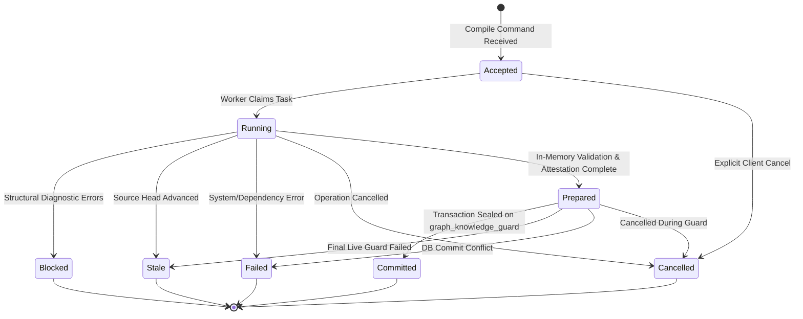

# Agent Factory and Operational Capability IR Specification

Status: Detailed technical specification — implementation pending

## Purpose and ownership

**Source references:** [PRODUCT.md §§13–14, 15.10, 21, 29.7; ORY-022–030](../../PRODUCT.md) | [TECHNICAL.md §§3, 5.5, 7.2, 9.2](../../TECHNICAL.md) | [ADR-0015](../adr/0015-agent-factory-ir-and-candidate-qualification.md)

### Core Responsibility
The Agent Factory and Operational Capability Compiler transforms approved operational capabilities and published playbooks into executable **agent candidates** expressed in a structured, model-independent Intermediate Representation (AgentIRV1), registers closed dependency closures with the Living Operational Graph, computes risk and qualification gates, and generates immutable, publisher-signed evaluation bundles for empirical simulation.

### Core Domain Distinctions
Under ADR-0015 and ORY-022–030, this component enforces strict separation among candidate proposals, immutable executable versions, and production authorization:
- **Agent Candidate:** Proposed executable behavior, declared dependencies, and structural bindings for an automated workflow. It confers zero production authority and zero execution permission.
- **Agent Version:** Immutable executable behavior and declared dependencies. Separate publisher attestations sign its identity; evaluation and release records reference it and are never compiler-approved fields.
- **Execution Qualification:** Verified structural and prerequisite readiness of an agent candidate for a stated execution mode (e.g., Stage 3 supervised, Stage 4 unattended). Qualification establishes neither business correctness nor permission to deploy.
- **Draft and Lineage:** A source capability may support guidance while remaining unable to produce an executable agent. Such drafts are saved with explicit typed gaps. New agents start in product state `draft` at product stage `1`, with a client-selected requested qualification stage defaulting to `3`, and zero production write authority. Product stage (1) and requested qualification stage (3, 4, or 5) are distinct fields.
- **Materiality:** Material edits produce a new immutable executable version and immediately invalidate downstream evaluation readiness. Cosmetic display revisions retain executable identity and existing evaluation references.
- **Risk Computation:** Risk tier is computed deterministically as:
  $$\text{Effective Risk Tier} = \max(\text{Action Risk Floors}, \text{Applicable Policy Floors}, \text{Creator-Selected Raised Tier})$$
  A creator may raise risk above the computed floor, but can never lower it. All reachable branches and iteration bodies are analyzed. Executable nodes unreachable from entry are rejected at compile time rather than permitting hidden actions. Tier 4 actions strictly block executable qualification. Tier 3 actions retain mandatory per-item human approval at every consequential commit.

### Owns
- The Operational Capability Intermediate Representation (AgentIRV1) schema and closed semantic specification.
- The deterministic compiler pipeline lowering human-accepted proposals into executable agent bodies.
- Dataflow validation: definite assignment, dominance, RFC 6901 pointer resolution, and taint preservation.
- Static execution bounding: reverse-topological longest-path worst-case node execution budget (limit 10,000).
- Materiality classification distinguishing cosmetic display edits from behavior-invalidating changes.
- Manifest generation and transactional registration of dependency closures through `OperationalGraphPort`.
- Packaging sealed, Vault Ed25519-signed `CandidateEvaluationBundleV1` instances for simulation admission.
- Draft storage, synthesis proposal provenance, compile attempt tracking, and candidate attestation records.

### Consumes
- Approved capability versions (`knowledge.capability-version.v1`), playbooks (`knowledge.playbook-version.v1`), and business rules (`knowledge.business-rule-version.v1`) from [operational-graph](operational-graph.md).
- Application capability snapshots (`application.capability-snapshot.v1`) and live statuses from [application-adapters](application-adapters.md).
- Verification specification projections (`verification.spec-projection.v1`) and statuses from [outcome-verification](outcome-verification.md).
- Role maximums and actor remits (`agent.edit`) from [identity-policy](identity-policy.md).
- Governed AI reasoning operations (`agent_candidate_synthesize` under `agent.ir.candidate.v1`) via [cloud-inference](../architecture/cloud-inference.md).
- Incident repair specifications and regression requirements from [incident-correction-repair](incident-correction-repair.md).

### Produces
- Closed `AgentIRV1` and draft `DraftAgentIRV1` structures.
- Sealed `ExecutableAgentBodyV1` and immutable `AgentVersionV1` records.
- Vault Ed25519-signed `SignedCandidateAttestationV1` envelopes.
- `CompileReportV1` documents detailing structural diagnostics and qualification blockers.
- `CandidateEvaluationBundleV1` packages delivered to [flight-simulator](flight-simulator.md).
- Control Plane REST endpoints under `/v1/agents` and outbox domain events.

### Does Not Own
- Approving agents for production deployment or assigning runtime permissions (owned exclusively by [release-governance](release-governance.md) and [identity-policy](identity-policy.md)).
- Running scenario test suites or evaluating candidate pass/fail grades (owned by [flight-simulator](flight-simulator.md)).
- Runtime job orchestration, lease management, or task dispatch (owned by [job-orchestration](job-orchestration.md)).
- Adapter plugin transport, credential storage, or external HTTP actuation (owned by [application-adapters](application-adapters.md)).
- Business policy authoring or condition formalization (owned by [operational-graph](operational-graph.md)).

### Boundary Requirement
The compiler produces a model-independent, deterministic operational representation. Business objectives, operational steps, governing rules, and verification postconditions remain conceptually and structurally decoupled. The compiler cannot invent missing adapter operations, fallback rules, or verification predicates; missing dependencies result in an explicitly blocked compilation report.

---

## Product requirements

### Key Product Requirements ([PRODUCT.md §§13–14, 15.10, 21, 29.7; ORY-022–030](../../PRODUCT.md))
- **Builder Creation Without Production Access (ORY-022):** Authorized actors holding `agent.edit` within their remit (`workflow_owner` or `automation_builder`) can draft, synthesize, edit, and compile agent candidates without holding production write credentials, API keys, or `job.run` authority.
- **Candidate Transparency (ORY-023):** Every candidate explicitly exposes its objective, typed inputs, declared outputs, governing business rules, allowed adapter operations, forbidden actions, effective scope, ownership, computed risk tier, and attached verification requirements.
- **Incompatible Autonomy Blocking (ORY-024):** Missing executable bindings, authoritative rules, verification specifications, or proven scope block evaluation admission. Stage-specific restrictions also block incompatible releases.
- **Edit Invalidation (ORY-025):** Any modification outside cosmetic display metadata creates a material revision and requires a new immutable version without inherited evaluation readiness. Historical grades remain attached to their original version.
- **Item Approval (ORY-026):** Tier 3 actions require item-level human approval before every consequential commit.
- **Restricted Actions (ORY-027):** Tier 4 actions are unavailable to agents regardless of historical human demonstration.
- **Scope Enforcement (ORY-028):** An agent cannot access applications or record populations outside its approved scope.
- **Repair Authorization (ORY-029):** A permission expansion requires appropriate new authorization; a repair cannot silently include it.
- **Stage Eligibility (ORY-030):** Only eligible versions and approval scopes advance to Stage 3, 4, or 5 under documented gates.

---

## Upstream and downstream contracts

### Catalog References
- **Contract 5 (`operational-graph`):** Ingests `CapabilityVersionV1`, `PlaybookVersionV1`, `BusinessRuleVersionV1`, and registers `DependencyManifestV1`.
- **Contract 6 (`application-capability`):** Ingests `ApplicationCapabilitySnapshotV1` and `ApplicationCapabilityStatusV1`. Wire schema: [`application-capability-v1.schema.json`](../architecture/contracts/application-capability-v1.schema.json) (`$id: urn:oryn:schemas:application-capability:v1`).
- **Contract 7 (`outcome-verification` / `flight-simulator`):** Ingests `VerificationSpecProjectionV1` and delivers `CandidateEvaluationBundleV1`. Wire schema: [`outcome-verification-v1.schema.json`](../architecture/contracts/outcome-verification-v1.schema.json) (`$id: urn:oryn:schemas:outcome-verification:v1`).
- **Contract 17 (`incident-correction-repair`):** Ingests `RepairCandidateCommandV1` with regression requirements.
- **Contract 22 (`cloud-inference`):** Governed AI synthesis via purpose `agent_candidate_synthesize` and runtime reason binding `agent_runtime_reason`.
- **Contract 25 (`identity-policy`):** Validates actor `agent.edit` capability, role maximums, and risk tiers.

### Wire Schema Definitions
All Factory wire structures conform to Draft 2020-12 at [`agent-factory-v1.schema.json`](../architecture/contracts/agent-factory-v1.schema.json) (`$id: urn:oryn:schemas:agent-factory:v1`).

```
+----------------------------------------------------------------------------------------------------+
|                                      UPSTREAM CONTRACTS                                            |
|                                                                                                    |
|   +-----------------------+     +--------------------------+     +-----------------------------+   |
|   |   Operational Graph   |     |   Application Adapters   |     |    Outcome Verification     |   |
|   |      (Contract 5)     |     |       (Contract 6)       |     |        (Contract 7)         |   |
|   |  - CapabilityVersion  |     |  - CapabilitySnapshot    |     |  - SpecProjection           |   |
|   |  - PlaybookVersion    |     |  - CapabilityStatus      |     |  - SpecStatus               |   |
|   |  - BusinessRuleVersion|     |  - DataTypeV1            |     |  - VerificationRequirement  |   |
|   +-----------+-----------+     +------------+-------------+     +--------------+--------------+   |
+---------------|------------------------------|----------------------------------|------------------+
                |                              |                                  |
                v                              v                                  v
+----------------------------------------------------------------------------------------------------+
|                       AGENT FACTORY & OPERATIONAL CAPABILITY COMPILER                              |
|                                                                                                    |
|    +-------------------------+     +-------------------------+     +--------------------------+    |
|    |     DraftCoordinator    | --> |   SynthesisCoordinator  | --> |   DeterministicCompiler  |    |
|    |  (EditableAgentPlanV1)  |     |   (Proposal Provenance) |     |  (Pure 8-Pass Lowering)  |    |
|    +-------------------------+     +-------------------------+     +------------+-------------+    |
|                                                                                 |                  |
|                                                                                 v                  |
|                                                                    +--------------------------+    |
|                                                                    |     CandidateSigner      |    |
|                                                                    |   (Vault Ed25519 Seal)   |    |
|                                                                    +------------+-------------+    |
+---------------------------------------------------------------------------------|------------------+
                                                                                  |
                                                                                  v
+----------------------------------------------------------------------------------------------------+
|                                     DOWNSTREAM CONSUMERS                                           |
|                                                                                                    |
|   +------------------------------------+             +-----------------------------------------+   |
|   |          Flight Simulator          |             |           Release Governance            |   |
|   |            (Contract 7)            |             |              (Contract 16)              |   |
|   |  - CandidateEvaluationBundleV1     |             |  - Version-Bound Release Readiness      |   |
|   |  - Suggested Coverage Scenarios    |             |  - Invalidation on Material Change      |   |
|   +------------------------------------+             +-----------------------------------------+   |
+----------------------------------------------------------------------------------------------------+
```

### Rust Port Interfaces

```rust
pub trait AgentFactoryPort: Send + Sync {
    fn create<'a>(
        &'a self,
        tx: &'a mut TenantTransaction,
        principal: &'a VerifiedPrincipal,
        command: CreateAgentCommandV1,
    ) -> impl Future<Output = Result<AgentDraftV1, FactoryError>> + Send + 'a;

    fn replace_draft<'a>(
        &'a self,
        tx: &'a mut TenantTransaction,
        principal: &'a VerifiedPrincipal,
        agent_id: Uuid,
        command: ReplaceAgentDraftCommandV1,
    ) -> impl Future<Output = Result<AgentDraftV1, FactoryError>> + Send + 'a;

    fn preview_edit<'a>(
        &'a self,
        principal: &'a VerifiedPrincipal,
        agent_id: Uuid,
        command: PreviewAgentEditCommandV1,
    ) -> impl Future<Output = Result<MaterialityReportV1, FactoryError>> + Send + 'a;

    fn request_synthesis<'a>(
        &'a self,
        tx: &'a mut TenantTransaction,
        principal: &'a VerifiedPrincipal,
        agent_id: Uuid,
        command: SynthesizeAgentCommandV1,
    ) -> impl Future<Output = Result<OperationV1, FactoryError>> + Send + 'a;

    fn request_compilation<'a>(
        &'a self,
        tx: &'a mut TenantTransaction,
        principal: &'a VerifiedPrincipal,
        agent_id: Uuid,
        command: CompileAgentCommandV1,
    ) -> impl Future<Output = Result<OperationV1, FactoryError>> + Send + 'a;

    fn submit_repair<'a>(
        &'a self,
        tx: &'a mut TenantTransaction,
        principal: &'a VerifiedPrincipal,
        agent_id: Uuid,
        command: RepairCandidateCommandV1,
    ) -> impl Future<Output = Result<AgentDraftV1, FactoryError>> + Send + 'a;
}

pub trait CandidateBundlePort: Send + Sync {
    fn load<'a>(
        &'a self,
        principal: &'a VerifiedPrincipal,
        agent_version_id: Uuid,
    ) -> impl Future<Output = Result<CandidateEvaluationBundleV1, FactoryError>> + Send + 'a;
}
```

### Producer-owned discovery projections

Application Adapters owns `ApplicationCapabilityRefV1 {application_id, capability_id, version_id, content_sha256}` and `ApplicationCapabilitySnapshotV1 {schema_id:"application.capability-snapshot.v1", organization_id, ref, body}`. The body is `{application_profile_ref, adapter_id, adapter_revision, execution_location, platform, supported_stages, operations, qualification_refs}`. Location is `cloud` or `employee_device`, platform is `api`, `browser`, `macos` or `windows`, and supported stages are unique values from 3, 4 and 5. The profile reference has entity kind `application_profile`. An operation is `{operation_id, input_type, output_type, effect, minimum_risk_tier, record_types, allowed_stages, idempotency, reversibility, write_guard, verification_spec_refs, policy_fact_fields, max_argument_bytes}`. Effect is `read`, `draft` or `write`; idempotency is `native_key`, `read_reconcile` or `none`; reversibility is `reversible`, `irreversible` or `unknown`; `write_guard` is `not_applicable`, `immutable_input`, `strong_precondition`, or `exclusive_scope`. Qualification references is an ordered array of closed 1:1 `{operation_id, qualification_ref}` bindings ordered by operation ID. Operation IDs are unique per snapshot; argument limit is 1–16384 bytes. Snapshot reference digest hashes RFC 8785 canonical body. `ApplicationCapabilityStatusV1 {schema_id:"application.capability-status.v1", organization_id, capability_ref, generation, status, observed_at, operation_statuses}` reports coarse status and per-operation statuses separately from immutable body hash.

Outcome Verification owns `VerificationSpecProjectionV1 {schema_id:"verification.spec-projection.v1", organization_id, spec_ref, body}`. Its body is a closed union of `system_evidence` (`{method:"system_evidence", capability_ref, postcondition_ids, sources, direct_facts, derived_facts, predicate, supported_stages}`) and `authorized_reviewer` (`{method:"authorized_reviewer", capability_ref, postcondition_ids, direct_facts, derived_facts, predicate, reviewer_policy, supported_stages:[3]}`). `spec_ref` is a `verification_spec` and its digest hashes RFC 8785 canonical body; all postconditions exist in the pinned source capability. `system_evidence` requires approved source declarations with readback capabilities and null reviewer policy. `authorized_reviewer` requires an attributable reviewer policy (`{reviewer_role, source_refs, max_review_duration_seconds: 86400, separation_policy}`), no automated readback sources, and Stage 3 only. Approval to commit an action is not a postcondition assessment. Reuse Graph fact definitions, conditions, verified-source requirements and three-valued evaluation; no SQL or second rule DSL.

`VerificationSpecStatusV1 {organization_id, spec_ref, generation, status, observed_at}` uses `available`, `revoked` or `unknown`. `VerificationRequirementV1 {requirement_id, capability_ref, postcondition_id, spec_ref, action_node_ids, required_before_node_ids, source_bindings, on_unknown:"pause_case", on_mismatch:"pause_case"}` requires valid `source_bindings` mapping each required source ID to its adapter connection, record key, and argument canonical digest; a null `spec_ref` is permitted in a saved proposal, but blocks execution readiness. Factory never invents authoritative verifier specifications.

```rust
pub trait ApplicationCapabilityPort: Send + Sync {
    fn snapshot<'a>(
        &'a self,
        principal: &'a VerifiedPrincipal,
        capability_ref: &'a ApplicationCapabilityRefV1,
    ) -> impl Future<Output = Result<ApplicationCapabilitySnapshotV1, CapabilityError>> + Send + 'a;

    fn statuses<'a>(
        &'a self,
        principal: &'a VerifiedPrincipal,
        capability_ref: &'a ApplicationCapabilityRefV1,
    ) -> impl Future<Output = Result<ApplicationCapabilityStatusV1, CapabilityError>> + Send + 'a;
}
pub trait VerificationCatalogPort: Send + Sync {
    fn projections(&self, principal: &VerifiedPrincipal, references: &[KnowledgeVersionRefV1])
        -> Result<Vec<VerificationSpecProjectionV1>, VerificationCatalogError>;
    fn statuses(&self, principal: &VerifiedPrincipal, references: &[KnowledgeVersionRefV1])
        -> Result<Vec<VerificationSpecStatusV1>, VerificationCatalogError>;
}
```


These are pure authenticated registry reads, not production application calls or adapter plugin execution. Missing and unknown references are explicit blockers. New adapter, profile or operation definitions are material dependency changes.

### Management HTTP contract

Use the existing BFF/CSRF boundary, verified tenant principal, UUIDv7 `Idempotency-Key`, replay retention, Operation tracking, cursor conventions and problem envelope. Unsafe-method CSRF also applies to previews. Mutations and previews require `agent.edit`, source access and owner remit; administrator status alone is insufficient. Reads require inherited object access. Workloads use scoped workload identity, not owner impersonation. Inaccessible IDs return `404 CP_RESOURCE_NOT_FOUND`; visible but unauthorized commands return `403 CP_ACCESS_DENIED`. Concurrent edits return 409 and preserve historical proposals without merging.

| Method and path | Request and success |
|---|---|
| `POST /v1/agents` | `CreateAgentCommandV1 {source_playbook_ref, display, requested_stage, owner_actor_id, operator_team_ids, incident_owner_actor_id}`; 201 `AgentDraftV1`, revision `1`. Requested stage is 3, 4 or 5; clients send it, with documented default 3. Source-derived draft retains explicit missing bindings. |
| `GET /v1/agents` | `cursor`, `page_size` 1–100, optional `capability_id`; 200 `AgentPageV1 {agents, next_cursor}`. Filter authorized objects before pagination. |
| `GET /v1/agents/{agent_id}` | 200 `AgentDetailV1`, including authorized draft, owner and scope, restrictions, executable reference, overlap warnings, and read-only evaluation and release projections. |
| `POST /v1/agents/{agent_id}/edit-previews` | `PreviewAgentEditCommandV1 {expected_revision, replacement, force_material}`; 200 `MaterialityReportV1`, no domain mutation. |
| `PUT /v1/agents/{agent_id}/draft` | `ReplaceAgentDraftCommandV1 {expected_revision, replacement, replacement_sha256, force_material, change_reason}`; 200 `AgentDraftV1`. Recompute digest and materiality; never merge. |
| `POST /v1/agents/{agent_id}/syntheses` | `SynthesizeAgentCommandV1 {expected_revision}`; 202 `OperationV1` whose result references a validated proposal, not an edited draft. |
| `GET /v1/agents/{agent_id}/syntheses/{proposal_id}` | 200 `AgentSynthesisProposalV1 {proposal_id, base_revision, proposal_sha256, proposal, provenance}`. |
| `POST /v1/agents/{agent_id}/compilations` | `CompileAgentCommandV1 {expected_revision}`; 202 `OperationV1`. A blocked compile completes with a blocked report, not business success. Transport and signing faults fail the operation. |
| `GET /v1/agents/{agent_id}/compilations/{compilation_id}` | 200 `CompileAttemptV1` with report, attempt state and nullable committed version reference. |
| `GET /v1/agents/{agent_id}/versions/{version_id}` | 200 exact immutable `AgentVersionV1`. |
| `GET /v1/agents/{agent_id}/versions/{version_id}/evaluation-bundle` | 200 `CandidateEvaluationBundleV1` only after live qualification checks; otherwise a typed problem. Never automatically evaluate or dispatch. |
| `POST /v1/agents/{agent_id}/repair-candidates` | `RepairCandidateCommandV1`; 201 `AgentDraftV1` in a new proposed revision or lineage, never an overwrite of a released version. |

`AgentDraftV1` is `{schema_id:"agent.draft.v1", organization_id, agent_id, revision, current_stage:1, product_state:"draft", plan, active_executable_version_id:UUID|null, qualification_state, created_at, updated_at}`. `AgentSummaryV1` carries tenant and agent IDs, display name, source capability reference, revision, qualification state, nullable current version ID, and nullable evaluation and release states. Detail adds the authorized plan, reports, overlap choices and owner-scoped projections. Product state on assembled detail derives from its owning systems. Responses identify tenant, agent and exact revision where applicable; immutable version and bundle records identify their version and draft revision through the version.

Rust snippets use `std::future::Future`, `uuid::Uuid`, Control Plane `TenantTransaction`, `VerifiedPrincipal`, `OperationV1`, and Factory schema DTOs and `FactoryError`; these are contract imports, not a separate application crate. `CandidateBundlePort` is a read-only module interface.

---

## Trust and deployment boundaries

### Process Isolation and Network Confinement
- **Control Plane Placement:** Deployed as a logical Rust module within the Axum/Tokio/SQLx Control Plane API and Durable Worker roles.
- **Zero Production Authority:** Factory workers have zero network connectivity to external production SaaS applications, ERP databases, or desktop observation workers. No production write credentials or API keys exist in the Factory environment.
- **Inference Boundary:** AI synthesis connects strictly to Oryn's LiteLLM proxy using signed `InferenceAuthorization` tokens under ADR-0005. Prompts contain only sanitized authorized operational text; raw transcripts, screenshots, PII, and production payloads are strictly excluded.
- **Cryptographic Sealing:** Candidate attestations are signed using Vault Transit Ed25519 publisher keys. Compilation workers have sign-only access through Vault AppRole authentication; private keys never touch application memory.
- **Relational Authority:** All persistence is enforced within PostgreSQL 18 with mandatory Row-Level Security (`current_setting('oryn.organization_id', true)::uuid`).

---

## Internal architecture

### Logical Submodules
1. **AgentRegistry:** Manages agent lifecycles, tenant-scoped ownership, actor remit checks, and draft revisions.
2. **DraftCoordinator:** Validates replacement drafts, recomputes RFC 8785 canonical hashes, and executes optimistic concurrency checks.
3. **SynthesisCoordinator:** Prepares minimized source prompts for LiteLLM, executes governed synthesis requests, validates incoming `AgentIRCandidateProposalV1` payloads, and records immutable provenance.
4. **DeterministicCompiler:** Implements the pure, deterministic 8-pass compilation pipeline lowering accepted plans into `AgentIRV1`.
5. **QualificationAnalyzer:** Evaluates structural prerequisites, risk tiers, outcome coverage, and assigns qualification states for requested stages.
6. **CandidateSigner:** Calculates canonical digests, registers dependency closures on `graph_knowledge_guard`, requests Vault attestations, and commits immutable versions atomically.

### Pure Compiler Functions

```rust
pub fn compile_candidate(input: &CompileInputV1) -> CompileOutputV1;

pub fn classify_candidate_edit(
    previous: &EditableAgentPlanV1,
    proposed: &EditableAgentPlanV1,
) -> MaterialityReportV1;

pub fn validate_ir(
    ir: &AgentIRV1,
    context: &CompileContextV1,
) -> Vec<CompileDiagnosticV1>;
```

### Deterministic 8-Pass Pipeline

```
CompileInputV1
      │
      ▼
┌──────────────┐
│    Pass 1    │  Source & Remit Verification: Check playbook/capability link, digests, actor remit
└──────┬───────┘
      ▼
┌──────────────┐
│    Pass 2    │  Dependency Resolution: Pin adapter snapshots, models, rules, verifiers
└──────┬───────┘
      ▼
┌──────────────┐
│    Pass 3    │  Plan Lowering: Map accepted steps to IR nodes; verify source provenance
└──────┬───────┘
      ▼
┌──────────────┐
│    Pass 4    │  Graph Validation: DAG acyclicity, outcome coverage, dominance, 10k budget
└──────┬───────┘
      ▼
┌──────────────┐
│    Pass 5    │  Rule & Verifier Linking: Evaluate 3-valued formalizations, UNIQUE proofs
└──────┬───────┘
      ▼
┌──────────────┐
│    Pass 6    │  Scope & Risk Analysis: Subset proofs, compute risk floor max(floors, raised)
└──────┬───────┘
      ▼
┌──────────────┐
│    Pass 7    │  Provenance & Approval: Taint tracking, independent validation for writes
└──────┬───────┘
      ▼
┌──────────────┐
│    Pass 8    │  Manifest & Assembly: Compute behavior_sha256, build DependencyManifestV1
└──────┬───────┘
      │
      ▼
CompileOutputV1 (ExecutableAgentBodyV1 + CompileReportV1)
```

1. **Pass 1 — Source & Remit Verification:**
   - Validates that `source_playbook_ref` directly derives from `source_capability_ref`.
   - Re-checks actor remit: creator must possess `agent.edit` within the capability's organizational scope.
   - Verifies source capability has status `approved` and playbook has status `published`.
2. **Pass 2 — Dependency & Adapter Resolution:**
   - Resolves all pinned application capability snapshots and verification projections.
   - Unknown or revoked capabilities block executable qualification. Degradation is a visible operational restriction; it never selects an alternate adapter.
   - Fallback adapters or dynamic version selection are strictly prohibited.
3. **Pass 3 — Plan Lowering to IR:**
   - Lowers accepted `DraftAgentIRV1` steps into concrete `AgentIRV1` nodes.
   - Every executable node must map to an approved source step ID (`source_step_ids`).
   - If narrowing leaves unhandled workflow branches, requires explicit `residual_obligations` and terminal `handoff_required` nodes.
4. **Pass 4 — Graph Topology, Assignability, Types & Expansion:**
   - Verifies each region is a strict Directed Acyclic Graph (DAG) with no cycles.
   - Verifies single root region; child regions exist only under `foreach` nodes (max depth 2).
   - Validates edge outcome completeness: every nonterminal node must declare all mandatory outcomes.
   - Validates definite assignment and dominance: node outputs consumed via `ValueRefV1::node_output` must dominate the consumer node across all incoming execution paths.
   - Computes static worst-case node execution budget using reverse-topological traversal:
     $$\text{Cost}(\text{node}) = 1$$
     $$\text{Cost}(\text{foreach}) = 1 + \text{max\_items} \times \text{Cost}(\text{body\_region})$$
     $$\text{Cost}(\text{region}) = \text{Cost}(\text{entry}) + \max_{\text{paths}}(\sum \text{Cost}(\text{successors}))$$
     Rejects plans exceeding 10,000 node executions or 256 total nodes / 512 transitions.
5. **Pass 5 — Business Rule Formalization & Verifier Linking:**
   - Binds decision nodes to approved `BusinessRuleVersionV1` records.
   - Verifies that decision logic uses three-valued semantics (`pass`, `fail`, `unknown`) and that decision tables satisfy the `UNIQUE` hit policy (pairwise disjointness proved via solver).
   - Prose-only rules or unproven formalizations block candidate qualification.
   - Links action nodes to corresponding `VerificationRequirementV1` definitions.
6. **Pass 6 — Effective Scope & Risk Analysis:**
   - Proves candidate application and record-type sets are subsets of source capability sets; equality is permitted.
   - Effective audience is the conjunction of source audiences and any candidate narrowing.
   - Resolves formal record scope conditions (`KnowledgeScopeV1`); unproven scope implications trigger qualification blockers.
   - Computes effective risk tier across all reachable paths. Rejects plans containing reachable Tier 4 actions.
7. **Pass 7 — Dataflow Provenance & Approval Dominance:**
   - Analyzes value provenance (`ValueEvidenceV1`).
   - Model-inferred values cannot supply write-target IDs, mandatory policy facts, Tier 3 parameters, or Tier 2 model-influenced mutation parameters without independent validation under the matching source requirement.
   - Verifies that Tier 3 actions require mandatory approval boundaries (`review_requirement = "always"` or policy-bound).
   - Verifies ambiguous action dispatch transitions (`not_submitted`, `submission_unknown`, `denied`) lead immediately to safe case escalation or handoff.
8. **Pass 8 — Manifest Assembly, Materiality & Attestation:**
   - Assembles transitive dependency closure into an ordered `DependencyManifestV1` (capped at 4,096 items).
   - Computes canonical RFC 8785 body digest: `behavior_sha256 = SHA256(RFC8785(body))`.
   - Computes materiality report against predecessor revision.
   - Generates `CompileReportV1`. If report status is `structurally_valid`, prepares `ExecutableAgentBodyV1`.

### Data Types and Portable IR Specification
- **DataTypeV1:** Closed tagged union (`boolean`, `decimal`, `date`, `instant`, `string` $\le 4096$, `enum` $\le 128$ values, `money`, `record` $\le 128$ fields, `array` $\le 1000$ items). Recursive nesting depth capped at 8.
- **Value References (`ValueRefV1`):** Static RFC 6901 JSON pointers addressing input bindings, dominating node outputs, loop items, or typed literals. Dynamic evaluation, wildcards, and code execution are prohibited.
- **Closed Node Vocabulary (10 kinds):**
  1. `read`: Authoritative application query (`effect = read`). Emits source data with evidence, not a case verdict.
  2. `transform`: Deterministic closed math/string operations (`copy`, `trim`, `concat`, `parse_decimal`, `parse_date`, `add`, `subtract`, `multiply`, `quantize`). Checked decimal arithmetic; overflow yields `unknown`.
  3. `reason`: Bounded model inference (`extract`, `classify`, `draft`, `choose_branch`). Result is typed value or allowed branch choice, never an arbitrary tool invocation.
  4. `decision`: Deterministic three-valued rule evaluation (`pass`, `fail`, `unknown`, row IDs, `no_match`).
  5. `action`: External state mutation (`review_requirement`, `verification_requirement_ids`).
  6. `foreach`: Bounded iteration over array collections ($\le 1000$ items, max 2 levels).
  7. `verify`: Invokes independent outcome verification oracle (`verified`, `mismatch`, `unknown`).
  8. `human_input`: Structured employee query yielding to Orchestrator. Response role strictly checked.
  9. `escalate`: Terminal case yield to human role with attached evidence bindings.
  10. `finish`: Terminal completion requesting verification (`verification_requested`, `expected_rejection`, `handoff_required`, `iteration_complete`). Root regions cannot emit `iteration_complete`.

### Compiler input and report

`CompileInputV1` is `{accepted_plan, source_playbook, source_capability, rules, application_snapshots, verification_projections, dependency_closure, compiler_revision, knowledge_generation, catalog_generations}`. Source records are pinned Playbook, Capability and BusinessRule versions. `CatalogGenerationV1` is `{kind:"application"|"verification", reference_sha256, generation:U64}`. Source bounds apply and the overall dependency closure has at most 4096 references. Input contains no mutable database handles, credentials or production endpoints. `CompileOutputV1` is `{body:ExecutableAgentBodyV1|null, report:CompileReportV1}`. `CompileContextV1` is an internal borrowed view of input, node and region ID maps, node-port type map and per-region dominance sets; it is not a wire schema or authority.

`CompileDiagnosticV1` contains `{code:FactoryErrorCodeV1, severity:"error"|"warning", gate:"creation"|"evaluation"|"stage3_release"|"stage4_release"|"stage5_release", json_pointer, source_refs, message, remedy}`. Source refs contain at most 32 items, message at most 1024 characters, and remedy is `edit_plan`, `upstream_review`, `configure_capability`, `configure_verifier`, `retry_dependency`, or `request_evaluation`. Sort diagnostics by pointer then code and redact inaccessible details. `CompileReportV1` contains `{schema_id:"agent.compile-report.v1", organization_id, compilation_id, agent_id, draft_revision, compiler_revision, input_sha256, status:"blocked"|"structurally_valid", diagnostics, risk_tier, worst_case_node_executions, required_scenario_categories, requested_stage, compiled_agent_version_id:UUID|null}`; diagnostics have at most 256 items. Compilation does not issue an evaluation verdict.

Pass 1 also checks exact source digests, organization, audience conjunction, known objective, ownership and accepted proposal binding; reject rejected workflows or unknown objectives at creation. Pass 2 resolves source steps, formal scopes and pinned model bindings without choosing latest versions. Pass 3 blocks missing bindings and requires new upstream approval/version when narrowing changes approved objective or scope. Pass 4 rejects unreachable nodes, orphaned/shared children and missing outcomes. Pass 5 uses `OperationalGraphPort::evaluate_rule`, including three-valued and UNIQUE-table proof semantics; model output cannot decide mandatory policy. Pass 6 uses Graph's bounded Boolean/interval/set solver for scope implication; an unproven subset blocks. Pass 7 checks verification dominates dependent mutations. Pass 8 emits blockers and canonical roots; missing generation inference never blocks a fully explicit valid plan.

### IR records, control flow and evidence

`AgentIRV1` is `{schema_id:"agent.ir.v1", regions, root_region_id, inputs, output_type}`. It contains 1–129 regions, at most 128 inputs, 256 total nodes and 512 total transitions. `DraftAgentIRV1` has the same complete graph shape but allows zero regions, null root, null output type and explicit null unresolved node bindings. Drafts still reject unknown fields and node kinds and enforce limits. Complete lowering removes null bindings and exactly matches plan inputs and output type. Each input is `{name, type, nullable, source_requirement}`; names are unique, every execution input is present, and null follows the unknown path rather than a default.

Each region is `{region_id, entry_node_id, nodes, transitions}`, with 1–256 nodes and 0–512 transitions. A transition is `{from_node_id, outcome, to_node_id}` within its region. Node IDs are globally unique; only foreach owns a child, and ownership forms a tree with no shared, orphaned, recursively referenced or externally entered child. All regions are DAGs and every reachable path ends in finish or escalate. Identifiers match `^[a-z][a-z0-9_]{0,63}$`. No dynamic graphs, parallel branches, scripts, recursive subworkflows or general loops are permitted.

All nodes carry `{node_id, kind, source_step_ids, rule_refs}`. Their exact payloads are:

| Kind | Additional fields |
|---|---|
| `read` | `capability_ref`, `operation_id`, named `arguments`, `output_type` |
| `transform` | `operator`, ordered `arguments`, `result_type`, nullable `scale`, nullable `rounding` |
| `reason` | `model_binding_id`, `purpose`, named `inputs`, `output_type`, `allowed_choices` |
| `decision` | `rule_ref`, named `fact_bindings` |
| `action` | `capability_ref`, `operation_id`, named `arguments`, `review_requirement:"policy"|"always"`, `verification_requirement_ids` |
| `foreach` | `collection`, `body_region_id`, `max_items`, `output_type` |
| `verify` | `requirement_ids` |
| `human_input` | `question_template`, `response_type`, `responder_role` |
| `escalate` | `reason_code`, `recipient_role`, `evidence_bindings` |
| `finish` | `disposition`, named output bindings |

Ordinary nonterminal nodes require exactly one `success` and `unknown` transition unless a special set applies. `choose_branch` has one edge for every allowed choice and `unknown`; other reason nodes use `success`/`unknown`. Decision uses `pass`, `fail`, `unknown` for a condition, or every declared table row ID plus `unknown` and `no_match`. Verify uses `verified`, `mismatch`, `unknown`; human input uses `answered`, `rejected`, `unknown`. Action additionally requires `not_submitted`, `submission_unknown`, `denied`; admission or dispatch ambiguity goes directly to case escalation/reconciliation and cannot reach another mutation. Terminals have no edges. Reject duplicate, missing or undeclared outcomes. Reserved labels `success`, `unknown`, `pass`, `fail`, `no_match`, `not_submitted`, `submission_unknown`, `denied`, `verified`, `mismatch`, `answered`, `rejected` cannot also be choice or table-row IDs.

`ValueRefV1` selects an input, a strictly dominating node output and static RFC 6901 pointer, the current or parent lexical loop item and pointer, or a typed literal. Because `ValueRefV1` contains no phi or merge operator, a node-output reference must strictly dominate its consumer; branch-local outputs cannot cross control-flow joins, and equal output labels across divergent branches do not create an implicit join port. `ValueEvidenceV1` is `{origin, source_refs, parent_binding_ids, verification, observed_at, valid_until}`: origin is `approved_literal`, `system_evidence`, `authorized_reviewer`, `model_inference` or `derived`; verification is `verified` or `unverified`. Derived evidence is verified only when all relevant parents are verified and the deterministic transform is valid. Parsed JSON and model outputs are not independently verified. Low-risk classification may use inferred values only for explicitly declared Tier 0/1 actions and cannot change record population, risk/policy floors, destination or permissions.

Application Capability owns `DataTypeV1`: tagged boolean, decimal, date, instant, bounded string, enum, money with currency, record with uniquely named typed nullable fields, and bounded array. Nesting depth is at most eight. Graph rule-bound strings fit its 1024-character TypedValue limit without truncation. Business numbers use Graph decimal strings, never floating-point JSON numbers. Exact transforms use locale-independent dot decimal and ISO dates, checked base-10 arithmetic and Graph decimal bounds. `quantize` requires scale 0–18, `half_even` or `half_up`, and an applicable approved rule. Overflow, unrepresentable exact result or undeclared rounding follows unknown; money requires equal currency and never converts. Unknown, stale, null, mismatched or ill-typed data never silently becomes zero, false, an arbitrary match or success.

Foreach fixes collection membership and order at entry; empty collections execute zero iterations. Oversize collections pause before entry without truncation or splitting. The ordered output contains only a complete sequence of completed iteration outputs. A failed child pauses the case. A child finish uses only `iteration_complete`; root finish cannot use it. Root `verification_requested` requires every mandatory verifier on every preceding path. Finish requests owner assessment and never self-issues Verified Complete. Escalation is a terminal pause, not success. Human responses must match case, question, version and role; they do not automatically create authority or verified evidence. Iteration failure preserves prior committed effects and exact checkpoint location, with no automatic replay, skipping, compensation or claimed rollback. Runtime and Orchestrator own durable checkpoints and safe resumption.

The reverse-topological cost of each ordinary node is 1; foreach weighs `1 + max_items * cost(body_region)`. Region cost is entry weight plus its largest successor path. Use checked arithmetic, stop at 10001 and reject overflow or cost above 10000. Maximum foreach depth is two and each bound is 1–1000.

### Drafts, synthesis and repair

`EditableAgentPlanV1` contains `{display, objective, source_playbook_ref, source_capability_ref, scope, record_types, requested_stage, raised_risk_tier, owner_actor_id, operator_team_ids, incident_owner_actor_id, inputs, outputs, step_mappings, verification_requirements, model_bindings, residual_obligations, accepted_proposal_sha256, overlap_resolution}`. Scope, raised risk, owner, incident owner, outputs, accepted digest and overlap resolution are nullable; mappings are a complete `DraftAgentIRV1`. Empty draft lists create explicit gaps, not guessed defaults. `DisplayMetadataV1` is exactly `{name, description, step_labels, condition_explanations}`; display never feeds prompts, decisions, tool arguments or verification. Runtime templates belong in material model bindings.

Materiality preflight returns `{base_revision, replacement_sha256, material, changed_json_pointers, reason_codes, invalidates_evaluation}`. Pointers are sorted and unique; reasons are `display_only`, `behavior_changed`, `forced_material`. An unchanged replacement has no pointers or reasons and is nonmaterial. `invalidates_evaluation` equals `material`. Any change outside display is material, including wording, ownership, input, scope, model pins and limits. An authorized actor may force material classification, never override material as cosmetic. Save rechecks base revision and digest and recomputes classification. Material edits immediately clear the current-ready pointer; cosmetic revisions retain executable identity and evaluation references.

Synthesis invokes governed `text.reason`, purpose `agent_candidate_synthesize`, output `agent.ir.candidate.v1`. `AgentIRCandidateProposalV1` contains `{schema_id, organization_id, agent_id, base_draft_revision, input_sha256, proposed_step_mappings, proposed_verification_requirements, proposed_model_bindings, source_citations, unresolved_questions, assumptions}`. The server validates and hashes the proposal; acceptance names that digest and exact base revision. No proposal changes the head or approves a business rule. Citations are at most 1024 `{proposal_json_pointer, source_ref, source_json_pointer}` records whose references are supplied authorized sources. Questions and assumptions each contain at most 32 strings of at most 4096 characters. Proposals contain no approval flags, tokens, provider URLs, credentials or executable actions outside supplied IDs.

`SynthesisProvenanceV1` records `{request_id, input_sha256, route_id, route_revision, model_revision, template_sha256, output_sha256, usage}` and source bindings outside executable identity. Requests use minimized authorized procedures, rules, operation schemas and IDs, never raw captures, screenshots, audio, full transcripts, credentials or production customer payloads. Persist validated proposal/configuration and provenance, not raw prompts, model reasoning or completions. Enforce governed authorization and budget reservation. Maximum input is 256 KiB, output 128 KiB, deadline 120000 ms clamped to authorization and route limits, and two concurrent Factory syntheses per tenant within worker budgets. Retry once only for confirmed transient pre-response failure with unchanged input, route and authorization. Never substitute providers or self-repair in a loop. A crash after provider interaction produces failed/unknown state and requires an explicit new request; late results never edit a changed draft.

`RuntimeModelBindingV1` pins `{binding_id, route_id, route_revision, model_revision, prompt_template, prompt_sha256, output_schema_id:"agent.runtime-value.v1", output_type, output_schema_sha256, max_input_bytes, max_output_bytes, timeout_ms}`. Prompt limit is 32768 characters; input limit 1–32768 bytes, output limit 1–16384 bytes, timeout 1–30000 ms. Hash prompt UTF-8 bytes and canonical output type respectively. Runtime calls governed `text.reason` purpose `agent_runtime_reason`; revoked or unavailable pins pause without substitution. `RuntimeModelResultV1` is `{kind:"value", binding_id, value}` or `{kind:"unknown", binding_id, reason:"insufficient_evidence"|"conflicting_evidence"|"unsupported_input"}`. Values use only null, Boolean, strings, arrays and records, never JSON numbers; context validates exact declared type and allowed choices.

`RepairCandidateCommandV1` is `{base_agent_version_id, expected_draft_revision, incident_refs, repair_ref, regression_requirement_refs, replacement}`. It binds 1–32 incident references (`IncidentRefV1`) and 1–128 regression references (`SimulationRegressionRequirementRefV1`). Factory validates current base/revision and referenced repair/requirements: requirement base and repair must match command; union of requirement incident references must equal command incident references (mismatch fails with `FACTORY_BINDING_INVALID`; stale base returns 409 `FACTORY_REVISION_CONFLICT`).
Submission returns the existing 201 `AgentDraftV1` and atomically persists draft revision plus immutable `AgentRepairContextV1` (`agent.repair-context.v1`) containing the command's base/incident/repair/regression bindings. Later draft edits carry this context forward. A cosmetic-only or unchanged replacement cannot establish a behavioral repair; it returns the normal materiality result and keeps the incident unresolved.
Compilation is requested separately as an asynchronous 202 `OperationV1`. Outside-lock compilation includes repair context in the compile-attempt fingerprint (not executable `behavior_sha256`). Guarded finalization atomically commits the candidate, attestation, and `RepairCandidateBindingV1` (`agent.repair-candidate-binding.v1` binding `context` and `candidate_identity`). Simulator loads this metadata through `CandidateBundlePort::load` via `CandidateEvaluationBundleV1.repair_bindings` (empty for ordinary candidates; exactly one binding for repair candidates). No JSON Patch, raw executable import, in-place released-version edit or policy/permission authority is implied.

### Qualification and stage gates

All executable bindings, postconditions, source authority, signatures and complete manifests precede simulation admission. Missing demonstrated-history counts or scenario passage are release blockers, not automatic simulation blockers. Release Governance enforces Stage 3: five verified human examples and 25 distinct scenarios including five edge/negative; Stage 4: twenty consecutive outcome-verified supervised cases and 100 scenarios including twenty edge/failure/negative; Stage 5: complete regression suite, affected failures and five nearby variations. Ordinary material replacements reset the 20-case supervised streak with no inheritance. Counts alone never establish readiness. Independent authorized human assessment can verify supervised Stage 3 outcomes; human-only verification cannot qualify unattended Stage 4 completion. A narrower agent remains visibly partial and never claims the unsupported original objective completed.

`ExecutableAgentBodyV1.requested_stage` represents the requested autonomy ceiling, not currently granted authority. A candidate compiling with `requested_stage: 4` or `5` may first receive a Stage 3 supervised Release without changing its immutable body. Once deployed, the exact same immutable candidate can earn its 20-case consecutive supervised streak in production, allowing Release Governance to promote the release to Stage 4 without mutating the candidate's body or altering its `behavior_sha256`. Factory compiles and qualifies candidates but never approves release readiness. Factory provides protected structural AST diff projections to the Release Governance `ReleaseDiffClassifier` to support material diff analysis (`ReleaseDiffV1`).

### Immutable identity and admission

`ExecutableAgentBodyV1` contains exactly `{schema_id:"agent.executable-body.v1", organization_id, ir_semantic_revision:"1", source_playbook_ref, source_capability_ref, objective, scope, record_types, requested_stage, risk_tier, owner_actor_id, operator_team_ids, incident_owner_actor_id, ir, application_capability_snapshots, verification_spec_projections, verification_requirements, model_bindings, residual_obligations, dependencies}`. Dependencies contain 1–4096 Graph references. Embedded snapshots pin declarations; runtime checks live status. Sort set collections canonically by stable identity, including node/region IDs and dependency references; preserve ordered transform arguments, input collections and decision rows. Reject duplicate JSON object keys before canonicalization.

`behavior_sha256 = SHA256(RFC8785(body))` uses bare lowercase 64-character hex. Display, agent/version UUIDs, timestamps, provenance, signatures, registered manifest and evaluation/release metadata are excluded. `AgentVersionV1` contains `{schema_id:"agent.version.v1", organization_id, agent_id, agent_version_id, predecessor_version_id, draft_revision, body, behavior_sha256, compiler_revision, created_by, created_at}`. Identical complete accepted inputs produce identical body bytes; model inference itself need not be repeatable. Separate agents or tenants may share a digest without shared ownership or deduplication.

Manifest roots include source Capability and Playbook, governing rules, referenced application profiles, verifier specifications and other knowledge references; register their full transitive closure through Graph. Manifest hash is SHA-256 of RFC 8785 canonical `{schema_id, organization_id, consumer_ref, dependencies, completeness, owner_component}`, excluding `manifest_sha256` and `registered_at`. Sort dependencies by `(organization_id, entity_kind, entity_id, version_id, content_sha256)` and reject duplicate identities or conflicting digests. Consumer is Graph `agent`, with agent and version UUID strings, body digest as `content_sha256`, and owner `agent-factory-ir`. The body contains dependencies but not this self-binding manifest, avoiding a hash cycle.

`SignedCandidateAttestationV1` is `{schema_id:"agent.candidate-attestation.v1", key_id, payload, signature}`. Payload is `{organization_id, agent_id, agent_version_id, behavior_sha256, manifest_sha256, compiler_revision, signed_at}`. Vault publisher-purpose Ed25519 signs `UTF8(schema_id) + LF + RFC8785(payload)`; signature uses unpadded base64url and existing trust-keyset validation. This is not the guidance-specific signature envelope, and a hash alone is not a signature. Rotation may append an attestation over unchanged version/body. Compromise or revocation blocks trust until valid reattestation and live eligibility checks; history is immutable.

`CandidateEvaluationBundleV1` is `{schema_id:"agent.evaluation-bundle.v1", organization_id, agent_version, dependency_manifest, attestation, compile_report, evaluation_target, coverage_requirements}`. Target is `{kind:"agent", agent_version}` and its version string must equal the version UUID. Each `CoverageRequirementV1` is `{requirement_id, kind, source_ids, expected_disposition}`; kind is `branch`, `postcondition`, `policy`, `exception`, `input_boundary`, `ambiguous_submission`, `model_output`, `iteration_boundary`, or `regression`; 1–128 source IDs; disposition is `verified`, `safe_escalation`, or `expected_rejection`. These are coverage obligations, not passed scenarios. Simulator admission rechecks signature and trust, body and manifest digests, target identity, current knowledge eligibility, supported stage and complete closure. Authenticity never grants release or production authority.

---

## State and lifecycle

### PostgreSQL 18 Schema and DDL

```sql
-- Agents Table
CREATE TABLE factory_agent (
    organization_id UUID NOT NULL,
    agent_id UUID NOT NULL,
    capability_id UUID NOT NULL,
    head_revision NUMERIC(20, 0) NOT NULL DEFAULT 1 CHECK (head_revision BETWEEN 1 AND 18446744073709551615),
    current_version_id UUID NULL,
    current_stage SMALLINT NOT NULL DEFAULT 1 CHECK (current_stage BETWEEN 1 AND 5),
    created_at TIMESTAMPTZ NOT NULL DEFAULT NOW(),
    updated_at TIMESTAMPTZ NOT NULL DEFAULT NOW(),
    CONSTRAINT pk_factory_agent PRIMARY KEY (organization_id, agent_id)
);

ALTER TABLE factory_agent ENABLE ROW LEVEL SECURITY;
ALTER TABLE factory_agent FORCE ROW LEVEL SECURITY;

CREATE POLICY factory_agent_tenant_isolation ON factory_agent
    USING (organization_id = current_setting('oryn.organization_id', true)::uuid)
    WITH CHECK (organization_id = current_setting('oryn.organization_id', true)::uuid);

CREATE INDEX idx_factory_agent_list ON factory_agent (organization_id, updated_at DESC, agent_id);
CREATE INDEX idx_factory_agent_capability ON factory_agent (organization_id, capability_id);

-- Draft Revisions Table (Insert-Only)
CREATE TABLE factory_draft_revision (
    organization_id UUID NOT NULL,
    agent_id UUID NOT NULL,
    revision NUMERIC(20, 0) NOT NULL CHECK (revision BETWEEN 1 AND 18446744073709551615),
    plan JSONB NOT NULL,
    plan_sha256 CHAR(64) NOT NULL CHECK (plan_sha256 ~ '^[0-9a-f]{64}$'),
    material BOOLEAN NOT NULL,
    force_material BOOLEAN NOT NULL DEFAULT FALSE,
    predecessor_revision NUMERIC(20, 0) NULL CHECK (predecessor_revision BETWEEN 1 AND 18446744073709551615),
    executable_version_id UUID NULL,
    created_by VARCHAR(128) NOT NULL,
    change_reason TEXT NOT NULL,
    created_at TIMESTAMPTZ NOT NULL DEFAULT NOW(),
    CONSTRAINT pk_factory_draft_revision PRIMARY KEY (organization_id, agent_id, revision),
    CONSTRAINT fk_factory_draft_agent FOREIGN KEY (organization_id, agent_id)
        REFERENCES factory_agent (organization_id, agent_id) ON DELETE RESTRICT,
    CONSTRAINT fk_factory_draft_predecessor FOREIGN KEY (organization_id, agent_id, predecessor_revision)
        REFERENCES factory_draft_revision (organization_id, agent_id, revision) ON DELETE RESTRICT
);

ALTER TABLE factory_draft_revision ENABLE ROW LEVEL SECURITY;
ALTER TABLE factory_draft_revision FORCE ROW LEVEL SECURITY;

CREATE POLICY factory_draft_revision_tenant_isolation ON factory_draft_revision
    USING (organization_id = current_setting('oryn.organization_id', true)::uuid)
    WITH CHECK (organization_id = current_setting('oryn.organization_id', true)::uuid);

-- Synthesis Proposals Table (Insert-Only)
CREATE TABLE factory_synthesis_proposal (
    organization_id UUID NOT NULL,
    proposal_id UUID NOT NULL,
    agent_id UUID NOT NULL,
    base_revision NUMERIC(20, 0) NOT NULL CHECK (base_revision BETWEEN 1 AND 18446744073709551615),
    proposal JSONB NOT NULL,
    proposal_sha256 CHAR(64) NOT NULL CHECK (proposal_sha256 ~ '^[0-9a-f]{64}$'),
    input_sha256 CHAR(64) NOT NULL CHECK (input_sha256 ~ '^[0-9a-f]{64}$'),
    provenance JSONB NOT NULL,
    operation_id UUID NOT NULL,
    created_at TIMESTAMPTZ NOT NULL DEFAULT NOW(),
    CONSTRAINT pk_factory_synthesis_proposal PRIMARY KEY (organization_id, proposal_id),
    CONSTRAINT fk_factory_synthesis_draft FOREIGN KEY (organization_id, agent_id, base_revision)
        REFERENCES factory_draft_revision (organization_id, agent_id, revision) ON DELETE RESTRICT
);

ALTER TABLE factory_synthesis_proposal ENABLE ROW LEVEL SECURITY;
ALTER TABLE factory_synthesis_proposal FORCE ROW LEVEL SECURITY;

CREATE POLICY factory_synthesis_proposal_tenant_isolation ON factory_synthesis_proposal
    USING (organization_id = current_setting('oryn.organization_id', true)::uuid)
    WITH CHECK (organization_id = current_setting('oryn.organization_id', true)::uuid);

-- Compile Attempts Table
CREATE TABLE factory_compile_attempt (
    organization_id UUID NOT NULL,
    compilation_id UUID NOT NULL,
    agent_id UUID NOT NULL,
    draft_revision NUMERIC(20, 0) NOT NULL CHECK (draft_revision BETWEEN 1 AND 18446744073709551615),
    compiler_revision VARCHAR(128) NOT NULL,
    input_sha256 CHAR(64) NOT NULL CHECK (input_sha256 ~ '^[0-9a-f]{64}$'),
    operation_id UUID NOT NULL,
    state VARCHAR(32) NOT NULL CHECK (state IN ('accepted', 'running', 'blocked', 'prepared', 'committed', 'stale', 'failed', 'cancelled')),
    report JSONB NULL,
    prepared_version_id UUID NULL,
    committed_version_id UUID NULL,
    created_at TIMESTAMPTZ NOT NULL DEFAULT NOW(),
    updated_at TIMESTAMPTZ NOT NULL DEFAULT NOW(),
    CONSTRAINT pk_factory_compile_attempt PRIMARY KEY (organization_id, compilation_id),
    CONSTRAINT fk_factory_compile_draft FOREIGN KEY (organization_id, agent_id, draft_revision)
        REFERENCES factory_draft_revision (organization_id, agent_id, revision) ON DELETE RESTRICT
);

ALTER TABLE factory_compile_attempt ENABLE ROW LEVEL SECURITY;
ALTER TABLE factory_compile_attempt FORCE ROW LEVEL SECURITY;

CREATE POLICY factory_compile_attempt_tenant_isolation ON factory_compile_attempt
    USING (organization_id = current_setting('oryn.organization_id', true)::uuid)
    WITH CHECK (organization_id = current_setting('oryn.organization_id', true)::uuid);

CREATE UNIQUE INDEX uq_factory_compile_attempt_active ON factory_compile_attempt
    (organization_id, agent_id, draft_revision, compiler_revision, input_sha256)
    WHERE state IN ('accepted', 'running', 'prepared', 'committed');

CREATE INDEX idx_factory_compile_operation ON factory_compile_attempt (organization_id, operation_id);

-- Executable Agent Versions Table (Insert-Only)
CREATE TABLE factory_agent_version (
    organization_id UUID NOT NULL,
    agent_version_id UUID NOT NULL,
    agent_id UUID NOT NULL,
    predecessor_version_id UUID NULL,
    draft_revision NUMERIC(20, 0) NOT NULL CHECK (draft_revision BETWEEN 1 AND 18446744073709551615),
    body JSONB NOT NULL,
    behavior_sha256 CHAR(64) NOT NULL CHECK (behavior_sha256 ~ '^[0-9a-f]{64}$'),
    compiler_revision VARCHAR(128) NOT NULL,
    created_by VARCHAR(128) NOT NULL,
    created_at TIMESTAMPTZ NOT NULL DEFAULT NOW(),
    CONSTRAINT pk_factory_agent_version PRIMARY KEY (organization_id, agent_version_id),
    CONSTRAINT fk_factory_version_draft FOREIGN KEY (organization_id, agent_id, draft_revision)
        REFERENCES factory_draft_revision (organization_id, agent_id, revision) ON DELETE RESTRICT,
    CONSTRAINT fk_factory_version_predecessor FOREIGN KEY (organization_id, predecessor_version_id)
        REFERENCES factory_agent_version (organization_id, agent_version_id) ON DELETE RESTRICT
);

ALTER TABLE factory_agent_version ENABLE ROW LEVEL SECURITY;
ALTER TABLE factory_agent_version FORCE ROW LEVEL SECURITY;

CREATE POLICY factory_agent_version_tenant_isolation ON factory_agent_version
    USING (organization_id = current_setting('oryn.organization_id', true)::uuid)
    WITH CHECK (organization_id = current_setting('oryn.organization_id', true)::uuid);

CREATE INDEX idx_factory_version_agent ON factory_agent_version (organization_id, agent_id, created_at DESC);

-- Candidate Attestations Table (Insert-Only)
CREATE TABLE factory_candidate_attestation (
    organization_id UUID NOT NULL,
    attestation_id UUID NOT NULL,
    agent_version_id UUID NOT NULL,
    key_id VARCHAR(128) NOT NULL,
    manifest_sha256 CHAR(64) NOT NULL CHECK (manifest_sha256 ~ '^[0-9a-f]{64}$'),
    envelope JSONB NOT NULL,
    signed_at TIMESTAMPTZ NOT NULL DEFAULT NOW(),
    CONSTRAINT pk_factory_candidate_attestation PRIMARY KEY (organization_id, attestation_id),
    CONSTRAINT fk_factory_attestation_version FOREIGN KEY (organization_id, agent_version_id)
        REFERENCES factory_agent_version (organization_id, agent_version_id) ON DELETE RESTRICT
);

ALTER TABLE factory_candidate_attestation ENABLE ROW LEVEL SECURITY;
ALTER TABLE factory_candidate_attestation FORCE ROW LEVEL SECURITY;

CREATE POLICY factory_candidate_attestation_tenant_isolation ON factory_candidate_attestation
    USING (organization_id = current_setting('oryn.organization_id', true)::uuid)
    WITH CHECK (organization_id = current_setting('oryn.organization_id', true)::uuid);

-- Qualification Projections Table (Mutable Projection)
CREATE TABLE factory_qualification (
    organization_id UUID NOT NULL,
    agent_id UUID NOT NULL,
    head_revision NUMERIC(20, 0) NOT NULL CHECK (head_revision BETWEEN 1 AND 18446744073709551615),
    agent_version_id UUID NULL,
    state VARCHAR(32) NOT NULL CHECK (state IN ('draft_review_required', 'blocked', 'ready_for_evaluation', 'needs_revalidation')),
    report JSONB NOT NULL,
    knowledge_generation BIGINT NULL CHECK (knowledge_generation >= 0),
    updated_at TIMESTAMPTZ NOT NULL DEFAULT NOW(),
    CONSTRAINT pk_factory_qualification PRIMARY KEY (organization_id, agent_id),
    CONSTRAINT fk_factory_qualification_agent FOREIGN KEY (organization_id, agent_id)
        REFERENCES factory_agent (organization_id, agent_id) ON DELETE RESTRICT,
    CONSTRAINT fk_factory_qualification_version FOREIGN KEY (organization_id, agent_version_id)
        REFERENCES factory_agent_version (organization_id, agent_version_id) ON DELETE RESTRICT,
    CONSTRAINT fk_factory_qualification_draft FOREIGN KEY (organization_id, agent_id, head_revision)
        REFERENCES factory_draft_revision (organization_id, agent_id, revision) ON DELETE RESTRICT
);

ALTER TABLE factory_qualification ENABLE ROW LEVEL SECURITY;
ALTER TABLE factory_qualification FORCE ROW LEVEL SECURITY;

CREATE POLICY factory_qualification_tenant_isolation ON factory_qualification
    USING (organization_id = current_setting('oryn.organization_id', true)::uuid)
    WITH CHECK (organization_id = current_setting('oryn.organization_id', true)::uuid);

-- Tenant-bound references declared after both sides exist.
ALTER TABLE factory_agent ADD CONSTRAINT fk_factory_agent_current_version
    FOREIGN KEY (organization_id, current_version_id)
    REFERENCES factory_agent_version (organization_id, agent_version_id) ON DELETE RESTRICT;
ALTER TABLE factory_draft_revision ADD CONSTRAINT fk_factory_draft_executable_version
    FOREIGN KEY (organization_id, executable_version_id)
    REFERENCES factory_agent_version (organization_id, agent_version_id) ON DELETE RESTRICT;
ALTER TABLE factory_compile_attempt ADD CONSTRAINT fk_factory_compile_committed_version
    FOREIGN KEY (organization_id, committed_version_id)
    REFERENCES factory_agent_version (organization_id, agent_version_id) ON DELETE RESTRICT;

CREATE TABLE factory_repair_context (
    organization_id UUID NOT NULL,
    agent_id UUID NOT NULL,
    draft_revision BIGINT NOT NULL,
    base_agent_version_id UUID NOT NULL,
    repair_ref_json JSONB NOT NULL,
    incident_refs_json JSONB NOT NULL,
    regression_requirement_refs_json JSONB NOT NULL,
    created_at TIMESTAMPTZ NOT NULL,
    PRIMARY KEY (organization_id, agent_id, draft_revision),
    CONSTRAINT fk_factory_repair_context_draft FOREIGN KEY (organization_id, agent_id, draft_revision)
        REFERENCES factory_draft_revision (organization_id, agent_id, revision) ON DELETE RESTRICT,
    CONSTRAINT fk_factory_repair_context_base FOREIGN KEY (organization_id, base_agent_version_id)
        REFERENCES factory_agent_version (organization_id, agent_version_id) ON DELETE RESTRICT
);

ALTER TABLE factory_repair_context ENABLE ROW LEVEL SECURITY;
ALTER TABLE factory_repair_context FORCE ROW LEVEL SECURITY;

CREATE POLICY factory_repair_context_isolation ON factory_repair_context
    USING (organization_id = current_setting('oryn.organization_id', true)::uuid)
    WITH CHECK (organization_id = current_setting('oryn.organization_id', true)::uuid);

CREATE TABLE factory_repair_candidate_binding (
    organization_id UUID NOT NULL,
    binding_id UUID NOT NULL,
    agent_id UUID NOT NULL,
    agent_version_id UUID NOT NULL,
    draft_revision BIGINT NOT NULL,
    context_json JSONB NOT NULL,
    candidate_identity_json JSONB NOT NULL,
    created_at TIMESTAMPTZ NOT NULL,
    PRIMARY KEY (organization_id, binding_id),
    CONSTRAINT uq_factory_repair_candidate_binding_version UNIQUE (organization_id, agent_version_id),
    CONSTRAINT fk_factory_repair_binding_version FOREIGN KEY (organization_id, agent_version_id)
        REFERENCES factory_agent_version (organization_id, agent_version_id) ON DELETE RESTRICT,
    CONSTRAINT fk_factory_repair_binding_draft FOREIGN KEY (organization_id, agent_id, draft_revision)
        REFERENCES factory_draft_revision (organization_id, agent_id, revision) ON DELETE RESTRICT
);

ALTER TABLE factory_repair_candidate_binding ENABLE ROW LEVEL SECURITY;
ALTER TABLE factory_repair_candidate_binding FORCE ROW LEVEL SECURITY;

CREATE POLICY factory_repair_candidate_binding_isolation ON factory_repair_candidate_binding
    USING (organization_id = current_setting('oryn.organization_id', true)::uuid)
    WITH CHECK (organization_id = current_setting('oryn.organization_id', true)::uuid);

-- Deployment migration applies SELECT and INSERT, but not UPDATE or DELETE,
-- to each existing non-BYPASSRLS application role on these four tables.
-- Role names come from the existing Control Plane deployment, not a new role.
REVOKE UPDATE, DELETE ON factory_draft_revision, factory_synthesis_proposal,
    factory_agent_version, factory_candidate_attestation,
    factory_repair_context, factory_repair_candidate_binding FROM PUBLIC;
```

### State Machines and Lifecycle



Compile attempts follow only the transitions shown. Terminal attempts never resume. Replaying the same command returns its original operation; the same accepted draft/compiler/input fingerprint reuses an in-flight or committed attempt. Failed, stale, cancelled or blocked attempts require a new explicit command for retry, and do not consume the partial unique index.

Qualification starts `draft_review_required`; a blocked report sets `blocked`; successful atomic finalization sets `ready_for_evaluation`; a material edit restores `draft_review_required`; live knowledge, model or capability restriction sets `needs_revalidation`. Removing a restriction does not create an evaluation pass or release approval. Approved versions remain while active; historical definitions and audit follow existing 24-month approved audit schedules. No new candidate TTL or media retention is introduced. Disposed source evidence affects evidence availability and live eligibility without rewriting historical hashes.

The existing non-BYPASSRLS application roles must receive explicit `SELECT, INSERT` grants, and no `UPDATE` or `DELETE` grant, for draft revisions, proposals, versions and attestations. Enforce this for inherited roles too. The migration uses the deployment's existing role names. Version references also require same-agent lineage validation in the transaction.

### Finalization Protocol (5-Step Transactional Sequence)
1. **In-Memory Compilation:** Read expected draft revision, source capability, published playbook, active rules, and adapter snapshots. Allocate UUIDs and execute Passes 1–8 in memory outside row locks. Compute preimages for `ExecutableAgentBodyV1`, `behavior_sha256`, and `DependencyManifestV1`.
2. **Cryptographic Attestation:** Request Ed25519 signature from Vault Transit service outside database locks. Preimage: `UTF8("agent.candidate-attestation.v1") + LF + RFC8785(payload)`. If Vault fails, mark attempt `failed`; never publish unsigned candidates.
3. **TenantTransaction Acquisition:** Open `TenantTransaction`. Respect the existing identity, custody, discovery and staging lock order; lock Factory head after those rows, then acquire shared `adapter_registry_guard(organization_id, generation)` before `graph_knowledge_guard`. Call asynchronous internal `guard_catalog_generation(tx: &mut TenantTransaction, principal: &VerifiedPrincipal, expected_generation: u64) -> Result<(), CapabilityError>`, verify catalog generation matches compile input, and perform no external calls under locks. Re-verify identity and owner remit and:
   - Draft head revision has not advanced.
   - Pinned source versions remain approved/published.
   - Adapter qualification attestations remain valid and unexpired (<= 30 days).
   - Catalog generations match compile input.
   - No active knowledge conflicts exist against pinned rules.
4. **Manifest Registration & Live Guard:** Register the exact precomputed manifest through `OperationalGraphPort::register_dependencies` in the same transaction; compare returned digest and completeness and call `resolve_eligibility`. Recheck source status, catalog generations and digests, rule and conflict eligibility. If anything changed, roll back, discard the prepared signature, and record the stale/dependency blocker without advancing the head.
5. **Atomic Commit:** Commit immutable version, attestation, manifest registration, qualification projection, audit, domain events and successful Operation result atomically. A blocked compilation commits report/history only. No model call, Vault call, full graph scan or production network access occurs under locks.

---

## Error and edge-case behavior

### Closed Error Taxonomy (`FactoryErrorCodeV1`)
Mapped to RFC 7807 `ControlPlaneProblemV1` codes:

| HTTP | Factory Error Code | Meaning and Remediations | Retry Safety |
|---|---|---|---|
| **409** | `FACTORY_REVISION_CONFLICT` | Target draft revision does not match expected revision. | `never` |
| **409** | `FACTORY_SOURCE_INELIGIBLE` | Source capability is not approved, playbook is not published, or audience is incompatible. | `never` |
| **409** | `FACTORY_UPSTREAM_APPROVAL_REQUIRED` | Proposed plan introduces new business logic or scopes requiring Workflow Owner formalization. | `never` |
| **409** | `FACTORY_CAPABILITY_UNAVAILABLE` | Referenced adapter capability is revoked or unknown; degradation is a visible operational restriction. | `never` |
| **409** | `FACTORY_RULE_UNQUALIFIED` | Governing business rule is prose-only, unproven, or lacks UNIQUE table proof. | `never` |
| **409** | `FACTORY_VERIFIER_MISSING` | Mutating action lacks required outcome verification specification for requested stage. | `never` |
| **409** | `FACTORY_DEPENDENCY_INCOMPLETE` | Transitive dependency closure exceeds 4,096 items or contains unapproved assets. | `never` |
| **409** | `FACTORY_SCOPE_UNPROVEN` | Candidate scope is not a provable subset of source capability scope. | `never` |
| **409** | `FACTORY_EVALUATION_NOT_READY` | Requested candidate evaluation bundle lacks prerequisites or a trusted attestation. | `never` |
| **409** | `FACTORY_MODEL_BINDING_UNAVAILABLE` | Pinned model binding is uncertified, region-incompatible, unavailable, or revoked. | `never` |
| **409** | `FACTORY_OPERATION_STALE` | Compilation attempt invalidated by concurrent knowledge activation or draft edit. | `status_only` |
| **422** | `FACTORY_IR_INVALID` | IR syntax error, cyclic region, undeclared outcome, missing input, or type mismatch. | `never` |
| **422** | `FACTORY_BINDING_INVALID` | Tainted value used for write target, non-dominating port binding, or illegal pointer. | `never` |
| **422** | `FACTORY_RESTRICTED_ACTION` | Plan contains Tier 4 action or unauthorized high-risk operation. | `never` |
| **422** | `FACTORY_LIMIT_EXCEEDED` | Exceeds 256 nodes, 512 transitions, 2 loop levels, or 10,000 node execution budget. | `never` |
| **503** | `FACTORY_SIGNING_UNAVAILABLE` | Vault Transit service unreachable or publisher key unavailable. | `status_only` |

Malformed wire data uses `CP_SCHEMA_INVALID`; existing CP codes remain authoritative for access, idempotency, recovery and rate limits. Put sanitized governed `INFERENCE_*` literals in `invalid_params.reason`, never as undeclared problem codes. Map route, authorization, certification, retention, region and stale-binding failures to `FACTORY_MODEL_BINDING_UNAVAILABLE`; upstream transport to `CP_DEPENDENCY_UNAVAILABLE` (503); inference budget/limit exhaustion to `CP_RATE_LIMITED` (429); invalid model output to `FACTORY_BINDING_INVALID`. Explicit inference cancellation cancels the Operation. Put sanitized exact JSON Pointers in `invalid_params.name`. Conflict, schema and safety errors use `retry_safety=never`; stale or previously accepted outcomes and signing/dependency outages use `status_only`. Identical command replay remains available under CP idempotency.

### Overlap Detection and Resolution
When a candidate targets an operational capability or application record scope already managed by existing agents, Factory generates overlap warnings. The builder must submit an `OverlapResolutionV1`:
- `extend_existing`: Builder explicitly selects the existing agent to extend; Factory never silently merges or deprecates another lineage.
- `separate_scope`: Proves disjointness via formal record conditions (`KnowledgeScopeV1.record_condition`).
- `proceed_with_justification`: Records a mandatory business justification string ($\le 4096$ chars) acknowledging concurrency risks.

`OverlapResolutionV1` is `{agent_ids:UUID[1..32], choice:"extend_existing"|"separate_scope"|"proceed_with_justification", justification:string<=4096}` and is persisted as the plan's nullable `overlap_resolution`. Proceeding requires nonempty justification. Warn for the same capability ID, overlapping application and record-type sets, and potentially intersecting formal record scopes. Graph's bounded scope solver decides proven disjointness; unproven intersection remains a warning, not proof of equality or permission. Runtime conflicting-write exclusion belongs to Orchestrator and Identity.

---

## Observability and audit

### Telemetry and Metrics
Factory exports Prometheus metrics with bounded label sets:
- `oryn_factory_compile_duration_seconds`: Histogram of compile durations.
- `oryn_factory_compilations_total`: Counter of compilation attempts.
- `oryn_factory_blocked_candidates`: Count of blocked candidates.
- `oryn_factory_signing_failures_total`: Counter of Vault signing faults.

Labels are limited to bounded compiler stage, result, error code and requested stage. Never label actor IDs, key IDs, compiler revisions, source text, record IDs or digests.

### Domain Events
Emitted within the database transaction via outbox:
1. `agent.draft_created`: Emitted when new agent lineage is scaffolded.
2. `agent.draft_changed`: Emitted on draft replacement using the shared metadata-only event payload.
3. `agent.synthesis_proposed`: Emitted when AI proposal is persisted.
4. `agent.compilation_completed`: Emitted when compilation finishes (`blocked` or `structurally_valid`).
5. `agent.version_created`: Emitted when immutable executable version and attestation are committed.
6. `agent.qualification_changed`: Emitted when qualification state transitions.

### Audit Invariants
Audit records capture actor identity, tenant, command type, base revision, replacement SHA-256, and materiality verdict. Prompt bodies, LLM completions, customer records, and tool arguments containing private data are never written to audit tables or log streams.

---

## Security and threat model

### Threat Vectors and Mitigations
1. **Inferred-Value Laundering:** An untrusted model output might attempt to supply a write-target account ID or invoice amount.
   - *Mitigation:* Pass 7 enforces strict taint tracking. Model outputs cannot supply write targets or Tier 3 action arguments unless corroborated by independent system evidence or authorized reviewer input.
2. **Hidden High-Risk Branches:** A builder might place a Tier 4 or unverified action behind an unreachable or obscure conditional branch to lower apparent agent risk.
   - *Mitigation:* Compilation analyzes all reachable paths and iteration bodies. Any unreachable node causes an immediate `FACTORY_IR_INVALID` compilation failure. Any reachable Tier 4 action triggers `FACTORY_RESTRICTED_ACTION` and denies qualification.
3. **Stale Signing and Race Conditions:** A candidate compiled against active rules might be signed after a governing rule is revoked or a dependency is modified.
   - *Mitigation:* Step 3 of finalization serializes on `graph_knowledge_guard`. If any dependency generation has changed, the prepared version is aborted and marked `stale`.
4. **Manifest Incompleteness:** A candidate might omit a critical sub-rule from its manifest to bypass conflict detection.
   - *Mitigation:* Pass 8 traverses the complete transitive AST and rule references. Graph's `register_dependencies` validates closure completeness against its canonical dependency index.
5. **Conflating Authenticity with Authorization:** An attacker with access to a signed candidate bundle might attempt to deploy or execute it directly in production.
   - *Mitigation:* Candidate attestation proves only that the bundle was produced by the compiler. Release Governance and Identity Policy require independent release approval records and execution leases before admission.

---

## Test strategy

### Synthetic Fixture Conformance (`agent-factory-v1.fixtures.json`)
The specification is accompanied by normative synthetic fixtures adhering to `agent-factory.fixture-set.v1`:
- Deterministic cryptographic test vectors for RFC 8785 canonical hashing and Ed25519 signature verification.
- Positive schema validation cases for all 10 IR node kinds, data types, and management DTOs.
- Negative schema validation cases rejecting malformed pointers, unknown node kinds, unbounded arrays, and illegal currency codes.
- 18 Binding Vectors covering end-to-end semantic invariants.

### Required Binding Vector Test Cases
1. **Complete Valid Candidate:** Approved playbook + complete mappings $\to$ deterministic body, valid manifest, signed evaluation bundle.
2. **Determinism:** Identical input twice $\to$ identical canonical bytes and `behavior_sha256`.
3. **Missing Verifier Blocking:** Mutating invoice action without an independent verifier blocks evaluation admission; a separately reviewed draft-only variant stops before posting and reports `handoff_required`.
4. **Risk Floor Enforcement:** Tier 3 action retains mandatory approval boundary; Tier 4 action anywhere in graph yields `FACTORY_RESTRICTED_ACTION`.
5. **Dominance & Definite Assignment:** Consumer referencing node output not dominating all incoming paths yields `FACTORY_BINDING_INVALID`.
6. **Iteration Bounds:** 2 foreach levels with declared small counts passes; depth 3, count $>1000$, or cost $>10000$ yields `FACTORY_LIMIT_EXCEEDED`.
7. **Iteration Failure Invariants:** Mutating iteration failure preserves checkpoint and earlier committed iterations; no unverified rollback.
8. **Taint Tracking:** Inferred invoice total used for write target yields `FACTORY_BINDING_INVALID`; independently validated value passes.
9. **Currency Mismatch:** Arithmetic on mismatched currencies yields `unknown` outcome; no implicit conversion.
10. **Materiality Classification:** Display edits yield `material = false`, preserving executable version; prompt or step changes yield `material = true`.
11. **Concurrency Fencing:** Replacing draft with stale revision yields 409 `FACTORY_REVISION_CONFLICT`.
12. **Dependency Incompleteness:** Missing rule in closure or exceeding 4,096 references yields `FACTORY_DEPENDENCY_INCOMPLETE`.
13. **Tamper Rejection:** Mutating a single byte of compiled body invalidates Ed25519 attestation at admission.
14. **Upstream Rule Authority:** Decision node referencing unapproved or prose-only rule yields `FACTORY_RULE_UNQUALIFIED`.
15. **Idempotent Compilation:** Replaying compilation command with identical fingerprint returns existing operation result.
16. **Role Remit Enforcement:** Workflow Owner without remit or Read-Only Stakeholder denied candidate creation.
17. **Evaluation Prerequisites Decoupling:** Complete candidate can be admitted to simulation even if release history counts are zero; release gates remain blocked.
18. **Synthesis Route Unavailability:** Certified route outage returns honest 409 `FACTORY_MODEL_BINDING_UNAVAILABLE`; explicitly mapped plans compile without LLM invocation.

---

## Performance and operations

### Operational Targets
- **Static Compilation Latency:** Pure static validation and IR lowering p95 $\le 5$ seconds for maximum admitted plan (256 nodes, 128 inputs/outputs, 129 regions).
- **Control Plane API Latency:** Ordinary authorized metadata reads p95 $\le 250$ ms.
- **Synthesis Deadline:** Governed model synthesis bounded by explicit 120-second timeout clamped to authorization and route limits.
- **Resource Footprint:** Pure compiler executes in-process using existing database pool and worker budgets; no separate compiler service or pool is introduced.

---

## Architecture decisions and open questions

### Resolved Architecture Decisions (ADR-0015)
1. **Closed JSON IR vs. General Scripting:** Resolved in favor of closed, model-independent 10-node DAG IR to guarantee static termination, bounded execution, and deterministic taint analysis.
2. **Pure Rust Compiler vs. Python Microservice:** Resolved in favor of a pure Rust module inside existing Control Plane roles, avoiding a separate service and its consistency boundary.
3. **Deterministic Proposal Lowering:** Resolved that AI models propose plans but have zero authority to approve business logic or mutate authoring heads.
4. **Signed Immutable Candidate Identity:** Resolved that candidate versions are sealed with Vault Ed25519 attestations, decoupling structural qualification from production deployment authority.
5. **Decoupled Lifecycle Gates:** Compilation qualification, simulation evaluation, and release governance are strictly independent stages.

### Implementation Obligations
1. Implement pure Rust `compile_candidate`, `classify_candidate_edit`, and `validate_ir` functions matching the 8-pass pipeline.
2. Implement Axum HTTP handlers under `/v1/agents` conforming to OpenAPI specification.
3. Implement PostgreSQL 18 migrations for `factory_*` tables with mandatory RLS policies.
4. Implement Vault Transit client for Ed25519 candidate attestation signing.
5. Implement Flight Simulator admission verification validating candidate attestations and manifest completeness.
