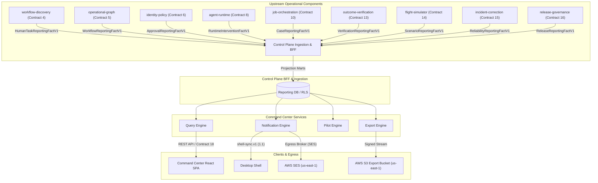
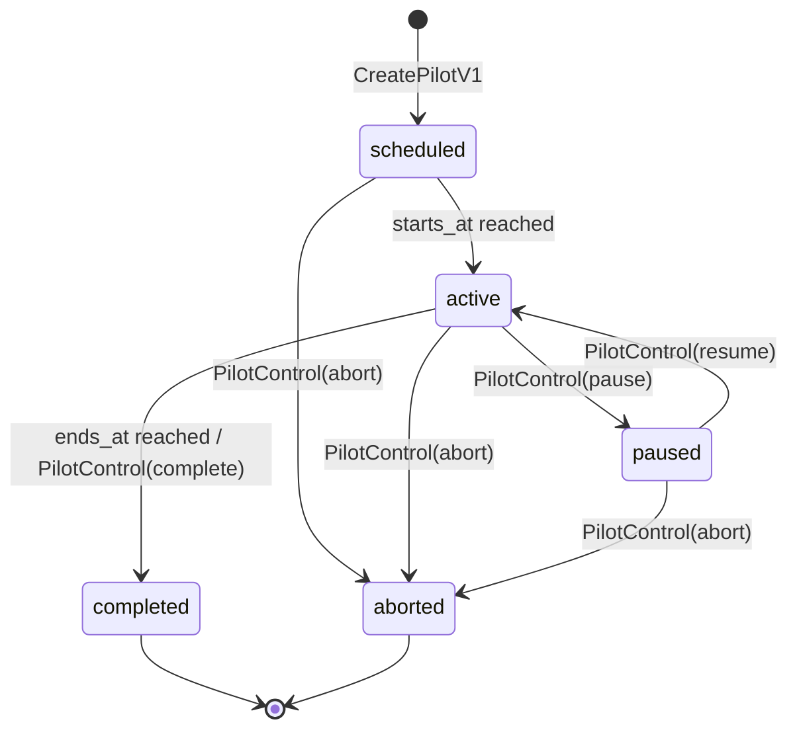
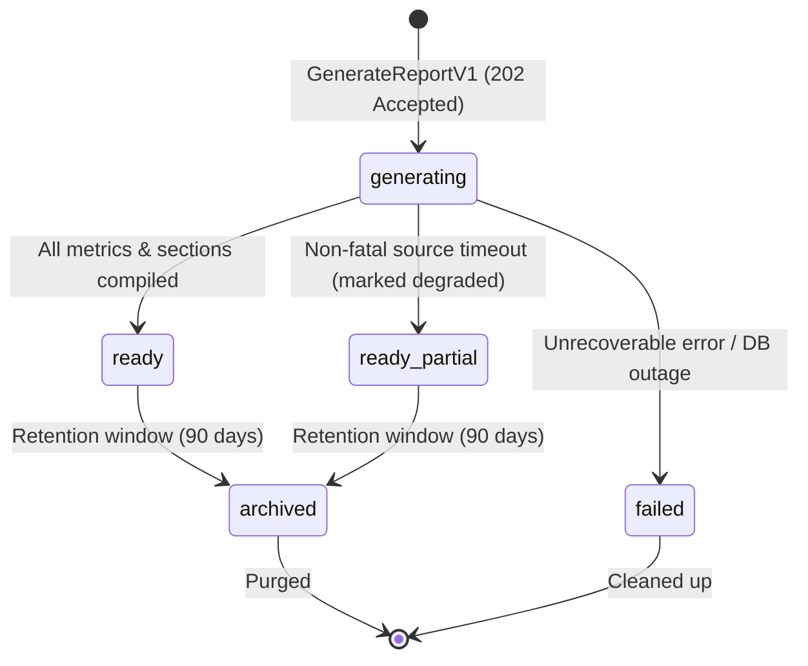
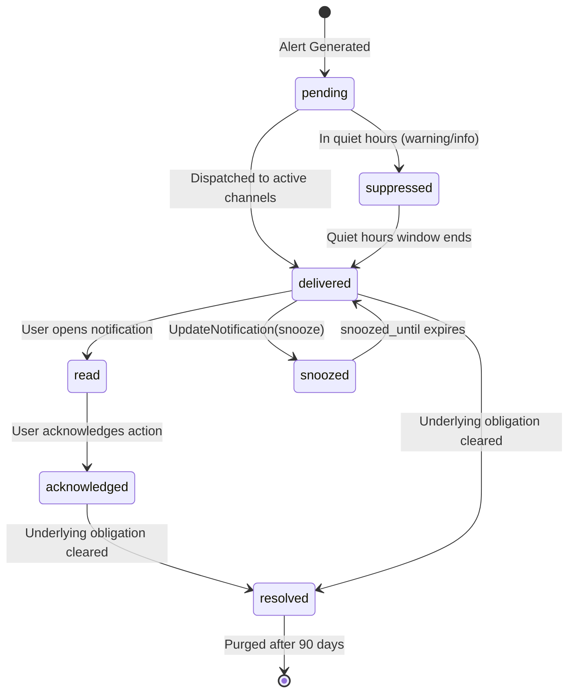

# Command Center, Notifications, and Analytics Component Specification

Status: Detailed technical specification — implementation pending

## Purpose and ownership

**Source references:** [TECHNICAL.md §§5.7, 7.3, 10, 12.7](../../TECHNICAL.md) | [PRODUCT.md §§11–12, 22–24, 26, 30; ORY-016, ORY-060–066](../../PRODUCT.md) | [ADR-0023](../adr/0023-command-center-reporting-privacy-and-delivery.md)

### Core Responsibility
The Command Center, Notifications, and Analytics component is the unified presentation, operational management, alerting, and reporting authority for the Oryn platform. It presents organization-scoped workflows, candidates, agents, evaluations, jobs, incidents, policies, and aggregate analytics via modern web interfaces and desktop notifications. It provides verifiable, privacy-safe metrics on agent automation, human time avoidance, and reliability without conducting any AI inference or exposing individual employee activities.

### Owns
- **Command Center Single Page Application (SPA):** Modern web user interface (React 19, TypeScript, Tailwind CSS, `@xyflow/react`, and `elkjs`), hierarchical navigation, role-scoped view projections, and interactive workflow execution topology visualizations.
- **Central Notification System:** Multi-channel alerting engine, principal notification preferences (quiet hours, channel binding, digest frequency), delivery receipts, and dispatch across desktop shell (via `shell-sync.v1` 1.1 rail) and email (via AWS SES egress broker in `us-east-1`).
- **Operational Analytics & Reporting Marts:** Daily and weekly rollup projection materializers, query execution engine for 13 canonical operational and reliability metrics, and privacy-preserving disclosure gatekeeper enforcing the 5-contributor cohort floor and weekly sealed partitions.
- **Baseline Duration & Assumption Governance:** Workflow human baseline duration approvals, hourly wage assumptions, revision tracking, and basis documentation.
- **14-Calendar-Day Evaluation Pilots:** Pilot lifecycle management (`scheduled` -> `active` -> `completed` / `paused` / `aborted`), participant roster enrollment, time-window boundary enforcement across daylight saving time (DST) shifts, and pilot-scoped reporting.
- **Immutable Report Snapshots:** Asynchronous compilation of frozen report snapshots with methodology identifiers, source watermarks, cryptographic manifest digests, and 90-day retention lifecycles.
- **Compliance Export Engine:** Sandboxed export generation for signed audit packages, runbooks, and reporting snapshots in CSV, ZIP, and PDF formats, with automatic chunk partitioning at 100MB and CSV formula injection neutralization.
- **Audit Journal Read Projections:** Verifiable audit query interface over the immutable hash-chained event journal.

### Explicitly Does NOT Own
- **Authorization Authority:** Identity Policy owns all capability resolution, token issuance, and approval decisions. Command Center is strictly a presentation and query consumer.
- **Operational Source Mutation:** Command Center reads from and queries operational components (`workflow-discovery`, `operational-graph`, `job-orchestration`, `outcome-verification`, `flight-simulator`, `incident-correction-repair`, `release-governance`) via standardized reporting source ports; it never directly mutates their operational tables.
- **AI Inference:** Command Center performs zero AI inference. All summaries, metric rollups, and report narratives use deterministic aggregation algorithms or parameter-driven templating.
- **Primary Data Capture & Filtering:** Contribution Sync, Local Privacy Storage, and Local Context HUD own desktop event capture, redaction, and local privacy guarantees.

---

## Product requirements

Command Center, Notifications, and Analytics implements the complete operational governance, visibility, and analytics experience defined in [PRODUCT.md §§11–12, 22–24, 26, 30](../../PRODUCT.md) and tracked across requirements `ORY-016` and `ORY-060` through `ORY-066`.

### Feature Requirements
1. **Interactive Workflow Topology Visualization (`ORY-016`):**
   - High-fidelity visual Directed Acyclic Graph (DAG) rendering of workflow stages, application steps, decision gates, and verification checkpoints using `@xyflow/react` and layered graph layouts via `elkjs`.
   - Node status color-coding reflecting live execution states (verified success, in-flight, approval required, exception, terminal failure).
   - Strict capability filtering: users lacking `operator.case.view` can inspect workflow structure and aggregate metrics but individual case identifiers and sensitive runtime payloads are omitted.

2. **Unified Operational Home View (`ORY-060`):**
   - Single-pane dashboard grouping executive Key Performance Indicators (KPIs), pending human obligations (proposals awaiting review, incidents requiring containment), active pilot countdowns, and recent alerts.
   - Live refresh backed by 25-second bounded long polling over `/v1/notifications` and `/v1/home`.

3. **Verifiable Operational Analytics Engine (`ORY-061`):**
   - Standardized calculation of 13 core product metrics grounded in verified execution facts:
     - **Case Volume:** Total started cases ($V = \sum \text{case\_started}$).
     - **Case Success Rate:** Fraction of started cases achieving verified complete disposition ($R_{\text{success}} = C_{\text{verified}} / C_{\text{started}}$).
     - **Failure Rate:** Fraction of started cases resulting in terminal failure ($R_{\text{fail}} = C_{\text{failed}} / C_{\text{started}}$).
     - **Exception Rate:** Fraction of started cases encountering non-fatal exceptions ($R_{\text{exc}} = C_{\text{exception}} / C_{\text{started}}$).
     - **Escalation Rate:** Fraction of started cases escalated to human review ($R_{\text{esc}} = C_{\text{escalated}} / C_{\text{started}}$).
     - **Time Avoidance Estimate:** Net employee hours saved by agent automation, computed per verified case as:
       $$\text{TimeAvoidance} = \text{BaselineDuration} - \text{ActiveExecutionDuration} - \text{HumanCorrectionDuration}$$
       *Rules:* Verified no-op cases yield exactly $0\,\text{ms}$ avoidance. Approval wait duration is explicitly excluded from active execution duration and never penalizes time avoidance.
     - **Active Execution Duration:** Median and P90 wall-clock duration of autonomous agent action execution.
     - **Approval Wait Duration:** Median and P90 duration cases spent awaiting human approval, evaluated as the union of non-overlapping wait intervals $[\text{start}_i, \text{end}_i]$.
     - **Spend Attribution:** Settled LLM and compute costs attributed to workflows and jobs, tracked in integer micro-units and strictly partitioned by ISO 4217 currency (no arbitrary cross-currency conversions).
     - **Cost per Case:** Settled spend divided by verified completed cases within the currency bucket.
     - **Regression Rate:** Pre-release vs. post-release evaluation pass-rate divergence ($R_{\text{post}} - R_{\text{pre}}$ percentage points; negative indicates improvement, positive indicates degradation).
     - **Simulation Pass Rate:** Scenarios passing golden-dataset assertions over total scenarios ($S_{\text{passed}} / S_{\text{total}}$).
     - **Mean Time to Recover (MTTR):** Median duration between incident opening and verified recovery ($T_{\text{recovered}} - T_{\text{opened}}$) across grouped incidents.

4. **Contributor Privacy Guardrails (`ORY-062`, `ADR-0023`):**
   - **5-Contributor Floor:** Any metric breakdown, discovery candidate, or reporting cell attributable to human workers requires a minimum cohort size of 5 distinct contributing employees ($\text{cohort\_size} \ge 5$).
   - If fewer than 5 contributors contributed to a cohort within the reporting window, the metric cell is returned with `state: "suppressed"` and `reason: "cohort_size_insufficient"`. The cell value is omitted. Suppressed cells do not fail query execution or parent page rendering.
   - **72-Hour Sealing Period:** Analytics source facts consolidate into sealed weekly partitions 72 hours after UTC ISO week close (Sunday 24:00 UTC + 72 hours = Wednesday 00:00 UTC). Once sealed, cohort membership and metric releases are permanently committed via `AnalyticsDisclosureCommitmentV1`.
   - **Consent Revocation Cascading:** If an employee withdraws analytics consent, their contributions are excluded from future generations. If cohort size drops below 5, subsequent query generations are immediately suppressed. Previously sealed historical weekly releases remain immutable.

5. **14-Calendar-Day Evaluation Pilots (`ORY-063`):**
   - Structured evaluation vehicle for observing agent performance against pre-approved human baselines.
   - Fixed 14-calendar-day boundary (e.g., 336 hours, or 335/337 hours across local DST transitions).
   - Roster tracking requiring at least 5 enrolled participants for team-level aggregations.
   - Formal control operations: `pause`, `resume`, `abort`, `complete`.

6. **Multi-Channel Notification Center (`ORY-064`):**
   - Unified notification model covering incidents, action items, policy changes, and report readiness.
   - Dual delivery: desktop notifications delivered to active desktop shells over `shell-sync.v1` 1.1; email notifications dispatched via AWS SES in `us-east-1`.
   - Quiet hours scheduling: user-configurable per weekday with minute precision ($0..1439$). Critical security and incident alerts bypass quiet hours automatically.
   - State machine enforcing that only `delivered` or `pending` notifications may be snoozed; resolved alerts cannot be snoozed.

7. **Audit-Grade Compliance Exports (`ORY-065`):**
   - Asynchronous export generation producing cryptographically sealed ZIP, CSV, and PDF packages.
   - Part splitting at 100MB thresholds with individual SHA-256 manifests.
   - Neutralization of CSV formula injection attacks by prefixing formula trigger characters (`=`, `+`, `-`, `@`, `\t`, `\r`) with a single quote (`'`).
   - Short-lived signed S3 download URLs expiring after 24 hours.

8. **Global Search and Quick Action Rail (`ORY-066`):**
   - Instant search across workflows, playbooks, incidents, candidates, and jobs, respecting caller role capabilities.

---

## Upstream and downstream contracts

Command Center, Notifications, and Analytics interacts with core Oryn subsystems through Contract 18 and standardized port traits.



### Upstream Contracts & Ingested Facts
- **Contract 4 (`workflow-discovery-v1.schema.json`):**
  - Ingests `HumanTaskReportingFactV1` capturing observed human task durations, frequency, and application transitions.
  - Discriminated `OpportunityV1`: displays candidate automations only when privacy release references are present; suppressed opportunities display reason without exposing contributor counts.
- **Contract 5 (`operational-graph-v1.schema.json`):**
  - Ingests `WorkflowReportingFactV1` linking workflow topology revisions, node definitions, and edge transitions.
- **Contract 6 (`identity-policy-v1.schema.json`):**
  - Enforces `ReportingPolicyV1` containing organization privacy floor and retention settings.
  - Requires `analytics.pilot.manage` for pilot lifecycle mutations and `analytics.assumptions.manage` for baseline duration approvals.
  - Ingests `ApprovalReportingFactV1` recording escalation decisions, approval wait intervals, and rejection causes.
  - Child tokens for desktop notifications are partitioned with `audience: "notifications"`.
- **Contract 8 (`agent-runtime-v1.schema.json`):**
  - Ingests `RuntimeInterventionFactV1` capturing human overrides, steering interventions, and step rejections.
  - Checkpoint commits track intervention and reporting sequences (`intervention_through_sequence`, `reporting_through_sequence`).
- **Contract 10 (`job-orchestration-v1.schema.json`):**
  - Ingests `CaseReportingFactV1` recording case lifecycle timestamps (`first_started_at`, `verified_completed_at`), `ApprovalWaitIntervalV1` lists, and settled costs (`total_settled_microusd`).
- **Contract 13 (`outcome-verification-v1.schema.json`):**
  - Ingests `VerificationReportingFactV1` providing independent verification outcomes (`verified_complete`, `expected_rejection`, `definitive_mismatch`, `unresolved`).
- **Contract 14 (`flight-simulator-v1.schema.json`):**
  - Ingests `ScenarioReportingFactV1` providing pre-release simulation pass/fail assertions and baseline regression deltas.
- **Contract 15 (`incident-correction-repair-v1.schema.json`):**
  - Ingests `ReliabilityReportingFactV1` tracking incident lifecycles (`opened_at`, `recovered_at`, severity, containment status).
- **Contract 16 (`release-governance-v1.schema.json`):**
  - Ingests `ReleaseReportingFactV1` mapping active rollout stages (stages 1..5), canary cohorts, and fence enforcements.

### Downstream Interfaces & Rust Traits
The component exposes Rust traits for control-plane integration:
```rust
#[async_trait]
pub trait ReportingSourcePort: Send + Sync {
    async fn fetch_source_page(
        &self,
        org_id: &Uuid,
        source_owner: &str,
        cursor: Option<&str>,
        limit: usize,
    ) -> Result<ReportingSourcePageV1, ReportingError>;

    async fn record_disclosure_commitment(
        &self,
        commitment: &AnalyticsDisclosureCommitmentV1,
    ) -> Result<(), ReportingError>;
}

#[async_trait]
pub trait ManagementSearchPort: Send + Sync {
    async fn search_entities(
        &self,
        query: &GlobalSearchQueryV1,
    ) -> Result<GlobalSearchPageV1, SearchError>;
}

#[async_trait]
pub trait NotificationEgressPort: Send + Sync {
    async fn dispatch_desktop(
        &self,
        notification: &DesktopNotificationV1,
    ) -> Result<(), NotificationError>;

    async fn dispatch_email(
        &self,
        to_address: &str,
        subject: &str,
        body_text: &str,
    ) -> Result<(), NotificationError>;
}

#[async_trait]
pub trait ExportArtifactPort: Send + Sync {
    async fn stage_export_part(
        &self,
        export_id: &Uuid,
        part_id: &str,
        content: &[u8],
    ) -> Result<ExportPartManifestV1, ExportError>;

    async fn complete_export_manifest(
        &self,
        manifest: &ExportManifestV1,
    ) -> Result<ExportViewV1, ExportError>;
}
```

---

## Trust and deployment boundaries

Command Center operates across three distinct security and execution tiers:

1. **Untrusted Client Tier (Web Browser / Desktop Webview):**
   - React 19 SPA runs within standard web browser security context.
   - Authentication via Secure, HttpOnly, SameSite=Strict cookies (`__Host-oryn_session`).
   - Mutating REST endpoints require CSRF token validation via `X-CSRF-Token` matching session secret.
   - Web application contains zero signing keys, credential secrets, or direct database connections.

2. **Control Plane / Analytics Service Tier (Cloud Core):**
   - Deployed within private VPC in AWS us-east-1.
   - Internal API endpoints authenticating via mutual TLS (mTLS) or internal service Bearer tokens.
   - Database isolation: reporting projections reside in dedicated PostgreSQL read schemas with separate database credentials and strictly budgeted connection pools (maximum 2 concurrent reporting connections, 1 export connection) preventing reporting spikes from starving transactional orchestration.
   - Row-Level Security (RLS) is enabled on all tables, enforcing tenant boundary checks (`organization_id = current_setting('app.current_org_id')`).

3. **External Integration & Worker Egress Tier:**
   - **AWS SES Egress Broker:** Operates in `us-east-1` with dedicated IAM roles, enforcing outbound rate limits and recipient domain validations.
   - **AWS S3 Export Broker:** Storage bucket in `us-east-1` configured with SSE-KMS encryption, private ACLs, and automatic 24-hour lifecycle expiration rules. Pre-signed URLs are signed with 15-minute expirations.
   - **Export Worker Sandbox:** Heavy CSV/PDF generation executes in isolated worker containers with non-root execution, restricted memory (1GB), ephemeral local scratch storage, and no network access during rendering.

---

## Internal architecture

Command Center Analytics consists of five decoupled subsystems within the Control Plane process boundary:

### 1. React SPA Architecture
- **State Management & Data Fetching:** Built with TypeScript, React 19, and TanStack Query (React Query) for declarative caching, background refetching, and pagination.
- **Topology Rendering:** Uses `@xyflow/react` combined with `@elkjs` for automated, non-overlapping hierarchical layout of complex multi-agent execution graphs.
- **Offline & Connectivity Resiliency:** Interceptors detect network degradation, presenting status banners and pausing non-essential polling feeds while preserving user form states.

### 2. Analytics Projection Engine
- Ingests events asynchronously from upstream components using an idempotent sequence-watermark pattern.
- Ingestion worker executes continuous micro-batches, writing normalized facts to `analytics_source_facts` and incrementing high-water marks in `analytics_watermarks`.
- Aggregates daily metric cubes in `metric_cells_daily` indexed by `(organization_id, workflow_id, metric_id, bucket_date)`.

### 3. Privacy Seal Engine
- Scheduled cron task running every Sunday at 24:00 UTC + 72 hours (Wednesday 00:00 UTC).
- Evaluates contributor cohorts for the closed ISO calendar week.
- For cohorts with $\ge 5$ distinct contributors, generates `AnalyticsDisclosureCommitmentV1` with `decision: "released"` and appends record to the audit journal.
- For cohorts with $< 5$ contributors, generates commitment with `decision: "suppressed"` and seals the partition.

### 4. Notification Dispatch Engine
- Evaluates inbound alerts against recipient preferences (`notification_preferences`), including quiet-hour intervals and channel enablement.
- Routes notifications to active desktop shells via `shell-sync.v1` 1.1 `central_notifications_v1` long-poll handler.
- Formats and queues email notifications for background delivery via SES.
- Receives and records `NotificationDeliveryReceiptV1` from client devices.

### 5. Export Broker Engine
- Accepts export requests, validating requester role permissions and rate limits.
- Background worker queries reporting marts, serializes rows, applies CSV formula neutralization, chunks output at 100MB boundaries, and streams encrypted parts to S3.
- Writes final `ExportManifestV1` with part hashes and total byte counts.

### PostgreSQL Relational Schema DDL
```sql
-- Schema DDL for Command Center, Notifications, and Analytics

CREATE TABLE IF NOT EXISTS analytics_watermarks (
    organization_id UUID NOT NULL,
    source_owner VARCHAR(64) NOT NULL,
    sequence BIGINT NOT NULL,
    recorded_through TIMESTAMPTZ NOT NULL,
    projection_generation BIGINT NOT NULL DEFAULT 1,
    coverage VARCHAR(32) NOT NULL DEFAULT 'complete',
    updated_at TIMESTAMPTZ NOT NULL DEFAULT NOW(),
    PRIMARY KEY (organization_id, source_owner)
);

CREATE TABLE IF NOT EXISTS analytics_source_facts (
    fact_id UUID PRIMARY KEY DEFAULT gen_random_uuid(),
    organization_id UUID NOT NULL,
    source_owner VARCHAR(64) NOT NULL,
    source_ref_kind VARCHAR(64) NOT NULL,
    source_ref_id VARCHAR(128) NOT NULL,
    source_ref_version VARCHAR(64) NOT NULL,
    source_revision VARCHAR(64) NOT NULL,
    owner_sequence BIGINT NOT NULL,
    source_recorded_at TIMESTAMPTZ NOT NULL,
    effective_at TIMESTAMPTZ NOT NULL,
    payload_sha256 CHAR(64) NOT NULL,
    availability VARCHAR(32) NOT NULL DEFAULT 'available',
    coverage VARCHAR(32) NOT NULL DEFAULT 'complete',
    payload JSONB,
    created_at TIMESTAMPTZ NOT NULL DEFAULT NOW(),
    CONSTRAINT uq_analytics_fact_owner_seq UNIQUE (organization_id, source_owner, owner_sequence)
);

CREATE TABLE IF NOT EXISTS reporting_baselines (
    baseline_id UUID NOT NULL,
    organization_id UUID NOT NULL,
    revision BIGINT NOT NULL DEFAULT 1,
    workflow_id VARCHAR(128) NOT NULL,
    capability_ref JSONB NOT NULL,
    valid_from TIMESTAMPTZ NOT NULL,
    valid_until TIMESTAMPTZ,
    baseline_ms_per_case BIGINT NOT NULL,
    basis VARCHAR(32) NOT NULL, -- 'measured', 'owner_assumption'
    privacy_release_refs JSONB NOT NULL DEFAULT '[]'::jsonb,
    review JSONB NOT NULL,
    approved_by VARCHAR(128) NOT NULL,
    approved_at TIMESTAMPTZ NOT NULL,
    state VARCHAR(32) NOT NULL DEFAULT 'active',
    PRIMARY KEY (organization_id, baseline_id, revision)
);

CREATE TABLE IF NOT EXISTS evaluation_pilots (
    pilot_id UUID NOT NULL,
    organization_id UUID NOT NULL,
    revision BIGINT NOT NULL DEFAULT 1,
    team_id VARCHAR(128) NOT NULL,
    owner_actor_id VARCHAR(128) NOT NULL,
    application_ids JSONB NOT NULL DEFAULT '[]'::jsonb,
    workflow_ids JSONB NOT NULL DEFAULT '[]'::jsonb,
    start_local_date DATE NOT NULL,
    end_local_date DATE NOT NULL,
    timezone VARCHAR(128) NOT NULL,
    starts_at TIMESTAMPTZ NOT NULL,
    ends_at TIMESTAMPTZ NOT NULL,
    status VARCHAR(32) NOT NULL, -- 'scheduled', 'active', 'paused', 'completed', 'aborted'
    intended_output TEXT NOT NULL,
    report_refs JSONB NOT NULL DEFAULT '[]'::jsonb,
    created_at TIMESTAMPTZ NOT NULL DEFAULT NOW(),
    updated_at TIMESTAMPTZ NOT NULL DEFAULT NOW(),
    PRIMARY KEY (organization_id, pilot_id, revision)
);

CREATE TABLE IF NOT EXISTS pilot_participants (
    pilot_id UUID NOT NULL,
    organization_id UUID NOT NULL,
    revision BIGINT NOT NULL DEFAULT 1,
    participant_actor_ids JSONB NOT NULL DEFAULT '[]'::jsonb,
    notice_refs JSONB NOT NULL DEFAULT '[]'::jsonb,
    updated_at TIMESTAMPTZ NOT NULL DEFAULT NOW(),
    PRIMARY KEY (organization_id, pilot_id, revision)
);

CREATE TABLE IF NOT EXISTS report_snapshots (
    report_id UUID NOT NULL,
    organization_id UUID NOT NULL,
    revision BIGINT NOT NULL DEFAULT 1,
    state VARCHAR(32) NOT NULL, -- 'ready', 'ready_partial'
    kind VARCHAR(64) NOT NULL, -- 'operational', 'xray', 'version_comparison'
    period_start TIMESTAMPTZ NOT NULL,
    period_end TIMESTAMPTZ NOT NULL,
    timezone VARCHAR(128) NOT NULL,
    generated_at TIMESTAMPTZ NOT NULL DEFAULT NOW(),
    cutoff_at TIMESTAMPTZ NOT NULL,
    methodology_id VARCHAR(64) NOT NULL,
    scope JSONB NOT NULL,
    audience_refs JSONB NOT NULL DEFAULT '[]'::jsonb,
    source_watermarks JSONB NOT NULL DEFAULT '[]'::jsonb,
    source_manifest_sha256 CHAR(64) NOT NULL,
    source_manifest_ref JSONB NOT NULL,
    privacy_release_refs JSONB NOT NULL DEFAULT '[]'::jsonb,
    baseline_refs JSONB NOT NULL DEFAULT '[]'::jsonb,
    metrics JSONB NOT NULL DEFAULT '[]'::jsonb,
    sections JSONB NOT NULL DEFAULT '[]'::jsonb,
    completeness VARCHAR(32) NOT NULL,
    degraded_reasons JSONB NOT NULL DEFAULT '[]'::jsonb,
    predecessor_ref JSONB,
    expires_at TIMESTAMPTZ NOT NULL,
    PRIMARY KEY (organization_id, report_id, revision)
);

CREATE TABLE IF NOT EXISTS notifications (
    notification_id UUID NOT NULL,
    organization_id UUID NOT NULL,
    revision BIGINT NOT NULL DEFAULT 1,
    notification_type VARCHAR(64) NOT NULL,
    priority VARCHAR(32) NOT NULL, -- 'critical', 'required', 'due', 'routine'
    source_ref JSONB NOT NULL,
    obligation_generation BIGINT NOT NULL,
    generic_message VARCHAR(512) NOT NULL,
    app_path VARCHAR(512) NOT NULL,
    created_at TIMESTAMPTZ NOT NULL DEFAULT NOW(),
    updated_at TIMESTAMPTZ NOT NULL DEFAULT NOW(),
    read_at TIMESTAMPTZ,
    acknowledged_at TIMESTAMPTZ,
    snoozed_until TIMESTAMPTZ,
    dismissed_at TIMESTAMPTZ,
    source_disposition VARCHAR(32) NOT NULL DEFAULT 'active',
    expires_at TIMESTAMPTZ NOT NULL,
    PRIMARY KEY (organization_id, notification_id, revision)
);

CREATE TABLE IF NOT EXISTS notification_preferences (
    organization_id UUID NOT NULL,
    principal_id VARCHAR(128) NOT NULL,
    revision BIGINT NOT NULL DEFAULT 1,
    timezone VARCHAR(128) NOT NULL DEFAULT 'UTC',
    quiet_hours JSONB NOT NULL DEFAULT '[]'::jsonb,
    desktop_enabled BOOLEAN NOT NULL DEFAULT TRUE,
    email_enabled BOOLEAN NOT NULL DEFAULT TRUE,
    digest VARCHAR(32) NOT NULL DEFAULT 'daily',
    category_preferences JSONB NOT NULL DEFAULT '[]'::jsonb,
    updated_at TIMESTAMPTZ NOT NULL DEFAULT NOW(),
    PRIMARY KEY (organization_id, principal_id)
);

CREATE TABLE IF NOT EXISTS notification_delivery_receipts (
    receipt_id UUID PRIMARY KEY DEFAULT gen_random_uuid(),
    organization_id UUID NOT NULL,
    notification_id UUID NOT NULL,
    notification_revision BIGINT NOT NULL,
    device_id VARCHAR(128) NOT NULL,
    attempt_id UUID NOT NULL,
    outcome VARCHAR(32) NOT NULL, -- 'presented', 'suppressed', 'unavailable'
    occurred_at TIMESTAMPTZ NOT NULL,
    created_at TIMESTAMPTZ NOT NULL DEFAULT NOW()
);

CREATE TABLE IF NOT EXISTS export_views (
    export_id UUID NOT NULL,
    organization_id UUID NOT NULL,
    revision BIGINT NOT NULL DEFAULT 1,
    state VARCHAR(32) NOT NULL, -- 'queued', 'generating', 'ready', 'failed', 'canceled', 'revoked', 'expired'
    operation_ref JSONB NOT NULL,
    manifest JSONB,
    expires_at TIMESTAMPTZ,
    problem JSONB,
    created_at TIMESTAMPTZ NOT NULL DEFAULT NOW(),
    updated_at TIMESTAMPTZ NOT NULL DEFAULT NOW(),
    PRIMARY KEY (organization_id, export_id, revision)
);

CREATE TABLE IF NOT EXISTS analytics_disclosure_commitments (
    commitment_id UUID PRIMARY KEY DEFAULT gen_random_uuid(),
    organization_id UUID NOT NULL,
    privacy_partition_sha256 CHAR(64) NOT NULL,
    cell_key_sha256 CHAR(64) NOT NULL,
    assignment_manifest_sha256 CHAR(64) NOT NULL,
    source_membership_sha256 CHAR(64) NOT NULL,
    source_watermarks_sha256 CHAR(64) NOT NULL,
    policy_revision BIGINT NOT NULL,
    decision VARCHAR(32) NOT NULL, -- 'released', 'suppressed'
    released_value_sha256 CHAR(64),
    disclosure_generation BIGINT NOT NULL,
    recorded_at TIMESTAMPTZ NOT NULL,
    created_at TIMESTAMPTZ NOT NULL DEFAULT NOW()
);

-- Row-Level Security Policies
ALTER TABLE analytics_watermarks ENABLE ROW LEVEL SECURITY;
ALTER TABLE analytics_source_facts ENABLE ROW LEVEL SECURITY;
ALTER TABLE reporting_baselines ENABLE ROW LEVEL SECURITY;
ALTER TABLE evaluation_pilots ENABLE ROW LEVEL SECURITY;
ALTER TABLE pilot_participants ENABLE ROW LEVEL SECURITY;
ALTER TABLE report_snapshots ENABLE ROW LEVEL SECURITY;
ALTER TABLE notifications ENABLE ROW LEVEL SECURITY;
ALTER TABLE notification_preferences ENABLE ROW LEVEL SECURITY;
ALTER TABLE notification_delivery_receipts ENABLE ROW LEVEL SECURITY;
ALTER TABLE export_views ENABLE ROW LEVEL SECURITY;
ALTER TABLE analytics_disclosure_commitments ENABLE ROW LEVEL SECURITY;

CREATE POLICY tenant_isolation_watermarks ON analytics_watermarks
    FOR ALL USING (organization_id = NULLIF(current_setting('app.current_org_id', true), '')::uuid);
CREATE POLICY tenant_isolation_source_facts ON analytics_source_facts
    FOR ALL USING (organization_id = NULLIF(current_setting('app.current_org_id', true), '')::uuid);
CREATE POLICY tenant_isolation_baselines ON reporting_baselines
    FOR ALL USING (organization_id = NULLIF(current_setting('app.current_org_id', true), '')::uuid);
CREATE POLICY tenant_isolation_pilots ON evaluation_pilots
    FOR ALL USING (organization_id = NULLIF(current_setting('app.current_org_id', true), '')::uuid);
CREATE POLICY tenant_isolation_participants ON pilot_participants
    FOR ALL USING (organization_id = NULLIF(current_setting('app.current_org_id', true), '')::uuid);
CREATE POLICY tenant_isolation_reports ON report_snapshots
    FOR ALL USING (organization_id = NULLIF(current_setting('app.current_org_id', true), '')::uuid);
CREATE POLICY tenant_isolation_notifications ON notifications
    FOR ALL USING (organization_id = NULLIF(current_setting('app.current_org_id', true), '')::uuid);
CREATE POLICY tenant_isolation_preferences ON notification_preferences
    FOR ALL USING (organization_id = NULLIF(current_setting('app.current_org_id', true), '')::uuid);
CREATE POLICY tenant_isolation_receipts ON notification_delivery_receipts
    FOR ALL USING (organization_id = NULLIF(current_setting('app.current_org_id', true), '')::uuid);
CREATE POLICY tenant_isolation_exports ON export_views
    FOR ALL USING (organization_id = NULLIF(current_setting('app.current_org_id', true), '')::uuid);
CREATE POLICY tenant_isolation_commitments ON analytics_disclosure_commitments
    FOR ALL USING (organization_id = NULLIF(current_setting('app.current_org_id', true), '')::uuid);
```

---

## State and lifecycle

### 1. Evaluation Pilot Lifecycle

- **Boundary Invariance:** Once created, a pilot's 14-calendar-day window is computed once based on `start_local_date` and `timezone` and stored as immutable UTC timestamps `starts_at` and `ends_at`.
- **Roster Changes:** Adding participants during the scheduled phase generates a new revision (`AmendPilotV1`). Roster modifications after `active` transition are forbidden.

### 2. Report Snapshot Lifecycle

- **Immutability:** Report snapshots are strictly immutable once transitioned to `ready` or `ready_partial`. Revisions require generating a new report snapshot referencing the prior `revises_report_id`.
- **Retention:** Stored in PostgreSQL and S3 for exactly 90 days, after which scheduled maintenance jobs purge them.

### 3. Notification Lifecycle

- **Snooze Restrictions:** A notification can only be transitioned to `snoozed` from `delivered` or `pending` state. Snoozing a `resolved` or `dismissed` alert is rejected with `CC_CONFLICT` (HTTP 409).

### 4. Export Artifact Lifecycle
- `queued` -> `generating` -> `ready` -> `downloaded` -> `expired` (24-hour retention).
- Failures during rendering transition state to `failed` and trigger immediate cleanup of temporary scratch files.

---

## Error and edge-case behavior

### Problem Details Mapping
Errors return standard `ControlPlaneProblemV1` objects mapped to RFC 9457 HTTP Problem Details:

| Error Code | HTTP Status | Trigger Condition |
| :--- | :--- | :--- |
| `CC_METRIC_NOT_FOUND` | 404 Not Found | Requested metric identifier not recognized by analytics methodology |
| `CC_INSUFFICIENT_COHORT` | 200 OK (in-band) | Cohort $< 5$ contributors; cell suppressed with reason code |
| `CC_SEAL_PENDING` | 409 Conflict | Attempt to finalize report before 72-hour weekly seal closes |
| `CC_BASELINE_CONFLICT` | 409 Conflict | Baseline approval revision mismatch or overlapping date range |
| `CC_PILOT_INVALID_STATE` | 409 Conflict | Invalid lifecycle control transition (e.g. resuming an aborted pilot) |
| `CC_PILOT_ROSTER_INSUFFICIENT` | 400 Bad Request | Pilot participant roster has $< 5$ active employees |
| `CC_REPORT_EXPIRED` | 410 Gone | Report snapshot has passed its 90-day retention cutoff |
| `CC_EXPORT_FAILED` | 500 Internal Error | Worker crashed, timed out, or encountered write error during export |
| `CC_EXPORT_TOO_LARGE` | 413 Payload Too Large | Export exceeds total tenant quota or single file limits |
| `CC_QUIET_HOURS_ACTIVE` | 200 OK (in-band) | Notification delivery deferred until end of user quiet-hours window |
| `CC_NOT_FOUND` | 404 Not Found | Entity does not exist OR caller lacks tenant access (prevents leakage) |

### Concrete Edge Cases & Handling

1. **Daylight Saving Time (DST) Transitions:**
   - 14 calendar days in America/New_York across spring-forward produces 335 wall-clock hours ($13 \times 24 + 23$); across fall-back produces 337 wall-clock hours ($13 \times 24 + 25$). Pilot scheduling binds exact start/end UTC instants using IANA timezone definitions, preserving local midnight-to-midnight alignment.
2. **Deduplication vs. Conflict on Source Facts:**
   - A fact arriving with identical `source_owner` and `owner_sequence` with identical `payload_sha256` is ignored idempotently.
   - An arriving fact with identical `(source_owner, owner_sequence)` but conflicting `payload_sha256` is rejected with `CC_CONFLICT`, flagged for quarantine, and raises an internal integrity alert.
3. **Out-of-Order Fact Arrivals:**
   - Case start, progress, and verification events may arrive out of chronological order due to network retries. Projections use monotonic event timestamps and explicit sequence tracking. State convergence is deterministic regardless of ingestion order.
4. **Approval Wait Duration Interval Union:**
   - If a case encounters overlapping or nested approval wait intervals (e.g., $[10:00, 10:15]$ and $[10:10, 10:30]$), the interval union algorithm merges them into $[10:00, 10:30]$ (20 minutes total wait, preventing double-counting).
5. **CSV Formula Injection Defense:**
   - All cell values in generated CSV files are inspected. If the leading character is any of `=`, `+`, `-`, `@`, `\t`, or `\r`, the string is escaped by prepending a single quote `'`.
6. **Cross-Tenant Information Isolation:**
   - Any query attempting to access a report, pilot, or export belonging to another tenant returns `404 Not Found` (never `403 Forbidden`). This strictly prevents existence discovery across tenant boundaries.

---

## Observability and audit

### Structured Logging
All Command Center and Analytics events emit structured JSON logs with correlated trace identifiers:
- Fields: `timestamp`, `level`, `trace_id`, `span_id`, `organization_id`, `principal_id`, `component: "command-center-analytics"`, `action`, `duration_ms`, `status_code`.
- Sensitive data scrubbing: messages, user comments, and candidate parameters are strictly excluded from logging.

### Prometheus Metrics
- `oryn_analytics_query_duration_seconds{metric_id, status}`: Histogram of reporting query latencies.
- `oryn_analytics_watermark_lag_seconds{source_owner}`: Gauge of replication lag between operational sources and reporting marts.
- `oryn_notifications_dispatched_total{channel, priority, outcome}`: Counter of notification delivery attempts.
- `oryn_export_duration_seconds{export_class, format}`: Histogram of export generation runtimes.
- `oryn_export_bytes_total{export_class}`: Counter of exported artifact volumes.

### Audit Journal Commitments
In accordance with ADR-0023, high-impact administrative actions append tamper-evident records to the audit journal:
- `baseline.approved`: Captures `baseline_id`, `workflow_id`, `baseline_ms_per_case`, and approver.
- `pilot.created`, `pilot.controlled`: Captures pilot state transitions and justification.
- `report.generated`: Records `report_id`, methodology hash, and source watermark cutoffs.
- `export.created`: Records export parameters, requester, and authorization scope hash.
- `analytics.disclosure_committed`: Records sealed privacy commitments and released cell hashes.

---

## Security and threat model

### STRIDE Threat Analysis

| Threat Category | Specific Attack Vector | Architectural Mitigation |
| :--- | :--- | :--- |
| **Spoofing** | Attacker impersonates legitimate user via fabricated session cookie | Secure, HttpOnly, SameSite=Strict cookies; Auth0 state validation; CSRF token check on all mutating requests. |
| **Tampering** | Attacker attempts to alter immutable historical report snapshot or baseline | Database constraints forbid updates to published report snapshots; SHA-256 pre-computed manifests; audit journal verification. |
| **Repudiation** | Operator denies approving a low baseline duration | Baseline approvals require signed session context, recorded with principal ID, timestamp, and reason in tamper-evident journal. |
| **Information Disclosure** | Contributor individual performance inferred through small cohort query | Strict 5-contributor floor enforced in-engine; weekly 72-hour sealed partitions; suppressed cells emit generic reason code. |
| **Information Disclosure** | Cross-tenant access to report snapshots or export downloads | Tenant RLS on all tables; cross-tenant queries return 404; S3 download links use single-use signed URLs with 15-minute TTL. |
| **Denial of Service** | Massive analytics query or large CSV export exhausts database memory | Dedicated read replica; strict connection pool budget (max 2 reporting, 1 export); query pagination and 100MB part streaming. |
| **Elevation of Privilege** | User without export rights triggers bulk audit log export | RBAC capability check enforces required permissions prior to job queuing; worker verifies capability token before streaming. |

### Formula Injection Sanitization Pattern
```rust
pub fn sanitize_csv_cell(input: &str) -> String {
    if input.is_empty() {
        return String::new();
    }
    let first_char = input.chars().next().unwrap();
    if matches!(first_char, '=' | '+' | '-' | '@' | '\t' | '\r') {
        format!("'{}", input)
    } else {
        input.to_string()
    }
}
```

---

## Test strategy

### 1. Unit & Property Testing
- **Metric Formula Calculations:** Test runners assert exact mathematical outputs for all 13 metrics across clean data, missing values, and mixed-currency inputs.
- **Privacy Floor Enforcement:** Property tests verify that arbitrary combinations of inputs with fewer than 5 contributors unconditionally yield `state: "suppressed"`.
- **Interval Union Reducer:** Disjoint, overlapping, contiguous, and out-of-order interval inputs are verified to merge into exact minimal non-overlapping sets.

### 2. Schema Validation Testing
- Every JSON fixture in `command-center-analytics-v1.fixtures.json` is validated using `Draft202012Validator` against `command-center-analytics-v1.schema.json`.
- All digest vectors verify against canonical RFC 8785 preimages and SHA-256 hashes.

### 3. Integration & Boundary Testing
- RLS policy test suites verify that multi-tenant concurrent sessions cannot query or observe records from other organizations.
- Long-poll boundary tests verify clean 25-second timeouts and prompt wake-up upon event insertion.
- Export broker tests verify chunk part creation at exactly 100MB thresholds and proper part manifest generation.

---

## Performance and operations

### Service Level Objectives (SLOs)
- **Home View API Latency:** P95 < 150ms.
- **Reporting Mart Query Latency:** P95 < 250ms for pre-aggregated rollups; P95 < 1500ms for arbitrary custom date-window queries.
- **Watermark Ingestion Lag:** Monitored high-water mark lag < 60 seconds from operational event occurrence under standard load.
- **Desktop Notification Delivery:** P95 < 2000ms from alert creation to desktop shell presentation.
- **Export Processing:** Standard report bundle (< 100MB) ready for download within 30 seconds of request.

### Database Connection & Resource Governance
- Max 2 concurrent read connections dedicated to analytics queries.
- Max 1 connection dedicated to export workers.
- Work memory (`work_mem`) restricted to 64MB per connection on reporting pools to prevent memory exhaustion during complex window aggregations.

### Data Retention Schedules
- **Analytics Source Facts:** Retained for 24 months, then archived to cold storage.
- **Report Snapshots:** Active for 90 days, then purged automatically.
- **Notifications & Receipts:** Retained for 90 days.
- **Export Artifacts (S3):** Expire and purged automatically after 24 hours.

---

## Architecture decisions and open questions

### Resolved Architecture Decisions (ADR-0023)
- **Decision 1: Relational Projections vs. Dedicated OLAP:** Relational PostgreSQL read replica with RLS was chosen over ClickHouse or DuckDB for v1.0. Rationale: simplifies operational topology, guarantees multi-tenant isolation through RLS, and easily handles projected daily transaction volumes without distributed sync complexity.
- **Decision 2: 72-Hour Sealing Period:** Weekly cohorts close at Sunday 24:00 UTC and seal 72 hours later (Wednesday 00:00 UTC). Rationale: accounts for weekend time-drift, offline desktop synchronization, and delayed verification readback proofs before cohort boundaries are finalized.
- **Decision 3: Desktop Shell Notification Transport:** Uses `shell-sync.v1` 1.1 `central_notifications_v1` long-polling rail rather than dedicated WebSockets. Rationale: eliminates connection state management, leverages existing desktop sync authentication, and complies with firewall policies.
- **Decision 4: Zero AI Inference in Reporting:** Reporting and metrics calculation strictly forbid LLM-generated summaries or speculative inferences. Rationale: enterprise audit compliance requires deterministic, mathematically reproducible metrics.

### Open Questions (Resolved)
- *Resolved:* How are multiple currencies represented in cost-per-case metrics?
  - *Resolution:* Workflows spending multiple currencies report separate cost-per-case values per currency. Oryn does not perform automated currency conversions.
- *Resolved:* How do quiet hours interact with multi-device desktop sessions?
  - *Resolution:* Preferences are stored centrally per principal; devices report local delivery receipts (`presented` or `suppressed`). If quiet hours are active, non-critical alerts remain pending until the quiet window concludes.
