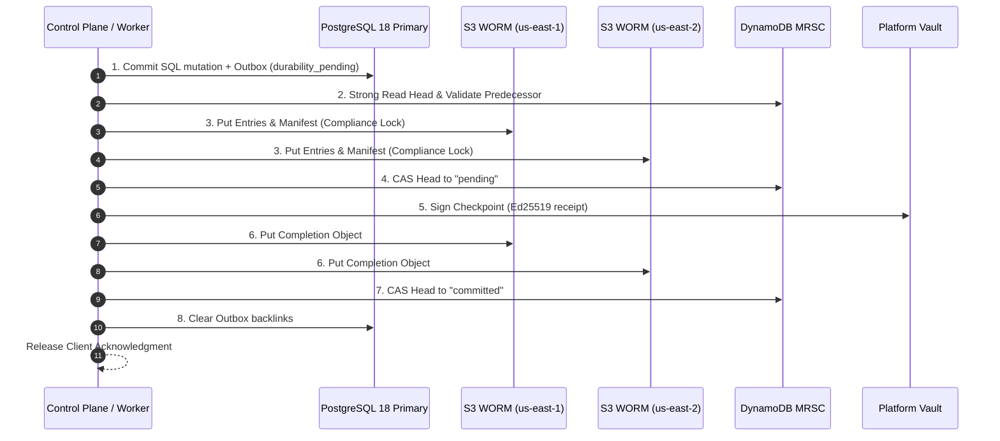

# Infrastructure and Security Engineering Component Specification

Status: Detailed technical specification — implementation pending

## Purpose and ownership

**Source references:** [TECHNICAL.md §§2.1–3, 10–12, 14](../../TECHNICAL.md) | [PRODUCT.md §§4, 25, 31–32; ORY-006, ORY-009, ORY-064, ORY-068–070](../../PRODUCT.md) | [ADR-0024](../adr/0024-infrastructure-security-custody-and-recovery.md)

### Core Responsibility
Infrastructure and Security Engineering establishes, hardens, and operates the multi-account cloud hosting foundation, network perimeter controls, independent authority and audit journals, cryptographic key custody hierarchies, database topology, workload isolation fabrics, and regional disaster recovery systems for Oryn.

### Owns
- **Multi-Account AWS Hosting Topology:** Hardened production, simulation, security/archive, and nonproduction AWS environments across AWS regions `us-east-1` (primary), `us-east-2` (pilot-light recovery), and `us-west-2` (coordination witness).
- **Relational Database Platform:** Multi-AZ RDS PostgreSQL 18 instance with synchronous standby, dedicated reporting read replica, cross-region automated backup pipelines, forced Row-Level Security (RLS) enforcement, non-bypass role provisioning, and global connection pool allocation (64-connection ceiling).
- **Independent Authority and Audit Journals:** Dual-region WORM S3 append-only archive engines with Object Lock in Compliance Mode, coordinated via Amazon DynamoDB Multi-Region Strong Consistency (MRSC) global tables.
- **Physically Split Vault Custody:** Architecture and operation of two independent 3-voter HashiCorp Vault clusters on hardened EC2 instances:
  - *Platform Vault:* KMS multi-Region auto-unseal, recoverable root/intermediate action-signing keys, workload mTLS PKI, and third-party vendor secrets with 5-minute encrypted Raft backups.
  - *Expiring Payload Vault:* Disposable wrapping keys for finite-lifetime organizational evidence and runtime values, with explicit exclusion from all snapshots, backups, disk copies, and cross-region replication.
- **Envelope Encryption & Key Lifecycle:** Per-immutable-value/artifact AES-256-GCM Data Encryption Keys (DEKs), independently deletable Vault Transit wrapping keys, versioned Additional Authenticated Data (AAD) bindings, and two-phase destruction fences (`destroy_pending` -> `destroyed`).
- **Workload Isolation & Network Perimeter:** EKS node groups with immutable AL2023 AMIs, `gvisor` RuntimeClass sandboxes, VPC CNI strict-startup default-deny network policies, regional NLB TCP pass-through to TLS 1.3 terminating proxies, and DNS validation certificate issuance.
- **Inference Gateway Infrastructure:** Deployment and isolation of LiteLLM proxy instances enforcing RAM-disk (`tmpfs`) scratch ceilings (256 MiB per pod, 128 MiB final-meeting input limit), zero request-body persistence, disabled provider logging/caching, and US-only route confinement under Contract 22.
- **Security Log Egress Broker:** Governed OTLP/HTTP egress delivery of content-free security and audit events to customer SOC/SIEM platforms (`https://<host>:443/v1/logs`) with strict destination allowlisting, public-IP validation, and batch throttling.
- **Storage Certification & Disaster Recovery:** 24-hour continuous storage certification scanners and regional recovery runbooks guaranteeing RPO ≤ 15 minutes, RTO ≤ 4 hours, and failover ≤ 120 seconds.

### Explicitly Does NOT Own
- **Business Authorization & Risk Decisions:** [identity-policy](identity-policy.md) is the sole authority for assigning roles, admitting action intents, resolving approval thresholds, and issuing authorization tokens.
- **Private Raw Media Storage:** [local-privacy-storage](local-privacy-storage.md) owns employee-local private evidence capture, local encryption keys, and endpoint retention schedules. Infrastructure never receives or backs up employee-local raw capture files.
- **Application Logic & Adapter Protocols:** [application-adapters](application-adapters.md), [agent-runtime](agent-runtime.md), and [flight-simulator](flight-simulator.md) own business workflow schemas and vendor-specific protocol adaptations.

### Boundary Requirements
Simulation environments run in an entirely separate AWS account and EKS cluster with independent credentials, broker instances, and VPC networking. Production database roles have forced RLS and cannot bypass tenant policies. Platform Vault backups cannot reconstruct Expiring Payload Vault keys; regional loss of the primary payload vault results in permanent evidence custody loss while preserving unmutated content-free audit records.

---

## Product requirements

Infrastructure and Security Engineering directly implements and enforces foundational platform requirements from [PRODUCT.md](../../PRODUCT.md) and [TECHNICAL.md](../../TECHNICAL.md):

### Key Requirements Matrix
| Requirement ID | Product Description | Infrastructure Implementation |
|---|---|---|
| **ORY-006 / ORY-064** | Anti-Surveillance Architecture | Enforces content-free audit logs; strips all prompt/completion bodies, business values, and raw URLs; prohibits employee activity tracking in central databases. |
| **ORY-009** | Local Retention Enforcement | Central infrastructure possesses zero backups, replicas, or ingestion paths for unreviewed employee-local media; endpoints drop data locally without cloud recovery. |
| **ORY-068** | Immediate Policy Restriction Propagation | Enforces PostgreSQL authority guard locks and independent recovery journal synchronization; restrictions and revocations apply immediately without cached grant bypass. |
| **ORY-069** | Controlled Organization Deactivation & Erasure | Deactivation immediately revokes credentials, fences active jobs, and denies decryption; governed erasure disposes cloud wrapping keys via Transit deletion fences. |
| **ORY-070** | Immutable Audit Trail | Dual-region S3 Object Lock Compliance Mode (24 calendar months) backed by DynamoDB MRSC conditional CAS head progression; verifiable via cryptographic hash chains. |
| **ORY-075** | Enterprise SIEM Integration | Dedicated Security Log Egress Broker delivering sanitized OTLP/HTTP security events to customer SOC endpoints with retry backoff and failure quarantine. |

### Organization Deactivation vs. Erasure Semantics
- **Organization Deactivation:** Fences all new capture authority, execution jobs, and dispatch; immediately revokes active mTLS and session tokens; requests safe-boundary worker termination; reroutes pending obligations; and preserves unknown or already-committed external side effects. Historical audit records and unexpired encrypted payloads remain accessible for compliance review until governed deadlines.
- **Organization Erasure:** Disposes eligible cloud evidence payloads and wrapping keys under approved retention schedules via two-phase cryptographic erasure (`destroy_pending` -> deletion -> `destroyed`). Retained immutable WORM audit logs and sparse nonrollback deduplication metadata remain intact until their statutory lock expires. Erasure does not promise physical disk overwriting or retroactive retraction of external exports.
- **Evidence Custody Loss:** Irreversible loss of evidence access due to primary regional loss or unrecoverable quorum loss of the Expiring Payload Vault. Affected custody generations are permanently marked `lost`. Content-free verification outcomes and audit records remain intact.

---

## Upstream and downstream contracts

**Catalog reference:** [Cross-Component Contracts Catalog](../architecture/contracts/README.md) | [infrastructure-security-v1.schema.json](../architecture/contracts/infrastructure-security-v1.schema.json)

### Consumed Contracts
- **Identity & Policy Authority (`urn:oryn:schemas:identity-policy:v1`):** Consumes signed checkpoints (`SignedAuthorityCheckpointV1`), execution contexts, role definitions, and revocation fences. Extends Identity's `AuthorityJournalEntryV1` with `kind: "payload_key_custody_changed"` and after-images for `infrastructure_payload_key_fence` and `infrastructure_payload_custody_generation`.
- **Command Center & Reporting (`urn:oryn:schemas:command-center-analytics:v1`):** Provides read access to the reporting replica and audit journal query port; consumes `ResourceRefV1` for audit event targets; enforces 730-day fact retention and 365-day cold archive storage.
- **Cloud Inference Gateway Contract 22 (`urn:oryn:schemas:cloud-inference:v1`):** Deploys and manages the LiteLLM proxy; supplies Vault-backed provider credentials; enforces RAM-only scratch space and US geographic boundaries.
- **Application Adapters Contract 12 (`urn:oryn:schemas:application-adapters-v1.schema.json`):** Operates `AdapterEgressBroker` with out-of-process credential injection and tenant-pinned connection configurations.
- **Flight Simulator Contract 19 (`urn:oryn:schemas:flight-simulator:v1`):** Enforces isolated simulation EKS cluster, account boundaries, and broker credential isolation.

### Produced Platform Interfaces
The platform schema [`infrastructure-security-v1.schema.json`](../architecture/contracts/infrastructure-security-v1.schema.json) provides normative wire contracts under `$id = "urn:oryn:schemas:infrastructure-security:v1"`:
- `JournalHeadV1`: Authority journal state tracking (`schema_id: "infrastructure.journal-head.v1"`).
- `AuditJournalHeadV1`: Content-free audit journal state tracking (`schema_id: "infrastructure.audit-journal-head.v1"`).
- `MutationManifestV1`: Content-addressed entry manifest (`schema_id: "infrastructure.mutation-manifest.v1"`).
- `MutationCompletionV1`: Final committed completion binding (`schema_id: "infrastructure.mutation-completion.v1"`).
- `TransportDedupV1`: Monotonic idempotency and tombstone envelope (`schema_id: "infrastructure.transport-dedup.v1"`).
- `ReplicaSetActivationV1`: Declared disaster recovery pair activation (`schema_id: "infrastructure.replica-set-activation.v1"`).
- `RecoveryActivationV1`: Post-restore admission barrier and reopening timestamp (`schema_id: "infrastructure.recovery-activation.v1"`).
- `RecoveryBaselineV1` & `SignedRecoveryBaselineV1`: Daily signed recovery checkpoints (`schema_id: "infrastructure.recovery-baseline.v1"`).
- `PayloadKeyFenceV1`: Two-phase destruction and retention fence (`schema_id: "infrastructure.payload-key-fence.v1"`).
- `PayloadCustodyGenerationV1`: Evidence custody generation lifecycle (`schema_id: "infrastructure.payload-custody-generation.v1"`).
- `StorageCertificationV1` & `SignedStorageCertificationV1`: Cryptographic storage compliance proof (`schema_id: "infrastructure.storage-certification.v1"`).
- `AuditEventV1`: Content-free structured audit event (`schema_id: "infrastructure.audit-event.v1"`).
- `AuditArchiveSealV1` & `SignedAuditArchiveSealV1`: Receipt-signed audit archive cut (`schema_id: "infrastructure.audit-archive-seal.v1"`).
- `SocDestinationV1`: Customer SIEM/SOC endpoint configuration (`schema_id: "infrastructure.soc-destination.v1"`).
- `InfrastructureProblemV1`: Platform error details (`schema_id: "infrastructure.infrastructure-problem.v1"`).

---

## Trust and deployment boundaries

```
+--------------------------------------------------------------------------------------------------------------------------+
| AWS ORGANIZATION                                                                                                         |
|                                                                                                                          |
|  +---------------------------------------------------+    +-----------------------------------------------------------+  |
|  | SECURITY & ARCHIVE ACCOUNT                        |    | PRODUCTION ACCOUNT                                        |  |
|  |                                                   |    |                                                           |  |
|  |  +---------------------+  +--------------------+  |    |  +-----------------------------------------------------+  |  |
|  |  | Platform Vault      |  | Expiring Vault     |  |    |  | EKS Cluster (Private Worker Nodes)                  |  |  |
|  |  | (KMS Auto-Unseal,   |  | (No Backups,       |  |    |  |                                                     |  |  |
|  |  |  5m Raft Snapshots)  |  |  No Replication)   |  |    |  |  [API Pods]  [Worker Pods]  [Inference Pods]        |  |  |
|  |  +----------+----------+  +---------+----------+  |    |  |                                                     |  |  |
|  |             |                       |             |    |  |  [gVisor Sandbox Node Pool: Runtime/Render]         |  |  |
|  |             +-----------+-----------+             |    |  +--------------------------+--------------------------+  |  |
|  |                         | (Private mTLS)          |    |                             |                             |  |
|  |  +----------------------v----------------------+  |    |  +--------------------------v--------------------------+  |  |
|  |  | S3 WORM Archive (Object Lock Compliance)     |  |    |  | RDS PostgreSQL 18 Multi-AZ DB Instance              |  |  |
|  |  | (Primary: us-east-1, Standby: us-east-2)     |  |    |  | (Sync Standby + Reporting Read Replica)             |  |  |
|  |  +---------------------------------------------+  |    |  +-----------------------------------------------------+  |  |
|  |                                                   |    |                                                           |  |
|  |  +---------------------------------------------+  |    +-----------------------------------------------------------+  |
|  |  | Security Log Egress Broker (OTLP / TLS 1.3)   |  |                                                                   |
|  |  +---------------------------------------------+  |    +-----------------------------------------------------------+  |
|  +---------------------------------------------------+    | SIMULATION ACCOUNT (Separate VPC / EKS / Credentials)     |  |
|                                                           |  [Simulation Brokers]  [Simulation EKS gVisor Sandboxes]  |  |
|                                                           +-----------------------------------------------------------+  |
+--------------------------------------------------------------------------------------------------------------------------+
```

### Network Matrix and Service Egress
| Source Workload | Destination | Protocol / Port | Authentication / Credentials | Constraints & Route Policy |
|---|---|---|---|---|
| Ingress Proxy | API Pods | HTTPS / 8443 | Internal Workload mTLS | TLS 1.3, strict upstream verification, zero body buffering. |
| API / Worker Pods | RDS PostgreSQL | PostgreSQL / 5432 | IAM DB Auth / Scoped Role Password | Forced RLS, non-bypass roles (`app_api`, `app_worker`), max pool cap. |
| API / Worker Pods | Platform Vault | HTTPS / 8200 | EKS Pod Identity / AWS IAM Auth | Scoped policies for signing, transit encryption, and PKI certs. |
| API / Worker Pods | Expiring Vault | HTTPS / 8200 | EKS Pod Identity / AWS IAM Auth | Disposable wrapping keys only; `disable_upsert=true`. |
| API / Worker Pods | S3 WORM Buckets | HTTPS / 443 | AWS IAM (VPC Gateway Endpoint) | Private endpoint only; no general Internet egress. |
| API / Worker Pods | DynamoDB MRSC | HTTPS / 443 | AWS IAM (VPC Gateway Endpoint) | Private endpoint only; head CAS operations. |
| Inference Pods | LiteLLM Proxy | HTTPS / 4000 | Internal Workload mTLS | 256 MiB RAM scratch, zero disk writes, message logging disabled. |
| LiteLLM Proxy | AI Model Vendors | HTTPS / 443 | Scoped Provider API Keys in Vault | Pinned US endpoints only; no fallback; no response caching. |
| gVisor Workers | Control Plane | HTTPS / 8443 | One-use mTLS Leaf Certificate | No IAM tokens, no IMDS, no host filesystems, no direct database route. |
| Simulation Pods | Sim Brokers | HTTPS / 8443 | Dedicated Sim mTLS | Account boundary isolation; no route to production database. |
| Sim Brokers | SaaS Sandbox Targets | HTTPS / 443 | Pinned Sandbox OAuth Credentials | Shared hostnames allowed only with verified sandbox account bindings. |
| Security Log Broker| Customer SIEM | HTTPS / 443 | Tenant Vault Credential Ref | Pinned `/v1/logs`, public IP verification, no redirects, no metadata. |

---

## Internal architecture

### 1. Database Topology and Connection Governance
- **Instance Configuration:** RDS PostgreSQL 18 Multi-AZ DB Instance provisioned across three Availability Zones in `us-east-1` with one synchronous standby instance and a dedicated asynchronous reporting read replica.
- **Failover & Watermarks:** Failover completes within ≤120 seconds, observed via application connection retries. Reporting queries use the read replica only when the replica replay watermark covers the requested commit sequence cut; otherwise, queries return `stale_read_fallback` or wait.
- **Global Connection Budget (64 Cap):**
  ```
  Total Database Connections: 64
  ├── API Family: 24 slots
  │   ├── API Web Pods: 20 slots (10 per pod across 2 replicas)
  │   ├── Reporting Reader: 2 slots
  │   ├── Export Reader: 1 slot
  │   └── Headroom Reserve: 1 slot
  ├── Background Workers: 16 slots (8 per pod across 2 replicas; Discovery capped at 4)
  ├── Inference Pods: 8 slots (4 per pod across 2 replicas)
  └── Safety & Recovery Reserve: 16 slots (Dedicated to LISTEN, incident containment, recovery coordinator)
  ```
- **Zero-Surge Deployment Guard:** Deployments of database-connected pods use `maxSurge: 0` and `maxUnavailable: 1` to guarantee the connection cap is never breached during rolling upgrades.

### 2. Dual-Copy Independent Journal & MRSC Append Protocol
To eliminate backup snapshot rollback vulnerabilities, all privileged mutations and consequential actions follow this 8-step append algorithm:
1. **Transactional Outbox Commit:** Owner transaction takes the organization journal cursor lock (`SELECT ... FOR UPDATE`), commits semantic row mutations, content-free audit entries, immutable outbox records, cursor progression, and record backlinks atomically. Backlinks bind revision, mutation ID, final sequence, and writer tuple. No remote network calls (S3, Vault, DynamoDB) are made inside the SQL transaction.
2. **Chunking & Ordering:** Final record after-images are sorted deterministically by `(table_name, record_id)` with at most one final after-image per record. The mutation splits at 128 after-images or the 1-MiB canonical entry size ceiling (individual after-images bounded to 256 KiB). Zero-image mutations receive exactly one entry. Sequences increment monotonically and never reset.
3. **Strong Head Verification:** The journal writer strong-reads the DynamoDB MRSC head for `authority#<organization_id>`. It validates the expected previous sequence and authenticated writer tuple. If the mutation ID matches an already completed mutation, the prior receipt is returned (idempotency). If mutation ID matches with altered bytes or nonce, it fails with `IDENTITY_IDEMPOTENCY_CONFLICT`.
4. **Dual-Region S3 Storage:** Content-addressed entry chunks and mutation manifests are written to S3 WORM buckets in **both** `us-east-1` and `us-east-2` with `If-None-Match: *`, SHA-256 integrity checksums, SSE-KMS encryption, and Compliance retention.
5. **Head CAS to Pending:** DynamoDB MRSC head item is updated via conditional CAS to `mode: "open", pending: { manifest_ref, persisted_at, receipt_key_id }`, asserting matching prior head version and writer generation.
6. **Checkpoint Generation:** Vault Platform Transit signs a single `SignedAuthorityCheckpointV1` using the Ed25519 `receipt` purpose key over the final entry hash. Identical completion objects are written to S3 in both regions.
7. **Head CAS to Committed:** DynamoDB MRSC head item is updated via conditional CAS to clear `pending` and commit `completion_ref` and `checkpoint`. The client response is released only after this CAS succeeds.
8. **SQL Backlink Cleanup:** Asynchronous callback clears PostgreSQL outbox backlinks only if the database state matches the completed tuple. Old callbacks cannot clear newer pending fences.



### 3. Cryptographic Key Custody Architecture
- **Platform Vault:**
  - Dedicated 3-voter cluster running on hardened EC2 across 3 AZs in the Security Account.
  - Auto-unseal configured via AWS KMS multi-Region key (`mrk-`) with replica unseal enabled in `us-east-2`.
  - Holds Ed25519 action-signing keys (`root`, `policy`, `publisher`, `receipt`, `evaluation`), workload PKI intermediate CAs, and provider OAuth/API secrets.
  - Automated Raft snapshots taken every 5 minutes, KMS-encrypted, replicated to `us-east-2`, and retained for 7 days.
- **Expiring Payload Vault:**
  - Dedicated 3-voter cluster running on hardened EC2 across 3 AZs in the Security Account.
  - Generates disposable AES-256-GCM Transit wrapping keys per immutable evidence value/artifact.
  - Strict AWS SCPs prohibit snapshots, AMIs, AWS Backup, and volume cloning.
  - Regional disaster or quorum failure permanently destroys affected evidence payload keys. This is documented and accepted as an explicit payload loss exception.

### 4. Per-Immutable-Value Envelope Encryption Hierarchy
- Each sensitive payload, redacted still, or capture artifact receives a freshly generated 256-bit AES-256-GCM DEK with a unique 96-bit nonce.
- The DEK is wrapped by a dedicated Vault Transit key in the Expiring Payload Vault.
- The ciphertext and wrapped DEK are bound to canonical AAD:
  ```
  AAD = UTF8("oryn.payload-key-binding.v1") + LF + RFC8785({
    "organization_id": "<uuid>",
    "subject_ref": "<ref>",
    "key_ref": "<transit_key_name>",
    "custody_generation": "<generation_uuid>",
    "purpose": "<purpose_id>"
  })
  ```
- Two-Phase Destruction Sequence:
  1. Commit `PayloadKeyFenceV1 { state: "destroy_pending" }` to the independent journal.
  2. Call Expiring Payload Vault to delete the Transit wrapping key and verify 404 absence.
  3. Commit `PayloadKeyFenceV1 { state: "destroyed" }` to the independent journal.
  4. Subsequent read requests fail immediately with `410 Gone / INFRA_CUSTODY_UNAVAILABLE`.

---

## State and lifecycle

### Journal Head State Machine
```
           +-----------------------------------------+
           |                                         |
           v                                         |
     +------------+     Append Started      +-----------------+
---> |    OPEN    | ----------------------> | PENDING COMMIT  |
     +------------+                         +-----------------+
       |        ^                                    |
       |        | Recovery Complete                  | Crash / Timeout
       |        |                                    v
       |   +------------+   Restore Declared   +-----------------+
       +-> | RECOVERING | <------------------- | PENDING REPAIR  |
           +------------+                      +-----------------+
```
- **Open:** Accepting validated journal append requests matching current recovery epoch and writer generation.
- **Pending Commit:** Entry chunks durably stored in dual S3 stores; waiting for final completion checkpoint CAS. Helpers can advance pending commits.
- **Recovering:** Writer generation bumped, new privilege dispatch blocked, and read-only mode active while baseline and suffix replay reconstruct state.

### Evidence Custody Generation Lifecycle
- **Active:** Normal operation. Wrapping keys generated and destroyed within generation `custody_generation`.
- **Lost:** Catastrophic regional loss or unrecoverable quorum loss of Expiring Payload Vault. Declared permanently `lost`; can never be reactivated or revived. Future payloads initialize a fresh generation UUIDv4.

### Declared Disaster Recovery & Replica Set Replacement
When primary region `us-east-1` is declared lost:
1. **Freeze Registered Scopes:** Two-person approval freezes all registered organization heads in DynamoDB MRSC, blocking scope creation and old writer generations.
2. **Verify Canonical Closure:** The recovery coordinator scans surviving S3 WORM objects in `us-east-2` to establish the latest contiguous committed sequence cut.
3. **Copy Inventory:** Surviving objects and retention locks are copied from `us-east-2` to replacement recovery region `us-west-2`.
4. **Publish ReplicaSetActivationV1:** Cryptographically signed activation binds `old_regions: ["us-east-1", "us-east-2"]`, `new_regions: ["us-east-2", "us-west-2"]`, two approval references, and frozen head hashes.
5. **CAS Epoch:** DynamoDB global replica-set epoch is advanced. Old writers returning from `us-east-1` are fenced permanently.
6. **Reopen Under Guard:** Organizations run standard recovery replay and reopen with a new admission floor (+5 seconds).

---

## Error and edge-case behavior

### Failure Handling Matrix
| Failure Scenario | Immediate Detection Mechanism | Blast Radius | Recovery & Containment Action |
|---|---|---|---|
| PostgreSQL Standby Failover | RDS automated health check & DNS swing | Active DB connections terminated | Application re-connects within ≤120s; retryable transactions re-executed; uncommitted queries roll back safely. |
| S3 Secondary Put Failure (`us-east-2`) | HTTP timeout or 5xx response | Journal append blocked | Mutation not acknowledged; retried until secondary S3 succeeds; client receives 503 if timeout expires. |
| Pending CAS Crash (Step 5) | Missing committed CAS on recovery read | Single in-flight mutation | Recovery coordinator or helper inspects S3 manifests; if dual copies exist, signs checkpoint and finishes commit. |
| Expiring Vault Quorum Loss | Vault health check failing across 3 AZs | Disposable evidence payloads | Reading/wrapping evidence blocked; generation declared `lost`; metadata survives; new generation provisioned. |
| Platform Vault Seal Lockout | Auto-unseal KMS key access failure | Signing & mTLS renewal | Pod Identity fails closed; leaf certificates expire in 5 min; emergency break-glass unseal via secondary KMS key in `us-east-2`. |
| Network Partition (Cross-Region) | DynamoDB MRSC quorum unreachable | Privileged mutations | New privileged dispatch suspended; existing restrictions remain enforced; read-only operations continue if authority cached. |
| Database Snapshot Restore Attempt | Recovery epoch / incarnation mismatch | Entire restored database | Restored database blocked from receiving traffic (`IDENTITY_RECOVERY_INCOMPLETE`); recovery coordinator replays journal from WORM. |
| Malicious / Forged SOC URL | Public IP / DNS resolution filter | Single tenant SOC export | Security Log Egress Broker rejects private IP, AWS metadata IP (169.254.169.254), or HTTP redirects; marks destination `suspended`. |
| Stale Read Replica Watermark | Replay LSN lag check on replica | Reporting queries | Query routed to primary or rejected with retryable error; stale data never disclosed across privacy boundaries. |

---

## Observability and audit

### 1. Mandatory Audit Log Invariants
All consequential operational actions, privilege activations, key destruction events, and configuration modifications emit structured, content-free `AuditEventV1` records directly to PostgreSQL and the WORM audit journal (`schema_id: "infrastructure.audit-event.v1"`):
- **Sanitization Invariant:** Audit records strictly prohibit raw prompt text, completion text, transcript bodies, image data, URLs with query parameters, Authorization bearer tokens, and employee idle/activity intervals.
- **Allowlisted Fields Only:** `event_id` (UUIDv7), `organization_id`, `occurred_at`, `source_workload`, `actor` (`user|workload`), `action_type`, `object_ref` (`ResourceRefV1`), `outcome` (`allowed|denied|pending|succeeded|failed|unknown`), `reason_code`, `correlation_id`, and `artifact_sha256s` (up to 16 hashes).
- **Audit Verification:** Audit queries via `POST /v1/audit/queries` verify returned archive chunks against signed `AuditArchiveSealV1` committed cuts. Records without immutable WORM anchors return `integrity_status = "unverified"`.

### 2. Operational Metrics & Telemetry
- **Prometheus Metrics:**
  - `oryn_infra_db_connections_active{role="app_api|app_worker|app_reporting"}`
  - `oryn_infra_journal_append_duration_seconds{region="us-east-1|us-east-2", phase="s3_put|cas_pending|cas_committed"}`
  - `oryn_infra_vault_request_duration_seconds{cluster="platform|expiring", op="transit_sign|wrap|unwrap|delete"}`
  - `oryn_infra_inference_tmpfs_bytes_used{pod="..."}` (Alert threshold: > 200 MiB)
  - `oryn_infra_storage_certification_valid_seconds` (Alert if < 4 hours)
  - `oryn_infra_soc_delivery_attempts_total{status="success|failure|quarantined"}`
- **Alerting Thresholds:**
  - Database connection pool utilization > 80% (P1).
  - S3 dual-region durability latency P95 > 250 ms (P2).
  - Replica lag watermark > 30 seconds on reporting replica (P2).
  - Expiring Vault backup attempt detected (P0 Security Incident).
  - Missing journal quorum or CAS fence collision (P0).

---

## Security and threat model

### Threat Analysis & Mitigations
- **Insider Threat / DB Administrator Compromise:**
  - *Threat:* An attacker with direct RDS `postgres` superuser access attempts to read customer evidence or alter past audit logs.
  - *Mitigation:* Forced RLS prevents cross-tenant access. Sensitive payloads are encrypted with DEKs wrapped by the Expiring Payload Vault. Audit trails reside in external S3 Object Lock Compliance buckets that even the root AWS account cannot delete or overwrite until the 24-month retention period expires.
- **Backup Restoration Attack (Resurrection of Revoked Permissions):**
  - *Threat:* Restoring an older RDS snapshot resurrects revoked administrative roles or unconsumes action approval tokens.
  - *Mitigation:* Restored databases require recovery activation. Privileged execution remains blocked until the recovery coordinator replays all fences and tombstones from the independent WORM journal. Action consumptions and custody losses cannot roll back.
- **Cloud Provider Snapshot Exfiltration:**
  - *Threat:* Malicious hypervisor snapshot or EBS volume cloning exfiltrates expiring evidence keys.
  - *Mitigation:* Expiring Payload Vault runs strictly in memory on dedicated EC2 instances with AWS Backup and EBS snapshotting disabled via AWS Organizations SCPs. Volume encryption uses customer-specific KMS keys.
- **Container Escape & Kernel Exploits:**
  - *Threat:* Malicious Python or JavaScript code executed during agent simulation or rendering escapes container isolation.
  - *Mitigation:* Untrusted workloads execute under `gvisor` RuntimeClass (pTrace / KVM sandboxed kernel), running with read-only root filesystems, unprivileged UID 10001, dropped Linux capabilities (`CAP_DROP_ALL`), disabled swap, and IMDSv2 hop-limit 1.
- **SIEM Egress SSRF Attack:**
  - *Threat:* Attacker configures a SOC destination pointing to AWS internal metadata (`http://169.254.169.254/latest/meta-data`) or an internal VPC service.
  - *Mitigation:* `SecurityLogEgressBroker` requires HTTPS on port 443, validates that resolved IP addresses belong to public CIDR ranges at connection time, disallows HTTP redirects, and strips sensitive authorization headers.

---

## Test strategy

### 1. Synthetic Conformance Suite
Infrastructure verification references [`infrastructure-security-v1.fixtures.json`](../architecture/contracts/infrastructure-security-v1.fixtures.json), testing schema validation and the 14 mandatory semantic recovery scenarios:
- **Case 1: Schema Invariants:** Strict validation of valid and invalid heads, manifests, activations, signed checkpoints, custody records, and storage certifications.
- **Case 2: After-Image Chunking:** Verifies that metadata counts `0, 1, 128, 129, 256, 257` yield exactly `1, 1, 1, 2, 2, 3` entry chunks and a single final checkpoint, splitting at 128 images or 1-MiB payload ceiling.
- **Case 3: Crash Recovery Matrix:** Simulates crash after S3 put, after pending CAS, after completion put, and after final CAS; asserts zero false acknowledgments and deterministic helper completion.
- **Case 4: Idempotency & Conflict Fencing:** Asserts identical mutation returns identical receipt; altered payload with same mutation ID fails `IDENTITY_IDEMPOTENCY_CONFLICT`.
- **Case 5: Stale Head Rejection:** Rejects attempts to advance the journal using valid signed checkpoints with stale head versions.
- **Case 6: Historical Snapshot Restore:** Verifies that restoring an outdated snapshot replays fences, classifies missing payloads as `lost_after_restore`, and leaves consumed actions consumed.
- **Case 7: Replica Set Replacement:** Simulates total loss of `us-east-1`; proves that two-person approval fences old writers, verifies surviving `us-east-2` closure, copies inventory to `us-west-2`, and activates new epoch.
- **Case 8: Daily Baseline Integrity:** Verifies daily baseline omits deleted roles and carries sparse fences without resurrecting revoked grants.
- **Case 9: Two-Phase Destruction:** Verifies that destroying artifact A leaves B readable, and crash during `destroy_pending` denies reads without false completion receipts.
- **Case 10: Lost Custody Generation:** Declaring an Expiring Vault generation `lost` blocks all past payload decryption while preserving unmutated content-free outcome verdicts.
- **Case 11: Connection Pool & Watermark Fencing:** Verifies global 64-connection budget; confirms reporting read replica returns `stale_read_fallback` when watermark lags.
- **Case 12: Storage Certification Expiry:** Verifies that expired (>24h) or mismatched storage certification immediately halts image artifact policy issuance.
- **Case 13: Governed Export & SOC Security:** Verifies authenticated Range download resumption and rejection of private/metadata SOC endpoints.
- **Case 14: Canonical Artifact Policy Cutover:** Verifies all artifact policies validate against Identity's `policy_version` U64 definition without `policy_revision` duplication.

---

## Performance and operations

### Operational SLOs & Budgets
- **Control Plane Monthly Availability:** 99.9% valid-request internal SLO (excluding external third-party model vendor outages).
- **Safety Acknowledgment Latency:** P95 < 250 ms for dual-region S3 WORM put, DynamoDB CAS, and Ed25519 signing under standard load.
- **Database Failover Target:** ≤ 120 seconds application reconnection time during RDS Multi-AZ instance failover.
- **Regional Disaster Recovery:** RPO ≤ 15 minutes; RTO ≤ 4 hours for declared regional recovery.
- **Inference Memory Ceiling:** Hard cap of 256 MiB RAM-disk (`tmpfs`) scratch per inference pod; 128 MiB final-meeting input limit; max 20 global concurrent sessions.

### Maintenance & Operating Procedures
- **Key Rotation Schedule:**
  - Non-root Ed25519 action-signing keys: Rotated every 90 days via Platform Vault.
  - Root trust keys: Rotated every 365 days under two-person approval.
  - Workload mTLS Intermediate CAs: Rotated every 90 days; leaf certificates issued with 5-minute TTL, renewing at 2 minutes.
- **Zero-Downtime Migration Policy:** Database migrations follow the expand/backfill/verify/contract methodology. Contraction phases require explicit approval and compatibility validation. Helm rollbacks never roll back database schemas or unconsume action fences.
- **Quarterly Recovery Drills:** Mandatory simulated loss of `us-east-1` executed in staging, verifying replica set replacement, S3 WORM inventory sync to `us-west-2`, and post-restore fence reconstruction.

---

## Architecture decisions and open questions

### Resolved Architecture Decisions (ADR-0024)
- **Decision 1: SaaS-Only Hosting on AWS:** Multi-tenant AWS SaaS selected. Customer-hosted, CMEK, and multi-cloud architectures rejected for v1.0 to ensure uniform security boundaries, predictable recovery proofs, and compliance guarantees.
- **Decision 2: RDS Multi-AZ DB Instance over DB Cluster:** Single RDS Multi-AZ DB Instance with synchronous standby and reporting replica selected. Accepted ≤120s failover target in exchange for native AWS automated cross-region point-in-time recovery without external backup tooling.
- **Decision 3: Physically Split Vault Clusters:** Split into Platform Vault (backed up, KMS auto-unseal) and Expiring Payload Vault (no backups, disposable wrapping keys). Resolves the contradiction between enterprise disaster recovery and immutable crypto-shredding.
- **Decision 4: Dual-Region S3 WORM & DynamoDB MRSC:** Privileged mutations require durable writes to S3 Object Lock Compliance buckets in both `us-east-1` and `us-east-2` before client acknowledgment, coordinated via DynamoDB Multi-Region Strong Consistency CAS.
- **Decision 5: Per-Immutable-Value Envelope Encryption:** Cuts over from per-execution DEKs to per-immutable-value DEKs and independently deletable Transit wrapping keys, unifying runtime, capture, and verification encryption models.
- **Decision 6: Explicit Payload Loss Exception:** Acknowledges that catastrophic regional failure of `us-east-1` permanently destroys disposable evidence payloads while preserving content-free audit logs and outcome verdicts.

### Mandatory Handoff Questions ([TECHNICAL.md §14.2](../../TECHNICAL.md))
1. *What does this component **own** that no other component should overwrite?*
   Physical AWS multi-account infrastructure, RDS PostgreSQL instances and connection pools, Platform and Expiring Vault clusters, independent S3 WORM archives and DynamoDB MRSC journal coordination, EKS node groups and network policies, and the Security Log Egress Broker.
2. *What data can enter or leave it, and at what sensitivity/authorization level?*
   Ingresses encrypted client requests, authorized mutation after-images, and vendor tokens; egresses sanitized OTLP/HTTP security logs and client responses. Sensitive plaintext payload bodies never enter WORM archives, OpenTofu state, or unencrypted storage.
3. *Which versions and identities must accompany its requests or events?*
   `organization_id` (UUID), `recovery_epoch` (UUIDv4), `writer_generation` (U64), `replica_set_epoch` (U64), `head_version` (U64), `sequence` (U64), and workload mTLS SAN identities.
4. *What happens if its upstream source is unavailable, stale, wrong, or malicious?*
   If DynamoDB or S3 is unavailable, privileged mutations fail closed (503); if database restored snapshot is detected, traffic is blocked until journal replay completes (`IDENTITY_RECOVERY_INCOMPLETE`); if a SOC destination is invalid or malicious, it is rejected and quarantined without impacting platform safety.
5. *Who is authoritative for **permission**, **business correctness**, and **release** when this component interacts with those concepts?*
   Identity Policy is authoritative for permissions and action admission; domain owners (e.g. Verification, Release) are authoritative for business correctness; Infrastructure is authoritative strictly for physical containment, storage durability, cryptographic enforcement, and recovery fencing.
6. *How can another component use or test it without depending on its private implementation?*
   Via normative Draft 2020-12 schemas in [`infrastructure-security-v1.schema.json`](../architecture/contracts/infrastructure-security-v1.schema.json) and synthetic conformance test vectors in [`infrastructure-security-v1.fixtures.json`](../architecture/contracts/infrastructure-security-v1.fixtures.json).
7. *How does it preserve auditability and avoid unsafe retries or duplicate writes?*
   Through atomic DynamoDB MRSC head CAS operations, idempotency tombstones (`TransportDedupV1`), S3 Object Lock Compliance retention, and immutable record backlinks.
8. *Which failures require local containment, customer-visible attention, or broader emergency stop?*
   Failed SOC delivery is contained locally; Expiring Vault quorum loss triggers an organization-visible custody degradation alert; journal quorum partition or restored database detection triggers an immediate Control Plane emergency freeze.
9. *Which v1.0 acceptance criteria does the component enable, and how is that demonstrated?*
   Enables ORY-006, ORY-009, ORY-064, ORY-068, ORY-069, ORY-070, and ORY-075. Demonstrated via synthetic conformance suites verifying dual-copy append, two-phase key destruction, and regional disaster recovery replay.
