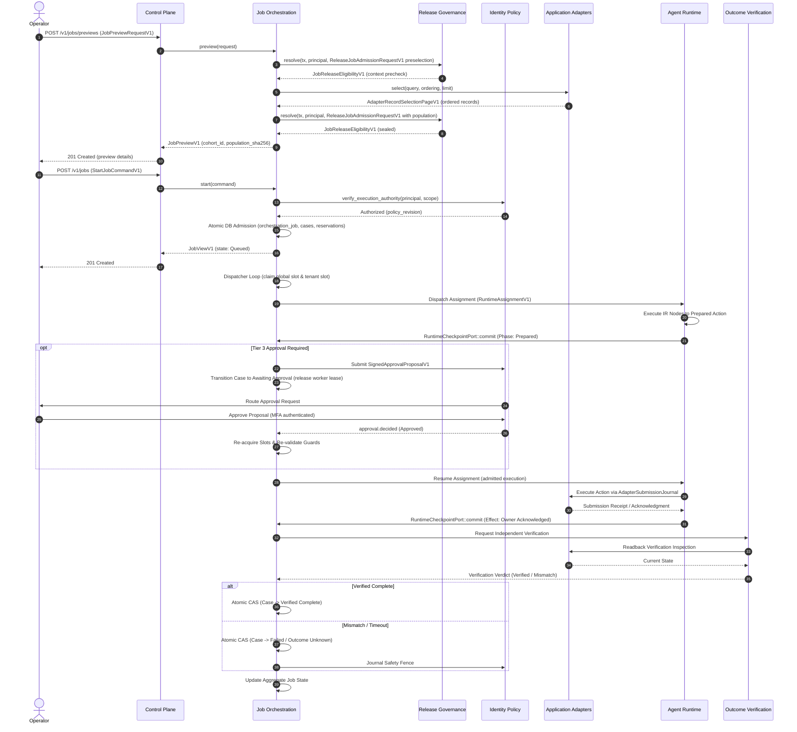
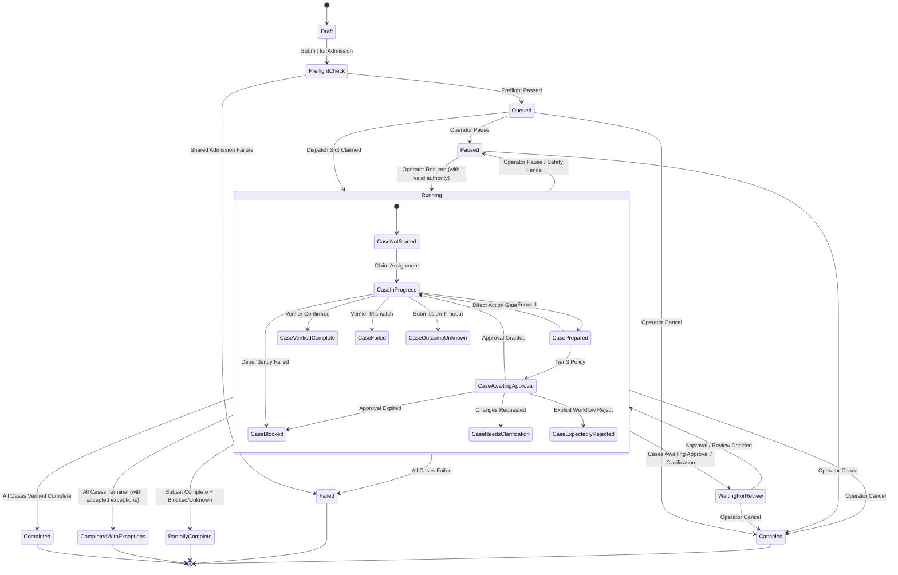

# Job Orchestration and Scheduling Component Specification

Status: Detailed technical specification — implementation pending

## Purpose and ownership

**Source references:** [TECHNICAL.md §§6.1, 8.3, 9.4, 11.4–5, 13.2](../../TECHNICAL.md) | [PRODUCT.md §§16, 20.5, 21.7; ORY-040–048](../../PRODUCT.md) | [ADR-0018](../adr/0018-job-orchestration-and-scheduling.md) | [ADR-0017](../adr/0017-agent-runtime-execution-and-recovery.md)

### Core Responsibility
Job Orchestration and Scheduling coordinates manually started and approved recurring agent jobs across case populations, manages approval suspension, concurrency, and retries, and maintains durable execution state across worker failures. It enforces organizational execution limits, budget encumbrance, and frozen record selection boundaries.

### Owns
- The durable lifecycle of jobs and cases (`Draft`, `Preflight Check`, `Queued`, `Running`, `Waiting for Review`, `Partially Complete`, `Completed`, `Completed with Exceptions`, `Paused`, `Failed`, `Canceled`).
- Bounded population selection sealing, qualified cursor pagination, and population digest verification.
- Cross-job business record exclusion reservations and tenant/global dispatch slot allocation.
- Timed and business-event schedule definition, activation verification, occurrence generation, and deduplication.
- Checkpointing case progression and managing safe crash recovery without repeating non-idempotent writes.
- Action generation allocation and the durable action-intent ledger for reconciled continuations.
- Central encrypted custody of runtime typed values and predecessor value inheritance across continuations.
- Aggregating authoritative case outcomes into deterministic job-level read models and audit projections.

### Consumes
- Authorized job start, control, and schedule commands from [command-center-analytics](command-center-analytics.md) / [control-plane](control-plane.md).
- Active, released agent versions and rollout scopes via `ReleaseJobAdmissionPort` from [release-governance](release-governance.md).
- Preflight validation checks, execution sponsor authority, and organization execution limits from [identity-policy](identity-policy.md).
- Qualified record selection pages via `AdapterRecordSelectionPort` from [application-adapters](application-adapters.md).
- Step completion, checkpoint commits, and value uploads via `RuntimeCheckpointPort` and `RuntimeValuePort` from [agent-runtime](agent-runtime.md).
- Independent business verdicts from [outcome-verification](outcome-verification.md).

### Produces
- Scoped work assignments dispatched to [agent-runtime](agent-runtime.md) workers.
- Human approval task notifications routed to [identity-policy](identity-policy.md) and [desktop-shell](desktop-shell.md).
- Job, case, schedule, and safety fence status transition events broadcast across the control plane domain event bus.
- Synchronous safety fences and incident trigger signals dispatched to [incident-correction-repair](incident-correction-repair.md) when anomalies or containment fences occur.

### Does Not Own
- Executing external application mutations directly (owned by [application-adapters](application-adapters.md)).
- Authorizing action permissions, granting risk tier exemptions, or evaluating human MFA (owned by [identity-policy](identity-policy.md)).
- Editing or patching agent code (owned by [agent-factory-ir](agent-factory-ir.md) / [incident-correction-repair](incident-correction-repair.md)).
- Declaring business correctness without verifier verdicts (owned by [outcome-verification](outcome-verification.md)).
- Direct workstation screen or OS capture (owned by [desktop-shell](desktop-shell.md)).
- Inference model routing, token rate limits, and provider API connectivity (owned by [control-plane](control-plane.md) via LiteLLM).

### Boundary Requirement
Job operations must be durable, recoverable, and idempotent. Orchestration owns workflow retries, checkpoint persistence, and case populations; Application Adapters owns the external submission journal (`AdapterSubmissionJournal`); Identity owns action fences and recovery durability. An orchestrator restart or crash recovery must never blindly repeat non-idempotent external writes or unconsume action fences. Uncertain outcomes (`unknown`) place cases in explicit hold states for workflow reconciliation. Recovery requires issuing a new action intent with distinct action ID, valid authorization, and reconciliation evidence. Scheduling must strictly enforce organizational policies regarding concurrency, budget caps, and emergency stops. Terminal case status requires independent verification.

## Product requirements

### Key Product Requirements ([PRODUCT.md §§16, 20.5, 21.7; ORY-040–048](../../PRODUCT.md))
- **Precise Queue Selection (ORY-040):** Operators must be able to view eligible queues, scope, and expected effects before starting a job. Populations are frozen at preview confirmation; dynamic population expansion or silent record substitution during execution is strictly forbidden.
- **Preflight Gating (ORY-041):** Preflight checks block job start if scope, role, required inputs, or permissions are invalid. Shared preflight failures block the entire job prior to dispatch; isolated per-case record failures mark only affected cases as `Blocked` while independent cases proceed.
- **Accurate Batch Reporting (ORY-042):** Batches show verified successes, expected exceptions, and unresolved cases separately without false 100% claims. Status counters strictly reflect authoritative case states and never misrepresent partial progress as full completion.
- **Terminal Status Integrity (ORY-043):** A submitted but unverified action cannot be reported as `Verified Complete`. An application acknowledgment signals external receipt only; terminal success requires independent verifier evaluation.
- **Uncertain Outcome Holding (ORY-044):** Uncertain external submissions are placed in an explicit hold state (`Outcome Unknown`) to prevent duplicate retries. Consumed action fences in Identity remain consumed; automatic redispatch is prohibited.
- **Emergency Stop (ORY-045):** Operators can stop running jobs via synchronous domain commands; the orchestrator establishes durable safety fences, reports completed effects, and preserves unresolved cases without data loss.
- **Overlap Prevention (ORY-046):** Scheduled jobs respect declared scopes and prevent overlapping runs by default. Any prior scheduled run with unresolved effects or incomplete outputs retains the overlap guard, causing subsequent occurrences to skip.
- **Approval Context (ORY-047):** Consequential approvals present proposed changes, supporting evidence, and authority context. Approvals remain suspended within bounded deadlines without holding database row locks or active worker leases.
- **Separation of Duties (ORY-048):** Starting a job does not grant approval authority to unprivileged operators. Operational execution permissions (`job.run`) remain strictly separate from action approval privileges and schedule management (`schedule.manage`).

## Upstream and downstream contracts

**Catalog reference:** [Cross-Component Contracts Catalog](../architecture/contracts/README.md)

### Cross-Component Contracts
- **Contract Reference #6 in [Contracts Catalog](../architecture/contracts/README.md):** Consumes qualified record selection pages from [application-adapters](application-adapters.md) via `AdapterRecordSelectionPort::select`. Uses `ApplicationRecordRefV1` to construct canonical record identity digests:
  ```text
  record_identity_sha256 = SHA256(RFC8785({
    application_id,
    vendor_account_id,
    environment,
    record_type,
    native_record_id
  }))
  ```
- **Contract Reference #9 in [Contracts Catalog](../architecture/contracts/README.md):** Ingests eligible active version, explicit named cohort, and scope from [release-governance](release-governance.md) via `ReleaseJobAdmissionPort::resolve(&self, tx: &mut TenantTransaction, principal: &VerifiedPrincipal, request: &ReleaseJobAdmissionRequestV1)`, returning `JobReleaseEligibilityV1`. Enforces two-stage admission: preselection context check and final population validation (`population_sha256 = SHA256(RFC8785(ordered_records))`). Rejects ambiguous cohort matches (`RELEASE_COHORT_AMBIGUOUS`). Dispatches synchronous cohort safety fences (`ReleaseCohortFenceV1` under `release_cohort`). Populates `canary_bucket_id` with the chosen named `cohort_id`. Preview (`JobPreviewV1`) and schedule definitions (`ScheduleDefinitionV1`) durably persist the required `cohort_id`.
- **Contract Reference #10 in [Contracts Catalog](../architecture/contracts/README.md):** Dispatches bounded work assignments (`RuntimeAssignmentV1`) to [agent-runtime](agent-runtime.md) supplying `ExecutionContextV1`. Receives checkpoint commits via `RuntimeCheckpointPort` and value uploads/queries via `RuntimeValuePort`. For production jobs, `orchestration_execution` is owned by an `orchestration_case` (`environment = 'production'`). For Flight Simulator evaluations ([flight-simulator](flight-simulator.md)), `orchestration_execution` is owned by a `simulation_attempt` (`environment = 'simulation'`) without fabricating dummy jobs or cases; both environments share the same checkpoint, encrypted value custody, action generation CAS, and runtime worker seams.
- **Contract Reference #11 in [Contracts Catalog](../architecture/contracts/README.md):** Synchronizes approval wait states and admission fence status with [identity-policy](identity-policy.md). Ingests `ScheduledExecutionAuthorityV1` for recurring runs. Tier 3 proposals use `SignedApprovalProposalV1` and are governed by `pending_approval_seconds` bounds. Synchronous safety containment writes `OrchestrationSafetyFenceV1` to Identity authority recovery journals.
- **Contract Reference #14 in [Contracts Catalog](../architecture/contracts/README.md):** Ingests independent verification verdicts from [outcome-verification](outcome-verification.md) to transition case states. Immutable historical verdicts are preserved; subsequent readback evaluations generate distinct verifier request and result records.
- **Contract Reference #18 in [Contracts Catalog](../architecture/contracts/README.md):** Normative wire contract `urn:oryn:schemas:job-orchestration:v1` ([job-orchestration-v1.schema.json](../architecture/contracts/job-orchestration-v1.schema.json)) and associated conformance suite ([job-orchestration-v1.fixtures.json](../architecture/contracts/job-orchestration-v1.fixtures.json)):
  - **Case Reporting Facts (`CaseReportingFactV1`):** Emitted via `ReportingSourcePort` to [command-center-analytics](command-center-analytics.md) under schema `orchestration.case-reporting-fact.v1`. Supplies case execution timestamps (`first_started_at`, `verified_completed_at`), final resolution outcomes (`resolved_outcome`), exception/escalation tallies, and applied human corrections.
  - **Approval Wait Intervals (`ApprovalWaitIntervalV1`):** Captures disjoint human approval wait intervals (`wait_started_at`, `wait_ended_at`, `disposition`) so analytics query reducers can cleanly subtract human review latency from active agent duration.
  - **Settled Cost Attribution:** Attributed micro-USD spend (`total_settled_microusd`) and charge lineage (`settled_charge_ids`) for granular workflow cost-per-case analytics.
- **Contract Reference #22 in [Contracts Catalog](../architecture/contracts/README.md):** Job orchestration remains deterministic; underlying worker model decisions route through LiteLLM under [cloud-inference](../architecture/cloud-inference.md). Encumbers job budget via `JobBudgetReservationV1`.

### Domain Events
- **Produced Domain Events:**
  - `job.requested`: Published when a manual or scheduled job is admitted.
  - `job.changed`: Published on job lifecycle transitions (state, limits, pause/cancel).
  - `job.case_state_changed`: Published on individual case state transitions.
  - `job.schedule_changed`: Published on schedule creation, mutation, activation, pause, or retirement.
  - `job.occurrence_recorded`: Published when a schedule occurrence is evaluated and recorded.
  - `job.control_fenced`: Published when a synchronous safety fence is durably established.
  - `job.reconciliation_recorded`: Published when an operator records a case reconciliation decision.
  - `job.completed`: Published strictly when all cases reach verified complete or approved exception states.
- **Consumed Domain Events:**
  - `release.approved`, `release.paused`, `release.expanded`, `release.reverted` from [release-governance](release-governance.md).
  - `outcome.verified`, `outcome.unknown` from [outcome-verification](outcome-verification.md).
  - `approval.requested`, `approval.decided` from [identity-policy](identity-policy.md).

## Trust and deployment boundaries

### Process and Security Boundaries
- **Control Plane Isolation:** Job Orchestration executes as a clustered, highly available service within the Oryn Control Plane VPC. It communicates with PostgreSQL over TLS with mutual authentication.
- **Tenant Isolation & RLS:** All tenant tables enforce PostgreSQL Row-Level Security (`ENABLE ROW LEVEL SECURITY` and `FORCE ROW LEVEL SECURITY`). Tenant operations execute under the `oryn_app` role with session variable `oryn.organization_id` set to the authenticated tenant UUID. Cross-tenant queries are blocked at the database engine level.
- **Global Dispatch Capacity Semaphore:** The table `orchestration_global_dispatch_slot` holds exactly eight cluster-wide capacity slots. It contains zero tenant data and zero business identifiers. Direct table access is revoked from `oryn_app` and all worker roles. Access is permitted solely through two `SECURITY DEFINER` functions (`claim_global_case_slot` and `release_global_case_slot`) owned by a dedicated, no-login `oryn_capacity` role.
- **Central Value Custody:** Worker nodes never store unencrypted intermediate values on disk or exchange plaintext secrets. Values are uploaded to the Control Plane via `RuntimeValuePort`, where they are encrypted with AES-GCM-256 using a per-execution Data Encryption Key (DEK) and authenticated additional data (AAD). DEKs are wrapped using Vault Transit keys and stored alongside the ciphertext.
- **Zero Business Credential Custody:** Job Orchestration holds no external SaaS credentials or API tokens. External actions are brokered via Application Adapters, and approvals are brokered via Identity Policy.

## Internal architecture

### Logical Submodules
- **Selection Engine & Population Sealer:** Coordinates record selection with application adapters, enforces pagination limits (max 100 items/page, max 1,000 items/job), validates deterministic ordering, computes population hashes, and seals frozen member lists into `orchestration_selection`.
- **Preflight Validator & Admission Gate:** Validates operator permissions (`job.run`), release eligibility (`JobReleaseEligibilityV1`), scope containment, input schema conformance, dependency DAG validity, budget encumbrance, and record reservation conflicts prior to queuing.
- **Scheduler & Occurrence Generator:** Polls due schedules using `FOR UPDATE SKIP LOCKED`, generates deterministic occurrence keys, validates sponsor authority (`ScheduledExecutionAuthorityV1`), evaluates recurrence rules and permitted hours, and records immutable occurrences.
- **Fair Dispatcher & Slot Manager:** Implements fair round-robin scheduling across organizations, FIFO scheduling within organizations, and ordinal progression within jobs. Allocates global capacity slots and tenant concurrency slots in strict canonical order.
- **Durable State Machine:** Governs job and case lifecycle transitions through atomic Compare-And-Swap (CAS) database transactions on PostgreSQL, maintaining delta checkpoints and content-free execution traces.
- **Approval Wait Coordinator:** Manages suspension of cases awaiting human approval, releases worker compute leases and workstation reservations during waits, tracks pending deadlines, and handles approval decisions or expirations.
- **Action Identity & Intent Ledger:** Manages the monotonic action generation sequence for each case context, deriving deterministic 68-character action IDs and enforcing single-use action guarantees.
- **Budget & Encumbrance Manager:** Tracks per-job and per-organization spending limits, manages two-phase budget reservations (`JobBudgetReservationV1`) for inference and runtime costs, and blocks unbounded execution.
- **Safety Fencing & Emergency Stop Coordinator:** Implements sub-second synchronous containment fences (`OrchestrationSafetyFenceV1`), advances control generations, fences worker dispatch, and logs audit records to Identity recovery journals.
- **Projection Engine:** Generates real-time, deterministic job and case read models for Control Plane REST APIs and long-polling consumers.

### Deep Module Interface (Rust)

```rust
use async_trait::async_trait;
use uuid::Uuid;

#[async_trait]
pub trait JobOrchestrationPort: Send + Sync {
    async fn preview(
        &self,
        principal: &VerifiedPrincipal,
        request: JobPreviewRequestV1,
    ) -> Result<JobPreviewV1, JobProblemV1>;

    async fn start(
        &self,
        principal: &VerifiedPrincipal,
        command: StartJobCommandV1,
    ) -> Result<JobViewV1, JobProblemV1>;

    async fn control(
        &self,
        principal: &VerifiedPrincipal,
        job_id: &str,
        command: JobControlCommandV1,
    ) -> Result<JobViewV1, JobProblemV1>;

    async fn reconcile(
        &self,
        principal: &VerifiedPrincipal,
        job_id: &str,
        case_id: &str,
        command: CaseReconciliationCommandV1,
    ) -> Result<CaseViewV1, JobProblemV1>;

    async fn set_incident_restriction(
        &self,
        tx: &mut TenantTransaction,
        principal: &VerifiedPrincipal,
        command: SetIncidentRestrictionCommandV1,
    ) -> Result<OrchestrationSafetyFenceV1, JobProblemV1>;

    async fn clear_incident_restriction(
        &self,
        tx: &mut TenantTransaction,
        principal: &VerifiedPrincipal,
        command: ClearIncidentRestrictionCommandV1,
    ) -> Result<OrchestrationSafetyFenceV1, JobProblemV1>;

    async fn set_release_restriction(
        &self,
        tx: &mut TenantTransaction,
        principal: &VerifiedPrincipal,
        fence: ReleaseCohortFenceV1,
    ) -> Result<OrchestrationSafetyFenceV1, JobProblemV1>;

    async fn clear_release_restriction(
        &self,
        tx: &mut TenantTransaction,
        principal: &VerifiedPrincipal,
        release_id: Uuid,
        cohort_id: &str,
        expected_generation: &str,
        approval_refs: &[OwnerRecordRefV1],
    ) -> Result<OrchestrationSafetyFenceV1, JobProblemV1>;
}

#[async_trait]
pub trait ReleaseJobAdmissionPort: Send + Sync {
    async fn resolve(
        &self,
        tx: &mut TenantTransaction,
        principal: &VerifiedPrincipal,
        request: &ReleaseJobAdmissionRequestV1,
    ) -> Result<JobReleaseEligibilityV1, JobProblemV1>;
}

#[async_trait]
pub trait AdapterRecordSelectionPort: Send + Sync {
    async fn select(
        &self,
        principal: &VerifiedPrincipal,
        request: AdapterRecordSelectionRequestV1,
    ) -> Result<AdapterRecordSelectionPageV1, AdapterErrorV1>;
}

#[async_trait]
pub trait RuntimeValuePort: Send + Sync {
    async fn upload(
        &self,
        principal: &VerifiedPrincipal,
        request: RuntimeValueUploadV1,
    ) -> Result<RuntimeValueBlobRefV1, RuntimeErrorV1>;

    async fn materialize(
        &self,
        principal: &VerifiedPrincipal,
        request: RuntimeValueQueryV1,
    ) -> Result<RuntimeMaterializedValueV1, RuntimeErrorV1>;
}
```

### End-to-End Execution Sequence



## State and lifecycle

### State Machines and Display Mappings

| Wire State (`job-orchestration-v1`) | Product Display Label (`PRODUCT.md §16`) | Category | Description |
| :--- | :--- | :--- | :--- |
| `draft` | Draft | Initial | Job specification configured but not yet submitted for preflight. |
| `preflight_check` | Preflight Check | Admission | Validating permissions, release eligibility, scope, and record reservations. |
| `queued` | Queued | Admitted | Preflight passed; waiting for global or tenant dispatch slot capacity. |
| `running` | Running | Execution | Active work assignments executing or output finalization underway. |
| `waiting_for_review` | Waiting for Review | Suspended | No runnable work; one or more cases awaiting human approval or clarification. |
| `partially_complete` | Partially Complete | Execution | Work completed on a subset of cases; remaining cases require manual resolution. |
| `completed` | Completed | Terminal | All cases verified complete and all required job outputs generated. |
| `completed_with_exceptions` | Completed with Exceptions | Terminal | All cases reached approved terminal states, with accepted exceptions or rejections. |
| `paused` | Paused | Suspended | Execution paused by operator command, safety fence, or schedule window expiry. |
| `failed` | Failed | Terminal | Entire batch unexecutable, shared preflight failed, or all cases failed. |
| `canceled` | Canceled | Terminal | Job canceled by operator; active workers safely drained and fenced. |

| Case Wire State | Product Display Label | Resolution Category | Description |
| :--- | :--- | :--- | :--- |
| `not_started` | Not Started | `unresolved` | Case admitted and queued; worker has not yet claimed execution. |
| `in_progress` | In Progress | `unresolved` | Worker actively executing read or internal compute nodes. |
| `prepared` | Prepared | `unresolved` | Mutation effect intent constructed; ready for approval or execution gate. |
| `awaiting_approval` | Awaiting Approval | `unresolved` | Execution suspended pending human Tier 3 approval decision. |
| `verified_complete` | Verified Complete | `terminal` | Action executed and independently confirmed correct by verifier. |
| `expectedly_rejected` | Expectedly Rejected | `terminal` | Action cleanly rejected by explicit workflow decision or business policy. |
| `needs_clarification` | Needs Clarification | `unresolved` / `handed_off` | Reviewer requested changes, or human question encountered. |
| `blocked` | Blocked | `unresolved` / `handed_off` | Record conflict, dependency failure, or approval expiration encountered. |
| `failed` | Failed | `unresolved` / `handed_off` | Verification mismatch, unhandled runtime error, or permanent failure. |
| `canceled` | Canceled | `terminal` | Canceled by operator command prior to mutation execution. |
| `outcome_unknown` | Outcome Unknown | `unresolved` | External submission timed out; outcome ambiguous; locked in hold state. |

### Lifecycle State Machine Diagram



### Authoritative Outcome Aggregation Order

Job read-model state is strictly evaluated from authoritative case records in the following deterministic sequence:

1. **Explicit Pause / Cancel Fence:** If a job-level control fence specifies `control_intent = 'pause'`, the job state is `Paused`. If `control_intent = 'cancel'`, the job state transitions to `Canceled` only after all active worker leases have expired or drained to clean boundaries; cases with ambiguous external submissions remain marked with `has_unresolved_effects = true`.
2. **Shared Admission Evaluation:** If a job failed preflight checks prior to dispatch, state is `Preflight Check` with recorded blockers. If admitted but no cases have started, state is `Queued`.
3. **Active Work:** If any case is `In Progress`, or any queued case in a started job is runnable, or output finalization is underway, the job state is `Running`.
4. **Human Review Hold:** If no work is actively running and any case is `Awaiting Approval` or `Needs Clarification`, the job state is `Waiting for Review` (even if other cases are `Outcome Unknown`).
5. **Partial Progress Hold:** If unresolved cases or output finalizations remain and at least one case is `Verified Complete` or `Expectedly Rejected`, the job state is `Partially Complete`. If zero cases resolved successfully and all remaining cases are suspended, state is `Paused` (awaiting remediation), unless all cases failed, in which case state is `Failed`.
6. **Successful Termination:** If 100% of cases are `Verified Complete` and required outputs exist, the job state is `Completed`. If 100% of cases are in approved terminal states, with at least one case `Expectedly Rejected` or accepted via formal handoff, and required outputs exist, state is `Completed with Exceptions`.
7. **Clean Failure / Cancellation:** If 100% of cases were safely canceled without unresolved effects, state is `Canceled`. If 100% of cases failed, state is `Failed`. Mixed cancellations and failures with partial successes remain `Partially Complete`.

### Authoritative Relational DDL (PostgreSQL)

```sql
-- Core Orchestration Schema (All tables enforce organization isolation via RLS)

-- 1. Authoritative Job Table
CREATE TABLE orchestration_job (
    organization_id UUID NOT NULL,
    job_id TEXT NOT NULL,
    revision NUMERIC(20,0) NOT NULL DEFAULT 1,
    state TEXT NOT NULL,
    agent_id TEXT NOT NULL,
    agent_version_id UUID NOT NULL,
    agent_version TEXT NOT NULL,
    behavior_sha256 TEXT NOT NULL,
    manifest_sha256 TEXT NOT NULL,
    release_id UUID NOT NULL,
    release_revision NUMERIC(20,0) NOT NULL,
    cohort_id TEXT NOT NULL,
    population_sha256 TEXT NOT NULL,
    population_count INTEGER NOT NULL,
    host JSONB NOT NULL,
    limits JSONB NOT NULL,
    initiator_actor_id UUID NOT NULL,
    schedule_id UUID,
    occurrence_id UUID,
    control_intent TEXT NOT NULL DEFAULT 'none',
    control_generation NUMERIC(20,0) NOT NULL DEFAULT 1,
    required_outputs_available BOOLEAN NOT NULL DEFAULT false,
    result_ref TEXT,
    created_at TIMESTAMPTZ NOT NULL DEFAULT clock_timestamp(),
    updated_at TIMESTAMPTZ NOT NULL DEFAULT clock_timestamp(),
    terminal_at TIMESTAMPTZ,
    PRIMARY KEY (organization_id, job_id),
    CONSTRAINT ck_job_state CHECK (state IN (
        'draft', 'preflight_check', 'queued', 'running', 'waiting_for_review',
        'partially_complete', 'completed', 'completed_with_exceptions',
        'paused', 'failed', 'canceled'
    )),
    CONSTRAINT ck_job_population_count CHECK (population_count >= 1 AND population_count <= 1000),
    CONSTRAINT ck_job_control_intent CHECK (control_intent IN ('none', 'pause', 'cancel'))
);

CREATE INDEX idx_orchestration_job_ready ON orchestration_job (organization_id, state, created_at, job_id)
    WHERE state IN ('queued', 'running');

-- 2. Authoritative Case Table
CREATE TABLE orchestration_case (
    organization_id UUID NOT NULL,
    job_id TEXT NOT NULL,
    case_id TEXT NOT NULL,
    member_ordinal INTEGER NOT NULL,
    record_ref JSONB NOT NULL,
    record_identity_sha256 TEXT NOT NULL,
    revision NUMERIC(20,0) NOT NULL DEFAULT 1,
    state TEXT NOT NULL,
    resolution TEXT NOT NULL DEFAULT 'unresolved',
    assigned_team_id UUID NOT NULL,
    assigned_actor_id UUID,
    already_satisfied BOOLEAN NOT NULL DEFAULT false,
    handoff_id UUID,
    current_execution_id UUID,
    latest_verification_ref TEXT,
    control_intent TEXT NOT NULL DEFAULT 'none',
    blocker_code TEXT,
    created_at TIMESTAMPTZ NOT NULL DEFAULT clock_timestamp(),
    updated_at TIMESTAMPTZ NOT NULL DEFAULT clock_timestamp(),
    terminal_at TIMESTAMPTZ,
    PRIMARY KEY (organization_id, case_id),
    CONSTRAINT fk_case_job FOREIGN KEY (organization_id, job_id)
        REFERENCES orchestration_job (organization_id, job_id) ON DELETE CASCADE,
    CONSTRAINT uk_case_job_ordinal UNIQUE (organization_id, job_id, member_ordinal),
    CONSTRAINT uk_case_job_record UNIQUE (organization_id, job_id, record_identity_sha256),
    CONSTRAINT ck_case_state CHECK (state IN (
        'not_started', 'in_progress', 'prepared', 'awaiting_approval',
        'verified_complete', 'expectedly_rejected', 'needs_clarification',
        'blocked', 'failed', 'canceled', 'outcome_unknown'
    )),
    CONSTRAINT ck_case_resolution CHECK (resolution IN ('unresolved', 'terminal', 'handed_off'))
);

CREATE INDEX idx_orchestration_case_ready ON orchestration_case (organization_id, job_id, state, member_ordinal)
    WHERE state IN ('not_started', 'in_progress', 'prepared');

-- 3. Selection Snapshot and Sealing Tables
CREATE TABLE orchestration_selection (
    organization_id UUID NOT NULL,
    preview_id UUID NOT NULL,
    principal_actor_id UUID NOT NULL,
    agent_id TEXT NOT NULL,
    agent_version_id UUID NOT NULL,
    behavior_sha256 TEXT NOT NULL,
    release_id UUID NOT NULL,
    release_revision NUMERIC(20,0) NOT NULL,
    cohort_id TEXT NOT NULL,
    population_sha256 TEXT NOT NULL,
    population_count INTEGER NOT NULL,
    more_available BOOLEAN NOT NULL,
    host JSONB NOT NULL,
    limits JSONB NOT NULL,
    state TEXT NOT NULL,
    consumed_job_id TEXT,
    created_at TIMESTAMPTZ NOT NULL DEFAULT clock_timestamp(),
    expires_at TIMESTAMPTZ NOT NULL,
    PRIMARY KEY (organization_id, preview_id),
    CONSTRAINT ck_selection_state CHECK (state IN ('building', 'sealed', 'consumed', 'invalidated', 'expired')),
    CONSTRAINT ck_selection_count CHECK (population_count >= 1 AND population_count <= 1000)
);

CREATE TABLE orchestration_selection_member (
    organization_id UUID NOT NULL,
    preview_id UUID NOT NULL,
    ordinal INTEGER NOT NULL,
    record_ref JSONB NOT NULL,
    record_identity_sha256 TEXT NOT NULL,
    created_at TIMESTAMPTZ NOT NULL DEFAULT clock_timestamp(),
    PRIMARY KEY (organization_id, preview_id, ordinal),
    CONSTRAINT fk_selection_member FOREIGN KEY (organization_id, preview_id)
        REFERENCES orchestration_selection (organization_id, preview_id) ON DELETE CASCADE,
    CONSTRAINT uk_selection_member_record UNIQUE (organization_id, preview_id, record_identity_sha256)
);

-- 4. Case DAG Dependencies
CREATE TABLE orchestration_case_dependency (
    organization_id UUID NOT NULL,
    job_id TEXT NOT NULL,
    predecessor_case_id TEXT NOT NULL,
    successor_case_id TEXT NOT NULL,
    condition JSONB NOT NULL,
    created_at TIMESTAMPTZ NOT NULL DEFAULT clock_timestamp(),
    PRIMARY KEY (organization_id, job_id, predecessor_case_id, successor_case_id),
    CONSTRAINT fk_dep_job FOREIGN KEY (organization_id, job_id)
        REFERENCES orchestration_job (organization_id, job_id) ON DELETE CASCADE,
    CONSTRAINT fk_dep_pred FOREIGN KEY (organization_id, predecessor_case_id)
        REFERENCES orchestration_case (organization_id, case_id) ON DELETE CASCADE,
    CONSTRAINT fk_dep_succ FOREIGN KEY (organization_id, successor_case_id)
        REFERENCES orchestration_case (organization_id, case_id) ON DELETE CASCADE,
    CONSTRAINT ck_dep_no_self_edge CHECK (predecessor_case_id <> successor_case_id)
);

-- 5. Case-Execution Lineage
CREATE TABLE orchestration_case_execution (
    organization_id UUID NOT NULL,
    execution_id UUID NOT NULL,
    job_id TEXT NOT NULL,
    case_id TEXT NOT NULL,
    execution_ordinal INTEGER NOT NULL,
    predecessor_execution_id UUID,
    reconciliation_ref TEXT,
    remaining_scope_sha256 TEXT NOT NULL,
    created_at TIMESTAMPTZ NOT NULL DEFAULT clock_timestamp(),
    terminal_at TIMESTAMPTZ,
    PRIMARY KEY (organization_id, execution_id),
    CONSTRAINT fk_case_exec_case FOREIGN KEY (organization_id, case_id)
        REFERENCES orchestration_case (organization_id, case_id) ON DELETE CASCADE,
    CONSTRAINT uk_case_exec_ordinal UNIQUE (organization_id, case_id, execution_ordinal)
);

-- 6. Business Record Reservation (Cross-Job Exclusion)
CREATE TABLE orchestration_record_reservation (
    organization_id UUID NOT NULL,
    record_identity_sha256 TEXT NOT NULL,
    job_id TEXT NOT NULL,
    case_id TEXT NOT NULL,
    state TEXT NOT NULL,
    control_generation NUMERIC(20,0) NOT NULL DEFAULT 1,
    acquired_at TIMESTAMPTZ NOT NULL DEFAULT clock_timestamp(),
    resolved_at TIMESTAMPTZ,
    PRIMARY KEY (organization_id, record_identity_sha256),
    CONSTRAINT fk_res_case FOREIGN KEY (organization_id, case_id)
        REFERENCES orchestration_case (organization_id, case_id) ON DELETE CASCADE,
    CONSTRAINT ck_res_state CHECK (state IN ('active', 'quiescing', 'uncertain'))
);

CREATE INDEX idx_orchestration_record_res ON orchestration_record_reservation (organization_id, job_id, case_id);

-- 7. Tenant Dispatch Slots
CREATE TABLE orchestration_dispatch_slot (
    organization_id UUID NOT NULL,
    slot_kind TEXT NOT NULL,
    scope_key TEXT NOT NULL,
    slot_number INTEGER NOT NULL,
    job_id TEXT,
    execution_id UUID,
    assignment_id UUID,
    assignment_epoch NUMERIC(20,0) NOT NULL DEFAULT 0,
    lease_not_after TIMESTAMPTZ,
    global_slot_token UUID,
    updated_at TIMESTAMPTZ NOT NULL DEFAULT clock_timestamp(),
    PRIMARY KEY (organization_id, slot_kind, scope_key, slot_number),
    CONSTRAINT ck_slot_kind CHECK (slot_kind IN ('organization', 'job', 'connection'))
);

-- 8. Global Dispatch Capacity Semaphore (Internal, No Tenant Data)
CREATE TABLE orchestration_global_dispatch_slot (
    slot_number SMALLINT PRIMARY KEY,
    lease_token UUID UNIQUE,
    lease_not_after TIMESTAMPTZ,
    CONSTRAINT ck_global_slot_bounds CHECK (slot_number >= 1 AND slot_number <= 8)
);

-- Seed exactly 8 cluster capacity slots
INSERT INTO orchestration_global_dispatch_slot (slot_number, lease_token, lease_not_after)
SELECT s, NULL, NULL FROM generate_series(1, 8) AS s
ON CONFLICT (slot_number) DO NOTHING;

-- Revoke direct permissions on global slot table
REVOKE ALL ON orchestration_global_dispatch_slot FROM PUBLIC;
REVOKE ALL ON orchestration_global_dispatch_slot FROM oryn_app;

-- 9. Runtime Command Deduplication Ledger
CREATE TABLE orchestration_runtime_command (
    organization_id UUID NOT NULL,
    execution_id UUID NOT NULL,
    command_id UUID NOT NULL,
    principal_id UUID NOT NULL,
    assignment_id UUID NOT NULL,
    assignment_epoch NUMERIC(20,0) NOT NULL,
    request_sha256 TEXT NOT NULL,
    result_json JSONB,
    result_ref TEXT,
    created_at TIMESTAMPTZ NOT NULL DEFAULT clock_timestamp(),
    replay_deadline TIMESTAMPTZ NOT NULL,
    tombstone_deadline TIMESTAMPTZ NOT NULL,
    PRIMARY KEY (organization_id, execution_id, command_id)
);

CREATE INDEX idx_runtime_cmd_purge ON orchestration_runtime_command (tombstone_deadline);

-- 10. Durable Action Intent Ledger
CREATE TABLE orchestration_action_intent (
    organization_id UUID NOT NULL,
    execution_context_sha256 TEXT NOT NULL,
    node_id TEXT NOT NULL,
    iteration_path_sha256 TEXT NOT NULL,
    action_generation NUMERIC(20,0) NOT NULL,
    action_id TEXT NOT NULL,
    creator_execution_id UUID NOT NULL,
    retry_of_action_id TEXT,
    reconciliation_ref TEXT,
    created_at TIMESTAMPTZ NOT NULL DEFAULT clock_timestamp(),
    PRIMARY KEY (organization_id, execution_context_sha256, node_id, iteration_path_sha256, action_generation),
    CONSTRAINT uk_action_intent_id UNIQUE (organization_id, action_id)
);

-- 11. Authoritative Execution State (Amended from runtime specification)
CREATE TABLE orchestration_execution (
    organization_id UUID NOT NULL,
    execution_id UUID NOT NULL,
    environment TEXT NOT NULL,
    job_id TEXT,
    case_id TEXT,
    evaluation_attempt_id UUID,
    execution_context JSONB NOT NULL,
    execution_context_sha256 TEXT NOT NULL,
    agent_version_id UUID NOT NULL,
    behavior_sha256 TEXT NOT NULL,
    manifest_sha256 TEXT NOT NULL,
    host JSONB NOT NULL,
    current_assignment_id UUID,
    current_worker_id TEXT,
    assignment_epoch NUMERIC(20,0) NOT NULL DEFAULT 0,
    control_generation NUMERIC(20,0) NOT NULL DEFAULT 1,
    checkpoint_revision NUMERIC(20,0) NOT NULL DEFAULT 0,
    lease_not_after TIMESTAMPTZ,
    phase TEXT NOT NULL,
    max_active_ms NUMERIC(20,0) NOT NULL,
    active_elapsed_ms NUMERIC(20,0) NOT NULL DEFAULT 0,
    node_executions NUMERIC(20,0) NOT NULL DEFAULT 0,
    max_node_executions NUMERIC(20,0) NOT NULL,
    recoveries_without_progress INTEGER NOT NULL DEFAULT 0,
    last_progress_at TIMESTAMPTZ NOT NULL,
    last_cursor_sha256 TEXT,
    terminal_at TIMESTAMPTZ,
    created_at TIMESTAMPTZ NOT NULL DEFAULT clock_timestamp(),
    PRIMARY KEY (organization_id, execution_id),
    CONSTRAINT fk_exec_case FOREIGN KEY (organization_id, case_id)
        REFERENCES orchestration_case (organization_id, case_id) ON DELETE CASCADE,
    CONSTRAINT fk_exec_sim_attempt FOREIGN KEY (organization_id, evaluation_attempt_id)
        REFERENCES simulation_attempt (organization_id, attempt_id) ON DELETE CASCADE,
    CONSTRAINT ck_orchestration_execution_owner CHECK (
        (environment = 'production' AND job_id IS NOT NULL AND case_id IS NOT NULL AND evaluation_attempt_id IS NULL) OR
        (environment = 'simulation' AND job_id IS NULL AND case_id IS NULL AND evaluation_attempt_id IS NOT NULL)
    ),
    CONSTRAINT ck_orchestration_execution_env CHECK (environment IN ('production', 'simulation')),
    CONSTRAINT ck_orchestration_phase CHECK (phase IN ('ready', 'effect_pending', 'waiting', 'held', 'completion_requested', 'stopped'))
);

CREATE INDEX idx_orchestration_execution_lease ON orchestration_execution (lease_not_after)
    WHERE phase IN ('ready', 'effect_pending', 'waiting');

-- 12. Checkpoints
CREATE TABLE orchestration_checkpoint (
    organization_id UUID NOT NULL,
    execution_id UUID NOT NULL,
    revision NUMERIC(20,0) NOT NULL,
    metadata JSONB NOT NULL,
    metadata_sha256 TEXT NOT NULL,
    created_at TIMESTAMPTZ NOT NULL DEFAULT clock_timestamp(),
    PRIMARY KEY (organization_id, execution_id, revision),
    CONSTRAINT fk_checkpoint_execution FOREIGN KEY (organization_id, execution_id)
        REFERENCES orchestration_execution (organization_id, execution_id) ON DELETE CASCADE
);

-- 13. Encrypted Value Custody
CREATE TABLE orchestration_value (
    organization_id UUID NOT NULL,
    execution_id UUID NOT NULL,
    binding_id TEXT NOT NULL,
    value_revision NUMERIC(20,0) NOT NULL,
    type_sha256 TEXT NOT NULL,
    value_sha256 TEXT NOT NULL,
    nonce BYTEA NOT NULL,
    ciphertext BYTEA NOT NULL,
    wrapped_dek BYTEA NOT NULL,
    bytes_length INTEGER NOT NULL,
    source_expires_at TIMESTAMPTZ,
    retention_deadline TIMESTAMPTZ NOT NULL,
    created_at TIMESTAMPTZ NOT NULL DEFAULT clock_timestamp(),
    PRIMARY KEY (organization_id, execution_id, binding_id, value_revision),
    CONSTRAINT fk_value_execution FOREIGN KEY (organization_id, execution_id)
        REFERENCES orchestration_execution (organization_id, execution_id) ON DELETE CASCADE,
    CONSTRAINT ck_value_bytes_cap CHECK (bytes_length <= 262144)
);

CREATE INDEX idx_orchestration_value_purge ON orchestration_value (organization_id, retention_deadline);

-- 14. Effect Intent and Results (Amended with generation)
CREATE TABLE orchestration_effect (
    organization_id UUID NOT NULL,
    execution_id UUID NOT NULL,
    effect_id TEXT NOT NULL,
    node_id TEXT NOT NULL,
    iteration_path JSONB NOT NULL,
    action_generation NUMERIC(20,0) NOT NULL DEFAULT 0,
    kind TEXT NOT NULL,
    state TEXT NOT NULL,
    action_id TEXT,
    attempt_id UUID,
    owner_result_ref JSONB,
    receipt_digest TEXT,
    created_at TIMESTAMPTZ NOT NULL DEFAULT clock_timestamp(),
    updated_at TIMESTAMPTZ NOT NULL DEFAULT clock_timestamp(),
    PRIMARY KEY (organization_id, execution_id, effect_id),
    CONSTRAINT uk_orchestration_effect_invocation UNIQUE (organization_id, execution_id, node_id, iteration_path, action_generation, kind),
    CONSTRAINT fk_effect_execution FOREIGN KEY (organization_id, execution_id)
        REFERENCES orchestration_execution (organization_id, execution_id) ON DELETE CASCADE,
    CONSTRAINT ck_effect_state CHECK (state IN ('prepared', 'requested', 'owner_acknowledged', 'unknown'))
);

-- 15. Content-Free Execution Trace
CREATE TABLE orchestration_trace (
    organization_id UUID NOT NULL,
    execution_id UUID NOT NULL,
    sequence NUMERIC(20,0) NOT NULL,
    checkpoint_revision NUMERIC(20,0) NOT NULL,
    node_id TEXT NOT NULL,
    iteration_path JSONB NOT NULL,
    event_tag TEXT NOT NULL,
    action_ids JSONB NOT NULL,
    owner_result_refs JSONB NOT NULL,
    created_at TIMESTAMPTZ NOT NULL DEFAULT clock_timestamp(),
    PRIMARY KEY (organization_id, execution_id, sequence),
    CONSTRAINT fk_trace_execution FOREIGN KEY (organization_id, execution_id)
        REFERENCES orchestration_execution (organization_id, execution_id) ON DELETE CASCADE
);

-- 16. Human Questions
CREATE TABLE orchestration_human_question (
    organization_id UUID NOT NULL,
    question_id TEXT NOT NULL,
    execution_id UUID NOT NULL,
    node_id TEXT NOT NULL,
    iteration_path JSONB NOT NULL,
    agent_version_id UUID NOT NULL,
    checkpoint_revision NUMERIC(20,0) NOT NULL,
    responder_role TEXT NOT NULL,
    deadline_at TIMESTAMPTZ NOT NULL,
    state TEXT NOT NULL,
    response_binding_id TEXT,
    created_at TIMESTAMPTZ NOT NULL DEFAULT clock_timestamp(),
    PRIMARY KEY (organization_id, question_id),
    CONSTRAINT fk_question_execution FOREIGN KEY (organization_id, execution_id)
        REFERENCES orchestration_execution (organization_id, execution_id) ON DELETE CASCADE,
    CONSTRAINT ck_question_state CHECK (state IN ('open', 'answered', 'rejected', 'expired', 'invalidated'))
);

-- 17. Retention Fence Journal
CREATE TABLE orchestration_retention_fence (
    organization_id UUID NOT NULL,
    execution_id UUID NOT NULL,
    retention_generation NUMERIC(20,0) NOT NULL,
    record_id TEXT NOT NULL,
    terminal_at TIMESTAMPTZ,
    last_progress_high_watermark TIMESTAMPTZ NOT NULL,
    source_deadline TIMESTAMPTZ NOT NULL,
    retention_deadline TIMESTAMPTZ NOT NULL,
    invalidated_binding_ids JSONB NOT NULL,
    event_at TIMESTAMPTZ NOT NULL DEFAULT clock_timestamp(),
    PRIMARY KEY (organization_id, execution_id, retention_generation),
    CONSTRAINT fk_retention_fence_execution FOREIGN KEY (organization_id, execution_id)
        REFERENCES orchestration_execution (organization_id, execution_id) ON DELETE CASCADE
);

-- 18. Schedules
CREATE TABLE orchestration_schedule (
    organization_id UUID NOT NULL,
    schedule_id UUID NOT NULL,
    revision NUMERIC(20,0) NOT NULL DEFAULT 1,
    definition JSONB NOT NULL,
    state TEXT NOT NULL,
    owner_confirmation_revision NUMERIC(20,0) NOT NULL,
    sponsor_confirmation_revision NUMERIC(20,0) NOT NULL,
    employee_consent_revision NUMERIC(20,0),
    control_generation NUMERIC(20,0) NOT NULL DEFAULT 1,
    next_due_at TIMESTAMPTZ,
    time_zone_database_revision TEXT NOT NULL,
    created_at TIMESTAMPTZ NOT NULL DEFAULT clock_timestamp(),
    updated_at TIMESTAMPTZ NOT NULL DEFAULT clock_timestamp(),
    PRIMARY KEY (organization_id, schedule_id),
    CONSTRAINT ck_schedule_state CHECK (state IN ('draft', 'active', 'paused', 'retired'))
);

CREATE INDEX idx_orchestration_sched_due ON orchestration_schedule (next_due_at)
    WHERE state = 'active';

-- 19. Schedule Occurrences
CREATE TABLE orchestration_occurrence (
    organization_id UUID NOT NULL,
    occurrence_id UUID NOT NULL,
    schedule_id UUID NOT NULL,
    schedule_revision NUMERIC(20,0) NOT NULL,
    occurrence_key TEXT NOT NULL,
    intended_at TIMESTAMPTZ NOT NULL,
    admitted_at TIMESTAMPTZ,
    source_event_id UUID,
    state TEXT NOT NULL,
    job_id TEXT,
    reason_code TEXT,
    created_at TIMESTAMPTZ NOT NULL DEFAULT clock_timestamp(),
    PRIMARY KEY (organization_id, occurrence_id),
    CONSTRAINT fk_occ_schedule FOREIGN KEY (organization_id, schedule_id)
        REFERENCES orchestration_schedule (organization_id, schedule_id) ON DELETE CASCADE,
    CONSTRAINT uk_occ_key UNIQUE (organization_id, schedule_id, occurrence_key),
    CONSTRAINT ck_occ_state CHECK (state IN ('pending', 'admitted', 'no_work', 'missed', 'skipped_overlap', 'blocked', 'canceled'))
);

-- 20. Business Trigger Sources
CREATE TABLE orchestration_trigger_source (
    organization_id UUID NOT NULL,
    source_id TEXT NOT NULL,
    workload_id TEXT NOT NULL,
    event_type TEXT NOT NULL,
    schema_id TEXT NOT NULL,
    approved_scope JSONB NOT NULL,
    status TEXT NOT NULL,
    revision NUMERIC(20,0) NOT NULL DEFAULT 1,
    created_at TIMESTAMPTZ NOT NULL DEFAULT clock_timestamp(),
    updated_at TIMESTAMPTZ NOT NULL DEFAULT clock_timestamp(),
    PRIMARY KEY (organization_id, source_id),
    CONSTRAINT ck_trigger_status CHECK (status IN ('active', 'suspended', 'revoked'))
);

-- 21. Schedule Overlap Tracking
CREATE TABLE orchestration_schedule_overlap (
    organization_id UUID NOT NULL,
    schedule_id UUID NOT NULL,
    current_unresolved_job_id TEXT,
    control_generation NUMERIC(20,0) NOT NULL DEFAULT 1,
    updated_at TIMESTAMPTZ NOT NULL DEFAULT clock_timestamp(),
    PRIMARY KEY (organization_id, schedule_id),
    CONSTRAINT fk_overlap_sched FOREIGN KEY (organization_id, schedule_id)
        REFERENCES orchestration_schedule (organization_id, schedule_id) ON DELETE CASCADE
);

-- 22. Approval Wait Tracking
CREATE TABLE orchestration_approval_wait (
    organization_id UUID NOT NULL,
    proposal_id UUID NOT NULL,
    job_id TEXT NOT NULL,
    case_id TEXT NOT NULL,
    execution_id UUID NOT NULL,
    action_id TEXT NOT NULL,
    action_generation NUMERIC(20,0) NOT NULL,
    proposal_sha256 TEXT NOT NULL,
    identity_policy_revision NUMERIC(20,0) NOT NULL,
    pending_deadline_at TIMESTAMPTZ NOT NULL,
    approved_deadline_at TIMESTAMPTZ NOT NULL,
    state TEXT NOT NULL,
    assigned_team_id UUID NOT NULL,
    assigned_actor_id UUID,
    updated_at TIMESTAMPTZ NOT NULL DEFAULT clock_timestamp(),
    PRIMARY KEY (organization_id, proposal_id),
    CONSTRAINT fk_wait_case FOREIGN KEY (organization_id, case_id)
        REFERENCES orchestration_case (organization_id, case_id) ON DELETE CASCADE,
    CONSTRAINT ck_wait_state CHECK (state IN ('pending', 'approved', 'rejected', 'changes_requested', 'expired', 'invalidated', 'consumed'))
);

CREATE INDEX idx_orchestration_approval_pending ON orchestration_approval_wait (pending_deadline_at)
    WHERE state = 'pending';

-- 23. Job Budget Envelope
CREATE TABLE orchestration_budget (
    organization_id UUID NOT NULL,
    job_id TEXT NOT NULL,
    configured_cap_microusd NUMERIC(20,0),
    reserved_microusd NUMERIC(20,0) NOT NULL DEFAULT 0,
    settled_microusd NUMERIC(20,0) NOT NULL DEFAULT 0,
    pricing_revision TEXT NOT NULL,
    created_at TIMESTAMPTZ NOT NULL DEFAULT clock_timestamp(),
    updated_at TIMESTAMPTZ NOT NULL DEFAULT clock_timestamp(),
    PRIMARY KEY (organization_id, job_id),
    CONSTRAINT fk_budget_job FOREIGN KEY (organization_id, job_id)
        REFERENCES orchestration_job (organization_id, job_id) ON DELETE CASCADE,
    CONSTRAINT ck_budget_nonnegative CHECK (reserved_microusd >= 0 AND settled_microusd >= 0)
);

-- 24. Budget Reservations (Two-Phase Spend Accounting)
CREATE TABLE orchestration_budget_reservation (
    organization_id UUID NOT NULL,
    reservation_id UUID NOT NULL,
    job_id TEXT NOT NULL,
    execution_id UUID NOT NULL,
    owner TEXT NOT NULL,
    owner_request_id UUID NOT NULL,
    pricing_revision TEXT NOT NULL,
    reserved_microusd NUMERIC(20,0) NOT NULL,
    settled_microusd NUMERIC(20,0) NOT NULL DEFAULT 0,
    state TEXT NOT NULL,
    created_at TIMESTAMPTZ NOT NULL DEFAULT clock_timestamp(),
    updated_at TIMESTAMPTZ NOT NULL DEFAULT clock_timestamp(),
    PRIMARY KEY (organization_id, reservation_id),
    CONSTRAINT fk_budget_res_job FOREIGN KEY (organization_id, job_id)
        REFERENCES orchestration_job (organization_id, job_id) ON DELETE CASCADE,
    CONSTRAINT uk_budget_res_owner UNIQUE (organization_id, owner, owner_request_id),
    CONSTRAINT ck_budget_res_owner CHECK (owner IN ('inference', 'runtime', 'adapter')),
    CONSTRAINT ck_budget_res_state CHECK (state IN ('reserved', 'dispatched', 'settled', 'released', 'usage_unknown'))
);

-- 25. Synchronous Safety Fences (Mirrored to Identity Authority Journal)
CREATE TABLE orchestration_safety_fence (
    organization_id UUID NOT NULL,
    fence_id UUID NOT NULL,
    generation NUMERIC(20,0) NOT NULL,
    subject_kind TEXT NOT NULL,
    subject_id TEXT NOT NULL,
    state_ref_sha256 TEXT NOT NULL,
    after_state JSONB NOT NULL,
    event_at TIMESTAMPTZ NOT NULL DEFAULT clock_timestamp(),
    PRIMARY KEY (organization_id, fence_id),
    CONSTRAINT uk_safety_fence_gen UNIQUE (organization_id, subject_kind, subject_id, generation),
    CONSTRAINT ck_safety_fence_kind CHECK (subject_kind IN ('job', 'schedule', 'case', 'action_intent', 'budget', 'occurrence', 'incident_restriction', 'release_cohort'))
);

-- 26. Active Incident Containment Restrictions
CREATE TABLE orchestration_incident_restriction (
    organization_id UUID NOT NULL,
    restriction_id UUID NOT NULL,
    generation NUMERIC(20,0) NOT NULL,
    incident_id UUID NOT NULL,
    target_kind TEXT NOT NULL,
    target JSONB NOT NULL,
    effect TEXT NOT NULL,
    state TEXT NOT NULL,
    approval_refs JSONB NOT NULL DEFAULT '[]'::jsonb,
    has_unresolved_effects BOOLEAN NOT NULL DEFAULT false,
    created_at TIMESTAMPTZ NOT NULL DEFAULT clock_timestamp(),
    updated_at TIMESTAMPTZ NOT NULL DEFAULT clock_timestamp(),
    PRIMARY KEY (organization_id, restriction_id),
    CONSTRAINT ck_restriction_effect CHECK (effect IN ('pause_execution', 'pause_writes', 'stop_new_jobs')),
    CONSTRAINT ck_restriction_state CHECK (state IN ('active', 'cleared')),
    CONSTRAINT ck_restriction_target_kind CHECK (target_kind IN ('case', 'job', 'schedule', 'agent_version', 'connection', 'operation', 'capability', 'rule', 'worker', 'organization'))
);
CREATE INDEX idx_incident_restriction_active ON orchestration_incident_restriction (organization_id, target_kind, state) WHERE state = 'active';

ALTER TABLE orchestration_incident_restriction ENABLE ROW LEVEL SECURITY;
ALTER TABLE orchestration_incident_restriction FORCE ROW LEVEL SECURITY;
CREATE POLICY orchestration_incident_restriction_isolation ON orchestration_incident_restriction
    FOR ALL TO oryn_app
    USING (organization_id = NULLIF(current_setting('oryn.organization_id', true), '')::UUID)
    WITH CHECK (organization_id = NULLIF(current_setting('oryn.organization_id', true), '')::UUID);


-- Row-Level Security Enablement across All Tenant Tables
ALTER TABLE orchestration_job ENABLE ROW LEVEL SECURITY;
ALTER TABLE orchestration_job FORCE ROW LEVEL SECURITY;
CREATE POLICY orchestration_job_isolation ON orchestration_job
    FOR ALL TO oryn_app
    USING (organization_id = NULLIF(current_setting('oryn.organization_id', true), '')::UUID)
    WITH CHECK (organization_id = NULLIF(current_setting('oryn.organization_id', true), '')::UUID);

ALTER TABLE orchestration_case ENABLE ROW LEVEL SECURITY;
ALTER TABLE orchestration_case FORCE ROW LEVEL SECURITY;
CREATE POLICY orchestration_case_isolation ON orchestration_case
    FOR ALL TO oryn_app
    USING (organization_id = NULLIF(current_setting('oryn.organization_id', true), '')::UUID)
    WITH CHECK (organization_id = NULLIF(current_setting('oryn.organization_id', true), '')::UUID);

ALTER TABLE orchestration_selection ENABLE ROW LEVEL SECURITY;
ALTER TABLE orchestration_selection FORCE ROW LEVEL SECURITY;
CREATE POLICY orchestration_selection_isolation ON orchestration_selection
    FOR ALL TO oryn_app
    USING (organization_id = NULLIF(current_setting('oryn.organization_id', true), '')::UUID)
    WITH CHECK (organization_id = NULLIF(current_setting('oryn.organization_id', true), '')::UUID);

ALTER TABLE orchestration_selection_member ENABLE ROW LEVEL SECURITY;
ALTER TABLE orchestration_selection_member FORCE ROW LEVEL SECURITY;
CREATE POLICY orchestration_selection_member_isolation ON orchestration_selection_member
    FOR ALL TO oryn_app
    USING (organization_id = NULLIF(current_setting('oryn.organization_id', true), '')::UUID)
    WITH CHECK (organization_id = NULLIF(current_setting('oryn.organization_id', true), '')::UUID);

ALTER TABLE orchestration_case_dependency ENABLE ROW LEVEL SECURITY;
ALTER TABLE orchestration_case_dependency FORCE ROW LEVEL SECURITY;
CREATE POLICY orchestration_case_dependency_isolation ON orchestration_case_dependency
    FOR ALL TO oryn_app
    USING (organization_id = NULLIF(current_setting('oryn.organization_id', true), '')::UUID)
    WITH CHECK (organization_id = NULLIF(current_setting('oryn.organization_id', true), '')::UUID);

ALTER TABLE orchestration_case_execution ENABLE ROW LEVEL SECURITY;
ALTER TABLE orchestration_case_execution FORCE ROW LEVEL SECURITY;
CREATE POLICY orchestration_case_execution_isolation ON orchestration_case_execution
    FOR ALL TO oryn_app
    USING (organization_id = NULLIF(current_setting('oryn.organization_id', true), '')::UUID)
    WITH CHECK (organization_id = NULLIF(current_setting('oryn.organization_id', true), '')::UUID);

ALTER TABLE orchestration_record_reservation ENABLE ROW LEVEL SECURITY;
ALTER TABLE orchestration_record_reservation FORCE ROW LEVEL SECURITY;
CREATE POLICY orchestration_record_reservation_isolation ON orchestration_record_reservation
    FOR ALL TO oryn_app
    USING (organization_id = NULLIF(current_setting('oryn.organization_id', true), '')::UUID)
    WITH CHECK (organization_id = NULLIF(current_setting('oryn.organization_id', true), '')::UUID);

ALTER TABLE orchestration_dispatch_slot ENABLE ROW LEVEL SECURITY;
ALTER TABLE orchestration_dispatch_slot FORCE ROW LEVEL SECURITY;
CREATE POLICY orchestration_dispatch_slot_isolation ON orchestration_dispatch_slot
    FOR ALL TO oryn_app
    USING (organization_id = NULLIF(current_setting('oryn.organization_id', true), '')::UUID)
    WITH CHECK (organization_id = NULLIF(current_setting('oryn.organization_id', true), '')::UUID);

ALTER TABLE orchestration_runtime_command ENABLE ROW LEVEL SECURITY;
ALTER TABLE orchestration_runtime_command FORCE ROW LEVEL SECURITY;
CREATE POLICY orchestration_runtime_command_isolation ON orchestration_runtime_command
    FOR ALL TO oryn_app
    USING (organization_id = NULLIF(current_setting('oryn.organization_id', true), '')::UUID)
    WITH CHECK (organization_id = NULLIF(current_setting('oryn.organization_id', true), '')::UUID);

ALTER TABLE orchestration_action_intent ENABLE ROW LEVEL SECURITY;
ALTER TABLE orchestration_action_intent FORCE ROW LEVEL SECURITY;
CREATE POLICY orchestration_action_intent_isolation ON orchestration_action_intent
    FOR ALL TO oryn_app
    USING (organization_id = NULLIF(current_setting('oryn.organization_id', true), '')::UUID)
    WITH CHECK (organization_id = NULLIF(current_setting('oryn.organization_id', true), '')::UUID);

ALTER TABLE orchestration_schedule ENABLE ROW LEVEL SECURITY;
ALTER TABLE orchestration_schedule FORCE ROW LEVEL SECURITY;
CREATE POLICY orchestration_schedule_isolation ON orchestration_schedule
    FOR ALL TO oryn_app
    USING (organization_id = NULLIF(current_setting('oryn.organization_id', true), '')::UUID)
    WITH CHECK (organization_id = NULLIF(current_setting('oryn.organization_id', true), '')::UUID);

ALTER TABLE orchestration_occurrence ENABLE ROW LEVEL SECURITY;
ALTER TABLE orchestration_occurrence FORCE ROW LEVEL SECURITY;
CREATE POLICY orchestration_occurrence_isolation ON orchestration_occurrence
    FOR ALL TO oryn_app
    USING (organization_id = NULLIF(current_setting('oryn.organization_id', true), '')::UUID)
    WITH CHECK (organization_id = NULLIF(current_setting('oryn.organization_id', true), '')::UUID);

ALTER TABLE orchestration_trigger_source ENABLE ROW LEVEL SECURITY;
ALTER TABLE orchestration_trigger_source FORCE ROW LEVEL SECURITY;
CREATE POLICY orchestration_trigger_source_isolation ON orchestration_trigger_source
    FOR ALL TO oryn_app
    USING (organization_id = NULLIF(current_setting('oryn.organization_id', true), '')::UUID)
    WITH CHECK (organization_id = NULLIF(current_setting('oryn.organization_id', true), '')::UUID);

ALTER TABLE orchestration_schedule_overlap ENABLE ROW LEVEL SECURITY;
ALTER TABLE orchestration_schedule_overlap FORCE ROW LEVEL SECURITY;
CREATE POLICY orchestration_schedule_overlap_isolation ON orchestration_schedule_overlap
    FOR ALL TO oryn_app
    USING (organization_id = NULLIF(current_setting('oryn.organization_id', true), '')::UUID)
    WITH CHECK (organization_id = NULLIF(current_setting('oryn.organization_id', true), '')::UUID);

ALTER TABLE orchestration_approval_wait ENABLE ROW LEVEL SECURITY;
ALTER TABLE orchestration_approval_wait FORCE ROW LEVEL SECURITY;
CREATE POLICY orchestration_approval_wait_isolation ON orchestration_approval_wait
    FOR ALL TO oryn_app
    USING (organization_id = NULLIF(current_setting('oryn.organization_id', true), '')::UUID)
    WITH CHECK (organization_id = NULLIF(current_setting('oryn.organization_id', true), '')::UUID);

ALTER TABLE orchestration_budget ENABLE ROW LEVEL SECURITY;
ALTER TABLE orchestration_budget FORCE ROW LEVEL SECURITY;
CREATE POLICY orchestration_budget_isolation ON orchestration_budget
    FOR ALL TO oryn_app
    USING (organization_id = NULLIF(current_setting('oryn.organization_id', true), '')::UUID)
    WITH CHECK (organization_id = NULLIF(current_setting('oryn.organization_id', true), '')::UUID);

ALTER TABLE orchestration_budget_reservation ENABLE ROW LEVEL SECURITY;
ALTER TABLE orchestration_budget_reservation FORCE ROW LEVEL SECURITY;
CREATE POLICY orchestration_budget_reservation_isolation ON orchestration_budget_reservation
    FOR ALL TO oryn_app
    USING (organization_id = NULLIF(current_setting('oryn.organization_id', true), '')::UUID)
    WITH CHECK (organization_id = NULLIF(current_setting('oryn.organization_id', true), '')::UUID);

ALTER TABLE orchestration_safety_fence ENABLE ROW LEVEL SECURITY;
ALTER TABLE orchestration_safety_fence FORCE ROW LEVEL SECURITY;
CREATE POLICY orchestration_safety_fence_isolation ON orchestration_safety_fence
    FOR ALL TO oryn_app
    USING (organization_id = NULLIF(current_setting('oryn.organization_id', true), '')::UUID)
    WITH CHECK (organization_id = NULLIF(current_setting('oryn.organization_id', true), '')::UUID);

-- Existing tables RLS configuration is preserved
ALTER TABLE orchestration_execution ENABLE ROW LEVEL SECURITY;
ALTER TABLE orchestration_execution FORCE ROW LEVEL SECURITY;
CREATE POLICY orchestration_execution_isolation ON orchestration_execution
    FOR ALL TO oryn_app
    USING (organization_id = NULLIF(current_setting('oryn.organization_id', true), '')::UUID)
    WITH CHECK (organization_id = NULLIF(current_setting('oryn.organization_id', true), '')::UUID);

ALTER TABLE orchestration_checkpoint ENABLE ROW LEVEL SECURITY;
ALTER TABLE orchestration_checkpoint FORCE ROW LEVEL SECURITY;
CREATE POLICY orchestration_checkpoint_isolation ON orchestration_checkpoint
    FOR ALL TO oryn_app
    USING (organization_id = NULLIF(current_setting('oryn.organization_id', true), '')::UUID)
    WITH CHECK (organization_id = NULLIF(current_setting('oryn.organization_id', true), '')::UUID);

ALTER TABLE orchestration_value ENABLE ROW LEVEL SECURITY;
ALTER TABLE orchestration_value FORCE ROW LEVEL SECURITY;
CREATE POLICY orchestration_value_isolation ON orchestration_value
    FOR ALL TO oryn_app
    USING (organization_id = NULLIF(current_setting('oryn.organization_id', true), '')::UUID)
    WITH CHECK (organization_id = NULLIF(current_setting('oryn.organization_id', true), '')::UUID);

ALTER TABLE orchestration_effect ENABLE ROW LEVEL SECURITY;
ALTER TABLE orchestration_effect FORCE ROW LEVEL SECURITY;
CREATE POLICY orchestration_effect_isolation ON orchestration_effect
    FOR ALL TO oryn_app
    USING (organization_id = NULLIF(current_setting('oryn.organization_id', true), '')::UUID)
    WITH CHECK (organization_id = NULLIF(current_setting('oryn.organization_id', true), '')::UUID);

ALTER TABLE orchestration_trace ENABLE ROW LEVEL SECURITY;
ALTER TABLE orchestration_trace FORCE ROW LEVEL SECURITY;
CREATE POLICY orchestration_trace_isolation ON orchestration_trace
    FOR ALL TO oryn_app
    USING (organization_id = NULLIF(current_setting('oryn.organization_id', true), '')::UUID)
    WITH CHECK (organization_id = NULLIF(current_setting('oryn.organization_id', true), '')::UUID);

ALTER TABLE orchestration_human_question ENABLE ROW LEVEL SECURITY;
ALTER TABLE orchestration_human_question FORCE ROW LEVEL SECURITY;
CREATE POLICY orchestration_human_question_isolation ON orchestration_human_question
    FOR ALL TO oryn_app
    USING (organization_id = NULLIF(current_setting('oryn.organization_id', true), '')::UUID)
    WITH CHECK (organization_id = NULLIF(current_setting('oryn.organization_id', true), '')::UUID);

ALTER TABLE orchestration_retention_fence ENABLE ROW LEVEL SECURITY;
ALTER TABLE orchestration_retention_fence FORCE ROW LEVEL SECURITY;
CREATE POLICY orchestration_retention_fence_isolation ON orchestration_retention_fence
    FOR ALL TO oryn_app
    USING (organization_id = NULLIF(current_setting('oryn.organization_id', true), '')::UUID)
    WITH CHECK (organization_id = NULLIF(current_setting('oryn.organization_id', true), '')::UUID);

-- 26. Security Definer Functions for Global Dispatch Capacity
CREATE OR REPLACE FUNCTION claim_global_case_slot(
    p_lease_token UUID,
    p_lease_not_after TIMESTAMPTZ
) RETURNS SMALLINT
LANGUAGE plpgsql
SECURITY DEFINER
SET search_path = public, pg_temp
AS $$
DECLARE
    v_slot SMALLINT;
BEGIN
    -- Look for an unallocated slot or an expired lease
    UPDATE orchestration_global_dispatch_slot
    SET lease_token = p_lease_token,
        lease_not_after = p_lease_not_after
    WHERE slot_number = (
        SELECT slot_number
        FROM orchestration_global_dispatch_slot
        WHERE lease_token IS NULL
           OR lease_not_after <= clock_timestamp()
        ORDER BY slot_number ASC
        FOR UPDATE SKIP LOCKED
        LIMIT 1
    )
    RETURNING slot_number INTO v_slot;

    RETURN v_slot;
END;
$$;

CREATE OR REPLACE FUNCTION release_global_case_slot(
    p_lease_token UUID
) RETURNS BOOLEAN
LANGUAGE plpgsql
SECURITY DEFINER
SET search_path = public, pg_temp
AS $$
DECLARE
    v_released BOOLEAN;
BEGIN
    UPDATE orchestration_global_dispatch_slot
    SET lease_token = NULL,
        lease_not_after = NULL
    WHERE lease_token = p_lease_token
    RETURNING true INTO v_released;

    RETURN COALESCE(v_released, false);
END;
$$;
```

### Transaction Boundaries, CAS Protocol, and Lock Ordering

1. **Lock Hierarchy (Deadlock Prevention):**
   All multi-table transactions acquire locks in strict canonical order:
   ```text
   Tier 1: Identity Policy Guards (authority, policy revision)
   Tier 2: Adapter / Graph Guards (connection revision, qualification)
   Tier 3: Execution Guard Tier:
           3a: orchestration_job row (by organization_id, job_id)
           3b: orchestration_case rows (sorted by case_id ASC)
           3c: orchestration_record_reservation rows (sorted by record_identity_sha256 ASC)
           3d: orchestration_dispatch_slot rows (sorted by slot_kind, scope_key, slot_number ASC)
           3e: orchestration_execution rows (sorted by execution_id ASC)
   Tier 4: Checkpoint, Value, and Effect Rows
   ```
   No external RPCs, LiteLLM inference calls, adapter operations, or cryptographic token unwrapping occur while database row locks are held. External preparation occurs before the transaction; the transaction validates revisions, records deltas, and commits.

2. **Atomic CAS Checkpoint Commit:**
   Checkpoint commits verify matching revisions and lease validity before writing deltas:
   ```sql
   UPDATE orchestration_execution
   SET checkpoint_revision = checkpoint_revision + 1,
       phase = $new_phase,
       active_elapsed_ms = active_elapsed_ms + $measured_elapsed_ms,
       node_executions = node_executions + 1,
       last_progress_at = clock_timestamp()
   WHERE organization_id = $org_id
     AND execution_id = $exec_id
     AND checkpoint_revision = $expected_revision
     AND control_generation = $expected_control_generation
     AND assignment_epoch = $expected_epoch
     AND lease_not_after > clock_timestamp();
   ```
   If 0 rows are updated, the transaction aborts with `JOB_REVISION_CONFLICT` (`RUNTIME_CHECKPOINT_CONFLICT`).

## Error and edge-case behavior

### Error and Action Mapping Table

| Error Literal | HTTP Status | Trigger Condition | System Action | Operator Next Step |
| :--- | :--- | :--- | :--- | :--- |
| `JOB_NOT_AUTHORIZED` | 403 Forbidden | Initiator lacks `job.run` or schedule lacks `schedule.manage` | Rejects command; journals security event | Grant required OAuth scope / capability |
| `JOB_SCOPE_INVALID` | 422 Unprocessable | Requested record scope not implied by release / sponsor remit | Blocks admission; records invalid scope | Reconfigure job scope within approved remit |
| `JOB_VERSION_INELIGIBLE` | 422 Unprocessable | Requested agent version revoked, rolled back, or out of rollout | Rejects admission; returns release eligibility | Select active, eligible release version |
| `JOB_PREFLIGHT_BLOCKED` | 422 Unprocessable | Adapter unavailable, input malformed, or missing required bindings | Sets state to Preflight Check with blockers | Resolve declared blockers and re-test |
| `JOB_SELECTION_UNSUPPORTED` | 422 Unprocessable | Operation lacks qualified `selection` capability declaration | Rejects preview / admission | Implement selection capability in adapter |
| `JOB_SELECTION_INCOMPLETE` | 422 Unprocessable | Adapter returned truncated or non-exhaustive page sequence | Fails preview sealing; zero records admitted | Verify adapter query parameters and source index |
| `JOB_SELECTION_STALE` | 409 Conflict | Underlying data source changed during preview confirmation | Invalidates preview; requires fresh selection | Request fresh preview and confirm |
| `JOB_SELECTION_LIMIT_EXCEEDED` | 413 / 422 | Selection exceeds 1,000 members or single page >100 items | Rejects preview; no truncation permitted | Filter query or configure smaller batch |
| `JOB_REVISION_CONFLICT` | 409 Conflict | Optimistic revision mismatch on job, case, schedule, or CAS | Aborts transaction; no state change | Re-read resource and re-submit command |
| `JOB_RECORD_CONFLICT` | 409 Conflict | Primary mutation record identity already reserved by another job | Sets case to Blocked; other cases proceed | Wait for conflicting job to release record |
| `JOB_DEPENDENCY_BLOCKED` | 409 Conflict | Predecessor case failed, unknown, or cyclic dependency | Blocks successor case; halts dependent branch | Reconcile predecessor case outcome |
| `JOB_LIMIT_REACHED` | 422 Unprocessable | Active cases exceed organization (4), job (2), or connection (1) | Holds job in Queued state | Wait for running cases to reach terminal state |
| `JOB_COST_UNBOUNDED` | 422 Unprocessable | Operation has unpriced covered costs without certified finite bound | Rejects job admission | Configure explicit budget cap and pricing |
| `JOB_OUTCOME_UNRESOLVED` | 409 Conflict | Mutation attempted but outcome unknown; hold active | Prevents redispatch; maintains record lock | Review external system and record reconciliation |
| `JOB_RECONCILIATION_REQUIRED` | 409 Conflict | Continuation requested without verified owner evidence | Rejects continuation command | Collect proof of external effect status |
| `JOB_DEVICE_UNAVAILABLE` | 503 Unavailable | Pinned local workstation offline, locked, or consent expired | Fails occurrence with Blocked status | Log in to desktop shell and renew consent |
| `JOB_SCHEDULE_OVERLAP` | 409 Conflict | Prior scheduled run has unresolved effects or missing outputs | Skips occurrence; records skipped_overlap | Complete or reconcile prior job run |
| `JOB_SCHEDULE_MISSED` | 409 Conflict | Occurrence time arrived >60s late or DST spring-forward gap | Marks occurrence Missed; no catch-up job | Verify scheduler host clock and load |
| `JOB_SCHEDULE_AUTHORITY_LOST` | 403 / 503 | Sponsor or owner role revoked, expired, or modified | Pauses schedule; fences active occurrences | Re-confirm schedule with valid sponsor |
| `JOB_RECOVERY_REQUIRED` | 503 Unavailable | PITR restore detected missing action-intent journal entries | Freezes dispatch for affected scope | Reconstruct highest generations from journal |

### Crash Recovery and Lease Expiry Matrix

All 10 Agent Runtime crash windows are handled with zero blind redispatch:

| Crash Window | Execution State at Crash | Database Durable State | Recovery Action on Lease Expiry | External Write Safety Proof |
| :--- | :--- | :--- | :--- | :--- |
| **W1: Pre-Execution** | Assignment claimed; node 0 not started | Phase: `ready`, checkpoint rev 0 | Reassign assignment to new worker; epoch increments | No effects prepared; zero writes attempted |
| **W2: Read Execution** | Executing read node | Phase: `ready`, checkpoint rev N | Reassign from checkpoint N; re-run deterministic read | Reads are side-effect free; no mutation |
| **W3: Effect Prepared** | Prepared mutation; uncommitted | Phase: `ready`, checkpoint rev N | Reassign from checkpoint N; re-evaluate node logic | Effect never dispatched to adapter |
| **W4: Checkpoint Commit** | CAS update executing in DB | Phase transitioning to `effect_pending` | If CAS succeeded, resume at W5; if aborted, resume at W3 | DB transaction is strictly atomic |
| **W5: Action Authorization** | Authorizing action with Identity | Phase: `effect_pending`, rev N+1 | Identity query checks authorization status; if unissued, re-evaluate | Identity action ledger is single-use |
| **W6: External Dispatch** | Sending mutation to Adapter | Phase: `effect_pending`, rev N+1 | Adapter submission journal queried; if unrecorded, adapter fences action | Action ID is deterministically frozen |
| **W7: External Execution** | Adapter executed; response in flight | Phase: `effect_pending`, rev N+1 | Adapter journal proves execution receipt; verifier queries readback | Idempotent receipt lookup via action ID |
| **W8: Verdict Wait** | Awaiting verifier verdict | Phase: `waiting`, rev N+2 | Verifier queried with existing request ID; verdict ingested | Verifier verdicts are immutable |
| **W9: Human Approval** | Suspended awaiting human review | Phase: `waiting`, rev N+1 | Leases released; case resumes only upon `approval.decided` | Worker not running; no compute held |
| **W10: Continuation Setup** | Reconciling prior unknown | Phase: `held`, rev N | Operator command required; allocates generation `G+1` | Action generation formula guarantees new ID |

### Approval Deadline and Suspension Behavior
- When a case enters `Awaiting Approval`, its worker assignment lease and workstation actuation reservation are released immediately. The case retains its business record reservation (`orchestration_record_reservation`) to prevent conflicting writes.
- If the `pending_deadline_at` expires before a decision is recorded, the wait transitions to `expired`, the case transitions to `Blocked`, and an incident signal is generated.
- If an approved proposal reaches `approved_deadline_at` before the worker re-acquires compute and dispatches the action, the approval is invalidated, the case transitions to `Blocked`, and the action cannot be dispatched without fresh authorization.

## Observability and audit

### Telemetry and Audit Records
- **Durable Execution Trace (`orchestration_trace`):** Content-free, append-only operational log recording node visits, iteration paths, event tags, action IDs, and owner result references. Contains zero customer plaintext or sensitive payloads.
- **Safety Fence Journal (`orchestration_safety_fence`):** Cryptographically hashed audit records of all job pauses, cancels, schedule retirements, and containment fences, mirrored to the Identity Authority recovery journal.
- **Operational Metrics:**
  - `oryn_orchestration_active_jobs_total` (by state).
  - `oryn_orchestration_active_cases_total` (by state, resolution).
  - `oryn_orchestration_dispatch_slot_utilization` (global and tenant).
  - `oryn_orchestration_checkpoint_commit_latency_ms` (p50, p95, p99).
  - `oryn_orchestration_budget_reserved_microusd_total` (by job, owner).
  - `oryn_orchestration_schedule_evaluations_total` (admitted, missed, skipped_overlap).

## Security and threat model

### Threat Catalog and Mitigations
- **Selection Tampering & Substitution:** Attackers attempt to inject unauthorized record IDs into an approved job queue. *Mitigation:* Populations are frozen at preview creation and sealed with `population_sha256 = SHA256(RFC8785(ordered_records))`. Job admission verifies that the sealed population matches the confirmed preview digest exactly.
- **Cross-Connection Duplicate Writers:** Multiple connections to the same underlying SaaS account target the same business entity using different local aliases. *Mitigation:* Application Adapters resolve all records to a canonical `record_identity_sha256`. Orchestration enforces exclusive uniqueness across the entire tenant organization via `orchestration_record_reservation`.
- **Stale Schedule Sponsors:** A schedule continues running after the sponsoring executive or employee leaves the organization. *Mitigation:* Every occurrence admission performs live evaluation of sponsor `job.run` privileges and owner `schedule.manage` privileges via `ScheduledExecutionAuthorityV1`. Any privilege loss immediately pauses the schedule.
- **Consumed-Generation Replay:** Network retries or replayed commands attempt to re-execute a completed or unknown action. *Mitigation:* Action IDs are derived deterministically using the logical action generation:
  ```text
  action_id = "act_" + hex(SHA256(RFC8785({
    organization_id,
    execution_context,
    node_id,
    iteration_path,
    action_generation
  })))
  ```
  Generations are tracked in `orchestration_action_intent`. Generation increment occurs solely through owner-authorized reconciliation transactions.
- **Unsafe Stop / Restore Inconsistency:** In-flight worker executions continue writing after an emergency stop or PITR restore. *Mitigation:* Emergency stop creates a synchronous `OrchestrationSafetyFenceV1` that advances the `control_generation`. Worker CAS commits verify the control generation and abort if fenced. Adapter submission journals verify the current job fence before dispatching external calls.
- **Unbounded Cost & Budget Exhaustion:** Malicious or runaway jobs consume unbounded LLM tokens or API credits. *Mitigation:* Two-phase budget reservation enforces strict monetary caps before dispatch. Operations lacking certified finite cost bounds are rejected with `JOB_COST_UNBOUNDED`.

## Test strategy

### Fixture Suite Conformance
The component specification is validated against the normative test suites defined in [job-orchestration-v1.fixtures.json](../architecture/contracts/job-orchestration-v1.fixtures.json):
- **15 Structural Validation Cases:** Verifies Draft 2020-12 schema conformance for all job, case, schedule, occurrence, preview, and safety fence DTOs.
- **20 Semantic Evaluation Scenarios:**
  1. *Mixed Batch Aggregation:* 11 input cases (7 verified, 2 clarification, 1 approval, 1 unknown) correctly evaluate to `Waiting for Review` while work is runnable, and accurately sum counters.
  2. *Frozen Population Sealing:* Source additions/removals after preview sealing do not alter frozen members.
  3. *Qualified Prefix Enumeration:* Stable queue of 1,001 items capped at 100 correctly seals first 100 with `more_available = true`.
  4. *Cross-Connection Record Exclusion:* Distinct connections mapping to the same canonical account/record produce identical digests and block concurrent writers.
  5. *DAG Dependency Isolation:* Failure of predecessor case blocks successor while independent cases proceed.
  6. *Schedule Occurrence Deduplication:* Duplicate delivery of timed ticks produces exactly one occurrence.
  7. *Daylight Saving Time Handling:* Spring-forward gaps evaluate to `missed`; fall-back folds select earlier UTC instant.
  8. *Sponsor Authority Revocation:* Revoking sponsor `job.run` blocks subsequent occurrence admission.
  9. *Local Device Consent Expiry:* Expired desktop consent blocks local occurrence dispatch.
  10. *Preflight Block Isolation:* Single invalid item marks only that case `Blocked`; shared permission failure blocks entire job.
  11. *Approval Expiration:* Pending approval timeout marks case `Blocked` without blind retries.
  12. *Terminal Verification Integrity:* Adapter acknowledgment without verifier confirmation prohibits `Verified Complete`.
  13. *Action Generation Uniqueness:* Generation 0 and Generation 1 yield distinct 68-character action IDs.
  14. *Command CAS Replay:* Duplicate command ID returns committed result without re-executing steps.
  15. *Crash Window Recovery:* All 10 crash windows recover without duplicate external mutations.
  16. *Central Value Custody:* AES-GCM-256 upload round-trips correctly and enforces bound AAD.
  17. *Budget Encumbrance Races:* Concurrent reservations exceeding job cap reject over-budget requests.
  18. *Safety Containment Fencing:* High-severity incident synchronously sets control fence and halts dispatch.
  19. *Retention Expiry:* Values past source expiry or 7 days post-termination are purged.
  20. *PITR Generation Reconstruction:* Highest admitted generations reconstructed from journals prevent duplicate allocation.

## Performance and operations

### Operational Bounds and Concurrency
- **Global Concurrency Ceiling:** 8 simultaneous active case executions across the entire cluster, enforced by `orchestration_global_dispatch_slot`.
- **Tenant Concurrency Limits (`ExecutionLimitsPolicyV1`):**
  - Maximum active cases per organization: 4.
  - Maximum active cases per job: 2.
  - Maximum active cases per connection: 1.
  - Default maximum case active duration: 900,000 ms (15 minutes).
- **Scheduler Polling Throughput:** Schedules are polled every 1,000 ms using `SELECT ... FOR UPDATE SKIP LOCKED` in batches of 100.
- **Checkpoint Commit Latency:** Sub-10ms target for atomic CAS transactions.

### Retention and Eviction Lifecycle
- **Encrypted Value Blobs (`orchestration_value`):** Purged at the earliest of:
  - Source data expiry (`source_expires_at`).
  - 7 days following terminal case disposition.
  - 30 days of inactivity without durable semantic progress.
- **Staged / Unattached Values:** Purged automatically after 5 minutes if not bound to a committed checkpoint.
- **Selection Previews (`orchestration_selection`):** Expire and become unconsumable 5 minutes after creation.
- **Terminal Operational Records:** Job, case, occurrence, and audit trace records are retained for 24 months before archiving.

## Architecture decisions and open questions

### Settled Architecture Decisions
1. **Relational State Machine over Temporal Engine (ADR-0018):** Oryn implements job orchestration directly on PostgreSQL using Row-Level Security, atomic CAS updates, and skip-locked queue polling rather than introducing an external Temporal cluster. This eliminates cross-system consistency anomalies, keeps execution fences strictly unified with Identity authority journals, and ensures identical security boundaries.
2. **Frozen Population Sealing (ADR-0018):** Dynamic queue replenishment during job execution is rejected. Populations are frozen at preview time, validated against release scopes, and sealed with cryptographic digests to ensure deterministic auditability.
3. **Deterministic Monotonic Action Identity (ADR-0017 / ADR-0018):** Action IDs are pure cryptographic hashes of organization, execution context, node ID, iteration path, and durable action generation. Worker restarts or transport failures at the same generation preserve identity; retries require owner-authorized reconciliation and generation advancement.
4. **Central Coordinator Value Custody (ADR-0017 / ADR-0018):** Workers never act as custody authorities for sensitive business values. Plaintext is uploaded to the control plane, encrypted under per-execution DEKs, and stored in PostgreSQL.

### Handoff Questions ([TECHNICAL.md §14.2](../../TECHNICAL.md))
1. *Owns exclusively:* Durable job and case lifecycles, schedule definitions and occurrences, frozen population sealing, record reservations, execution slot allocation, value custody, action generation ledger, and budget envelopes.
2. *Data ingress/egress:* Ingests preview requests, start commands, control commands, reconciliation commands, schedule definitions, trigger events, adapter pages, runtime checkpoints, and verifier verdicts. Egresses work assignments, approval proposals, domain events, and job/case projections.
3. *Versions/identities:* Job ID, Case ID, Schedule ID, Occurrence ID, Agent Version ID, Release ID/Revision, Population SHA256, Action Generation, Record Identity SHA256, and Execution ID.
4. *Upstream failure handling:* Worker crash is recovered via checkpoint without re-running writes; uncertain submissions become `Outcome Unknown`; verifier mismatch pauses case; missing adapter qualification blocks selection.
5. *Authority separation:* Release Governance authorizes releases; Identity authorizes users/sponsors/policies; Outcome Verification authorizes business correctness; Job Orchestration coordinates within these boundaries.
6. *Testing without private details:* Validated via synthetic fixture suites, reproducible Ed25519/AES-GCM keys, content-free digests, and closed mock adapters.
7. *Audit and duplicate prevention:* Atomic PostgreSQL CAS, unique record identity reservations, RFC 8785 action ID formula, schedule occurrence dedup keys, and command idempotency.
8. *Failure blast radius:* Orchestration failure halts dispatch; external writes remain protected by adapter journals; tenant RLS isolates tenants; global capacity failure falls back to queue holding.
9. *v1.0 criteria satisfaction:* Enables ORY-040, ORY-041, ORY-042, ORY-043, ORY-044, ORY-045, ORY-046, ORY-047, and ORY-048 with complete technical specifications, schemas, contracts, and fixture verification.
