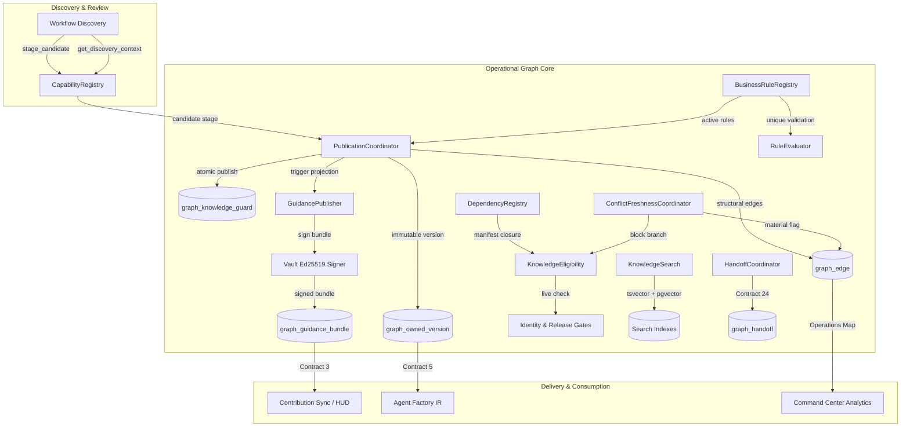
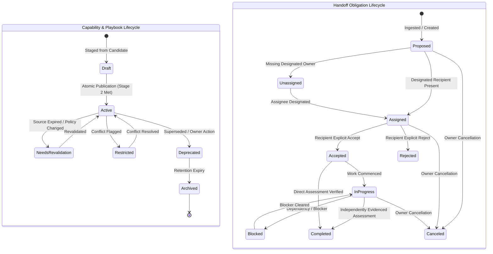

# Living Operational Graph and Knowledge Governance Component Brief

Status: Detailed technical specification — implementation pending

## Purpose and ownership

**Source references:** [TECHNICAL.md §§3, 5.4, 9.1, 10.2](../../TECHNICAL.md) | [PRODUCT.md §§5, 10–11, 21.8, 26; ORY-015–018, ORY-061–062](../../PRODUCT.md) | [ADR-0010](../adr/0010-contribution-delivery-and-guidance-sync.md) | [ADR-0011](../adr/0011-identity-authority-and-approval-fencing.md) | [ADR-0012](../adr/0012-control-plane-transport-durability-and-inference.md) | [ADR-0013](../adr/0013-workflow-discovery-evidence-and-review-boundaries.md) | [ADR-0014](../adr/0014-operational-graph-knowledge-and-rule-governance.md) | [Cloud Inference Architecture](../architecture/cloud-inference.md)

### Core Responsibility
The Living Operational Graph and Knowledge Governance component maintains the authoritative, versioned network of approved business processes, published playbooks, domain rules, system dependencies, peer fixes, and cross-team handoffs within Oryn's control plane. It enforces strict separation between observational evidence, proposed candidates, and authoritative business rules, ensuring that no unverified procedure or unapproved policy change governs employee guidance or autonomous execution.

### Owns
- The authoritative Operational Capability entity model, version lineage, and playbook registry.
- One-to-one tenant-scoped mapping between stable `capability_id` and `workflow_id`; capability versions bind procedure, variants, approved rules, audience, and claim provenance.
- The Business Rule Version registry, preserving approved prose, authority sources, owner remit, effective intervals, scopes, and optional deterministic condition or decision-table formalizations.
- The canonical Dependency Manifest registry and live transactional Knowledge Eligibility resolution for consumers (agents, flight simulator, assist plans).
- Knowledge conflict detection, materiality assessment, policy continuation grants, and rule freshness monitoring.
- Canonical Handoff coordination, inter-team operational obligation tracking, and independent completion assessment records.
- Hybrid search indexing (lexical full-text GIN plus pgvector exact cosine) and bounded recursive graph traversal for Operations Map and blast-radius queries.
- Guidance projection review, publisher Ed25519 signing coordination, and guidance bundle delivery staging.

### Consumes
- Approved workflow candidates, review records, and claim provenance from domain reviewers via [workflow-discovery](workflow-discovery.md) and [control-plane](control-plane.md) using Contract 4.
- Accepted expert corrections, proposed rule amendments, and repair proposals from [incident-correction-repair](incident-correction-repair.md) using Contract 16.
- Authorized cross-team handoff commitments and reviewed meeting handoffs (`MeetingReviewedHandoffV1`) from [contribution-sync](contribution-sync.md) via Contract 24 (`graph_handoff_intake`).
- Agent evaluation outcomes and deployment readiness requests from [release-governance](release-governance.md).
- Verified principal tokens, role memberships, and authority evaluation from [identity-policy](identity-policy.md) (ADR-0011).
- Independent outcome verification verdicts (`system_evidence` or `authorized_reviewer`) from [outcome-verification](outcome-verification.md).
- Governed cloud embedding (`text.embed`) and reranking (`text.rerank`) operations via [cloud-inference](../architecture/cloud-inference.md) under Contract 22.

### Produces
- Published playbooks and peer error resolutions delivered to [local-context-hud](local-context-hud.md) via [contribution-sync](contribution-sync.md) under Contract 3 (`sync.signed-guidance-bundle.v1`).
- Approved capability models, business rules, and postconditions delivered to [agent-factory-ir](agent-factory-ir.md) under Contract 5.
- Authoritative Operations Map graph projections and blast-radius impact analysis delivered to [command-center-analytics](command-center-analytics.md).
- Transactional dependency registrations and live knowledge eligibility snapshots (`KnowledgeEligibilitySnapshotV1`) to [identity-policy](identity-policy.md) and [release-governance](release-governance.md).
- Domain events (`workflow.published`, `rule.approved`, `rule.changed`, `knowledge.conflict_detected`, `knowledge.conflict_resolved`, `workflow.revalidation_required`, `knowledge.guidance_changed`, `knowledge.handoff_changed`, `knowledge.dependency_registered`) via Contract 18 outbox.

### Does Not Own
- Raw desktop media, screen capture, audio, keylogging, or unreviewed personal history (strictly prohibited; owned by [local-privacy-storage](local-privacy-storage.md) and [os-observation](os-observation.md)).
- Authorizing production execution or evaluating runtime permissions (strictly owned by [identity-policy](identity-policy.md)).
- Generating executable agent code, Intermediate Representation (IR), or test suites (owned by [agent-factory-ir](agent-factory-ir.md)).
- Executing independent postcondition or demonstration outcome verifications (owned by [outcome-verification](outcome-verification.md)).
- Deciding policy conflicts across authority sources (owned by designated organizational policy owners; never resolved by automated vote or model inference).

### Boundary Requirement
Strictly separate observational evidence, proposed interpretations, and authoritative rules. Authoritative graph traversal must answer dependency and blast-radius questions based exclusively on verified, transactionally registered relationships in PostgreSQL 18; semantic vector retrieval aids exploration and discovery but never establishes, alters, or overrides structural authority. Policy conflicts must be flagged explicitly and immediately restrict automated execution of affected capability branches.

## Product requirements

### Key Product Requirements ([PRODUCT.md §§5, 10–11, 21.8, 26; ORY-015–018, ORY-061–062](../../PRODUCT.md))
- **Team-Scoped Publication (ORY-015):** Verified playbooks can be published to specific authorized teams and role tiers based on the strict conjunction of Discovery source audiences. Unauthorized users are restricted from viewing procedure steps, screenshots, or rule details.
- **Operations Map Visualization (ORY-016, ORY-061):** Displays approved workflows, owners, business rules, exceptions, application dependencies, linked agents, and active handoffs with clear visual distinction between approved and suggested assets.
- **Conflict Resolution Blocking (ORY-017):** Policy conflicts across rules or playbooks are displayed as unresolved and automatically block execution of the affected workflow branch. Unbound blast radii block the entire capability until resolved by the authoritative policy owner.
- **Peer Error Resolution with Provenance (ORY-018):** Stores published peer fixes for specific normalized error codes, displaying verifiable provenance and claim source references to searching employees.
- **Cross-Team Handoff Tracking (ORY-062):** Links source workflow, destination workflow, triggering state, expected downstream state, owner, and due date for inter-team handoffs without leaking restricted source evidence to recipient teams.

### Publication and Evidence Thresholds
- **Stage 2 Guidance Publication Minimum:** Under PRODUCT §10, publication of a candidate playbook to employee guidance requires a minimum of two distinct, eligible completed examples, deduplicated through Discovery attempts. Manual draft creation with zero examples cannot bypass this threshold for guidance publication.
- **Automatic Formation Minimum:** Automatic candidate synthesis retains its separate three-instance minimum under Discovery governance.
- **Outcome Verification Gaps:** Outcome verification gaps can permit human guidance publication with owner-accepted limitations, but can never qualify a capability for automated execution (Stage 3) without independent outcome verification.

## Upstream and downstream contracts

**Catalog reference:** [Cross-Component Contracts Catalog](../architecture/contracts/README.md)

### Cross-Component Contracts
- **Contract Reference #3 (`sync.signed-guidance-bundle.v1` / `hud.guidance-bundle.v1`):** Publishes access-filtered guidance bundles (`GuidanceBundleV1`) paired with publisher signature sidecars (`SignedPublisherSignatureV1`) to [contribution-sync](contribution-sync.md) for caching and delivery to [local-context-hud](local-context-hud.md). Bundles are strictly immutable, version-pinned by content SHA-256 (`content_sha256`), signed by the Operational Graph Vault Ed25519 publisher key, and contain deterministic task signatures, DAG step graphs (`step_edges`, max 128 steps, cycle-checked), peer-fix descriptors, profile-approved predicates, and optional Stage 3 approved assist plans (`AssistPlanV1`).
- **Contract Reference #4 (`workflow-discovery.md`):** Consumes staged candidates via `GraphPromotionPort` and exposes discovery context projections (`GraphDiscoveryContextV1`).
- **Contract Reference #5 (`knowledge.capability-version.v1`):** Delivers approved capability models, business rules, and postconditions to [agent-factory-ir](agent-factory-ir.md).
- **Contract Reference #16 (`incident-correction-repair.md`):** Receives accepted expert corrections and candidate rule proposals.
- **Contract Reference #18 (Domain Events):** Emits transactional outbox events: `workflow.published`, `rule.approved`, `rule.changed`, `knowledge.conflict_detected`, `knowledge.conflict_resolved`, `workflow.revalidation_required`, `knowledge.guidance_changed`, `knowledge.handoff_changed`, `knowledge.dependency_registered`.
- **Contract Reference #22 (Governed Cloud Inference):** Consumes `text.embed` and `text.rerank` via LiteLLM gateway under [cloud-inference](../architecture/cloud-inference.md) for semantic knowledge retrieval and node search.
- **Contract Reference #24 (`MeetingReviewedHandoffV1`):** Ingests handoff proposals from [contribution-sync](contribution-sync.md) via `graph_handoff_intake`, managing canonical shared status, recipient authorization, duplicate prevention, and separately authorized summaries.

### Pure Rust Interfaces and Signatures

```rust
use std::future::Future;
use uuid::Uuid;
use crate::context::{RequestContext, VerifiedPrincipal};
use crate::storage::TenantTransaction;
use crate::errors::{GraphError, GraphPromotionError};
use crate::dtos::*;

/// Staging and context port implemented by Operational Graph for Discovery (Contract 4)
pub trait GraphPromotionPort: Send + Sync {
    fn stage_candidate<'a>(
        &'a self,
        tx: &'a mut TenantTransaction,
        principal: &'a VerifiedPrincipal,
        promotion: CandidatePromotionV1,
    ) -> impl Future<Output = Result<GraphCandidateReceiptV1, GraphPromotionError>> + Send + 'a;

    fn get_discovery_context<'a>(
        &'a self,
        tx: &'a mut TenantTransaction,
        principal: &'a VerifiedPrincipal,
        source: &'a ContributionRevisionRefV1,
    ) -> impl Future<Output = Result<GraphDiscoveryContextV1, GraphPromotionError>> + Send + 'a;
}

/// Core domain port for Operational Graph management and rule governance
pub trait OperationalGraphPort: Send + Sync {
    fn register_dependencies<'a>(
        &'a self,
        tx: &'a mut TenantTransaction,
        principal: &'a VerifiedPrincipal,
        manifest: DependencyManifestV1,
    ) -> impl Future<Output = Result<DependencyRegistrationV1, GraphError>> + Send + 'a;

    fn resolve_eligibility<'a>(
        &'a self,
        tx: &'a mut TenantTransaction,
        principal: &'a VerifiedPrincipal,
        consumer_ref: &'a KnowledgeVersionRefV1,
        manifest_sha256: &'a str,
        as_of: chrono::DateTime<chrono::Utc>,
    ) -> impl Future<Output = Result<KnowledgeEligibilitySnapshotV1, GraphError>> + Send + 'a;

    fn apply_rule_change<'a>(
        &'a self,
        tx: &'a mut TenantTransaction,
        principal: &'a VerifiedPrincipal,
        command: RuleChangeCommandV1,
    ) -> impl Future<Output = Result<BusinessRuleVersionV1, GraphError>> + Send + 'a;

    fn evaluate_rule(
        &self,
        rule: &BusinessRuleVersionV1,
        facts: &[BusinessFactV1],
        as_of: chrono::DateTime<chrono::Utc>,
    ) -> Result<RuleEvaluationV1, GraphError>;
}
```

### REST Routes and Transport API

All endpoints operate under `/v1/knowledge` within the Axum control-plane service. All mutations require `Idempotency-Key` (UUIDv7), authenticated tenant principal, CSRF token for BFF sessions, and `expected_revision` for optimistic concurrency.

| Method | Path | Request DTO | Response | Description |
|---|---|---|---|---|
| `POST` | `/candidate-stages/{graph_draft_id}/publications` | `GraphPublicationCommandV1` | `201 GraphPublicationResponseV1` | Publishes staged candidate to playbook version |
| `GET` | `/capabilities` | Query filters | `200 CapabilityPageV1` | Lists tenant capabilities matching audience |
| `GET` | `/capabilities/{capability_id}` | None | `200 CapabilityDetailV1` | Retrieves capability details and versions |
| `GET` | `/capabilities/{capability_id}/versions/{version_id}` | None | `200 CapabilityVersionV1` | Retrieves exact immutable capability version |
| `GET` | `/playbooks/{playbook_id}/versions/{playbook_version}` | None | `200 PlaybookVersionV1` | Retrieves exact playbook version |
| `POST` | `/playbooks/{playbook_id}/defaults` | `SetDefaultScopeCommandV1` | `200 DefaultScopeResponseV1` | Binds playbook as default for nonoverlapping scope |
| `POST` | `/playbooks/{playbook_id}/guidance-projections` | `GuidanceProjectionDraftV1` | `201 GuidanceProjectionResponseV1` | Stages HUD projection for qualification |
| `POST` | `/playbooks/{playbook_id}/retirements` | `RetirePlaybookCommandV1` | `200 PlaybookStatusResponseV1` | Retires playbook and revokes guidance bundles |
| `POST` | `/rules` | `ProposeRuleCommandV1` | `201 RuleProposalResponseV1` | Submits proposed rule for owner review |
| `GET` | `/rules/{rule_id}/versions/{version_id}` | None | `200 BusinessRuleVersionV1` | Retrieves exact immutable business rule version |
| `POST` | `/rules/{rule_id}/approvals` | `ApproveRuleCommandV1` | `200 BusinessRuleVersionV1` | Approves rule version into active effectivity |
| `POST` | `/rules/{rule_id}/continuations` | `GrantContinuationCommandV1` | `201 PreviousPolicyContinuationV1` | Grants bounded continuation for old rule |
| `POST` | `/queries` | `KnowledgeQueryV1` | `200 KnowledgeQueryPageV1` / `202 OperationV1` | Executes graph query or queues large traversal |
| `POST` | `/conflicts` | `ReportConflictCommandV1` | `201 KnowledgeConflictV1` | Reports material policy conflict |
| `POST` | `/conflicts/{conflict_id}/decisions` | `ConflictDecisionCommandV1` | `200 KnowledgeConflictV1` | Owner resolves or dismisses conflict |
| `POST` | `/revalidations` | `RequestRevalidationCommandV1` | `200 RevalidationResponseV1` | Submits revalidation assessment |
| `GET` | `/handoffs` | Query filters | `200 HandoffPageV1` | Lists accessible handoff obligations |
| `POST` | `/handoffs` | `HandoffProposalV1` | `201 HandoffV1` | Creates manual or intake handoff proposal |
| `GET` | `/handoffs/{handoff_id}` | None | `200 HandoffV1` | Retrieves handoff obligation details |
| `POST` | `/handoffs/{handoff_id}/commands` | `HandoffCommandV1` | `200 HandoffV1` | Dispatches lifecycle command on handoff |

## Trust and deployment boundaries

### Process and Security Boundaries
- **Deployment Location:** Logical Rust module embedded within the core Axum/Tokio/SQLx control-plane process (`oryn-api` and `oryn-worker`). No separate graph database, vector database, broker, or Python service is deployed.
- **Tenant Isolation:** Enforced via PostgreSQL 18 Row-Level Security (RLS) on every tenant table using `ENABLE ROW LEVEL SECURITY` and `FORCE ROW LEVEL SECURITY`. RLS policies evaluate `organization_id = current_setting('oryn.organization_id', true)::uuid`. Non-BYPASSRLS application roles cannot query or mutate data without verified organization context.
- **Lock Ordering Hierarchy:** All multi-aggregate transactions strictly adhere to this lock order to prevent deadlocks:
  1. Identity Authority Guards (ADR-0011)
  2. Custody & Intake Guards (`(organization_id, contribution_id, revision)` rows locked `FOR UPDATE`)
  3. Discovery Clusters & Candidate rows
  4. Graph Staging rows (`graph_candidate_stage`)
  5. Tenant `graph_knowledge_guard` (monotonic sequence serialization)
  6. Canonical Graph Heads, Defaults, and Dependency Manifests
  *No external network calls, cloud inference requests, cryptographic signing, or full graph scans may be executed while SQL row locks are held.*

### Central Publication vs. HUD Qualification Boundary
Central playbook publication and HUD guidance qualification are strictly decoupled:
- **Central Publication:** Publishes approved human-facing procedure text, audience rules, and limitations. Sets `hud_status = 'not_configured'` until a guidance projection is reviewed.
- **HUD Qualification:** Requires a reviewed `GuidanceProjectionDraftV1` mapping procedure steps to certified `ApplicationProfileV1` versions, concrete `target_key` references, and deterministic HUD predicates. Guidance bundles are hashed via RFC 8785 (excluding `content_sha256` and `publisher_signature_ref`) and asynchronously signed by Vault Ed25519 keys (`SignedPublisherSignatureV1`). Any mapping gap or predicate ambiguity leaves HUD status unconfigured or blocked; it never emits an unverified or unsigned bundle.

## Internal architecture



### Logical Submodules
1. **CapabilityRegistry:** Manages tenant-scoped operational capabilities, ensuring 1:1 mapping with workflows, maintaining version lineages, and validating candidate promotion staging.
2. **PublicationCoordinator:** Orchestrates atomic publication of playbooks, enforces the Stage 2 minimum of two distinct completed examples, verifies source custody fences, and coordinates Vault Ed25519 signing.
3. **GuidancePublisher:** Reviews HUD projection drafts, validates step-to-profile bindings, constructs deterministic DAG guidance bundles, and manages active/revoked delivery states.
4. **BusinessRuleRegistry:** Manages enterprise business rules, owner remits, effectivity intervals, authority source references, and policy continuations.
5. **RuleEvaluator:** Pure, deterministic evaluation engine implementing three-valued logic (`pass`, `fail`, `unknown`) over typed facts and proving pairwise disjointness for UNIQUE decision tables.
6. **DependencyRegistry:** Validates and registers immutable dependency manifests for consumers, computing transitive closures up to 4,096 references.
7. **KnowledgeEligibility:** Provides live transactional eligibility snapshots for Identity action admission and Release governance, enforcing active rule fences and conflict restrictions.
8. **ConflictFreshnessCoordinator:** Ingests typed contradictions and authorized material conflict reports, flags affected graph branches, and coordinates revalidation workflows upon source withdrawal or rule expiry.
9. **KnowledgeSearch:** Implements hybrid retrieval combining PostgreSQL 18 English tsvector full-text search with pgvector exact cosine distance (`<=>`), reciprocal-rank fusion (RRF), and optional `text.rerank`.
10. **HandoffCoordinator:** Ingests handoff proposals from Contract 24, enforces recipient state transitions, manages separately authorized summaries, and binds independent outcome verification verdicts.

## State and lifecycle

### Complete SQL DDL, Foreign Keys, Indexes, and RLS Policies

```sql
-- 1. Capability Store (1:1 with workflow_id per tenant)
CREATE TABLE graph_capability (
    organization_id UUID NOT NULL,
    capability_id UUID NOT NULL,
    workflow_id VARCHAR(128) NOT NULL,
    responsible_team_id VARCHAR(128) NOT NULL,
    current_owner_actor_id VARCHAR(128) NOT NULL,
    current_revision NUMERIC(20,0) NOT NULL DEFAULT 1,
    status VARCHAR(32) NOT NULL CHECK (status IN ('draft', 'active', 'restricted', 'deprecated', 'archived')),
    created_at TIMESTAMPTZ NOT NULL DEFAULT NOW(),
    updated_at TIMESTAMPTZ NOT NULL DEFAULT NOW(),
    CONSTRAINT pk_graph_capability PRIMARY KEY (organization_id, capability_id),
    CONSTRAINT uq_graph_capability_workflow UNIQUE (organization_id, workflow_id)
);
ALTER TABLE graph_capability ENABLE ROW LEVEL SECURITY;
ALTER TABLE graph_capability FORCE ROW LEVEL SECURITY;
CREATE POLICY p_graph_capability_tenant ON graph_capability USING (organization_id = current_setting('oryn.organization_id', true)::uuid);

-- 2. Graph Node Registry (Minimal identity for all graph entities)
CREATE TABLE graph_node (
    organization_id UUID NOT NULL,
    entity_kind VARCHAR(32) NOT NULL CHECK (entity_kind IN (
        'capability', 'playbook', 'rule', 'application_profile', 'verification_spec',
        'agent', 'assist_plan', 'scenario', 'test_suite', 'evaluation', 'job',
        'incident', 'correction', 'repair', 'release', 'handoff', 'evidence'
    )),
    entity_id VARCHAR(128) NOT NULL,
    version_id VARCHAR(128) NOT NULL,
    content_sha256 CHAR(64) NOT NULL,
    owner_component VARCHAR(64) NOT NULL,
    created_at TIMESTAMPTZ NOT NULL DEFAULT NOW(),
    CONSTRAINT pk_graph_node PRIMARY KEY (organization_id, entity_kind, entity_id, version_id)
);
ALTER TABLE graph_node ENABLE ROW LEVEL SECURITY;
ALTER TABLE graph_node FORCE ROW LEVEL SECURITY;
CREATE POLICY p_graph_node_tenant ON graph_node USING (organization_id = current_setting('oryn.organization_id', true)::uuid);

-- 3. Graph Owned Version Store (Immutable canonical payloads for capability/playbook/rule)
CREATE TABLE graph_owned_version (
    organization_id UUID NOT NULL,
    entity_kind VARCHAR(32) NOT NULL CHECK (entity_kind IN ('capability', 'playbook', 'rule')),
    entity_id VARCHAR(128) NOT NULL,
    version_id VARCHAR(128) NOT NULL,
    revision NUMERIC(20,0) NOT NULL,
    predecessor_version_id VARCHAR(128),
    canonical_body JSONB NOT NULL,
    canonical_bytes BYTEA NOT NULL,
    content_sha256 CHAR(64) NOT NULL,
    created_by VARCHAR(128) NOT NULL,
    created_at TIMESTAMPTZ NOT NULL DEFAULT NOW(),
    CONSTRAINT pk_graph_owned_version PRIMARY KEY (organization_id, entity_kind, entity_id, version_id),
    CONSTRAINT fk_graph_owned_version_node FOREIGN KEY (organization_id, entity_kind, entity_id, version_id)
        REFERENCES graph_node(organization_id, entity_kind, entity_id, version_id) ON DELETE RESTRICT
);
ALTER TABLE graph_owned_version ENABLE ROW LEVEL SECURITY;
ALTER TABLE graph_owned_version FORCE ROW LEVEL SECURITY;
CREATE POLICY p_graph_owned_version_tenant ON graph_owned_version USING (organization_id = current_setting('oryn.organization_id', true)::uuid);

-- 4. Candidate Staging Store
CREATE TABLE graph_candidate_stage (
    organization_id UUID NOT NULL,
    graph_draft_id UUID NOT NULL,
    promotion_id UUID NOT NULL,
    candidate_id UUID NOT NULL,
    candidate_revision NUMERIC(20,0) NOT NULL,
    candidate_content_sha256 CHAR(64) NOT NULL,
    source_manifest_sha256 CHAR(64) NOT NULL,
    invalidation_generation BIGINT NOT NULL,
    approval_record_ref VARCHAR(128) NOT NULL,
    stage_revision NUMERIC(20,0) NOT NULL DEFAULT 1,
    source_refs JSONB NOT NULL,
    staged_state VARCHAR(32) NOT NULL CHECK (staged_state IN ('staged', 'invalidated', 'published')),
    resolved_capability_id UUID,
    resolved_playbook_id UUID,
    staged_payload JSONB NOT NULL,
    created_at TIMESTAMPTZ NOT NULL DEFAULT NOW(),
    updated_at TIMESTAMPTZ NOT NULL DEFAULT NOW(),
    CONSTRAINT pk_graph_candidate_stage PRIMARY KEY (organization_id, graph_draft_id),
    CONSTRAINT uq_graph_candidate_stage_promotion UNIQUE (organization_id, promotion_id)
);
ALTER TABLE graph_candidate_stage ENABLE ROW LEVEL SECURITY;
ALTER TABLE graph_candidate_stage FORCE ROW LEVEL SECURITY;
CREATE POLICY p_graph_candidate_stage_tenant ON graph_candidate_stage USING (organization_id = current_setting('oryn.organization_id', true)::uuid);

-- 5. Claim Source Mapping (Public provenance without private contributor identity)
CREATE TABLE graph_claim_source (
    organization_id UUID NOT NULL,
    subject_kind VARCHAR(32) NOT NULL,
    subject_id VARCHAR(128) NOT NULL,
    subject_version_id VARCHAR(128) NOT NULL,
    claim_id VARCHAR(128) NOT NULL,
    source_ref VARCHAR(128) NOT NULL,
    json_pointer VARCHAR(256) NOT NULL,
    provenance_basis VARCHAR(64) NOT NULL,
    verification_status VARCHAR(32) NOT NULL CHECK (verification_status IN ('verified', 'unverified', 'unavailable')),
    source_digest CHAR(64) NOT NULL,
    source_generation BIGINT NOT NULL,
    created_at TIMESTAMPTZ NOT NULL DEFAULT NOW(),
    CONSTRAINT pk_graph_claim_source PRIMARY KEY (organization_id, subject_kind, subject_id, subject_version_id, claim_id, source_ref)
);
ALTER TABLE graph_claim_source ENABLE ROW LEVEL SECURITY;
ALTER TABLE graph_claim_source FORCE ROW LEVEL SECURITY;
CREATE POLICY p_graph_claim_source_tenant ON graph_claim_source USING (organization_id = current_setting('oryn.organization_id', true)::uuid);

-- 6. Default Playbook Scopes (Strict nonoverlapping domain validation)
CREATE TABLE graph_default_scope (
    organization_id UUID NOT NULL,
    default_id UUID NOT NULL,
    playbook_id UUID NOT NULL,
    playbook_version VARCHAR(128) NOT NULL,
    audience_policy JSONB NOT NULL,
    application_profiles JSONB NOT NULL,
    effective_from TIMESTAMPTZ NOT NULL,
    effective_until TIMESTAMPTZ,
    revision NUMERIC(20,0) NOT NULL DEFAULT 1,
    created_at TIMESTAMPTZ NOT NULL DEFAULT NOW(),
    CONSTRAINT pk_graph_default_scope PRIMARY KEY (organization_id, default_id)
);
ALTER TABLE graph_default_scope ENABLE ROW LEVEL SECURITY;
ALTER TABLE graph_default_scope FORCE ROW LEVEL SECURITY;
CREATE POLICY p_graph_default_scope_tenant ON graph_default_scope USING (organization_id = current_setting('oryn.organization_id', true)::uuid);

-- 7. Business Rule Heads
CREATE TABLE graph_rule_head (
    organization_id UUID NOT NULL,
    rule_id UUID NOT NULL,
    owner_remit VARCHAR(64) NOT NULL,
    current_owner_actor_id VARCHAR(128) NOT NULL,
    responsible_team_id VARCHAR(128) NOT NULL,
    current_revision NUMERIC(20,0) NOT NULL DEFAULT 1,
    created_at TIMESTAMPTZ NOT NULL DEFAULT NOW(),
    updated_at TIMESTAMPTZ NOT NULL DEFAULT NOW(),
    CONSTRAINT pk_graph_rule_head PRIMARY KEY (organization_id, rule_id)
);
ALTER TABLE graph_rule_head ENABLE ROW LEVEL SECURITY;
ALTER TABLE graph_rule_head FORCE ROW LEVEL SECURITY;
CREATE POLICY p_graph_rule_head_tenant ON graph_rule_head USING (organization_id = current_setting('oryn.organization_id', true)::uuid);

-- 8. Business Rule Effectivity Intervals
CREATE TABLE graph_rule_effectivity (
    organization_id UUID NOT NULL,
    rule_id UUID NOT NULL,
    version_id VARCHAR(128) NOT NULL,
    scope JSONB NOT NULL,
    effective_from TIMESTAMPTZ NOT NULL,
    effective_until TIMESTAMPTZ,
    approval_record_ref VARCHAR(128) NOT NULL,
    supersedes_version_id VARCHAR(128),
    created_at TIMESTAMPTZ NOT NULL DEFAULT NOW(),
    CONSTRAINT pk_graph_rule_effectivity PRIMARY KEY (organization_id, rule_id, version_id, effective_from)
);
ALTER TABLE graph_rule_effectivity ENABLE ROW LEVEL SECURITY;
ALTER TABLE graph_rule_effectivity FORCE ROW LEVEL SECURITY;
CREATE POLICY p_graph_rule_effectivity_tenant ON graph_rule_effectivity USING (organization_id = current_setting('oryn.organization_id', true)::uuid);
CREATE INDEX idx_rule_effectivity_lookup ON graph_rule_effectivity (organization_id, rule_id, effective_from, effective_until);

-- 9. Business Rule Formalization Validation Cache
CREATE TABLE graph_rule_validation (
    organization_id UUID NOT NULL,
    rule_id UUID NOT NULL,
    version_id VARCHAR(128) NOT NULL,
    formalization_digest CHAR(64) NOT NULL,
    validator_revision BIGINT NOT NULL,
    verdict VARCHAR(32) NOT NULL CHECK (verdict IN ('pass', 'overlap', 'unproven')),
    counterexample JSONB,
    solver_steps BIGINT NOT NULL,
    validated_at TIMESTAMPTZ NOT NULL DEFAULT NOW(),
    CONSTRAINT pk_graph_rule_validation PRIMARY KEY (organization_id, rule_id, version_id, formalization_digest)
);
ALTER TABLE graph_rule_validation ENABLE ROW LEVEL SECURITY;
ALTER TABLE graph_rule_validation FORCE ROW LEVEL SECURITY;
CREATE POLICY p_graph_rule_validation_tenant ON graph_rule_validation USING (organization_id = current_setting('oryn.organization_id', true)::uuid);

-- 10. Graph Edge Registry (Definitive vs. Proposed relationships)
CREATE TABLE graph_edge (
    organization_id UUID NOT NULL,
    from_entity_kind VARCHAR(32) NOT NULL,
    from_entity_id VARCHAR(128) NOT NULL,
    from_version_id VARCHAR(128) NOT NULL,
    to_entity_kind VARCHAR(32) NOT NULL,
    to_entity_id VARCHAR(128) NOT NULL,
    to_version_id VARCHAR(128) NOT NULL,
    relation_type VARCHAR(32) NOT NULL CHECK (relation_type IN (
        'owned_by', 'uses_application', 'triggered_by', 'governed_by', 'supported_by',
        'branches_to', 'resolves_exception', 'derived_from', 'depends_on', 'evaluated_by',
        'produced_outcome', 'caused_incident', 'proposes_repair', 'follows_workflow', 'supersedes'
    )),
    is_definitive BOOLEAN NOT NULL DEFAULT TRUE,
    approval_record_ref VARCHAR(128),
    created_at TIMESTAMPTZ NOT NULL DEFAULT NOW(),
    CONSTRAINT pk_graph_edge PRIMARY KEY (
        organization_id, from_entity_kind, from_entity_id, from_version_id,
        to_entity_kind, to_entity_id, to_version_id, relation_type
    )
);
ALTER TABLE graph_edge ENABLE ROW LEVEL SECURITY;
ALTER TABLE graph_edge FORCE ROW LEVEL SECURITY;
CREATE POLICY p_graph_edge_tenant ON graph_edge USING (organization_id = current_setting('oryn.organization_id', true)::uuid);
CREATE INDEX idx_graph_edge_reverse ON graph_edge (
    organization_id, to_entity_kind, to_entity_id, to_version_id,
    from_entity_kind, from_entity_id, from_version_id, relation_type
);

-- 11. Dependency Manifest and Normalized Members
CREATE TABLE graph_dependency_manifest (
    organization_id UUID NOT NULL,
    consumer_kind VARCHAR(32) NOT NULL,
    consumer_id VARCHAR(128) NOT NULL,
    consumer_version_id VARCHAR(128) NOT NULL,
    manifest_sha256 CHAR(64) NOT NULL,
    completeness VARCHAR(32) NOT NULL CHECK (completeness IN ('complete', 'incomplete', 'invalidated')),
    owner_component VARCHAR(64) NOT NULL,
    dependencies JSONB NOT NULL,
    registered_at TIMESTAMPTZ NOT NULL DEFAULT NOW(),
    CONSTRAINT pk_graph_dependency_manifest PRIMARY KEY (organization_id, consumer_kind, consumer_id, consumer_version_id)
);
ALTER TABLE graph_dependency_manifest ENABLE ROW LEVEL SECURITY;
ALTER TABLE graph_dependency_manifest FORCE ROW LEVEL SECURITY;
CREATE POLICY p_graph_dependency_manifest_tenant ON graph_dependency_manifest USING (organization_id = current_setting('oryn.organization_id', true)::uuid);

CREATE TABLE graph_dependency_member (
    organization_id UUID NOT NULL,
    consumer_kind VARCHAR(32) NOT NULL,
    consumer_id VARCHAR(128) NOT NULL,
    consumer_version_id VARCHAR(128) NOT NULL,
    dependency_kind VARCHAR(32) NOT NULL,
    dependency_id VARCHAR(128) NOT NULL,
    dependency_version_id VARCHAR(128) NOT NULL,
    content_sha256 CHAR(64) NOT NULL,
    CONSTRAINT pk_graph_dependency_member PRIMARY KEY (
        organization_id, consumer_kind, consumer_id, consumer_version_id,
        dependency_kind, dependency_id, dependency_version_id
    ),
    CONSTRAINT fk_graph_dep_member_manifest FOREIGN KEY (organization_id, consumer_kind, consumer_id, consumer_version_id)
        REFERENCES graph_dependency_manifest(organization_id, consumer_kind, consumer_id, consumer_version_id) ON DELETE CASCADE
);
ALTER TABLE graph_dependency_member ENABLE ROW LEVEL SECURITY;
ALTER TABLE graph_dependency_member FORCE ROW LEVEL SECURITY;
CREATE POLICY p_graph_dependency_member_tenant ON graph_dependency_member USING (organization_id = current_setting('oryn.organization_id', true)::uuid);
CREATE INDEX idx_dep_member_reverse ON graph_dependency_member (
    organization_id, dependency_kind, dependency_id, dependency_version_id
);

-- 12. Knowledge Guard (Monotonic serialization sequence per tenant)
CREATE TABLE graph_knowledge_guard (
    organization_id UUID NOT NULL,
    current_generation BIGINT NOT NULL DEFAULT 1,
    last_mutation_at TIMESTAMPTZ NOT NULL DEFAULT NOW(),
    CONSTRAINT pk_graph_knowledge_guard PRIMARY KEY (organization_id)
);
ALTER TABLE graph_knowledge_guard ENABLE ROW LEVEL SECURITY;
ALTER TABLE graph_knowledge_guard FORCE ROW LEVEL SECURITY;
CREATE POLICY p_graph_knowledge_guard_tenant ON graph_knowledge_guard USING (organization_id = current_setting('oryn.organization_id', true)::uuid);

-- 13. Mutable Status, Conflicts, Revalidation, and Continuations
CREATE TABLE graph_status (
    organization_id UUID NOT NULL,
    entity_kind VARCHAR(32) NOT NULL,
    entity_id VARCHAR(128) NOT NULL,
    version_id VARCHAR(128) NOT NULL,
    revision NUMERIC(20,0) NOT NULL DEFAULT 1,
    status VARCHAR(32) NOT NULL CHECK (status IN ('current', 'needs_revalidation', 'restricted', 'superseded', 'deprecated', 'archived')),
    evidence_status VARCHAR(32) NOT NULL CHECK (evidence_status IN ('available', 'partially_unavailable', 'unavailable')),
    hud_status VARCHAR(32) NOT NULL CHECK (hud_status IN ('not_configured', 'preparing', 'available', 'revoked', 'blocked')),
    last_verified_at TIMESTAMPTZ,
    known_changes JSONB NOT NULL DEFAULT '[]'::jsonb,
    updated_at TIMESTAMPTZ NOT NULL DEFAULT NOW(),
    CONSTRAINT pk_graph_status PRIMARY KEY (organization_id, entity_kind, entity_id, version_id)
);
ALTER TABLE graph_status ENABLE ROW LEVEL SECURITY;
ALTER TABLE graph_status FORCE ROW LEVEL SECURITY;
CREATE POLICY p_graph_status_tenant ON graph_status USING (organization_id = current_setting('oryn.organization_id', true)::uuid);

CREATE TABLE graph_conflict (
    organization_id UUID NOT NULL,
    conflict_id UUID NOT NULL,
    revision NUMERIC(20,0) NOT NULL DEFAULT 1,
    status VARCHAR(32) NOT NULL CHECK (status IN ('open', 'under_review', 'resolved', 'dismissed')),
    basis VARCHAR(32) NOT NULL CHECK (basis IN ('typed_contradiction', 'authorized_report')),
    materiality VARCHAR(32) NOT NULL CHECK (materiality IN ('outcome_changing', 'noncritical', 'unknown')),
    reported_by VARCHAR(128) NOT NULL,
    owner_actor_id VARCHAR(128),
    resolution JSONB,
    created_at TIMESTAMPTZ NOT NULL DEFAULT NOW(),
    updated_at TIMESTAMPTZ NOT NULL DEFAULT NOW(),
    CONSTRAINT pk_graph_conflict PRIMARY KEY (organization_id, conflict_id)
);
ALTER TABLE graph_conflict ENABLE ROW LEVEL SECURITY;
ALTER TABLE graph_conflict FORCE ROW LEVEL SECURITY;
CREATE POLICY p_graph_conflict_tenant ON graph_conflict USING (organization_id = current_setting('oryn.organization_id', true)::uuid);

CREATE TABLE graph_conflict_subject (
    organization_id UUID NOT NULL,
    conflict_id UUID NOT NULL,
    entity_kind VARCHAR(32) NOT NULL,
    entity_id VARCHAR(128) NOT NULL,
    version_id VARCHAR(128) NOT NULL,
    branch_ids JSONB NOT NULL DEFAULT '[]'::jsonb,
    CONSTRAINT pk_graph_conflict_subject PRIMARY KEY (organization_id, conflict_id, entity_kind, entity_id, version_id),
    CONSTRAINT fk_graph_conflict_sub_conflict FOREIGN KEY (organization_id, conflict_id)
        REFERENCES graph_conflict(organization_id, conflict_id) ON DELETE CASCADE
);
ALTER TABLE graph_conflict_subject ENABLE ROW LEVEL SECURITY;
ALTER TABLE graph_conflict_subject FORCE ROW LEVEL SECURITY;
CREATE POLICY p_graph_conflict_subject_tenant ON graph_conflict_subject USING (organization_id = current_setting('oryn.organization_id', true)::uuid);

CREATE TABLE graph_policy_continuation (
    organization_id UUID NOT NULL,
    continuation_id UUID NOT NULL,
    old_rule_ref JSONB NOT NULL,
    replacing_rule_ref JSONB NOT NULL,
    consumer_refs JSONB NOT NULL,
    scope JSONB NOT NULL,
    effective_from TIMESTAMPTZ NOT NULL,
    not_after TIMESTAMPTZ NOT NULL,
    approved_by VARCHAR(128) NOT NULL,
    approval_record_refs JSONB NOT NULL,
    legal_basis_refs JSONB NOT NULL,
    reason TEXT NOT NULL,
    revision NUMERIC(20,0) NOT NULL DEFAULT 1,
    created_at TIMESTAMPTZ NOT NULL DEFAULT NOW(),
    CONSTRAINT pk_graph_policy_continuation PRIMARY KEY (organization_id, continuation_id)
);
ALTER TABLE graph_policy_continuation ENABLE ROW LEVEL SECURITY;
ALTER TABLE graph_policy_continuation FORCE ROW LEVEL SECURITY;
CREATE POLICY p_graph_policy_continuation_tenant ON graph_policy_continuation USING (organization_id = current_setting('oryn.organization_id', true)::uuid);

-- 14. Guidance Projections and Signed Bundles
CREATE TABLE graph_guidance_projection (
    organization_id UUID NOT NULL,
    playbook_id UUID NOT NULL,
    playbook_version VARCHAR(128) NOT NULL,
    revision NUMERIC(20,0) NOT NULL DEFAULT 1,
    projection_payload JSONB NOT NULL,
    content_sha256 CHAR(64) NOT NULL,
    reviewed_by VARCHAR(128) NOT NULL,
    review_reason TEXT NOT NULL,
    preparation_state VARCHAR(32) NOT NULL CHECK (preparation_state IN ('preparing', 'qualified', 'rejected')),
    created_at TIMESTAMPTZ NOT NULL DEFAULT NOW(),
    CONSTRAINT pk_graph_guidance_projection PRIMARY KEY (organization_id, playbook_id, playbook_version)
);
ALTER TABLE graph_guidance_projection ENABLE ROW LEVEL SECURITY;
ALTER TABLE graph_guidance_projection FORCE ROW LEVEL SECURITY;
CREATE POLICY p_graph_guidance_proj_tenant ON graph_guidance_projection USING (organization_id = current_setting('oryn.organization_id', true)::uuid);

CREATE TABLE graph_guidance_bundle (
    organization_id UUID NOT NULL,
    bundle_id UUID NOT NULL,
    bundle_revision NUMERIC(20,0) NOT NULL,
    playbook_id UUID NOT NULL,
    playbook_version VARCHAR(128) NOT NULL,
    content_sha256 CHAR(64) NOT NULL,
    bundle_bytes BYTEA NOT NULL,
    publisher_signature_ref UUID NOT NULL,
    signed_sidecar JSONB NOT NULL,
    delivery_state VARCHAR(32) NOT NULL CHECK (delivery_state IN ('active', 'revoked')),
    published_at TIMESTAMPTZ NOT NULL DEFAULT NOW(),
    CONSTRAINT pk_graph_guidance_bundle PRIMARY KEY (organization_id, bundle_id, bundle_revision)
);
ALTER TABLE graph_guidance_bundle ENABLE ROW LEVEL SECURITY;
ALTER TABLE graph_guidance_bundle FORCE ROW LEVEL SECURITY;
CREATE POLICY p_graph_guidance_bundle_tenant ON graph_guidance_bundle USING (organization_id = current_setting('oryn.organization_id', true)::uuid);
CREATE INDEX idx_guidance_bundle_version ON graph_guidance_bundle (organization_id, playbook_id, playbook_version);

-- 15. Search Documents and Embeddings
CREATE TABLE graph_search_document (
    organization_id UUID NOT NULL,
    entity_kind VARCHAR(32) NOT NULL,
    entity_id VARCHAR(128) NOT NULL,
    version_id VARCHAR(128) NOT NULL,
    audience JSONB NOT NULL,
    title TEXT NOT NULL,
    objective TEXT NOT NULL,
    search_body TEXT NOT NULL,
    tsv_content tsvector GENERATED ALWAYS AS (
        setweight(to_tsvector('english', coalesce(title, '')), 'A') ||
        setweight(to_tsvector('english', coalesce(objective, '')), 'B') ||
        setweight(to_tsvector('english', coalesce(search_body, '')), 'C')
    ) STORED,
    content_sha256 CHAR(64) NOT NULL,
    updated_at TIMESTAMPTZ NOT NULL DEFAULT NOW(),
    CONSTRAINT pk_graph_search_document PRIMARY KEY (organization_id, entity_kind, entity_id, version_id)
);
ALTER TABLE graph_search_document ENABLE ROW LEVEL SECURITY;
ALTER TABLE graph_search_document FORCE ROW LEVEL SECURITY;
CREATE POLICY p_graph_search_doc_tenant ON graph_search_document USING (organization_id = current_setting('oryn.organization_id', true)::uuid);
CREATE INDEX idx_graph_search_tsv ON graph_search_document USING GIN (tsv_content);

CREATE TABLE graph_search_embedding (
    organization_id UUID NOT NULL,
    entity_kind VARCHAR(32) NOT NULL,
    entity_id VARCHAR(128) NOT NULL,
    version_id VARCHAR(128) NOT NULL,
    embedding_space_id VARCHAR(128) NOT NULL,
    input_fingerprint CHAR(64) NOT NULL,
    dimensions INTEGER NOT NULL CHECK (dimensions BETWEEN 1 AND 4096),
    vector vector NOT NULL,
    created_at TIMESTAMPTZ NOT NULL DEFAULT NOW(),
    CONSTRAINT pk_graph_search_embedding PRIMARY KEY (organization_id, entity_kind, entity_id, version_id, embedding_space_id)
);
ALTER TABLE graph_search_embedding ENABLE ROW LEVEL SECURITY;
ALTER TABLE graph_search_embedding FORCE ROW LEVEL SECURITY;
CREATE POLICY p_graph_search_emb_tenant ON graph_search_embedding USING (organization_id = current_setting('oryn.organization_id', true)::uuid);

-- 16. Handoff Obligations, Revisions, and Assessments
CREATE TABLE graph_handoff (
    organization_id UUID NOT NULL,
    handoff_id UUID NOT NULL,
    revision NUMERIC(20,0) NOT NULL DEFAULT 1,
    source_workflow_ref VARCHAR(128),
    destination_workflow_ref VARCHAR(128),
    triggering_state VARCHAR(64) NOT NULL,
    expected_downstream_state VARCHAR(64) NOT NULL,
    summary TEXT NOT NULL,
    business_context TEXT NOT NULL,
    audience JSONB NOT NULL,
    responsible_team_id VARCHAR(128) NOT NULL,
    assignee_actor_id VARCHAR(128),
    status VARCHAR(32) NOT NULL CHECK (status IN (
        'proposed', 'unassigned', 'assigned', 'accepted', 'in_progress', 'blocked', 'completed', 'canceled', 'rejected'
    )),
    due_at TIMESTAMPTZ,
    time_zone VARCHAR(64),
    evidence_refs JSONB NOT NULL DEFAULT '[]'::jsonb,
    completion_assessment_ref UUID,
    created_at TIMESTAMPTZ NOT NULL DEFAULT NOW(),
    updated_at TIMESTAMPTZ NOT NULL DEFAULT NOW(),
    CONSTRAINT pk_graph_handoff PRIMARY KEY (organization_id, handoff_id)
);
ALTER TABLE graph_handoff ENABLE ROW LEVEL SECURITY;
ALTER TABLE graph_handoff FORCE ROW LEVEL SECURITY;
CREATE POLICY p_graph_handoff_tenant ON graph_handoff USING (organization_id = current_setting('oryn.organization_id', true)::uuid);
CREATE INDEX idx_handoff_active ON graph_handoff (organization_id, status, due_at);

CREATE TABLE graph_handoff_revision (
    organization_id UUID NOT NULL,
    handoff_id UUID NOT NULL,
    revision NUMERIC(20,0) NOT NULL,
    action VARCHAR(32) NOT NULL,
    actor_id VARCHAR(128) NOT NULL,
    snapshot JSONB NOT NULL,
    reason TEXT NOT NULL,
    created_at TIMESTAMPTZ NOT NULL DEFAULT NOW(),
    CONSTRAINT pk_graph_handoff_revision PRIMARY KEY (organization_id, handoff_id, revision),
    CONSTRAINT fk_graph_handoff_rev_parent FOREIGN KEY (organization_id, handoff_id)
        REFERENCES graph_handoff(organization_id, handoff_id) ON DELETE RESTRICT
);
ALTER TABLE graph_handoff_revision ENABLE ROW LEVEL SECURITY;
ALTER TABLE graph_handoff_revision FORCE ROW LEVEL SECURITY;
CREATE POLICY p_graph_handoff_rev_tenant ON graph_handoff_revision USING (organization_id = current_setting('oryn.organization_id', true)::uuid);

CREATE TABLE graph_handoff_source (
    organization_id UUID NOT NULL,
    handoff_id UUID NOT NULL,
    proposal_id UUID NOT NULL,
    source_revision NUMERIC(20,0) NOT NULL,
    content_digest CHAR(64) NOT NULL,
    intake_accepted_at TIMESTAMPTZ NOT NULL,
    CONSTRAINT pk_graph_handoff_source PRIMARY KEY (organization_id, handoff_id, proposal_id, source_revision),
    CONSTRAINT uq_graph_handoff_source_prop UNIQUE (organization_id, proposal_id, source_revision)
);
ALTER TABLE graph_handoff_source ENABLE ROW LEVEL SECURITY;
ALTER TABLE graph_handoff_source FORCE ROW LEVEL SECURITY;
CREATE POLICY p_graph_handoff_src_tenant ON graph_handoff_source USING (organization_id = current_setting('oryn.organization_id', true)::uuid);

CREATE TABLE graph_handoff_assessment (
    organization_id UUID NOT NULL,
    assessment_id UUID NOT NULL,
    handoff_id UUID NOT NULL,
    method VARCHAR(32) NOT NULL CHECK (method IN ('system_evidence', 'authorized_reviewer')),
    verdict VARCHAR(32) NOT NULL CHECK (verdict IN ('verified', 'contradicted', 'unknown')),
    postcondition_refs JSONB NOT NULL,
    evidence_refs JSONB NOT NULL,
    assessed_by VARCHAR(128) NOT NULL,
    assessed_at TIMESTAMPTZ NOT NULL DEFAULT NOW(),
    CONSTRAINT pk_graph_handoff_assessment PRIMARY KEY (organization_id, assessment_id),
    CONSTRAINT fk_graph_handoff_ass_parent FOREIGN KEY (organization_id, handoff_id)
        REFERENCES graph_handoff(organization_id, handoff_id) ON DELETE RESTRICT
);
ALTER TABLE graph_handoff_assessment ENABLE ROW LEVEL SECURITY;
ALTER TABLE graph_handoff_assessment FORCE ROW LEVEL SECURITY;
CREATE POLICY p_graph_handoff_assessment_tenant ON graph_handoff_assessment USING (organization_id = current_setting('oryn.organization_id', true)::uuid);
```

### Knowledge and Handoff Lifecycles



## Error and edge-case behavior

### Closed Error Codes and HTTP Mappings
All domain errors project to closed `ControlPlaneProblemV1.code` literals defined in `control-plane-v1.schema.json`:

| Code Literal | HTTP | Triggering Condition | Retry Safety |
|---|---|---|---|
| `KNOWLEDGE_REVISION_CONFLICT` | 409 | `expected_revision` mismatch on mutating command | `status_only` |
| `KNOWLEDGE_SOURCE_INELIGIBLE` | 409 | Source contribution expired, withdrawn, or invalidated | `never` |
| `KNOWLEDGE_INSUFFICIENT_EXAMPLES` | 409 | Candidate lacks required two distinct completed examples for Stage 2 | `never` |
| `KNOWLEDGE_OWNER_REQUIRED` | 403 | Principal lacks required domain/policy owner remit | `never` |
| `KNOWLEDGE_RULE_UNFORMALIZED` | 422 | Attempting automated qualification with prose-only rule | `never` |
| `KNOWLEDGE_RULE_OVERLAP` | 422 | Decision table rows contain provable overlapping conditions | `never` |
| `KNOWLEDGE_RULE_UNPROVEN` | 422 | Decision table disjointness proof exhausted solver budget | `never` |
| `KNOWLEDGE_CONFLICT_UNRESOLVED` | 409 | Active unresolved policy conflict blocks requested branch or action | `status_only` |
| `KNOWLEDGE_DEPENDENCY_INCOMPLETE` | 422 | Dependency manifest closure exceeds 4,096 or contains missing nodes | `never` |
| `KNOWLEDGE_SCOPE_OVERLAP` | 422 | Default playbook audience/application scope overlaps existing default | `never` |
| `KNOWLEDGE_PROJECTION_INVALID` | 422 | Guidance projection contains invalid step mapping or uncertified profile | `never` |
| `KNOWLEDGE_EVIDENCE_UNAVAILABLE` | 409 | Action requires evidence whose source bytes are unavailable | `never` |
| `KNOWLEDGE_COMPLETION_UNVERIFIED` | 422 | Handoff completion requested without verified independent assessment | `never` |
| `KNOWLEDGE_TRANSITION_INVALID` | 409 | Requested lifecycle transition is illegal from current state | `never` |
| `KNOWLEDGE_QUERY_INCOMPLETE` | 200 | Interactive graph query hit statement budget (partial response) | `idempotent_replay` |
| `KNOWLEDGE_LIMIT_EXCEEDED` | 413 | Manifest, table rows, or query parameters exceed maximum bounds | `never` |

### Specific Edge Case and Race Behaviors
1. **Source Withdrawal vs. Publication Race:** If a source contribution is withdrawn or excluded while a publication transaction prepares, custody row locks in lock order step 2 linearize the operations. If withdrawal commits first, publication fails closed with `KNOWLEDGE_SOURCE_INELIGIBLE`. If publication commits first, the published playbook remains active under `graph_status.status = 'needs_revalidation'` and `evidence_status = 'partially_unavailable'`; published knowledge is never silently erased.
2. **Signature Preparation and Manifest Commit:** Publisher Vault Ed25519 signatures are computed over RFC 8785 canonical bytes outside SQL row locks. Inside the final atomic transaction, the pre-signed hash is rechecked against the staged payload digest. If the staged draft changed or aborted, the signature is safely discarded; no guidance bundle row is committed.
3. **Overlapping Default Scopes:** When `POST /playbooks/{playbook_id}/defaults` is called, the system evaluates pairwise intersection against all active defaults for the tenant using Boolean interval/set intersection. If any potential overlap is detected, registration fails with `KNOWLEDGE_SCOPE_OVERLAP`. The system never picks a default based on timestamp or specificity heuristics.
4. **Three-Valued Fact Evaluation in Decision Tables:** If an input fact is missing, untrusted, or ill-typed, it evaluates to `Unknown`. If any row condition evaluates to `Unknown` and could match, the table evaluation returns `unknown/blocked` (`disposition = 'blocked'`). Only when exactly one row evaluates to `True` and all other rows evaluate to `False` is a deterministic `pass/decision` emitted.
5. **Conflict Materiality and Blast Radius Gating:** A reported conflict with `materiality = 'outcome_changing'` or `'unknown'` restricts automated execution. If the report identifies specific `branch_ids`, only those procedure branches are restricted in `KnowledgeEligibilitySnapshotV1`. If `branch_ids` is empty or cannot be proven bounded, the entire capability is restricted.
6. **Graph Traversal Cycles and Statement Budgets:** Recursive CTEs use PostgreSQL 18 `CYCLE` clauses tracking composite entity keys `(entity_kind, entity_id, version_id)`. Interactive queries enforce a 2-second statement timeout, max depth 8, 1,000 nodes, and 2,000 edges. Hitting these limits returns `200 OK` with `completeness = 'partial'` and `degraded_reasons = ['resource_budget_exceeded']`; it never returns a false negative. Full impact traversals use asynchronous 202 `OperationV1` with background durable workers.
7. **Handoff Duplicate Intake and Amendment:** Ingesting a handoff proposal with existing `(organization_id, proposal_id, source_revision)` returns the original `HandoffV1` idempotently. Ingesting the same revision with a different content digest returns `409 KNOWLEDGE_REVISION_CONFLICT`. A higher revision produces a linked proposed amendment without mutating accepted work.
8. **Summary Privacy in Cross-Team Handoffs:** Handoff obligations store an authorized summary and business context separate from source evidence. When viewed by a destination team, source workflow references and underlying demonstration records are redacted unless the viewer's principal independently satisfies the source audience.

## Observability and audit

### Telemetry and Metrics
- `oryn_graph_query_duration_seconds`: Histogram of graph traversal latencies bucketed by mode (`search`, `neighbors`, `dependencies`, `impact`).
- `oryn_graph_rule_evaluation_total`: Counter of rule evaluations partitioned by `rule_id`, `result` (`pass`, `fail`, `unknown`), and `disposition` (`decision`, `escalate`, `blocked`).
- `oryn_graph_conflicts_active`: Gauge of active unresolved conflicts partitioned by `materiality`.
- `oryn_graph_handoffs_active`: Gauge of active handoff obligations partitioned by `status` and `team_id`.
- `oryn_graph_bundle_signatures_total`: Counter of Vault publisher signature requests partitioned by status (`success`, `failure`).

### Audit Logging and Zero-Knowledge Compliance
All mutations write immutable audit rows to the database within the same transaction. Audit payloads capture:
- Actor ID, verified principal kind, and active owner remit.
- Command name, idempotency key, expected revision, and resulting revision.
- Exact RFC 8785 content hashes and entity version references.
- Justification reason text provided by the human reviewer.
*In compliance with zero-retention and privacy policies, raw screen frames, audio, user keystroke logs, and model prompt/completion bodies are never written to audit tables or log streams.*

## Security and threat model

### Trust Boundaries and Threat Mitigations
1. **Multi-Tenant Infiltration:** Enforced by PostgreSQL 18 `FORCE ROW LEVEL SECURITY`. All tables require matching `oryn.organization_id`. Database connections are pooled without superuser privileges; setting invalid organization contexts rejects all row access.
2. **Unauthorized Policy Modification:** Altering business rules requires verified `rule.approve` authority and active remit over the rule's `owner_remit`. Workflow owners cannot alter compliance rules. Identity Policy evaluates these permissions at transaction start (ADR-0011).
3. **Audience Path and Metadata Leakage:** Graph queries and handoff views filter edges and nodes against the viewer's verified principal audience. If a viewer cannot access a node, the node and its incident edges are omitted entirely. Inaccessible detail lookups return `404 CP_RESOURCE_NOT_FOUND` rather than `403 Forbidden` to prevent entity existence disclosure.
4. **Solver Resource Exhaustion (DoS):** UNIQUE table validation enforces hard limits: condition AST depth <= 8, <= 64 leaf nodes, <= 32 declared inputs, normalized clauses <= 4,096, and solver step budget <= 1,000,000 steps. Exhaustion results in `unproven` verdict, denying automated qualification.
5. **Guidance Bundle Tampering:** Bundles delivered to edge devices are cryptographically bound to the RFC 8785 content hash signed by Vault Ed25519 keys. The HUD verifies the signature and hash before activating guidance.

## Test strategy

### Acceptance Criteria Mappings ([PRODUCT.md §§31.2, 31.7](../../PRODUCT.md))
- **ORY-015 (Team-Scoped Publication):** Verified by staging a candidate with restricted audience `[team_finance, tier_senior]`; verified that a principal in `team_logistics` receives 404 on playbook detail and empty search results.
- **ORY-016, ORY-061 (Operations Map Visualization):** Verified by generating an Operations Map projection linking capability, playbook, rules, application profiles, and agents; verified that approved versus suggested nodes carry explicit boolean flags.
- **ORY-017 (Conflict Resolution Blocking):** Verified by introducing an overlapping financial threshold rule; verified that the conflict coordinator restricts the affected playbook branch and blocks agent eligibility.
- **ORY-018 (Peer Error Resolution with Provenance):** Verified by querying peer fixes by application profile and error code; verified returned payload contains public claim references and verified provenance.
- **ORY-062 (Cross-Team Handoff Tracking):** Verified by ingesting a meeting handoff proposal from Contract 24; verified transition through `proposed -> assigned -> accepted -> in_progress -> completed` with independent outcome verification.

### Concrete Semantic Scenarios
1. **Two Real Examples Guidance vs. Zero Example Draft:** A manual candidate draft created with 0 examples attempts publication; fails with `KNOWLEDGE_INSUFFICIENT_EXAMPLES`. A candidate with 2 distinct verified examples publishes successfully with `hud_status = 'not_configured'`.
2. **Decision Table Exact Boundary vs. Overlap:** Table with Row 1 `amount <= 10000 USD` and Row 2 `amount > 10000 USD` passes UNIQUE validation. Changing Row 2 to `amount >= 10000 USD` fails with `KNOWLEDGE_RULE_OVERLAP` due to overlap at exactly 10000 USD.
3. **Currency Mismatch in Business Rules:** Rule expects `amount` in `USD`. Evaluator is supplied `{type: 'money', amount: '500.00', currency: 'EUR'}`; evaluation yields `Unknown` and halts automated decision.
4. **Transactional Dependency Registration Race:** An agent registers manifest $M_1$ concurrently with a rule change activating generation $G_2$. Either $M_1$ commits before $G_2$ and is flagged for revalidation, or $M_1$ commits after $G_2$ and sees the active restriction.

## Performance and operations

### Operational Characteristics and Budgets ([TECHNICAL.md §12](../../TECHNICAL.md))
- **Pilot Dataset Target:** 10,000 capabilities, 100,000 versions, and 1,000,000 dependency edges per tenant organization.
- **Deterministic Read Latency:** Ordinary authorized lookups and full-text searches target p95 <= 250ms (excluding model inference latency).
- **Database Connection Conservation:** Operates within the Control Plane's existing 64-connection pool limit. Background maintenance tasks are capped at 2 concurrent tasks per tenant organization.
- **Recursive CTE Budgets:** Recursive graph expansion queries are capped at depth 8, 1,000 nodes, 2,000 edges, and a 2.0-second statement timeout. Large impact analyses exceeding these bounds are offloaded to background durable workers returning 202 `OperationV1`.

## Architecture decisions and open questions

### Specific Preserved Implementation Questions
1. **Database Model (Dedicated Graph DB vs. PostgreSQL 18 Relational):** *Resolved:* Uses PostgreSQL 18 relational tables with recursive CTEs and pgvector exact cosine search (`<=>`). Avoids operational complexity and cross-database transaction hazards of a separate graph database, ensuring ACID transactions across authority guards, versions, and outbox events (ADR-0014).
2. **Conflict Detection Balance (Semantic vs. Strict):** *Resolved:* Strict, deterministic three-valued logic and Boolean set disjointness for rule contradictions; semantic similarity via embeddings is strictly advisory and produces review recommendations, never automated blocking.
3. **Cross-Team Handoff Tracking:** *Resolved:* Canonical `graph_handoff` table tracking obligations with independent outcome verification via `graph_handoff_assessment`; Contract 24 provides intake delivery via `graph_handoff_intake`.
4. **Search Indexing Hybrid Architecture:** *Resolved:* Combines PostgreSQL 18 English `tsvector` (GIN indexed) for keyword search with pgvector exact cosine (`<=>`) for semantic retrieval, fused via Reciprocal Rank Fusion (RRF) with $k=60$, followed by optional `text.rerank` over top 20 candidates.

### Handoff Questions ([TECHNICAL.md §14.2](../../TECHNICAL.md))
1. *Owns exclusively:* Authoritative capability models, published playbook versions, rule provenance, dependency graphs, and handoff obligations.
2. *Data ingress/egress:* Ingests approved candidates, expert corrections, and handoff proposals; outputs published playbooks, guidance bundles, dependency manifests, and Operations Map projections.
3. *Versions/identities:* Capability ID (UUID), Playbook version digest (`sha256-<64hex>`), Rule version UUID, Content SHA-256 (64-hex), and Organization ID (UUID).
4. *Upstream failure:* If Discovery services stall, existing published playbooks and registered dependency manifests remain active and authoritative.
5. *Authority:* Assigned domain and policy owners are authoritative for approving capabilities and rules; Identity Policy verifies remits.
6. *Testing without private details:* Tested via synthetic capability networks, mock decision tables, and automated contract fixture validation.
7. *Audit and duplicate prevention:* Version increments are strictly monotonic; mutations require idempotency keys and expected revisions.
8. *Failure blast radius:* Graph service degradation prevents new publications and updates; cached endpoint playbooks continue serving local HUDs.
9. *v1.0 criteria:* Enables ORY-015, ORY-016, ORY-017, ORY-018, ORY-061, and ORY-062 verified via automated graph navigation and contract tests.
